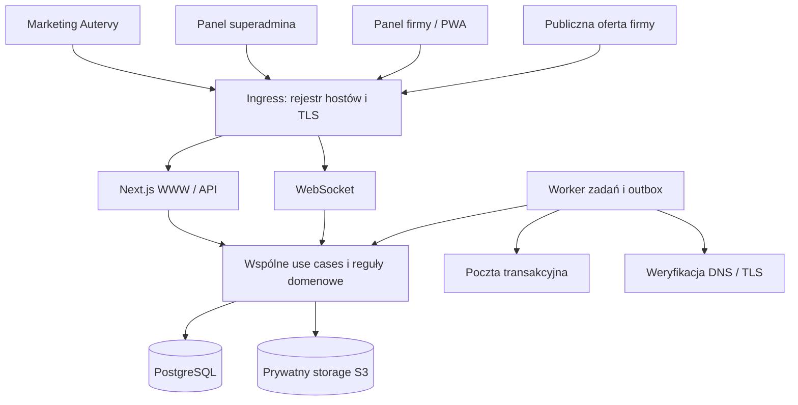

# Auterva — struktura technologiczna aplikacji MVP 3.1

Stan analizy: 22.10.2026. Dokument opisuje projekt aplikacji z superadminem na podstawie najnowszego PRD, zachowanych wymagań bazowych i design systemu Penpot. Nie jest raportem wdrożenia.

Dokument wymagań: [WYMAGANIA_AUTERVA.md](WYMAGANIA_AUTERVA.md). Dokładne nazwy i ID ekranów, stanów oraz wszystkich 175 komponentów Penpota: [załącznik A](#załącznik-a-dokładne-ścieżki-w-penpocie). Tabele inwentarza są zwijane.


## 1. Podstawa i stan istniejący

- Zakres: [kanoniczny PRD 3.1](product/PRD.md), zwłaszcza U3/U4 §5.2A–5.4 i §17–20; cztery obszary, superadmin i wiele odseparowanych firm.
- Reguły odziedziczone: [BASELINE_FLEET.md](product/BASELINE_FLEET.md). Wygląd i potwierdzone DEC-013–020: [SPEC](design/SPEC.md); szczegóły komponentów i responsywności: `design/handoff/components.md` i `design/handoff/responsive.md`.
- Bieżące mapowanie designu: `design/traceability.json` i załącznik A. Historyczny zakaz multi-tenancy z bazy nie zmienia zakresu V31.
- Repozytorium zawiera dokumentację, instrukcje, kontrakty komponentów, tokeny i mapę Penpota. Usunięto demonstrator oraz dawne eksporty i raporty pracy projektowej.
- Brak scaffoldingu aplikacji, `package.json`, lockfile aplikacji, schematu Prisma, migracji i runtime auth/poczty/storage/WebSocket. Zapisany kod przykładowy oraz proponowane katalogi nie są implementacją.
- `src/`, `prisma/` i `tests/` zawierają instrukcje przyszłej implementacji. Testy, CI i wdrożenia aplikacji pozostają do wykonania; walidację stosu zamyka [ADR-0002](adr/0002-version-validation.md).

## 2. Stos technologiczny i wersje

| Obszar | Stan repozytorium | Projekt docelowy — do walidacji ADR-0002 |
|---|---|---|
| Runtime | Brak przypiętego runtime aplikacji | Node 24 LTS, patch zgodny z CI i produkcją |
| Framework | Brak aplikacji Next.js | Next.js 16, App Router; bazowy PRD wskazuje `16.3+`, dokładny patch po walidacji |
| React | Brak zależności aplikacji | Stabilna wersja React 19 zgodna z Next.js; wspólne wersje runtime i typów |
| TypeScript | Brak konfiguracji/kompilatora aplikacji | Bazowy PRD wskazuje 7.x; zgodność kompilatora, lintowania, testów i generatora Prisma do sprawdzenia |
| Style | Zachowany manifest i CSS tokenów | Tailwind CSS 4 + tokeny Autervy; Inter Variable, Lucide |
| Komponenty | Kontrakty Penpota, brak `components.json` | shadcn/ui na Radix, dopasowane do Penpota bez zmiany palety |
| Formularze | Kontrakty, bez implementacji | React Hook Form + Zod; ostateczna walidacja serwerowa |
| Baza | Brak schematu i serwera projektu | Zarządzany PostgreSQL 18 jako kandydat, `btree_gist`, backup i PITR |
| ORM | Brak Prisma w projekcie | Prisma 7.x, zgodne CLI/client/`@prisma/adapter-pg`, `pg`, ESM, kontrolowane migracje SQL |
| Auth | Brak runtime | Better Auth + adapter Prisma + sesje bazodanowe + obowiązkowe MFA |
| Media | Brak produkcyjnych zasobów i storage | Prywatny storage zgodny z S3, walidacja, warianty obrazów, kontrolowany odczyt |
| PWA | Brak service workera | Serwist dla wybranego bundlera; scope panelu firmy |
| Czat | Brak runtime | WebSocket, natywny klient przeglądarki, mały serwer Node `ws`, historia w PostgreSQL |
| Zadania | Brak runtime | Worker tego samego kodu, trwałe zadania PostgreSQL, retry i deduplikacja |
| Testy | Brak testów aplikacji | Vitest, Testing Library, Playwright i rzeczywisty PostgreSQL testowy |
| Jakość | Brak konfiguracji aplikacji | ESLint + Prettier zgodne z wybranym TypeScript |
| Pakiety | Brak manifestu i lockfile aplikacji | Dokładnie przypięte pnpm, runtime i kompletny lockfile |
| Operacje | Brak CI i wdrożenia aplikacji | GitHub Actions, obraz kontenerowy, monitoring błędów i metryk |

Historyczne zależności usuniętego demonstratora nie wyznaczają wersji aplikacji. Scaffolding musi przejść odtwarzalną instalację od zera i testy integracji; nie kopiować dawnych `node_modules` ani niepełnego lockfile.

Oficjalne źródła konsultowane przy projekcie 22.10.2026; przed instalacją trzeba ponownie sprawdzić konkretne wersje:

- Node 24 jest linią LTS; Next.js 16.3 jest wydaniem stabilnym, a bieżąca dokumentacja Next.js wskazywała 16.4.2. Nie oznacza to automatycznej aktualizacji projektu. [Node.js](https://nodejs.org/en/about/previous-releases), [wydanie Next.js 16.3](https://nextjs.org/blog/next-16-3), [instalacja Next.js](https://nextjs.org/docs/app/getting-started/installation).
- TypeScript 7.0 jest wydany, ale zmiana API kompilatora wpływa na narzędzia; wymaga osobnego sprawdzenia lintowania i generatorów. [TypeScript 7.0](https://devblogs.microsoft.com/typescript/announcing-typescript-7-0/).
- Prisma 7 zmienia konfigurację, generator i inicjalizację klienta z adapterem; dokumentacja wymienia PostgreSQL 18 jako obsługiwany. To nie jest test całego stosu Autervy. [Prisma 7](https://docs.prisma.io/docs/orm/v6/more/upgrades/to-v7), [obsługiwane bazy](https://docs.prisma.io/docs/orm/reference/supported-databases).
- Better Auth ma adapter Prisma i plugin MFA; schemat generuje się do przeglądu, a migracje prowadzi przez Prisma. [Adapter](https://better-auth.com/docs/adapters/prisma), [MFA](https://better-auth.com/docs/plugins/2fa).
- Serwist rozróżnia integrację Webpack i Turbopack; konfiguracja jednej nie stanowi konfiguracji drugiej. [Webpack](https://serwist.pages.dev/docs/next/getting-started), [Turbopack](https://serwist.pages.dev/docs/next/turbo).

Warunek zamknięcia ADR-0002: zamrożone wersje i poprawna instalacja od zera, lint, typecheck, build, logowanie/MFA z PostgreSQL, współbieżny zapis blokady oraz produkcyjny build PWA. W tej analizie nie instalowano pakietów i nie wykonywano tego testu zgodności.

## 3. Topologia systemu

- Jeden modularny monolit i jeden rozwijany kod dla wszystkich firm.
- Cztery obszary WWW: marketing Autervy, panel superadmina, panel firmy, publiczna oferta firmy.
- Trzy role: niezalogowany odwiedzający, `ADMIN_FIRMY`, `SUPERADMIN_AUTERVA`.
- Główne komponenty uruchomieniowe: aplikacja WWW/API, proces WebSocket, proces zadań; współdzielą moduły domenowe i jedną bazę. To nie są odrębne produkty ani mikroserwisy.
- Infrastruktura: reverse proxy/DNS/TLS → aplikacja; aplikacja/procesy → PostgreSQL, storage S3 i dostawca poczty transakcyjnej.
- CDN początkowo dla wspólnych statycznych zasobów: JS, CSS, fontów i ikon. Dane firm i media wymagające natychmiastowego wyłączenia przechodzą kontrolę widoczności.
- Rezerwacje, najemcy, rozliczenia, pakiety, faktury, płatności, zespoły i przełącznik firm nie mają modułów ani tabel w MVP.



## 4. Hosty, routing i trasy

Host rozpoznaje obszar i firmę; uprawnienia wynikają osobno z sesji. Przykładowe domeny są wzorami z PRD, nie skonfigurowanymi adresami.

| Host / obszar | Trasy | Widoki Penpot |
|---|---|---|
| `auterva.example` | `/`, sekcje onepage, wymagane informacje prawne | MKT-01 |
| `app.auterva.example` | `/login`, `/mfa`, `/`, `/firmy`, `/firmy/nowa`, `/firmy/[id]`, `/wiadomosci`, `/wiadomosci/[conversationId]`, `/konto` | PLT-01/02/03/04/08/09, ACC-07 |
| `app.auterva.example` | `/firmy/[id]/zarzadzanie/pojazdy`, `/nowy`, `/[vehicleId]`, `/[vehicleId]/kalendarz`, ustawienia, audyt i chroniony preview | Zagnieżdżone ADM-* i FLOW-MVP-11 |
| `{slug}.sites.auterva.example` | `/admin/login`, `/admin/reset-hasla`, `/admin/reset-hasla/[token]`, `/admin/zaproszenie/[token]`, `/admin/mfa` | ADM-01/02/03, ACC-04/07 |
| Ten sam host firmy | `/admin`, `/admin/pojazdy`, `/admin/pojazdy/nowy`, `/admin/pojazdy/[id]`, `/admin/pojazdy/[id]/kalendarz` | ADM-04–09 |
| Ten sam host firmy | `/admin/ustawienia?sekcja=…`, `/admin/konto?sekcja=sesje`, `/admin/logi`, `/admin/offline`, `/admin/usluga`, `/admin/czat` | ADM-11–18, TEN-04/11 |
| Ten sam host firmy | `/admin/kalendarz` — po objęciu wydaniem funkcji SHOULD | ADM-10 |
| Własna domena firmy lub `{slug}.{publicDomainAutervy}` | `/`, `/pojazdy`, `/pojazdy/[slug]`, `/kontakt`, `/polityka-prywatnosci`, warunkowo `/regulamin`, `/robots.txt`, `/sitemap.xml` | PUB-01–06 |

- Trasy PLT/TEN/ACC niewskazane dokładnie w PRD są projektem technicznym; board nie stanowi automatycznie nowego URL.
- OVR-01–20 to stany dialogów, sheetów, menu lub lightboxa. Błędy, wygasła sesja, PUB-09/10 i macierze stanów nie wymagają osobnych pozycji menu.
- `HostMapping` przechowuje zatwierdzony hostname, obszar, firmę, stan weryfikacji i adres kanoniczny. Host normalizowany; brak dopasowania kończy się neutralną odmową.
- Nie ufać dowolnemu `Host`/`X-Forwarded-Host`: ingress usuwa nagłówki klienta i przekazuje własne; aplikacja używa jawnego rejestru hostów.
- Proxy wykonuje rewrite do wewnętrznych gałęzi App Routera. Każda gałąź oraz każdy endpoint ponownie weryfikuje host/obszar. Bezpośrednie wejścia do technicznych prefiksów są blokowane.
- Oferta publiczna i marketing nie udostępniają logowania, `/admin`, `/api/auth`, endpointów admina, API platformy ani administracyjnego handshake WebSocket. Host firmy nie udostępnia panelu superadmina.
- Host panelu nie jest publicznym adresem zastępczym. Publiczny alias po aktywacji własnej domeny przekierowuje na nią dopiero po kontroli bieżącej widoczności firmy.
- TLS dla paneli obejmuje właściwy poziom subdomen, np. `*.sites.auterva.example`. Własna domena wymaga weryfikacji przypisania, DNS, routingu i certyfikatu.

### Mapa 12 procesów do modułów i makiet

Numery z V31 §19 oznaczają procesy. Szczegółowe nazwy i ID każdego zachowanego stanu znajdują się w załączniku A; strzałka nie deklaruje sprawnego połączenia prototypu.

| Proces | Ścieżka funkcjonalna | Odpowiedzialne moduły / odbiór |
|---|---|---|
| `FLOW-MVP-01` | MKT-01 → telefon → akceptacja poza aplikacją → PLT-04 | Marketing, organizations; bez publicznego signup |
| `FLOW-MVP-02` | PLT-04 → zapis → PLT-03 → zaproszenie → ACC-04 → rejestracja → login/MFA → panel i oferta | organizations, invitations, auth, service-access; osobne wyniki zapisu/poczty |
| `FLOW-MVP-03` | PLT-03 → trial oczekujący → pierwsza rejestracja → TEN-04 | service-access; trwały start i dokładnie 336 h |
| `FLOW-MVP-04` | Rejestracja → publiczna zapowiedź → ADM-06/07 → zdjęcia → publikacja → PUB-01/02 | fleet, media; szkic bez zdjęcia dozwolony, publikacja warunkowa |
| `FLOW-MVP-05` | PUB-02 → PUB-03 → daty → kontakt → uzgodnienie poza aplikacją → ADM-09/OVR-06 → aktualny publiczny wynik | availability; osobne konteksty admina i odwiedzającego |
| `FLOW-MVP-06` | ADM-04/TEN-04 → TEN-11 ↔ PLT-09 → unread → właściwa rozmowa | chat, auth; tekst, typing/read, retry, szkic per rozmowa |
| `FLOW-MVP-07` | PLT-03 → zmiana okresu → TEN-04 | service-access, audit; nowa data bez transakcji płatniczej |
| `FLOW-MVP-08` | Koniec okresu → PUB-09 + pełny panel/banner → czat → przedłużenie → ponowna oferta | service-access; wszystkie hosty/API/media i brak komercyjnego read-only |
| `FLOW-MVP-09` | PLT-03 → materiały publiczne → zapis → chroniony preview → oferta | settings, media; wspólny panel i system wizualny bez zmiany |
| `FLOW-MVP-10` | PLT-03 → archiwizacja → lista → pokaż archiwum → przywrócenie → opłacenie i jawne odblokowanie publiczne | organizations, auth, service-access; dane zachowane |
| `FLOW-MVP-11` | PLT-01/02 → karta firmy → ADM-* w kontekście superadmina → audyt → ta sama karta | tenancy, fleet, availability, audit; bez impersonation/globalnej floty |
| `FLOW-MVP-12` | Publiczny adres Autervy → rejestracja/oferta → zakup domeny poza aplikacją → DNS/TLS → aktywacja → przekierowanie | domains, service-access; stały oddzielny host panelu |

## 5. Moduły i odpowiedzialność

| Moduł | Odpowiedzialność |
|---|---|
| `tenancy` | Rozpoznawanie hosta, kontekst firmy, zakaz dostępu między firmami, kontrola obszaru |
| `auth` | Hasło, MFA, sesje, reset, uprawnienia, brak publicznej rejestracji |
| `organizations` | Prerejestracja, karta firmy, lista/archiwum, przywrócenie, dwa KPI |
| `invitations` | Jednorazowe zaproszenie, resend, aktywacja i idempotencja pierwszej rejestracji |
| `service-access` | Opłacona data, jeden trial 336 h, bieżąca widoczność, przypomnienia i odblokowanie po archiwum |
| `domains` | Publiczny alias, domena własna, stan DNS/TLS, aktywacja i przekierowanie |
| `fleet` | Pojazdy, parametry, statusy, publikacja, kolejność, slugi, wyszukiwanie |
| `availability` | LocalDate, aktywność pojazdu, blokady, konflikty, publiczna projekcja dostępności |
| `media` | Upload, weryfikacja, warianty, kolejność, zdjęcie główne, alt, kontrolowany odczyt |
| `settings` | Dane i dozwolone ustawienia firmy, publiczne treści, SEO, kontakty i dokumenty |
| `chat` | Rozmowa firmy, historia, wiadomości, typing/read, unread, retry i reconnect |
| `audit` | Dopisywany dziennik zmian z aktorem, firmą i bezpiecznym podsumowaniem |

Warstwy w każdym module: prezentacja/transport → use case → reguły domenowe → infrastruktura. Komponent nie wykonuje samodzielnie zapytań Prisma ani nie decyduje o uprawnieniach. Nie tworzyć pustych interfejsów i fabryk dla przyszłych dostawców.

## 6. Projekt katalogów

```text
src/
  app/
    layout.tsx                     # bazowy dokument, język i wspólne style
    (marketing)/                    # publiczna strona Autervy
    platform/                       # wewnętrzny cel routingu hosta superadmina
    company/[organizationId]/admin/ # wewnętrzny cel routingu panelu firmy
    site/[organizationId]/          # wewnętrzny cel routingu oferty
    api/
      auth/[...all]/                # tylko odpowiednie hosty logowania
      public/                      # wyłącznie dozwolony publiczny kontekst
      admin/                       # panel firmy
      platform/                    # wyłącznie superadmin
      media/                       # odczyt po kontroli dostępu/widoczności
    not-found.tsx
    error.tsx
  components/
    ui/                            # prymitywy shadcn/Radix zgodne z DS
    forms/
    layout/
    public/
    admin/
    platform/
  modules/
    auth/ tenancy/ organizations/ invitations/ service-access/
    domains/ fleet/ availability/ media/ settings/ chat/ audit/
  lib/
    db/                            # klient Prisma, transakcje, kontekst DB
    dates/                         # LocalDate, zegar, Europe/Warsaw
    http/                          # błędy, requestId, idempotencja
    security/                      # host/origin, autoryzacja, limity
    jobs/                          # trwała kolejka i wykonanie zadań
    observability/                 # logi, metryki i raportowanie błędów
  server/
    realtime.ts                    # punkt wejścia WebSocket
    worker.ts                      # punkt wejścia zadań
  styles/                          # import wygenerowanych tokenów DS
  sw.ts
  proxy.ts
prisma/
  schema.prisma
  migrations/
  seed.ts                          # wyłącznie dane testowe/DEMO
tests/
  unit/ integration/ components/ e2e/ fixtures/
design/
  tokens/                         # manifest i wygenerowany CSS
  handoff/                        # komponenty i responsive.md
  traceability.json               # mapowanie wymagań do Penpota/kodu/testów
docs/
  adr/ runbooks/
prisma.config.ts
next.config.ts
package.json
pnpm-lock.yaml
```

To struktura planowana. Rzeczywistych istniejących plików instrukcji nie nadpisywać scaffoldem. Identyczne publiczne URL na różnych hostach obsługuje host-aware rewrite; same grupy `(public)`/`(admin)` nie rozwiązują kolizji ścieżek.

## 7. Model danych i ograniczenia

| Encja | Kluczowe dane / reguły |
|---|---|
| `Organization` | UUID, nazwa, unikalny slug panelu, `firstAdminRegisteredAt`, `archivedAt`, blokada publicznego wznowienia po przywróceniu, wersja rekordu |
| `HostMapping` | Unikalny znormalizowany hostname, obszar, `organizationId`, stan routingu/TLS, rodzaj własny/zastępczy, kanoniczny cel |
| `User`, `Session`, `Account`, `Verification`, model MFA | Schemat Better Auth; globalnie unikalny znormalizowany e-mail, rola, najwyżej jedna firma użytkownika; kontekst obszaru i MFA |
| `Invitation` | Firma, adresat, hash tokenu, 7-dniowe wygaśnięcie, użycie/odwołanie, identyfikator wydania i stan dostarczenia |
| `ServiceAccess` | Jeden rekord na firmę, `paidThrough: DATE?`, flaga przyznania trialu, `trialStartedAt`, `trialEndsAt`, wersja okresu i aktor zmiany |
| `Vehicle` | Firma, UUID, slug, nazwa, marka/model/wariant, rok, kategoria, opisy, miejsca/drzwi/skrzynia/napęd/kolor/bagaż, opcjonalna cena decimal i jednostka, status, wyróżnienie/kolejność, daty aktywności, SEO, wersja |
| `VehicleFeature` | Wyposażenie pojazdu; unikalna para pojazd–cecha; słownik zgodny z zatwierdzonymi kategoriami |
| `VehicleImage` | Firma i pojazd, losowy klucz storage, MIME, rozmiary, bajty, alt, kolejność, `isCover`, stan przetwarzania, warianty |
| `AvailabilityPeriod` | Firma i pojazd, `startDate/endDate: DATE`, typ RESERVED/MAINTENANCE/BLOCKED/OTHER, źródło MANUAL, prywatne reference/notatka, aktorzy, wersja |
| `SiteSettings` | Jeden rekord na firmę; typowane kontakty (telefon/WhatsApp/e-mail), pełny adres z mapą, godziny, osobny dla firmy przełącznik widoczności cen, metadane SEO i dokumenty prawne firmy; bez globalnego singletonu |
| `PublicContent` | Publiczne logo, wiele obrazów hero, tekst hero, treści firmy i zdjęcia kontrolowane przez superadmina; treści prawne Autervy są przechowywane osobno; może być częścią typowanego `SiteSettings`, bez duplikowania pól |
| `SlugRedirect` | Firma, stary slug, docelowy pojazd; brak kolizji z aktywnym slugiem i brak pętli |
| `Conversation` | Jedna trwała rozmowa na firmę |
| `Message` | Firma, rozmowa, nadawca, tekst, kolejność, UTC, `clientMessageId`; trwałe potwierdzenie wysyłki |
| `ConversationReadCursor` | Użytkownik i rozmowa, ostatnia faktycznie pokazana wiadomość; monotoniczny wskaźnik unread/read |
| `AuditLog` | Firma, aktor i rola, akcja, encja, bezpieczne pola zmiany, `requestId`, UTC; tylko dopisywanie |
| `Job` / `Outbox` | Typ zadania/zdarzenia, firma, deduplication key, bezpieczny payload, termin, próby, blokada wykonania i wynik |
| `OperationReceipt` | Idempotency key, aktor/obszar/firma/operacja, skrót wejścia, zapisany wynik; tylko mutacje wymagające bezpiecznego retry |

- Rekordy firmy mają `organizationId`; klucze obce dzieci obejmują parę `(organizationId, parentId)`, aby zdjęcie/blokada Alfy nie wskazały pojazdu Bety.
- `UNIQUE(organizationId, slug)`, `UNIQUE(organizationId)` dla ustawień/rozmowy, globalne UNIQUE hostname i e-mail; jeden aktywny administrator firmy egzekwowany także w DB.
- `CHECK(startDate <= endDate)`; aktywność `availableTo IS NULL OR availableFrom <= availableTo`; walidacje dodatnich parametrów i ceny nieujemnej.
- Ograniczenie częściowe dopuszcza najwyżej jedno zdjęcie główne pojazdu. Publikacja transakcyjnie wymaga dokładnie jednego poprawnego cover; szkic może nie mieć zdjęcia.
- `UNIQUE(conversationId, senderId, clientMessageId)` chroni przed podwójną wiadomością; retry z inną treścią pod tym samym ID jest odrzucane.
- `version` chroni edycję przed nadpisaniem przez drugiego operatora. Zapis aktualizuje tylko rekord z oczekiwaną wersją; zero zmienionych wierszy daje konflikt.
- Daty kalendarzowe to SQL DATE. Rejestracja, sesje, trial, audyt i wiadomości to TIMESTAMPTZ/UTC.
- Firmę i pojazdy z historią archiwizować. Ręczne blokady i zdjęcia można usuwać zgodnie z domeną, z audytem; nie tworzyć kaskady usuwającej historię całej firmy.

## 8. Izolacja firm i autoryzacja

- Każdy odczyt i zapis: rozpoznanie hosta → sesja → obszar/rola → stan konta/archiwizacji → firma → zgodność wszystkich powiązanych rekordów → reguła operacji.
- `organizationId` z URL jest wyłącznie wskazaniem zasobu. Zaufany kontekst serwerowy powstaje z hosta i uprawnionej sesji; sam identyfikator przesłany przez klienta niczego nie autoryzuje.
- Admin firmy działa tylko w swojej niearchiwizowanej firmie. Superadmin może przeglądać archiwum i przywracać firmy; jawnie wybiera firmę w zagnieżdżonym obszarze, zachowując własną tożsamość i audyt.
- Publiczne DTO budowane przez allowlistę: dane oferty, opublikowane pojazdy, media i dostępność. Bez typów blokady, notatek, reference, operatorów, okresów usługi i czatu w JSON/HTML/RSC.
- Repozytoria tenantowe wymagają kontekstu firmy. Zadania, eksport mediów, cache i zdarzenia WebSocket używają tego samego rozdzielenia.
- Proponowana dodatkowa warstwa izolacji (R/T, nie osobne zatwierdzone wymaganie biznesowe): PostgreSQL RLS na danych tenantowych; role runtime nie są właścicielem tabel ani `BYPASSRLS`; kontekst ustawiany transakcyjnie, bez pozostawiania go w poolu.
- Migrator ma oddzielne uprawnienia. Globalna lista firm superadmina korzysta z jawnej roli/polityki platformowej, a operacje na flocie nadal z kontekstu wskazanej firmy. Rozszerzenie uprawnień DB nie pochodzi z nagłówka klienta.
- RLS, pool i adapter auth wymagają wspólnego testu integracyjnego; samo istnienie polityki nie dowodzi izolacji. Właściciele tabel i role BYPASSRLS mogą omijać polityki. [PostgreSQL RLS](https://www.postgresql.org/docs/18/ddl-rowsecurity.html).
- Żądanie cudzej encji daje bezpieczną odmowę bez ujawnienia prywatnego istnienia zasobu.

### Macierz serwerowych uprawnień

| Operacja | Superadmin | Admin firmy | Publiczny odwiedzający |
|---|---|---|---|
| Tworzenie, archiwizacja, przywracanie firmy | Tak | Nie | Nie |
| Trial, opłacona data, domeny, odblokowanie po archiwum | Tak | Odczyt własnego stanu | Nie |
| Logo, hero i publiczne materiały firmy | Zapis wybranej firmy | Odczyt / prośba w czacie | Tylko opublikowana treść |
| Flota, zdjęcia pojazdów, prywatne blokady | W kontekście wybranej firmy | Wyłącznie własna firma | Brak zapisu, tylko publiczne DTO |
| Kontakt, SEO, prawne i pozostałe pola SiteSettings | Zapis wybranej firmy według [kontraktu D-01/D-02](contracts/company-settings-and-vehicle-publication.md) | Odczyt własnej firmy; odmowa zapisu tych pól | Tylko opublikowane pola |
| Czat | Rozmowy wybranych firm | Własna rozmowa | Nie |
| Pojazdy/oferta po końcu okresu | Chroniony podgląd | Chroniony podgląd i pełna praca operacyjna | Neutralna odmowa |
| Sekrety, hashe haseł, tokeny i kasowanie audytu | Nie przez UI/API produktu | Nie | Nie |

## 9. Auth, zaproszenia i MFA

- Better Auth odpowiada za hasła, sesje, reset i MFA. Auterva dodaje role, kontekst firmy, politykę zaproszeń i archiwizacji; bez własnej kryptografii haseł. MVP ma dokładnie jednego superadmina.
- Nie ma publicznego signup ani rejestracji superadmina. Konta powstają wyłącznie przez kontrolowane utworzenie operatora lub zaproszenie firmy.
- Cookies: `Secure`, `HttpOnly`, właściwe `SameSite`, bez współdzielenia szerokim `Domain`; rozdzielone obszary sesji. Origin i CSRF sprawdzane także między siostrzanymi subdomenami. [Cookies Better Auth](https://better-auth.com/docs/concepts/cookies), [bezpieczeństwo Better Auth](https://better-auth.com/docs/reference/security).
- Rola, firma, obszar sesji i potwierdzenie MFA są polami kontrolowanymi wyłącznie przez serwer; endpointy aktualizacji profilu/sesji nie przyjmują ich od klienta. Cache sesji nie może przywrócić cofniętych praw.
- MFA obowiązuje w obu panelach: TOTP i jednorazowe kody odzyskania; przed pełnym dostępem trzeba przejść enrolment/weryfikację. Wyłączenie MFA nie może pozostawić działającej pełnej sesji. Pierwsze konto superadmina tworzy jednorazowa interaktywna komenda administracyjna tylko przy pustej bazie; hasło i kody nie są argumentami procesu, logiem ani wartością w repozytorium. Odzyskanie po utracie MFA wymaga ręcznej procedury właściciela, unieważnienia sesji i audytu. Przebieg ograniczonej sesji i odzyskania określa [kontrakt D-04/D-05](contracts/technical-limits-and-mfa-bootstrap.md).
- Zaproszenie: losowy token, hash w bazie, właściwa firma/adresat/host, 7 dni, jednorazowe użycie. GET i skaner poczty nie aktywują konta.
- Zakończenie rejestracji w transakcji: zużycie ważnego tokenu → aktywacja właściwego konta → jednorazowy `firstAdminRegisteredAt` → start przyznanego trialu → zdarzenie publikacji → audyt.
- Zapis tokenu, konta i daty pierwszej rejestracji jest atomowy także przy dwóch równoczesnych aktywacjach; DB pilnuje globalnego e-maila i jednego administratora. Obowiązuje tylko skuteczne zatwierdzenie transakcji.
- Start trialu wynika z ukończenia formularza rejestracji; MFA blokuje operacyjny dostęp do panelu, a nie przesuwa samodzielnie tego zdarzenia biznesowego.
- Świadomy resend tworzy nowe wydanie i unieważnia stary nieużyty link. Retry tej samej próby wysyłki nie tworzy kolejnego wydania ani firmy.
- Zapis firmy i wysyłka zaproszenia to osobne wyniki. Błąd poczty pozostawia firmę oraz bezpieczną możliwość ponowienia.
- Wylogowanie, cofnięcie sesji i archiwizacja blokują bezpośrednie endpointy oraz aktywne połączenia WebSocket. Koniec opłaty/trialu nie cofa sesji.
- Reset ma neutralny wynik; link prowadzi na zatwierdzony host konta. Tokenów, sekretów MFA i haseł nie umieszczać w logach, analityce lub trace.

## 10. Okres usługi, publikacja firmy i archiwizacja

- Widoczność firmy jest obliczana na serwerze przy odczycie: konto pierwszy raz zarejestrowane, firma niezarchiwizowana, poprawny publiczny host, brak blokady po przywróceniu oraz ważny okres płatny lub trial.
- `paidThrough` obejmuje cały dzień w Europe/Warsaw. Techniczna granica to początek następnego lokalnego dnia; nie stałe dodanie 24 h do timestampu UTC.
- Efektywna widoczność: ważna opłata LUB ważny trial. Wygaśnięcie samego trialu nie może wyłączyć nadal opłaconej firmy. Przy obu okresach główny stan pokazuje „opłacono do”, firma jest liczona najwyżej raz, a przypomnienia dotyczą okresu wyznaczającego faktyczną datę wygaśnięcia.
- Trial = `trialStartedAt + 336 godzin`; dokładnie jeden na firmę. Zmiana czasu nie zmienia długości. W trakcie trialu oferta jest publiczna zgodnie z Q-03B/U3.
- Sam zapis firmy/wysyłka e-maila nie publikuje. Pierwsza skuteczna rejestracja uruchamia widoczność przy spełnionych warunkach; pusta flota pokazuje zapowiedź.
- Nie ma przyszłego startu płatnego okresu. Po zwykłym przedłużeniu po przerwie oferta wraca automatycznie, jeśli domena jest poprawna i nie ma archiwizacji/blokady po przywróceniu.
- Koniec okresu odcina wszystkie publiczne strony, API, sitemapę z ofertą i publiczne media firmy; neutralny ekran nie ujawnia zaległości. Panel, edycja, preview i czat pozostają czynne.
- Archiwizacja zachowuje dane, wyłącza stronę, blokuje login i unieważnia aktywne uprawnienia firmy. Przywrócenie odblokowuje login, ale strona czeka na opłacenie i jawne odblokowanie przez superadmina.
- Osobne stany rejestracji, okresu, widoczności, archiwizacji i bezpieczeństwa. Jeden enum `ACTIVE/INACTIVE` nie oddaje tych reguł.
- Przypomnienia w panelu i e-mailem są wysyłane o 09:00 `Europe/Warsaw`: 7 dni, 1 dzień i dzień wygaśnięcia. Zadanie jest związane z wersją okresu, po przedłużeniu/skróceniu harmonogram jest przeliczany od nowa, a po awarii worker nadrabia zaległe zdarzenie najwyżej raz.
- Archiwizowana firma nie zwiększa dwóch głównych KPI, nawet z przyszłą datą opłaty; może być pokazywana osobno w danych operacyjnych.

## 11. Flota, daty i współbieżność

- Pojazd: DRAFT → PUBLISHED → UNPUBLISHED/ARCHIVED; niekompletne dane zapisują się jako szkic, publikacja wymaga kompletu wymaganych pól, w tym niepustego pełnego opisu, poprawnych dat i cover. [Jedna tabela walidacji klient/serwer](contracts/company-settings-and-vehicle-publication.md) rozstrzyga szczegóły D-02.
- Publikacja pojazdu nie odblokowuje wygasłej firmy. Publiczny odczyt zawsze łączy warunki firmy i pojazdu.
- `LocalDate` ma walidowany format `YYYY-MM-DD`; prezentacja `dd.MM.yyyy`, poniedziałek jako początek tygodnia, dzisiaj z zegara Europe/Warsaw.
- Dostępność = cały żądany zakres mieści się w aktywności pojazdu i nie przecina żadnej ręcznej blokady. Wolnych dni nie zapisuje się w osobnej tabeli.
- Przecięcie: `existing.startDate <= requested.endDate && existing.endDate >= requested.startDate`. Zakres jednego dnia jest poprawny, wspólny dzień końca/początku jest konfliktem.
- Projekt zabezpieczenia DB: constraint GiST wykluczający nakładanie `daterange(startDate, endDate, '[]')` dla tego samego pojazdu i firmy; migracja sprawdza dostępność `btree_gist`. [Zakresy i exclusion constraints PostgreSQL](https://www.postgresql.org/docs/18/rangetypes.html).
- Zmiana aktywności pojazdu i zapis blokady używają spójnej blokady wiersza pojazdu w transakcji; zabezpiecza to również wyścig edycji aktywności z dodaniem okresu.
- Edycja wyklucza aktualny rekord z samokonfliktu; błędy constraintu są mapowane na `AVAILABILITY_CONFLICT`. Audyt zapisuje się w tej samej transakcji.
- Formularz przesyła oczekiwaną wersję; równoczesna edycja admina i superadmina daje konflikt z zachowaniem własnych danych, bez nadpisania.
- Publiczna dostępność czytana z bieżącej bazy; timeout/błąd pokazuje stan nieznany, nigdy poprzedni pozytywny wynik jako aktualny.

## 12. API i kontrakty błędów

- Server Components wywołują serwerowe use cases bez wewnętrznego HTTP. Route Handlers obsługują interakcje klienta; nie powielać tej samej mutacji w dwóch niezależnych implementacjach.
- Zachować kontrakty bazowe: `/api/public/vehicles`, `/api/public/vehicles/[slug]`, kalendarz, `/api/public/availability/check`, `/api/public/settings`; zakres firmy wyznacza host.
- Panel firmy: `/api/admin/vehicles`, publikacja/ukrycie/archiwizacja, zdjęcia, `/availability`, odczyt ustawień, audyt; wszystkie operacje z serwerową kontrolą roli i firmy. Próby zapisu kontaktu, publicznych treści, SEO, prawa i brandingu przez admina są odrzucane także przy bezpośrednim API.
- Platforma: `/api/platform/companies`, szczegóły firmy, `invitations`, `service-access`, `domains`, `archive`, `restore`, `public-unlock` oraz operacje floty w `/companies/[id]/…`.
- Czat: odczyt historii z kursorem; wysyłanie/ponowienie przez ten sam use case; WebSocket dla zdarzeń message/typing/read i aktualizacji wskaźnika.
- Payload mutacji: Zod, limit rozmiaru, jawna allowlista pól, oczekiwana wersja oraz idempotency key tam, gdzie retry może powielić skutek.
- Błędy: `code`, polski `message`, opcjonalne `fieldErrors`, `requestId`; HTTP 400/401/403/404/409/429/500 odpowiednio do przypadku. Bez stack trace.
- Kody domenowe: bazowe `VALIDATION_ERROR`, `AVAILABILITY_CONFLICT`, `DATE_OUTSIDE_VEHICLE_WINDOW`, `PUBLISHING_REQUIREMENTS_NOT_MET` plus `EDIT_CONFLICT`, `INVITATION_EXPIRED`, `DOMAIN_NOT_READY`, `PUBLIC_SITE_UNAVAILABLE`.
- Niepewny wynik mutacji po timeout wymaga odczytu potwierdzenia po jej identyfikatorze. Ponowienie ze zmienionym payloadem i tym samym kluczem jest konfliktem.
- Paginacja list i historii; ograniczone długości zapytań, tekstów, zakresów dat i uploadu jako jawna konfiguracja techniczna, bez fikcyjnych limitów handlowych.

### Projekt metod i granic endpointów

Prefiksy wyznaczają dozwolony obszar hosta; poniższe URI są projektem technicznym. Parametry firmy od klienta podlegają weryfikacji serwerowej.

| Metoda i ścieżka | Reguła / wynik |
|---|---|
| `GET /api/public/vehicles`, `GET /api/public/vehicles/[slug]` | Bramka firmy, filtry/paginacja, tylko opublikowany DTO |
| `GET /api/public/vehicles/[slug]/calendar?from=…&to=…` | Wyłącznie dni dostępne/niedostępne |
| `POST /api/public/availability/check` | Odczyt dla zakresu, bez utworzenia rezerwacji; limity kosztu zapytania |
| `GET /api/public/settings` | Allowlista opublikowanych treści firmy |
| `GET/POST /api/admin/vehicles`, `GET/PATCH /api/admin/vehicles/[id]` | Własna firma, wersja przy zmianie |
| `POST /api/admin/vehicles/[id]/publish`, `/unpublish`, `/archive` | Jawna walidowana zmiana stanu i audyt |
| `GET/POST /api/admin/vehicles/[id]/availability`, `PATCH/DELETE /api/admin/availability/[id]` | Daty, konflikt współbieżności, bieżąca publiczna projekcja |
| `POST /api/admin/vehicles/[id]/images`, `PATCH/DELETE /api/admin/images/[id]` | Upload/alt/cover/kolejność; bez obejścia warunku publikacji |
| `GET/PATCH /api/admin/settings`, `GET /api/admin/audit` | Odczyt własnych ustawień i tenantowy audyt; `PATCH` odrzuca zapis pól D-01 admina firmy (`403`, bez częściowego zapisu). Zapis tych pól wyłącznie w zagnieżdżonej mutacji platformy według [kontraktu](contracts/company-settings-and-vehicle-publication.md) |
| `GET/POST /api/platform/companies`, `GET/PATCH /api/platform/companies/[id]` | Prerejestracja z idempotencją, brak publicznego signup |
| `POST /api/platform/companies/[id]/invitations` | Nowe wydanie versus retry; unieważnienie poprzedniego linku |
| `PATCH /api/platform/companies/[id]/service-access` | Wyłącznie superadmin, wersja okresu, audyt i harmonogram |
| `POST /api/platform/companies/[id]/archive`, `/restore`, `/public-unlock` | Odrębne skutki, idempotencja; bez trwałego delete firmy |
| `PUT /api/platform/companies/[id]/domains`, `POST …/domains/verify`, `POST …/domains/activate` | Weryfikacja własności/DNS/TLS przed aktywacją |
| `/api/platform/companies/[id]/vehicles/...` | Te same use cases floty co admin; własna sesja superadmina i wybrana firma |
| `GET/POST /api/admin/chat/messages`, `GET/POST /api/platform/companies/[id]/chat/messages` | Historia z kursorem i wysyłka przez jeden use case; bez uploadu/załączników |
| `GET /api/media/[assetId]/[variant]` | Aktualna kontrola firmy/pojazdu lub prywatnej sesji; brak bezpośredniego publicznego bucket URL |

Ścieżki login/reset/MFA wynikają z przypiętej wersji Better Auth. Projekt zaproszenia jest wąskim serwerowym procesem Autervy, nie odblokowaniem dowolnego endpointu signup.

## 13. Media i treści publiczne

- Upload inicjowany po autoryzacji firmy i zasobu; krótkotrwały dostęp wyłącznie do losowego klucza tej operacji. Sam prefiks storage nie jest zabezpieczeniem.
- Serwer weryfikuje sygnaturę rzeczywistego JPEG/PNG/WebP, rozmiar pliku, wymiary i możliwość dekodowania; usuwa zbędne metadane, tworzy warianty i zapisuje wynik przetwarzania.
- HEIC tylko po rzeczywistej implementacji konwersji. Limity mediów są ustalone: maksymalnie 30 zdjęć pojazdu, 10 MB na plik i 12 000 × 12 000 px. Makietowe 12 zdjęć nie jest limitem produktu.
- Galeria zachowuje udane pliki po błędzie pojedynczego uploadu; retry dotyczy właściwego pliku, a porządkowanie ma alternatywę klawiaturową.
- Oryginały i szkice pozostają prywatne. Publiczne warianty udostępnia kontrolowany endpoint po sprawdzeniu aktualnej firmy/pojazdu; nie wystawiać trwałego publicznego bucket URL omijającego wygaśnięcie.
- Endpoint mediów i warstwa optymalizacji muszą respektować ukrycie, archiwizację i koniec okresu. Domyślny cache optymalizatora obrazów nie może obejść tej kontroli.
- Na start: brak współdzielonego cache odpowiedzi tenantowych obrazów; warianty generowane raz i odczytywane ze storage po autoryzacji. Optymalizacja CDN wymaga dowodu natychmiastowej odmowy/purge na każdym adresie.
- Warstwa mediów z góry generowanymi wariantami omija cache optymalizatora Next Image dla zasobów firmowych, dopóki nie powstanie bezpieczna kontrola wszystkich trafień cache. Wspólne zasoby marketingowe mogą korzystać ze standardowej optymalizacji.
- Logo i zdjęcia firmowe nie dostarczają wykonywalnego HTML/JS/SVG. Rekomendowany upload rasterowy; inny format wymaga jawnej sanitizacji i testów.
- Nie obiecywać usunięcia kopii już pobranych przez odwiedzającego. Dane firmy zarchiwizowanej nie są automatycznie usuwane ze storage.

## 14. WebSocket i czat

- Jedna rozmowa firmy z Autervą; brak najemców, ticketów, załączników i mailowych alertów czatu.
- Serwer Node z biblioteką `ws`, klient z natywnym `WebSocket`; implementacja transportu nie rozszerza zakresu UI. [Dokumentacja `ws`](https://github.com/websockets/ws).
- Upgrade weryfikuje sesję, host, Origin, rolę i firmę. Autoryzacja jest ponawiana przy subskrypcji/wysyłce; sesja cofnięta albo firma archiwalna traci dostęp również na już otwartym połączeniu.
- Trwała wiadomość zapisuje się w PostgreSQL przed potwierdzeniem `sent`. Zdarzenie do odbiorcy jest emitowane po commit; reconnect pobiera brakującą historię z bazy.
- `clientMessageId` pozostaje ten sam po timeout/retry; serwer zwraca istniejącą wiadomość. Nie tworzyć duplikatu przy ponowieniu przez inną instancję aplikacji.
- `typing` jest krótkotrwałym zdarzeniem, z wygasaniem i ograniczeniem częstotliwości. `read` wynika z faktycznego pokazania wiadomości; nie z preloadu/dashboardu.
- Potwierdzone Q-08A wymaga typing/read mimo starszych sprzecznych akapitów §11.2/15.9. Brak „online”, reakcji, botów i audio/wideo.
- Szkic przechowywać w trwałym lokalnym storage przeglądarki osobno pod `(accountId, conversationId)`; po zmianie rozmowy pozostaje przypisany do pierwotnej, a po restarcie karty/przeglądarki wraca bez dialogu. Wylogowanie usuwa szkice tego konta. Nie przechowywać w service workerze ani wysyłać automatycznie po odzyskaniu sieci.
- `typing` wygasa po 3 s i jest emitowany najwyżej raz na sekundę. `read` zapisuje się po widoczności wiadomości przez około 500 ms. Docelowe p95 dostarczenia realtime wynosi maksymalnie 2 s przy normalnym obciążeniu.
- Wiele procesów WebSocket wymaga dystrybucji zdarzeń między instancjami; na start PostgreSQL notification/outbox z identyfikatorem zdarzenia, bez pełnej treści w powiadomieniu. Historia jest źródłem odtworzenia po utracie zdarzenia.
- Po przerwaniu i wznowieniu połączenia procesu z PostgreSQL `LISTEN` trzeba zsynchronizować zaległe zdarzenia z trwałego outboxu/kursorów, również dla nadal otwartych socketów klientów. Sam reconnect przeglądarki nie naprawia tej luki; `NOTIFY` jest sygnałem, nie trwałą kolejką. [PostgreSQL NOTIFY](https://www.postgresql.org/docs/18/sql-notify.html).
- Maksymalny rozmiar wiadomości czatu to 4 000 znaków, a tempo wysyłania to 30 wiadomości/minutę na konto z burstem 10. Publiczne zapytanie dostępności obejmuje najwyżej 365 dni. Bazowe limity ruchu: logowanie/MFA 5 nieudanych prób na konto/15 min i 20/IP/15 min; reset, zaproszenie i resend 3/konto/godzinę i 20/IP/godzinę; uwierzytelnione odczyty API 120/min/konto+firma, mutacje 60/min; publiczna dostępność 60/min/IP. Przekroczenie zwraca `429 RATE_LIMITED` z `Retry-After`; wartości pozostają konfigurowalne po teście obciążenia. Klucze, wspólne liczniki, granice i fixture: [kontrakt D-04/D-05](contracts/technical-limits-and-mfa-bootstrap.md).

## 15. Zadania, poczta i integracje

- Trwały proces zadań obsługuje: zaproszenia i reset, przypomnienia usługi, przetwarzanie obrazów, kontrolę DNS/TLS oraz dostarczenie zdarzeń po commit.
- Zapis domenowy, audyt i wpis outbox tworzą jedną transakcję. Poczta lub storage nie są operacją wewnątrz długiej transakcji SQL.
- Zadanie ma deduplication key, termin, liczbę prób, backoff, blokadę wykonania i stan błędu. Restart procesu nie gubi zadania; ponowienie nie tworzy kolejnej firmy, okresu ani wiadomości.
- Worker ponownie sprawdza firmę, wersję okresu i uprawnienie do działania. Stary reminder po przedłużeniu usługi jest pomijany.
- Dostarczenie e-maila raportuje się osobno od zapisu i przyjęcia przez dostawcę. Trwały błąd pozostaje widoczny w karcie firmy i monitoringu.
- Kolejka gwarantuje ponawianie, nie matematycznie jednokrotne doręczenie e-maila: wykorzystywać idempotencję dostawcy, a przy niepewnym wyniku zachować to samo wydanie zaproszenia zamiast tworzyć nowe tokeny.
- Token resetu/zaproszenia nie trafia w jawnym payloadzie logów. Jeśli oczekuje w kolejce pocztowej, wymaga ograniczonego dostępu, szyfrowania i usunięcia po wykonaniu.
- Dostawca poczty: techniczny adapter API/SMTP, konfiguracja nadawcy i SPF/DKIM/DMARC, test dostarczalności na staging. Na preview można użyć darmowego planu dostawcy transakcyjnego; produkcja wymaga zweryfikowanego nadawcy i limitu odpowiedniego do ruchu.
- DNS/TLS: ręcznie inicjowana przez superadmina konfiguracja z automatyczną kontrolą stanu; aktywacja dopiero po poprawnym routingu/certyfikacie. Bez zakupu domen w aplikacji.
- Kontrakt techniczny domen: dowód przypisania konkretnej domeny do firmy, np. losowy rekord DNS TXT, ponowna weryfikacja po zmianie właściciela/przypisania; globalna unikalność hosta. Nie przyjmować wildcardów, IP, localhost ani dowolnych URL do pobrania; walidacja DNS/TLS nie może odpytywać prywatnej sieci.
- Brak cyklicznego purge firm i czatów. Sprzątanie nieudanych tymczasowych uploadów jest osobną operacją techniczną, która nie usuwa przypisanych danych firmy.

## 16. Cache, SSR i PWA

- Marketing i wspólne statyczne zasoby mogą być cache'owane. Oferta firmy jest SSR z serwerowym sprawdzeniem bieżącej widoczności; treść istnieje bez JavaScriptu.
- MVP: `no-store` dla HTML/API/RSC tenantów zawierających dostępność lub treści podlegające natychmiastowemu wyłączeniu; prywatne dane, sesje i czat bez publicznego cache.
- Memoizacja w obrębie jednego requestu może zmniejszać liczbę zapytań. Cache między żądaniami, jeśli później włączony, musi zawierać firmę, obszar i parametry, a każda odpowiedź nadal przechodzi kontrolę widoczności.
- Po mutacji odświeżyć klienta i wszystkie właściwe projekcje; nie polegać tylko na `router.refresh` w panelu. Osobny publiczny kontekst ma zobaczyć zapisane blokady.
- Wygaśnięcie jest kontrolą przy odczycie, nie skutkiem zależnym od uruchomienia crona. Awaria workera nie wydłuża publicznego okresu.
- PWA tylko na hoście firmy, z **`start_url: /admin/` i `scope: /admin/`**. Docelowy routing zachowuje końcowy slash pod panelem; wejście `/admin` prowadzi do `/admin/`, bez przekierowania powrotnego poza scope. Plik SW i rejestracja obejmują ten sam zakres. Sam redirect nie naprawia niezgodnego start_url w manifeście. [Zakres PWA](https://developer.mozilla.org/en-US/docs/Web/Progressive_web_apps/Manifest/Reference/scope).
- Service worker przechowuje wspólny statyczny shell i neutralny ekran offline; nie prywatny HTML, RSC, API, zdjęcia robocze, sesje ani czat.
- Zapisy oraz wysyłka wiadomości wymagają sieci. Brak background sync, kolejki offline i pozornego sukcesu.
- Aktualizacja SW czeka na zgodę użytkownika w odpowiednim stanie formularza; nie stosować bezwarunkowego `skipWaiting` i reload. Zachować dirty state, fokus i wpisane dane.
- Wylogowanie usuwa ewentualne prywatne pozostałości w pamięci klienta. Offline nie przywraca poprzedniego zalogowanego ekranu z danymi.

## 17. Implementacja design systemu

- Źródło tokenów: `design/tokens/auterva.tokens.json` → `scripts/generate_design_tokens.mjs` → `design/tokens/auterva.tokens.css`. Te same nazwy semantyczne w kodzie i Penpocie.
- Jeden jasny motyw: #151515, #424242, #737373, #a5a5a5, #f2f2f2 i zatwierdzone alfa. Zwykły tekst korzysta z ciemnych tokenów, nie #737373 na #f2f2f2.
- Inter Variable w aplikacji, Lucide, spacing 4 px, typowane warianty komponentów. Superadmin zmienia dozwolone publiczne materiały firmy; paleta, fonty i ikony pozostają wspólne.
- Reużycie: formularz pojazdu, kalendarze, media i ustawienia są wspólne dla admina i superadmina; różnią się kontekstem i uprawnieniami, nie osobnym forkiem UI.
- Kompozycje platformowe: `DS-SRV-001 ServiceStatusSummary`, `DS-CTX-001 CompanyContextBar`, `DS-COM-001 ChatMessage`, `DS-COM-002 ConversationItem`, `DS-COM-003 MessageComposer`.
- Kanoniczne widoki weryfikować przez aktualny odczyt Penpota i mapować w `design/traceability.json`. Świeży odczyt wykazał siedem nieaktualnych referencji; wykaz w załączniku A. Numer strony z historycznego handoff nie jest trwałym identyfikatorem.
- Wymaganie → ekran/stan → realny board/component ID → komponent/route → test i dowód. Status makiety nie oznacza statusu implementacji.
- Boardy `REFERENCE`, macierze opisowe, systemowy picker DEMO i symulacje odpowiedzi nie są nowymi komponentami produktowymi.
- Każdy widok ma właściwe loading/empty/error/validation/saving/conflict/offline/session-expired, gdy dotyczą funkcji. Timery prototypu nie sterują sukcesem API.
- Responsywność 320, 390, 430, 768, 1024, 1440, 1920 px; pełne funkcje na mobile. Formularze chronią dane, sheet/dialog przywraca fokus, klawiatura nie zasłania czatu i CTA.
- WCAG 2.2 AA: semantyka, focus, kontrast, dostępne komunikaty, alt, klawiatura, zoom i reduced motion; automat uzupełniony ręcznym sprawdzeniem.

## 18. Testy i kryteria jakości

| Poziom | Obowiązkowy zakres |
|---|---|
| Jednostkowe | LocalDate, dzień włącznie, jedna doba kalendarza, granice aktywności, trial 336 h, wygaśnięcie Warszawa/DST, publikacja, archiwizacja i odzyskanie widoczności |
| Integracyjne PostgreSQL | Constraints i RLS, tenant A/B, relacje dzieci, równoległe inserty/edycje blokad, version conflict, audit/outbox, idempotencja, migracje i auth |
| Auth/hosty | Oba loginy/MFA, brak signup, cofnięta sesja, cudzy host/ID, publiczny host z admin endpointem, nieznany host, CSRF z siostrzanej subdomeny |
| Integracje | Zaproszenie 7 dni/resend/GET skanera, błąd poczty, reminder po zmianie okresu, DNS/TLS, walidacja uploadu i błędy wariantów |
| Czat | Trwały zapis przed sent, deduplikacja retry, typing/read, unread, reconnect, utrata sesji, przełączanie rozmów i izolacja szkiców |
| UI | Role/etykiety, klawiatura, focus, dirty guard, błędy bez utraty danych, toast/status live i makiety M/D |
| E2E | TEST-MVP-01–55 oraz bazowe UC-01–10; admin zapisuje blokadę → niezależny publiczny kontekst widzi aktualny wynik |
| Publiczne wygaśnięcie | Własny/zastępczy host, home/lista/szczegół/kontakt/API/media, rozgrzane cache; prywatna edycja i czat nadal działają |
| PWA | Produkcyjny build, scope, offline, brak prywatnych cache, logout, aktualizacja z dirty form; realny iOS i Android |
| Odporność | Restart workera i WebSocket, timeout po commit, ponowienie zadań, odtworzenie kopii bez uszkodzenia drugiej firmy |

- Przeglądarki: Chromium, Firefox, WebKit oraz realne Safari iOS/Chrome Android dla instalacji PWA.
- NFR z bazy: publiczne CWV p75 LCP ≤ 2,5 s, INP ≤ 200 ms, CLS ≤ 0,1; API p95: dostępność ≤ 500 ms, zapis blokady ≤ 800 ms, lista do 100 pojazdów ≤ 600 ms.
- Bazowy profil obciążenia: 100 pojazdów, 100 000 okresów, 10 000–100 000 odsłon/miesiąc. PRD 3.1 nie ustala liczby firm ani wskaźnika jednoczesnych połączeń; przed testem obciążeniowym trzeba określić, czy liczby bazowe obowiązują per firma czy dla całej platformy.
- Skrypty produkcyjnego projektu do utworzenia: `lint`, `typecheck`, `test:unit`, `test:integration`, `test:e2e`, `build`; testy jednorazowe i kod błędu w CI.
- Na PR: lint/typecheck/unit/build, integracja zmienionych modułów i smoke E2E. Zmiany auth/hostów/cache/DB zawsze uruchamiają testy izolacji i dostępu.
- CI sprawdza także formatowanie, wycieki sekretów i podatności zależności; instalacja używa zamrożonego lockfile. Środowisko preview ma osobne dane/sekrety i kontrolowanych odbiorców poczty.
- Pełna regresja przeglądarek/PWA przed wydaniem. Brak aplikacji oznacza brak wykonanych testów runtime; makiety i historyczne testy usuniętego demonstratora ich nie zastępują.

## 19. Wdrożenie i utrzymanie

- Rekomendacja etapowa: darmowy Render tylko dla krótkotrwałych preview (usypianie, efemeryczny dysk i brak produkcyjnych backupów), Cloudflare DNS/TLS oraz Cloudflare R2 dla mediów. Produkcja używa zarządzanego hostingu kontenerowego Node dla WWW/WebSocket/workera, zarządzanego PostgreSQL z backupami/PITR i poczty transakcyjnej; wybór płatnego planu następuje przed pierwszym klientem. Faktyczna domena produkcyjna nie jest jeszcze podana.
- Wariant Vercel jest dopuszczalny po sprawdzeniu runtime. Aktualna dokumentacja potwierdza WebSocket w Functions; połączenia mają ograniczony czas życia i nie gwarantują tej samej instancji po reconnect. Nie opierać projektu na historycznym twierdzeniu o całkowitym braku WebSocketów. [Vercel WebSockets](https://vercel.com/docs/functions/websockets).
- Środowiska development/preview/staging/production z osobnymi bazami, bucketami, sekretami, domenami i odbiorcami testowej poczty. Brak używania danych prawdziwych firm w fixture.
- Tajne wartości wyłącznie w magazynie sekretów; `.env.example` dokumentuje nazwy bez wartości. Publiczne zmienne nie zawierają danych dostępowych.
- Przykładowe grupy konfiguracji: baza/pool, auth, główne domeny, storage, dostawca poczty/nadawca, limity uploadu/ruchu, monitoring i zegar testowy. Limity są jawne i wspólne dla UI oraz serwera.
- Wdrożenie: testy → artefakt z przypiętymi wersjami → migracja kompatybilna z bieżącą wersją → rollout → smoke czterech obszarów i zależności. Destrukcyjne migracje wymagają osobnej decyzji.
- Migracje testować na pustej oraz zasiedlonej bazie; bez `db push/reset` na staging/produkcji. Constraints/RLS utrzymywać w przeglądanych migracjach SQL.
- Rollback aplikacji tylko do wersji zgodnej ze schematem i izolacją firm. Nie wracać do kodu, który widzi wszystkie rekordy jak jedną firmę.
- SLO dostępności ≥ 99,9% miesięcznie. Liveness i readiness rozdzielone, bez publicznego ujawniania konfiguracji.
- Logi strukturalne: UTC, środowisko, request/operation ID, bezpieczny actor/organization ID, działanie, wynik i kod błędu. Bez tokenów, haseł, prywatnych notatek i treści rozmów.
- Metryki: latency/5xx, odmowy auth/tenant, konflikty zapisu, lag/retry zadań, skuteczność poczty, zdrowie WebSocket, upload, baza i storage. To monitoring techniczny, nie dodatkowe KPI biznesowe PLT.
- Alerty: niedostępność, 5xx, brak bazy/storage, niewykonane backupy/migracje, kolejka zadań, TLS i wzrost błędnych logowań.
- Backup bazy i mediów codziennie, z retencją 30 dni; dla bazy preferowane PITR. Cel RPO wynosi 24 h, a RTO 4 h. Właściciel/operator utrzymuje procedurę restore, testuje ją okresowo i potwierdza odtworzenie jednej firmy bez nadpisywania innych.
- Logi bezpieczeństwa i audytowe przechowywać 365 dni, a zwykłe logi aplikacyjne 30 dni. Retencja i restore nie są automatycznym purge danych firmy.
- Media z wersjonowaniem/ochroną usunięcia; restore jednej firmy wykonywać najpierw do odrębnego środowiska, aby nie nadpisać innych firm. Archiwizacja nie jest backupem.

## 20. Kolejność realizacji

1. Stosować uporządkowane źródła MVP 3.1; macierz pól D-01, publikacja D-02, limity D-04, bootstrap D-05, etapowy hosting D-09 i operacje D-10 są rozstrzygnięte 23.10.2026. Przed wdrożeniem pozostają do wpisania domena produkcyjna oraz zmierzony profil obciążenia.
2. Zamknąć ADR-0002 testem zgodności; odtwarzalny scaffold i lockfile, PostgreSQL, cztery hosty, auth/MFA, tenant context i testy A/B.
3. Firma, okres, domeny, zaproszenie i rejestracja; potwierdzone 336 h i publikacja pustej oferty; testy wygaśnięcia wszystkich publicznych adresów.
4. Flota, media, publikacja i dostępność; constraints, równoległe zapisy, DTO oraz aktualność publicznego wyniku.
5. Wspólne widoki ADM i zagnieżdżona praca superadmina, ustawienia/audyt; porównanie z kanonicznymi boardami Penpota.
6. Czat WebSocket, unread/typing/read, retry/szkice; zadania i przypomnienia; PWA bez zapisów offline.
7. Archiwizacja/przywrócenie, pełne TEST-MVP-01–55 i UC-01–10, przeglądarki, wydajność, backup/restore oraz pilotaż firm A/B.

## 21. Konkretne otwarte decyzje

- **Edycja publicznych pól — rozstrzygnięte 23.10.2026:** superadmin zapisuje dane kontaktowe i ofertowe firmy, SEO, treści prawne, logo, hero, publiczne zdjęcia, branding oraz osobny dla każdej firmy przełącznik cen. Administrator firmy ma odczyt tych pól, a zapisuje wyłącznie flotę, zdjęcia pojazdów i blokady własnej firmy. Mutacje `SiteSettings` wymagają serwerowej allowlisty według tej macierzy.
- **Publikacja pojazdu — rozstrzygnięte 23.10.2026:** oprócz dotychczasowej kompletności wymagany jest pełny niepusty opis; w przeciwnym razie zapis pozostaje szkicem.
- **Limity i konta — rozstrzygnięte 23.10.2026:** obowiązują wartości z sekcji limitów i jeden superadmin z jednorazowym bootstrapem interaktywnym.
- **Sprzeczne starsze akapity wewnątrz 3.1:** aktywny trial publiczny według Q-03B/U3; typing/read według Q-08A; stałe kolory według U4/DEC-014. Te rozstrzygnięcia są już potwierdzone i nie są ponownymi pytaniami.
- **Parametry produkcyjne:** liczba firm i współbieżnych użytkowników, docelowy profil obciążenia i priorytet kalendarza floty. Kategorie, osobny dla firmy przełącznik cen, dokumenty prawne, pełny adres/mapa, hero i kanały kontaktu są ustalone D-03. Limity zdjęć, wiadomości i zakresu dat są ustalone D-04.
- **Integracje i operacje:** etapowy hosting, backupy i retencja są ustalone D-09/D-10; faktyczna domena produkcyjna i jej rekordy DNS pozostają do wpisania przed wdrożeniem. Godzina oraz retry przypomnień są ustalone D-07; liczba kont superadmina, bootstrap i odzyskanie MFA są ustalone D-05.
- **Wersje:** zgodność Next/React/TypeScript/Prisma/Better Auth/Serwist i lockfile nadal wymaga rzeczywistego builda i integracji. Potwierdzenie istnienia wydania nie zamyka ADR-0002.

- **Publikacja i okresy:** pełny niepusty opis jest warunkiem publikacji zgodnie z decyzją D-02. Widoczność, KPI i przypomnienia przy nakładającym się trialu/opłacie są rozstrzygnięte w D-14. Typ serwisowej blokady to `MAINTENANCE`; makietowe `SERVICE` mapować na ten typ, nie rozszerzać enumu.
- **Czat i szkice — rozstrzygnięte 23.10.2026:** lokalny storage przetrwa restart przeglądarki, jest izolowany parą `(accountId, conversationId)` i czyszczony przy wylogowaniu; `typing` wygasa po 3 s, `read` po około 500 ms widoczności, a realtime ma cel p95 ≤2 s.
- **Kopie i logi — rozstrzygnięte 23.10.2026:** RPO 24 h, RTO 4 h, backup DB/mediów codziennie przez 30 dni, audyt/bezpieczeństwo 365 dni, zwykłe logi 30 dni; właściciel/operator wykonuje i testuje restore.

## 22. Co warto dodać po podstawowym wdrożeniu

Poniższe punkty są propozycjami do osobnego backlogu, nie obowiązkami MVP:

- **Kontrolowany import CSV floty:** podgląd zmian, walidacja rekordów, idempotentny zapis i raport błędów; skraca ręczne uruchamianie większej wypożyczalni.
- **Eksport danych jednej firmy:** flota, daty blokad i metadane w wersjonowanym formacie, z autoryzacją i audytem; wspiera przenoszenie danych i odtwarzanie.
- **Przypomnienia serwisowe pojazdów:** przypomnienie administratorowi o planowanym przeglądzie, bez automatycznego tworzenia rezerwacji lub blokady.
- **Minimalne statystyki kontaktu:** zagregowane kliknięcia telefonu/WhatsApp/e-mail na własnej ofercie, bez danych najemców; osobna decyzja zakresowa, bo PLT ma obecnie tylko dwa KPI.
- **Read-only iCalendar dostępności:** wyłącznie publiczny stan zajętości, bez notatek i powodów; wymaga oddzielnego kontraktu cache/wygaśnięcia i nie jest importem rezerwacji.
- Nie dodawać na starcie checkoutu, faktur, CRM, marketplace’u, zespołów, klientowych kont ani kreatora motywów; nie rozwiązują podstawowego celu MVP 3.1.

## 23. Granice weryfikacji

- Analiza źródłowa objęła wszystkie wersje PRD i niezależny przegląd wymagań oraz architektury, w tym 31 REQ-MVP i 55 TEST-MVP. W repozytorium pozostają kanoniczny PRD 3.1 oraz archiwalny kontrakt BASELINE_FLEET.
- Odczyt MCP z 22.10.2026 objął strony, boardy, bibliotekę, tokeny i interakcje. Załącznik A zachowuje 584 różne UUID, w tym jawnie oznaczone nieaktualne mapowania. Nie wykonano wtedy nowego pełnego przeglądu renderów ani testów klikania.
- Odczyt live z 23.10.2026 ponownie nie znalazł siedmiu historycznych boardów OVR-14/15/17; na stronach scenariuszy 14/15 potwierdził 52 puste cele wśród 506 interakcji. Szczegóły, bieżące źródła komponentowe, boardy MFA M/D i warunki odbioru zapisano w [audycie issue #7](design/PENPOT_AUDIT_ISSUE_7.md). Porządkowanie repozytorium nie naprawia prototypu i nie zmienia braków w zaliczone testy.
- Dawne eksporty, logi QA i demonstrator nie są częścią bazy implementacyjnej. Nie przenosi się ich historycznych wyników testów na przyszłą aplikację.
- Hashe oryginalnych źródeł i bieżących dokumentów: [source-provenance.json](source-provenance.json). Testy aplikacji, zgodności stosu, poczty, DNS/TLS i infrastruktury wymagają stworzenia runtime.

## Załącznik A. Dokładne ścieżki w Penpocie

Odczyt MCP: 22.10.2026; ponowny audyt wybranych referencji i interakcji: 23.10.2026. Plik `Nowy plik 2`, ID `b564c72c-f31f-81ec-8008-af198a313438`. Ścieżka oznacza rzeczywistą nazwę strony i boardu, nie proponowany URL aplikacji. ID pozwala odszukać obiekt mimo późniejszej zmiany nazwy.

- Potwierdzono 7 stron, 175 komponentów biblioteki, 15 stylów kolorów i 17 stylów typografii.
- Tokeny: `Primitives` — 94, `Semantic/Light` — 56, `Component` — 24; razem 174 tokeny natywne. Lokalny manifest ma 175; `font.family.sans` jest udokumentowanym wyjątkiem API.
- Biblioteczne style tekstu nadal wskazują `Inter Tight`; kontrakt implementacyjny wymaga `Inter Variable`. Nie kopiować fallbacku biblioteki do aplikacji.
- Historyczny katalog ekranów/overlayów i platformy miał 155 odwołań do boardów: 148 potwierdzonych i siedem nieaktualnych, wymienionych poniżej. Bieżąca mapa `design/traceability.json` zachowuje stare UUID wyłącznie jako jawne braki, nie jako aktywne boardy.
- Historyczny odczyt 1284 interakcji dotyczył pełnego pliku. Ponowny odczyt live stron 14/15 objął 506 interakcji i potwierdził 52 puste cele: 28 na stronie 14, 24 na stronie 15. Przykład: `PLT-03 / Company details / Mobile / state=active > Company detail / Mobile body > Instance / CompanySetupForm / Edit company mobile > Form actions > Actions row > Button / Anuluj` ma `open-overlay` z pustym ID celu. Jest to kontrola struktury, bez testu kliknięć i przeglądu wizualnego całego pliku.
- Odbiór z 21.10 dotyczy statycznych makiet. Prototypy i runtime są odłożone; wpis `verified` nie dowodzi działającej aplikacji.
- Strona 16 zawiera 52 plansze opisowe. Nie są dodatkowymi ekranami ani trasami produktu.

### A.1. Strony

| Strona | Page ID | Rola |
|---|---|---|
| `00 — Start i przekazanie` | `b564c72c-f31f-81ec-8008-af198a313439` | Okładka i przekazanie |
| `01 — System projektu` | `a4abf4c9-2e1f-80fd-8008-afc9717972ba` | Fundamenty, biblioteki, kontrakty i matryce stanów |
| `02 — Strony publiczne / Auterva i firma · M+D` | `269b07ba-69e5-8066-8008-c84a9b898bc0` | Auterva MKT oraz publiczna oferta firmy PUB, warianty M/D |
| `03 — Panel firmy · M+D` | `a4abf4c9-2e1f-80fd-8008-afc9717d55df` | ADM, ACC, TEN i prototypy panelu firmy, M/D |
| `14 — Scenarios / MVP / Mobile` | `fb4e1683-f05f-8095-8008-c755dff0027c` | Pełne scenariusze oraz superadmin — mobile |
| `15 — Scenarios / MVP / Desktop` | `fb4e1683-f05f-8095-8008-c755dff4dae6` | Pełne scenariusze oraz superadmin — desktop |
| `16 — Reference / Scenario descriptions` | `fb4e1683-f05f-8095-8008-c755dff64a17` | Referencje opisowe, bez implementacji jako ekrany |

### A.2. Ekrany i nakładki wskazane przez traceability

W obrębie każdej sekcji pełna ścieżka to **nazwa strony → ścieżka boardu z tabeli**. `variants` oznacza dodatkowy wariant istniejącego widoku. Powtórzone wskazanie tego samego boardu przez dwa wpisy katalogu zachowuje jedno ID.

<details>
<summary>02 — Strony publiczne / Auterva i firma · M+D</summary>

| Wymagany widok | Wariant | Dokładna ścieżka boardu | Board ID |
|---|---|---|---|
| `MKT-01` | desktop | `MKT-01 / Auterva onepage / Desktop / state=default` | `269b07ba-69e5-8066-8008-c84b6a04500c` |
| `MKT-01` | mobile | `MKT-01 / Auterva onepage / Mobile / state=default` | `1e066793-8858-8051-8008-cf36d8d5909f` |
| `OVR-01` | mobile | `flows / P-01-mobile-start > overlay / OVR-01-mobile-public-menu` | `3ae21ee9-2d75-800b-8008-cf515ca322fa` |
| `OVR-02` | desktop | `overlay / P-02-desktop-OVR-02-filters` | `3ae21ee9-2d75-800b-8008-cf518962d0ee` |
| `OVR-02` | mobile | `overlay / P-02-mobile-OVR-02-filters` | `3ae21ee9-2d75-800b-8008-cf5185f4abe2` |
| `OVR-03` | desktop | `overlay / P-01-desktop-OVR-03-dates` | `3ae21ee9-2d75-800b-8008-cf5181e5e1d0` |
| `OVR-03` | mobile | `overlay / P-01-mobile-OVR-03-dates` | `3ae21ee9-2d75-800b-8008-cf515ca32367` |
| `OVR-03` | variants | `overlay / P-02-desktop-OVR-03-dates` | `3ae21ee9-2d75-800b-8008-cf5189628c5f` |
| `OVR-03` | variants | `overlay / P-02-mobile-OVR-03-dates` | `3ae21ee9-2d75-800b-8008-cf5185f4aba2` |
| `OVR-04` | desktop | `overlay / P-01-desktop-OVR-04-contact` | `3ae21ee9-2d75-800b-8008-cf5181e5e20c` |
| `OVR-04` | mobile | `overlay / P-01-mobile-OVR-04-contact` | `3ae21ee9-2d75-800b-8008-cf515ca32392` |
| `OVR-04` | variants | `overlay / P-02-desktop-OVR-04-alternative-contact` | `3ae21ee9-2d75-800b-8008-cf518962d10f` |
| `OVR-04` | variants | `overlay / P-02-mobile-OVR-04-alternative-contact` | `3ae21ee9-2d75-800b-8008-cf5185f4ebad` |
| `OVR-05` | desktop | `overlay / OVR-05-desktop-lightbox` | `3ae21ee9-2d75-800b-8008-cf518962d14f` |
| `OVR-05` | mobile | `overlay / OVR-05-mobile-lightbox` | `3ae21ee9-2d75-800b-8008-cf518962d140` |
| `PUB-01` | desktop | `PUB-01 / Home / Desktop / state=default` | `1e066793-8858-8051-8008-cf38f350ea9b` |
| `PUB-01` | mobile | `PUB-01 / Home / Mobile / state=default` | `1e066793-8858-8051-8008-cf38b2bec442` |
| `PUB-01-02-empty-offer` | desktop | `PUB-01-02 / Empty offer / Desktop` | `1e066793-8858-8051-8008-cf391a9917dd` |
| `PUB-01-02-empty-offer` | mobile | `PUB-01-02 / Empty offer / Mobile` | `1e066793-8858-8051-8008-cf38dd4fa05e` |
| `PUB-02` | desktop | `PUB-02 / Vehicle list / Desktop / state=default` | `1e066793-8858-8051-8008-cf38f350ea22` |
| `PUB-02` | mobile | `PUB-02 / Vehicle list / Mobile / state=default` | `1e066793-8858-8051-8008-cf38b2bec401` |
| `PUB-03` | desktop | `PUB-03 / Vehicle detail / Desktop / state=available` | `1e066793-8858-8051-8008-cf38f3509c0b` |
| `PUB-03` | mobile | `PUB-03 / Vehicle detail / Mobile / state=available` | `1e066793-8858-8051-8008-cf38b2beb284` |
| `PUB-04` | desktop | `PUB-04 / Contact / Desktop / state=default` | `1e066793-8858-8051-8008-cf38f3509bc5` |
| `PUB-04` | mobile | `PUB-04 / Contact / Mobile / state=default` | `1e066793-8858-8051-8008-cf38b2beb248` |
| `PUB-05` | desktop | `PUB-05 / Privacy / Desktop / state=default` | `1e066793-8858-8051-8008-cf3916c13ab3` |
| `PUB-05` | mobile | `PUB-05 / Privacy / Mobile / state=default` | `1e066793-8858-8051-8008-cf38d9b4dc7e` |
| `PUB-06` | desktop | `PUB-06 / Terms / Desktop / state=content` | `1e066793-8858-8051-8008-cf3916c13a73` |
| `PUB-06` | mobile | `PUB-06 / Terms / Mobile / state=content` | `1e066793-8858-8051-8008-cf38d9b4dc4c` |
| `PUB-07` | desktop | `PUB-07 / Not found / Desktop / state=default` | `1e066793-8858-8051-8008-cf3916c13a10` |
| `PUB-07` | mobile | `PUB-07 / Not found / Mobile / state=default` | `1e066793-8858-8051-8008-cf38d9b4dbfa` |
| `PUB-08` | desktop | `PUB-08 / Error / Desktop / state=safe-shell` | `1e066793-8858-8051-8008-cf3916c139f0` |
| `PUB-08` | mobile | `PUB-08 / Error / Mobile / state=safe-shell` | `1e066793-8858-8051-8008-cf38d9b4dbde` |
| `PUB-09` | desktop | `PUB-09 / Public site unavailable / Desktop` | `1e066793-8858-8051-8008-cf391a991811` |
| `PUB-09` | mobile | `PUB-09 / Public site unavailable / Mobile` | `1e066793-8858-8051-8008-cf38dd4fa08f` |
| `PUB-10` | desktop | `PUB-10 / Unknown host / Desktop` | `1e066793-8858-8051-8008-cf391a99180a` |
| `PUB-10` | mobile | `PUB-10 / Unknown host / Mobile` | `1e066793-8858-8051-8008-cf38dd4fa088` |

</details>

<details>
<summary>03 — Panel firmy · M+D</summary>

| Wymagany widok | Wariant | Dokładna ścieżka boardu | Board ID |
|---|---|---|---|
| `ACC-04` | desktop | `ACC-04 / Account activation / Desktop / state=valid` | `269b07ba-69e5-8066-8008-c84b98156520` |
| `ACC-04` | mobile | `ACC-04 / Account activation / Mobile / state=valid` | `1e066793-8858-8051-8008-cf3e9d891551` |
| `ACC-07` | desktop | `ACC-07 / MFA verification / Desktop / state=default` | `269b07ba-69e5-8066-8008-c7a8b4386e15` |
| `ACC-07` | mobile | `ACC-07 / MFA verification / Mobile / state=default` | `1e066793-8858-8051-8008-cf3e790c33a6` |
| `ADM-01` | desktop | `ADM-01 / Login / Desktop / state=default` | `a4abf4c9-2e1f-80fd-8008-afe9d1d87042` |
| `ADM-01` | mobile | `ADM-01 / Login / Mobile / state=default` | `1e066793-8858-8051-8008-cf3e790c3387` |
| `ADM-02` | desktop | `ADM-02 / Password reset request / Desktop / state=default` | `a4abf4c9-2e1f-80fd-8008-afeafac09fec` |
| `ADM-02` | mobile | `ADM-02 / Password reset request / Mobile / state=default` | `1e066793-8858-8051-8008-cf3e790c5adb` |
| `ADM-03` | desktop | `ADM-03 / Set new password / Desktop / state=valid-token` | `a4abf4c9-2e1f-80fd-8008-afeb0ef385ec` |
| `ADM-03` | mobile | `ADM-03 / Set new password / Mobile / state=valid-token` | `1e066793-8858-8051-8008-cf3e790c33c3` |
| `ADM-04` | desktop | `ADM-04 / Dashboard / Desktop / state=default` | `a4abf4c9-2e1f-80fd-8008-afdb4885e1d0` |
| `ADM-04` | mobile | `ADM-04 / Dashboard / Mobile / state=default` | `1e066793-8858-8051-8008-cf3e790c330f` |
| `ADM-05` | desktop | `ADM-05 / Vehicle list / Desktop / state=default` | `a4abf4c9-2e1f-80fd-8008-afeba8dd6131` |
| `ADM-05` | mobile | `ADM-05 / Vehicle list / Mobile / state=default` | `1e066793-8858-8051-8008-cf3e7dc97aa7` |
| `ADM-06` | desktop | `ADM-06 / Create vehicle / Desktop / state=draft-clean` | `a4abf4c9-2e1f-80fd-8008-afed1a4a3669` |
| `ADM-06` | mobile | `ADM-06 / Create vehicle / Mobile / state=draft-clean` | `1e066793-8858-8051-8008-cf3e7dc97b19` |
| `ADM-07` | desktop | `ADM-07 / Edit vehicle / Desktop / state=published-saved` | `a4abf4c9-2e1f-80fd-8008-afee65161c8a` |
| `ADM-07` | mobile | `ADM-07 / Edit vehicle / Mobile / state=published-saved` | `1e066793-8858-8051-8008-cf3e7dc9dd17` |
| `ADM-08` | desktop | `ADM-08 / Protected preview / Desktop / state=unpublished` | `a4abf4c9-2e1f-80fd-8008-afef217e27ad` |
| `ADM-08` | mobile | `ADM-08 / Protected preview / Mobile / state=unpublished` | `1e066793-8858-8051-8008-cf3e7dc9dd82` |
| `ADM-09` | desktop | `ADM-09 / Vehicle calendar / Desktop / state=default` | `a4abf4c9-2e1f-80fd-8008-aff31c0f597d` |
| `ADM-09` | mobile | `ADM-09 / Vehicle calendar / Mobile / state=default` | `1e066793-8858-8051-8008-cf3e7dc9ddb2` |
| `ADM-10` | desktop | `ADM-10 / Fleet calendar / Desktop / state=matrix` | `a4abf4c9-2e1f-80fd-8008-aff53a38ed4e` |
| `ADM-10` | mobile | `ADM-10 / Fleet calendar / Mobile / state=by-vehicle` | `1e066793-8858-8051-8008-cf3e8e94576a` |
| `ADM-11` | desktop | `ADM-11 / Settings company / Desktop / state=saved` | `a4abf4c9-2e1f-80fd-8008-aff6ccddae2a` |
| `ADM-11` | mobile | `ADM-11 / Settings company / Mobile / state=saved` | `1e066793-8858-8051-8008-cf3e8e945812` |
| `ADM-12` | desktop | `ADM-12 / Contact settings / Desktop / state=saved` | `a4abf4c9-2e1f-80fd-8008-aff81d112e2c` |
| `ADM-12` | mobile | `ADM-12 / Contact settings / Mobile / state=saved` | `1e066793-8858-8051-8008-cf3e8e945873` |
| `ADM-13` | desktop | `ADM-13 / Presentation and SEO / Desktop / state=saved` | `a4abf4c9-2e1f-80fd-8008-aff89e4dfcee` |
| `ADM-13` | mobile | `ADM-13 / Presentation and SEO / Mobile / state=saved` | `1e066793-8858-8051-8008-cf3e8e9458d9` |
| `ADM-14` | desktop | `ADM-14 / Legal settings / Desktop / state=draft` | `a4abf4c9-2e1f-80fd-8008-affa094d9beb` |
| `ADM-14` | mobile | `ADM-14 / Legal settings / Mobile / state=draft` | `1e066793-8858-8051-8008-cf3e8e945944` |
| `ADM-15` | desktop | `ADM-15 / Account / Desktop / state=default` | `a4abf4c9-2e1f-80fd-8008-affaaf4fb733` |
| `ADM-15` | mobile | `ADM-15 / Account / Mobile / state=default` | `1e066793-8858-8051-8008-cf3e9586dccb` |
| `ADM-16` | desktop | `ADM-16 / Sessions / Desktop / state=default` | `a4abf4c9-2e1f-80fd-8008-affbfe0cadb2` |
| `ADM-16` | mobile | `ADM-16 / Sessions / Mobile / state=default` | `1e066793-8858-8051-8008-cf3e9586dd26` |
| `ADM-17` | desktop | `ADM-17 / Audit log / Desktop / state=default` | `a4abf4c9-2e1f-80fd-8008-affca1f45000` |
| `ADM-17` | mobile | `ADM-17 / Audit log / Mobile / state=default` | `1e066793-8858-8051-8008-cf3e9586dd76` |
| `ADM-18` | desktop | `ADM-18 / Offline PWA / Desktop / state=offline` | `a4abf4c9-2e1f-80fd-8008-affeae329016` |
| `ADM-18` | mobile | `ADM-18 / Offline PWA / Mobile / state=offline` | `1e066793-8858-8051-8008-cf3e9586ddd9` |
| `ADM-19` | desktop | `ADM-19 / Access & session / Desktop / state=session-expired` | `a4abf4c9-2e1f-80fd-8008-affed253d8f5` |
| `ADM-19` | mobile | `ADM-19 / Access & session / Mobile / state=session-expired` | `1e066793-8858-8051-8008-cf3e9586de22` |
| `ADM-20` | desktop | `ADM-20 / Admin 404 / Desktop / state=not-found` | `a4abf4c9-2e1f-80fd-8008-affef2a92315` |
| `ADM-20` | mobile | `ADM-20 / Admin 404 / Mobile / state=not-found` | `1e066793-8858-8051-8008-cf3e997e8760` |
| `ADM-21` | desktop | `ADM-21 / Admin error / Desktop / state=error` | `a4abf4c9-2e1f-80fd-8008-afff1c48df43` |
| `ADM-21` | mobile | `ADM-21 / Admin error / Mobile / state=error` | `1e066793-8858-8051-8008-cf3e997ecb95` |
| `OVR-06` | desktop | `overlay / OVR-06-desktop-create` | `1e066793-8858-8051-8008-cf4413275787` |
| `OVR-06` | mobile | `overlay / OVR-06-mobile-create` | `1e066793-8858-8051-8008-cf44132756f9` |
| `OVR-07` | desktop | `overlay / OVR-07-desktop-edit` | `1e066793-8858-8051-8008-cf44132757ce` |
| `OVR-07` | mobile | `overlay / OVR-07-mobile-edit` | `1e066793-8858-8051-8008-cf4413275740` |
| `OVR-07` | variants | `overlay / OVR-07-desktop-delete-confirm` | `1e066793-8858-8051-8008-cf443e7400dd` |
| `OVR-07` | variants | `overlay / OVR-07-mobile-delete-confirm` | `1e066793-8858-8051-8008-cf443b6e440b` |
| `OVR-07` | variants | `screens / ADM-09-desktop-deleted` | `1e066793-8858-8051-8008-cf4413273f1a` |
| `OVR-07` | variants | `screens / ADM-09-mobile-deleted` | `1e066793-8858-8051-8008-cf43e509c3b8` |
| `OVR-08` | desktop | `overlay / OVR-08-desktop-single` | `1e066793-8858-8051-8008-cf441782addb` |
| `OVR-08` | mobile | `overlay / OVR-08-mobile-single` | `1e066793-8858-8051-8008-cf441782459e` |
| `OVR-08` | variants | `overlay / OVR-08-desktop-multiple` | `1e066793-8858-8051-8008-cf441782adef` |
| `OVR-08` | variants | `overlay / OVR-08-mobile-multiple` | `1e066793-8858-8051-8008-cf44178245b2` |
| `OVR-09` | desktop | `overlay / A-01-desktop-OVR-09-publish` | `1e066793-8858-8051-8008-cf443e7400cd` |
| `OVR-09` | mobile | `overlay / A-01-mobile-OVR-09-publish` | `1e066793-8858-8051-8008-cf443b6e43fb` |
| `OVR-10` | desktop | `overlay / OVR-10-desktop-hide` | `1e066793-8858-8051-8008-cf443e7400d5` |
| `OVR-10` | mobile | `overlay / OVR-10-mobile-hide` | `1e066793-8858-8051-8008-cf443b6e4403` |
| `OVR-11` | desktop | `overlay / OVR-11-desktop-archive` | `1e066793-8858-8051-8008-cf443e7400e5` |
| `OVR-11` | mobile | `overlay / OVR-11-mobile-archive` | `1e066793-8858-8051-8008-cf443b6e4413` |
| `OVR-12` | desktop | `overlay / OVR-12-desktop-delete-photo` | `1e066793-8858-8051-8008-cf444f10c241` |
| `OVR-12` | mobile | `overlay / OVR-12-mobile-delete-photo` | `1e066793-8858-8051-8008-cf443b6e441b` |
| `OVR-13` | desktop | `overlay / A-04-desktop-OVR-13-unsaved` | `1e066793-8858-8051-8008-cf445a918d51` |
| `OVR-13` | mobile | `overlay / A-04-mobile-OVR-13-unsaved` | `1e066793-8858-8051-8008-cf445a918d46` |
| `OVR-16` | desktop | `overlay / A-04-desktop-OVR-16-update` | `1e066793-8858-8051-8008-cf445a918d37` |
| `OVR-16` | mobile | `overlay / A-04-mobile-OVR-16-update` | `1e066793-8858-8051-8008-cf44568baf90` |
| `OVR-18` | desktop | `overlay / OVR-18-desktop-audit-details` | `1e066793-8858-8051-8008-cf445e1a8a76` |
| `OVR-18` | mobile | `overlay / OVR-18-mobile-audit-details` | `1e066793-8858-8051-8008-cf445e1a8a60` |
| `OVR-19` | desktop | `overlay / OVR-19-desktop-end-session` | `1e066793-8858-8051-8008-cf444f10c249` |
| `OVR-19` | mobile | `overlay / OVR-19-mobile-end-session` | `1e066793-8858-8051-8008-cf443e7400c5` |
| `OVR-20` | desktop | `overlay / OVR-20-desktop-seo-preview` | `1e066793-8858-8051-8008-cf445e1a8a47` |
| `OVR-20` | mobile | `overlay / OVR-20-mobile-seo-preview` | `1e066793-8858-8051-8008-cf445e1a8a39` |
| `TEN-04` | desktop | `TEN-04 / Service status / Desktop / state=paid` | `269b07ba-69e5-8066-8008-c84b97fb8699` |
| `TEN-04` | desktop | `TEN-04 / Service status matrix / Desktop` | `269b07ba-69e5-8066-8008-c84b98294f79` |
| `TEN-04` | mobile | `TEN-04 / Service status / Mobile / state=paid` | `1e066793-8858-8051-8008-cf3e997ecc13` |
| `TEN-04` | mobile | `TEN-04 / Service status matrix / Mobile` | `1e066793-8858-8051-8008-cf3e9d89156f` |
| `TEN-11` | desktop | `TEN-11 / Chat with Auterva / Desktop / state=connected` | `269b07ba-69e5-8066-8008-c84b98452b8c` |
| `TEN-11` | mobile | `TEN-11 / Chat with Auterva / Mobile / state=connected` | `1e066793-8858-8051-8008-cf3e9d8915b2` |

</details>

<details>
<summary>14 — Scenarios / MVP / Mobile</summary>

| Wymagany widok | Wariant | Dokładna ścieżka boardu | Board ID |
|---|---|---|---|
| `PLT-01-02` | mobile | `PLT-01-02 / Dashboard and companies / Mobile / state=default` | `fb4e1683-f05f-8095-8008-c7595a575f33` |
| `PLT-01-02` | mobile | `PLT-01-02 / State matrix / Mobile` | `fb4e1683-f05f-8095-8008-c75dda215b6c` |
| `PLT-03` | mobile | `PLT-03 / Company details / Mobile / state=active` | `fb4e1683-f05f-8095-8008-c761449ab7eb` |
| `PLT-03-to-ADM` | mobile | `PLT-03 to ADM-05 / Nested company management / Mobile` | `fb4e1683-f05f-8095-8008-c77708a5ee00` |
| `PLT-04` | mobile | `FLOW-MVP-02 / M / 01 / Dodaj firmę` | `4e2ad814-13be-80ec-8008-cc908c621e2e` |
| `PLT-04` | mobile | `FLOW-MVP-02 / M / 01B — Walidacja firmy` | `fb4e1683-f05f-8095-8008-c7627a3913fc` |
| `PLT-04` | mobile | `FLOW-MVP-02 / M / 01C — Zapisywanie firmy` | `96538b9c-ee73-800d-8008-cf0f911b927d` |
| `PLT-04` | mobile | `FLOW-MVP-02 / M / 01D — Błąd zapisu, dane zachowane` | `fb4e1683-f05f-8095-8008-c77a9a5d904a` |
| `PLT-04` | mobile | `FLOW-MVP-02 / M / 02 / Firma zapisana — zaproszenie niewysłane` | `4e2ad814-13be-80ec-8008-cc908c892b4b` |
| `PLT-04` | mobile | `FLOW-MVP-02 / M / 02A — Wysyłanie zaproszenia` | `efe3ac9b-6991-807f-8008-cf1d8eeaad24` |
| `PLT-04` | mobile | `FLOW-MVP-02 / M / 03 / Zaproszenie wysłane` | `4e2ad814-13be-80ec-8008-cc908d70912e` |
| `PLT-04` | mobile | `FLOW-MVP-02 / M / 03B / Błąd wysyłki — firma zachowana` | `4e2ad814-13be-80ec-8008-cc908e33d374` |
| `PLT-08` | mobile | `PLT-08 / Superadmin login / Mobile / state=default` | `fb4e1683-f05f-8095-8008-c75bec06c851` |
| `PLT-09` | mobile | `PLT-09 / Messages / Mobile / state=conversation` | `fb4e1683-f05f-8095-8008-c771adffbe5d` |
| `PLT-09` | mobile | `PLT-09 / Messages / Mobile / state=list` | `fb4e1683-f05f-8095-8008-c76fcc42bde3` |

</details>

<details>
<summary>15 — Scenarios / MVP / Desktop</summary>

| Wymagany widok | Wariant | Dokładna ścieżka boardu | Board ID |
|---|---|---|---|
| `PLT-01-02` | desktop | `PLT-01-02 / Dashboard and companies / Desktop / state=default` | `fb4e1683-f05f-8095-8008-c759e3b05202` |
| `PLT-01-02` | desktop | `PLT-01-02 / State matrix / Desktop` | `fb4e1683-f05f-8095-8008-c75e49caf56f` |
| `PLT-03` | desktop | `PLT-03 / Company details / Desktop / state=active` | `fb4e1683-f05f-8095-8008-c760ae83b531` |
| `PLT-03-to-ADM` | desktop | `PLT-03 to ADM-05 / Nested company management / Desktop` | `fb4e1683-f05f-8095-8008-c7764f271d6e` |
| `PLT-04` | desktop | `FLOW-MVP-02 / D / 01 / Dodaj firmę` | `4e2ad814-13be-80ec-8008-cc8f9fd519c5` |
| `PLT-04` | desktop | `FLOW-MVP-02 / D / 01B — Walidacja firmy` | `fb4e1683-f05f-8095-8008-c761d7543613` |
| `PLT-04` | desktop | `FLOW-MVP-02 / D / 01C — Zapisywanie firmy` | `96538b9c-ee73-800d-8008-cf10e237dfe3` |
| `PLT-04` | desktop | `FLOW-MVP-02 / D / 01D — Błąd zapisu, dane zachowane` | `fb4e1683-f05f-8095-8008-c77acb14bbe5` |
| `PLT-04` | desktop | `FLOW-MVP-02 / D / 02 / Firma zapisana — zaproszenie niewysłane` | `4e2ad814-13be-80ec-8008-cc8fe11d16ba` |
| `PLT-04` | desktop | `FLOW-MVP-02 / D / 02A — Wysyłanie zaproszenia` | `efe3ac9b-6991-807f-8008-cf1d3bb6b245` |
| `PLT-04` | desktop | `FLOW-MVP-02 / D / 03 / Zaproszenie wysłane` | `4e2ad814-13be-80ec-8008-cc90124ec8d8` |
| `PLT-04` | desktop | `FLOW-MVP-02 / D / 03B / Błąd wysyłki — firma zachowana` | `4e2ad814-13be-80ec-8008-cc8fff9637ac` |
| `PLT-08` | desktop | `PLT-08 / Superadmin login / Desktop / state=default` | `fb4e1683-f05f-8095-8008-c75b5b2ee55c` |
| `PLT-09` | desktop | `PLT-09 / Messages / Desktop / state=split-view` | `fb4e1683-f05f-8095-8008-c772c96f234e` |

</details>

### A.3. Nieaktualne odwołania

| Widok | Wariant | Nieodnalezione Board ID |
|---|---|---|
| `OVR-14` | mobile | `1e066793-8858-8051-8008-cf43e509c246` |
| `OVR-14` | desktop | `1e066793-8858-8051-8008-cf43e509c247` |
| `OVR-15` | mobile | `1e066793-8858-8051-8008-cf43e509c243` |
| `OVR-15` | desktop | `1e066793-8858-8051-8008-cf43e509c245` |
| `OVR-15` | variants | `1e066793-8858-8051-8008-cf43e509c244` |
| `OVR-17` | mobile | `1e066793-8858-8051-8008-cf43e509c241` |
| `OVR-17` | desktop | `1e066793-8858-8051-8008-cf43e509c242` |

Zachować wymagania wygasłej sesji, instalacji PWA i menu użytkownika. Na stronie `01 — System projektu` istnieją źródła `Catalog / DS-FBK-020 / SessionExpiredDialog`, `DS-PWA-001 / InstallPrompt` i `DS-NAV-011 / UserMenu`; ekran `ADM-19` istnieje na stronie 03. Nie potwierdzono żadnego nowego boardu OVR-14/15/17. Właściciel designu musi rozstrzygnąć osobne boardy M/D albo użycie istniejących źródeł, z rzeczywistymi ID i stanami. Pełna macierz źródeł i braków: [audyt issue #7](design/PENPOT_AUDIT_ISSUE_7.md).

### A.4. Pełne scenariusze — lokalizacja poszczególnych stanów

Poniższy indeks obejmuje rzeczywiste boardy nazwane `FLOW-MVP-*` na stronach 14/15. Są to stany i kroki procesów; nie tworzyć osobnego URL dla każdego wiersza. Boardy referencyjne i opisy pozostają dokumentacją. Dla onboardingu część dodatkowych stanów ma nazwy `PLT-04` i znajduje się w A.2.

<details>
<summary>FLOW-MVP-02 — boardy mobile i desktop</summary>

| Strona | Dokładna nazwa boardu | Board ID |
|---|---|---|
| 14 | `FLOW-MVP-02 / M / 01 / Dodaj firmę` | `4e2ad814-13be-80ec-8008-cc908c621e2e` |
| 14 | `FLOW-MVP-02 / M / 01B — Walidacja firmy` | `fb4e1683-f05f-8095-8008-c7627a3913fc` |
| 14 | `FLOW-MVP-02 / M / 01C — Zapisywanie firmy` | `96538b9c-ee73-800d-8008-cf0f911b927d` |
| 14 | `FLOW-MVP-02 / M / 01D — Błąd zapisu, dane zachowane` | `fb4e1683-f05f-8095-8008-c77a9a5d904a` |
| 14 | `FLOW-MVP-02 / M / 01E — Chroniony podgląd nowej firmy` | `efe3ac9b-6991-807f-8008-cf19d5c41ed9` |
| 14 | `FLOW-MVP-02 / M / 02 / Firma zapisana — zaproszenie niewysłane` | `4e2ad814-13be-80ec-8008-cc908c892b4b` |
| 14 | `FLOW-MVP-02 / M / 02A — Wysyłanie zaproszenia` | `efe3ac9b-6991-807f-8008-cf1d8eeaad24` |
| 14 | `FLOW-MVP-02 / M / 03 / Zaproszenie wysłane` | `4e2ad814-13be-80ec-8008-cc908d70912e` |
| 14 | `FLOW-MVP-02 / M / 03B / Błąd wysyłki — firma zachowana` | `4e2ad814-13be-80ec-8008-cc908e33d374` |
| 14 | `FLOW-MVP-02 / M / 04 — Aktywacja konta` | `4e2ad814-13be-80ec-8008-cc93cb4b73b5` |
| 14 | `FLOW-MVP-02 / M / 04B — Link nieaktywny` | `4e2ad814-13be-80ec-8008-cc94899d655d` |
| 14 | `FLOW-MVP-02 / M / 04C — Błąd sieci, retry` | `4e2ad814-13be-80ec-8008-cc9489b09beb` |
| 14 | `FLOW-MVP-02 / M / 04D — Walidacja hasła` | `4e2ad814-13be-80ec-8008-cc94ae92828e` |
| 14 | `FLOW-MVP-02 / M / 05 — Konto aktywne, strona dostępna` | `4e2ad814-13be-80ec-8008-cc94727d4c52` |
| 14 | `FLOW-MVP-02 / M / 05B — Konto aktywne, routing w toku` | `4e2ad814-13be-80ec-8008-cc94ae761320` |
| 14 | `FLOW-MVP-02 / M / 06 — Logowanie do firmy` | `4e2ad814-13be-80ec-8008-cc94ae9f3df3` |
| 14 | `FLOW-MVP-02 / M / 07 — Pierwsza konfiguracja MFA` | `4e2ad814-13be-80ec-8008-cc98e7641a9a` |
| 14 | `FLOW-MVP-02 / M / 07B — Nieprawidłowy kod MFA` | `4e2ad814-13be-80ec-8008-cc98f67cd79b` |
| 14 | `FLOW-MVP-02 / M / 07C — Odzyskanie dostępu do MFA` | `4e2ad814-13be-80ec-8008-cc98f6937664` |
| 14 | `FLOW-MVP-02 / M / 08 — Panel firmy, pusta flota` | `4e2ad814-13be-80ec-8008-cc9917133544` |
| 14 | `FLOW-MVP-02 / M / 09 — Publiczna zapowiedź oferty` | `4e2ad814-13be-80ec-8008-cc99522f4480` |
| 14 | `FLOW-MVP-02 / M / Opis scenariusza — nie UI` | `4e2ad814-13be-80ec-8008-cc90a629f380` |
| 15 | `FLOW-MVP-02 / D / 01 / Dodaj firmę` | `4e2ad814-13be-80ec-8008-cc8f9fd519c5` |
| 15 | `FLOW-MVP-02 / D / 01B — Walidacja firmy` | `fb4e1683-f05f-8095-8008-c761d7543613` |
| 15 | `FLOW-MVP-02 / D / 01C — Zapisywanie firmy` | `96538b9c-ee73-800d-8008-cf10e237dfe3` |
| 15 | `FLOW-MVP-02 / D / 01D — Błąd zapisu, dane zachowane` | `fb4e1683-f05f-8095-8008-c77acb14bbe5` |
| 15 | `FLOW-MVP-02 / D / 01E — Chroniony podgląd nowej firmy` | `efe3ac9b-6991-807f-8008-cf18a4fb3a62` |
| 15 | `FLOW-MVP-02 / D / 02 / Firma zapisana — zaproszenie niewysłane` | `4e2ad814-13be-80ec-8008-cc8fe11d16ba` |
| 15 | `FLOW-MVP-02 / D / 02A — Wysyłanie zaproszenia` | `efe3ac9b-6991-807f-8008-cf1d3bb6b245` |
| 15 | `FLOW-MVP-02 / D / 03 / Zaproszenie wysłane` | `4e2ad814-13be-80ec-8008-cc90124ec8d8` |
| 15 | `FLOW-MVP-02 / D / 03B / Błąd wysyłki — firma zachowana` | `4e2ad814-13be-80ec-8008-cc8fff9637ac` |
| 15 | `FLOW-MVP-02 / D / 04 — Aktywacja konta` | `4e2ad814-13be-80ec-8008-cc9546a01790` |
| 15 | `FLOW-MVP-02 / D / 04B — Link nieaktywny` | `4e2ad814-13be-80ec-8008-cc95546474e8` |
| 15 | `FLOW-MVP-02 / D / 04C — Błąd sieci, retry` | `4e2ad814-13be-80ec-8008-cc9554747c6c` |
| 15 | `FLOW-MVP-02 / D / 04D — Walidacja hasła` | `4e2ad814-13be-80ec-8008-cc955492ea7b` |
| 15 | `FLOW-MVP-02 / D / 05 — Konto aktywne, strona dostępna` | `4e2ad814-13be-80ec-8008-cc95544b6ca9` |
| 15 | `FLOW-MVP-02 / D / 05B — Konto aktywne, routing w toku` | `4e2ad814-13be-80ec-8008-cc95548024d7` |
| 15 | `FLOW-MVP-02 / D / 06 — Logowanie do firmy` | `4e2ad814-13be-80ec-8008-cc95a23676ad` |
| 15 | `FLOW-MVP-02 / D / 07 — Pierwsza konfiguracja MFA` | `4e2ad814-13be-80ec-8008-cc95e2b4b5f4` |
| 15 | `FLOW-MVP-02 / D / 07B — Nieprawidłowy kod MFA` | `4e2ad814-13be-80ec-8008-cc95e2db8769` |
| 15 | `FLOW-MVP-02 / D / 07C — Odzyskanie dostępu do MFA` | `4e2ad814-13be-80ec-8008-cc96bbba80bb` |
| 15 | `FLOW-MVP-02 / D / 08 — Panel firmy, pusta flota` | `4e2ad814-13be-80ec-8008-cc9750a70b0f` |
| 15 | `FLOW-MVP-02 / D / 09 — Publiczna zapowiedź oferty` | `4e2ad814-13be-80ec-8008-cc9a3fc439bd` |
| 15 | `FLOW-MVP-02 / D / Opis scenariusza — nie UI` | `4e2ad814-13be-80ec-8008-cc90366244c0` |

</details>

<details>
<summary>FLOW-MVP-03 — boardy mobile i desktop</summary>

| Strona | Dokładna nazwa boardu | Board ID |
|---|---|---|
| 14 | `FLOW-MVP-03 / M / 01 — Trial oczekuje na rejestrację` | `4e2ad814-13be-80ec-8008-cc9e63d68356` |
| 14 | `FLOW-MVP-03 / M / 02 — Rejestracja uruchamia trial` | `4e2ad814-13be-80ec-8008-cc9e6427bcb3` |
| 14 | `FLOW-MVP-03 / M / 03 — Trial rozpoczęty` | `4e2ad814-13be-80ec-8008-cc9e643f0306` |
| 14 | `FLOW-MVP-03 / M / 04 — Wspólne logowanie` | `4e2ad814-13be-80ec-8008-cc9fbbe1b339` |
| 14 | `FLOW-MVP-03 / M / 05 — Wspólne MFA` | `4e2ad814-13be-80ec-8008-cc9fbbe9363e` |
| 14 | `FLOW-MVP-03 / M / 06 — Okres próbny w panelu firmy` | `4e2ad814-13be-80ec-8008-cc9e9cc0e4c8` |
| 14 | `FLOW-MVP-03 / M / Opis scenariusza — nie UI` | `4e2ad814-13be-80ec-8008-cc9f03db7fef` |
| 15 | `FLOW-MVP-03 / D / 01 — Trial oczekuje na rejestrację` | `4e2ad814-13be-80ec-8008-cc9f04984ff4` |
| 15 | `FLOW-MVP-03 / D / 02 — Rejestracja uruchamia trial` | `4e2ad814-13be-80ec-8008-cc9f04d63807` |
| 15 | `FLOW-MVP-03 / D / 03 — Trial rozpoczęty` | `4e2ad814-13be-80ec-8008-cc9f04e32062` |
| 15 | `FLOW-MVP-03 / D / 04 — Wspólne logowanie` | `4e2ad814-13be-80ec-8008-cc9f9f7be5a6` |
| 15 | `FLOW-MVP-03 / D / 05 — Wspólne MFA` | `4e2ad814-13be-80ec-8008-cc9f9f862e0d` |
| 15 | `FLOW-MVP-03 / D / 06 — Okres próbny w panelu firmy` | `4e2ad814-13be-80ec-8008-cc9f1a0250c1` |
| 15 | `FLOW-MVP-03 / D / Opis scenariusza — nie UI` | `4e2ad814-13be-80ec-8008-cc9f1d7c6e82` |

</details>

<details>
<summary>FLOW-MVP-04 — boardy mobile i desktop</summary>

| Strona | Dokładna nazwa boardu | Board ID |
|---|---|---|
| 14 | `FLOW-MVP-04 / M / 03 — Dodaj pojazd — pełny formularz` | `f625007f-d8bc-808b-8008-ccdf674f4905` |
| 14 | `FLOW-MVP-04 / M / 04 — Szkic zapisany bez zdjęcia` | `f625007f-d8bc-808b-8008-cce260a494cc` |
| 14 | `FLOW-MVP-04 / M / 05 — Publikacja zatrzymana — brak zdjęcia głównego` | `f625007f-d8bc-808b-8008-cce262b72962` |
| 14 | `FLOW-MVP-04 / M / 06 — Zdjęcia — wysyłanie` | `f625007f-d8bc-808b-8008-cced5434504a` |
| 14 | `FLOW-MVP-04 / M / 07 — Zdjęcia — błąd jednego pliku` | `f625007f-d8bc-808b-8008-cced5d19404e` |
| 14 | `FLOW-MVP-04 / M / 07a — Kolejka zakończona — jedno zdjęcie zapisane` | `f625007f-d8bc-808b-8008-cced92d30b76` |
| 14 | `FLOW-MVP-04 / M / 08 — Zdjęcia — ponowienie pliku` | `f625007f-d8bc-808b-8008-cced675d8f44` |
| 14 | `FLOW-MVP-04 / M / 09 — Zdjęcia gotowe — wybór głównego` | `f625007f-d8bc-808b-8008-ccec01cf8921` |
| 14 | `FLOW-MVP-04 / M / 10 — Chroniony podgląd pojazdu` | `f625007f-d8bc-808b-8008-cd0222996276` |
| 14 | `FLOW-MVP-04 / M / 11 — Potwierdź publikację` | `f625007f-d8bc-808b-8008-ccf9e7350f0e` |
| 14 | `FLOW-MVP-04 / M / 11b — Nie udało się opublikować — dane zachowane` | `f625007f-d8bc-808b-8008-ccfa0f87ad1c` |
| 14 | `FLOW-MVP-04 / M / 12 — Pojazd opublikowany` | `f625007f-d8bc-808b-8008-ccfa0f4cade8` |
| 14 | `FLOW-MVP-04 / M / 13 — Publiczna oferta pojazdu` | `f625007f-d8bc-808b-8008-cd01862532c0` |
| 14 | `FLOW-MVP-04 / M / 13a — Galeria / 1 z 2` | `92853b41-7b46-8088-8008-cd0dd14c8413` |
| 14 | `FLOW-MVP-04 / M / 13b — Galeria / 2 z 2` | `92853b41-7b46-8088-8008-cd0df4f92150` |
| 15 | `FLOW-MVP-04 / D / 03 — Dodaj pojazd — pełny formularz` | `f625007f-d8bc-808b-8008-ccdc884f6172` |
| 15 | `FLOW-MVP-04 / D / 04 — Szkic zapisany bez zdjęcia` | `f625007f-d8bc-808b-8008-cce22521e19c` |
| 15 | `FLOW-MVP-04 / D / 05 — Publikacja zatrzymana — brak zdjęcia głównego` | `f625007f-d8bc-808b-8008-cce22770a40a` |
| 15 | `FLOW-MVP-04 / D / 06 — Zdjęcia — wysyłanie` | `f625007f-d8bc-808b-8008-cced28df7ab5` |
| 15 | `FLOW-MVP-04 / D / 07 — Zdjęcia — błąd jednego pliku` | `f625007f-d8bc-808b-8008-cceceb47bdbc` |
| 15 | `FLOW-MVP-04 / D / 07a — Kolejka zakończona — jedno zdjęcie zapisane` | `f625007f-d8bc-808b-8008-ccede4a61d96` |
| 15 | `FLOW-MVP-04 / D / 08 — Zdjęcia — ponowienie pliku` | `f625007f-d8bc-808b-8008-cced371af403` |
| 15 | `FLOW-MVP-04 / D / 09 — Zdjęcia gotowe — wybór głównego` | `f625007f-d8bc-808b-8008-cceca63a982c` |
| 15 | `FLOW-MVP-04 / D / 10 — Chroniony podgląd pojazdu` | `f625007f-d8bc-808b-8008-cd024769659f` |
| 15 | `FLOW-MVP-04 / D / 11 — Potwierdź publikację` | `f625007f-d8bc-808b-8008-ccfa39515a02` |
| 15 | `FLOW-MVP-04 / D / 11b — Nie udało się opublikować — dane zachowane` | `f625007f-d8bc-808b-8008-ccfa39c7a9fd` |
| 15 | `FLOW-MVP-04 / D / 12 — Pojazd opublikowany` | `f625007f-d8bc-808b-8008-ccfa398cc009` |
| 15 | `FLOW-MVP-04 / D / 13 — Publiczna oferta pojazdu` | `f625007f-d8bc-808b-8008-cd009f22f663` |
| 15 | `FLOW-MVP-04 / D / 13a — Galeria / 1 z 2` | `92853b41-7b46-8088-8008-cd0d5fe6ecb3` |
| 15 | `FLOW-MVP-04 / D / 13b — Galeria / 2 z 2` | `92853b41-7b46-8088-8008-cd0da7cc317f` |

</details>

<details>
<summary>FLOW-MVP-05 — boardy mobile i desktop</summary>

| Strona | Dokładna nazwa boardu | Board ID |
|---|---|---|
| 14 | `FLOW-MVP-05 / M / 04 — Pojazd dostępny / 20–22.10.2026` | `92853b41-7b46-8088-8008-cd18a1aac21b` |
| 14 | `FLOW-MVP-05 / M / 04a — Sprawdzanie dostępności` | `92853b41-7b46-8088-8008-cd1f099c87e6` |
| 14 | `FLOW-MVP-05 / M / 04b — Błąd sprawdzania` | `92853b41-7b46-8088-8008-cd1f0c944161` |
| 14 | `FLOW-MVP-05 / M / 04c — Pojazd niedostępny` | `92853b41-7b46-8088-8008-cd1f0f4f8791` |
| 14 | `FLOW-MVP-05 / M / 04d — Dostępny jeden dzień` | `92853b41-7b46-8088-8008-cd2596ca7b52` |
| 15 | `FLOW-MVP-05 / D / 04 — Pojazd dostępny / 20–22.10.2026` | `92853b41-7b46-8088-8008-cd18dccfecae` |
| 15 | `FLOW-MVP-05 / D / 04a — Sprawdzanie dostępności` | `92853b41-7b46-8088-8008-cd1fd99f3120` |
| 15 | `FLOW-MVP-05 / D / 04b — Błąd sprawdzania` | `92853b41-7b46-8088-8008-cd1fdca839e6` |
| 15 | `FLOW-MVP-05 / D / 04c — Pojazd niedostępny` | `92853b41-7b46-8088-8008-cd1fdf9d557a` |
| 15 | `FLOW-MVP-05 / D / 04d — Dostępny jeden dzień` | `92853b41-7b46-8088-8008-cd2535c031e5` |

</details>

<details>
<summary>FLOW-MVP-06 — boardy mobile i desktop</summary>

| Strona | Dokładna nazwa boardu | Board ID |
|---|---|---|
| 14 | `FLOW-MVP-06 / M / 01 — Wejście do czatu z panelu firmy` | `4e2ad814-13be-80ec-8008-ccba8af395f7` |
| 14 | `FLOW-MVP-06 / M / 02 — Szkic wiadomości do Autervy` | `4e2ad814-13be-80ec-8008-ccba452f291f` |
| 14 | `FLOW-MVP-06 / M / 02E — Niepotwierdzona wysyłka i retry` | `4e2ad814-13be-80ec-8008-ccba70e63db9` |
| 14 | `FLOW-MVP-06 / M / 02H — Błąd pobrania historii` | `4e2ad814-13be-80ec-8008-ccba71c5af50` |
| 14 | `FLOW-MVP-06 / M / 02N — Początek rozmowy` | `4e2ad814-13be-80ec-8008-ccba718f5c6e` |
| 14 | `FLOW-MVP-06 / M / 02O — Brak sieci, zachowany szkic` | `4e2ad814-13be-80ec-8008-ccba7122a55d` |
| 14 | `FLOW-MVP-06 / M / 02S — Wysyłanie bez przedwczesnego sukcesu` | `4e2ad814-13be-80ec-8008-ccba70719a1e` |
| 14 | `FLOW-MVP-06 / M / 03 — Wiadomość zapisana, Auterva pisze` | `4e2ad814-13be-80ec-8008-ccba70aad8f4` |
| 14 | `FLOW-MVP-06 / M / 04 — Lista rozmów superadmina` | `4e2ad814-13be-80ec-8008-ccba775f339d` |
| 14 | `FLOW-MVP-06 / M / 05 — Odpowiedź superadmina do Alfy` | `4e2ad814-13be-80ec-8008-ccba7205929c` |
| 14 | `FLOW-MVP-06 / M / 05A — Powrót przywraca szkic Alfy` | `4e2ad814-13be-80ec-8008-ccba75fbeb0b` |
| 14 | `FLOW-MVP-06 / M / 05B — Zmiana rozmowy na Betę` | `4e2ad814-13be-80ec-8008-ccba749955fd` |
| 14 | `FLOW-MVP-06 / M / 05L — Szkic Alfy zachowany na liście` | `4e2ad814-13be-80ec-8008-ccba796594b5` |
| 14 | `FLOW-MVP-06 / M / 06 — Odpowiedź zapisana` | `4e2ad814-13be-80ec-8008-ccba734edf6b` |
| 14 | `FLOW-MVP-06 / M / 07 — Nowa odpowiedź w panelu firmy` | `4e2ad814-13be-80ec-8008-ccba8b1ff79d` |
| 14 | `FLOW-MVP-06 / M / 08 — Odpowiedź pokazana i odczytana` | `4e2ad814-13be-80ec-8008-ccba715fd164` |
| 15 | `FLOW-MVP-06 / D / 01 — Wejście do czatu z panelu firmy` | `4e2ad814-13be-80ec-8008-ccbb45dd3aa9` |
| 15 | `FLOW-MVP-06 / D / 02 — Szkic wiadomości do Autervy` | `4e2ad814-13be-80ec-8008-ccbad303ca62` |
| 15 | `FLOW-MVP-06 / D / 02E — Niepotwierdzona wysyłka i retry` | `4e2ad814-13be-80ec-8008-ccbb00ce481e` |
| 15 | `FLOW-MVP-06 / D / 02H — Błąd pobrania historii` | `4e2ad814-13be-80ec-8008-ccbb288124c0` |
| 15 | `FLOW-MVP-06 / D / 02N — Początek rozmowy` | `4e2ad814-13be-80ec-8008-ccbb1a532797` |
| 15 | `FLOW-MVP-06 / D / 02O — Brak sieci, zachowany szkic` | `4e2ad814-13be-80ec-8008-ccbb0d80c2f4` |
| 15 | `FLOW-MVP-06 / D / 02S — Wysyłanie bez przedwczesnego sukcesu` | `4e2ad814-13be-80ec-8008-ccbaf42843ce` |
| 15 | `FLOW-MVP-06 / D / 03 — Wiadomość zapisana, Auterva pisze` | `4e2ad814-13be-80ec-8008-ccbaddc0925b` |
| 15 | `FLOW-MVP-06 / D / 04 — Lista rozmów superadmina` | `4e2ad814-13be-80ec-8008-ccbb379ffd34` |
| 15 | `FLOW-MVP-06 / D / 05 — Odpowiedź superadmina do Alfy` | `4e2ad814-13be-80ec-8008-ccbb39d16c52` |
| 15 | `FLOW-MVP-06 / D / 05A — Powrót przywraca szkic Alfy` | `4e2ad814-13be-80ec-8008-ccbb4388f681` |
| 15 | `FLOW-MVP-06 / D / 05B — Zmiana rozmowy na Betę` | `4e2ad814-13be-80ec-8008-ccbb4060f386` |
| 15 | `FLOW-MVP-06 / D / 05L — Szkic Alfy zachowany na liście` | `4e2ad814-13be-80ec-8008-ccbb3e275ff0` |
| 15 | `FLOW-MVP-06 / D / 06 — Odpowiedź zapisana` | `4e2ad814-13be-80ec-8008-ccbb3bf8e4f9` |
| 15 | `FLOW-MVP-06 / D / 07 — Nowa odpowiedź w panelu firmy` | `4e2ad814-13be-80ec-8008-ccbb460c3322` |
| 15 | `FLOW-MVP-06 / D / 08 — Odpowiedź pokazana i odczytana` | `4e2ad814-13be-80ec-8008-ccbae88dbcd5` |

</details>

<details>
<summary>FLOW-MVP-07 — boardy mobile i desktop</summary>

| Strona | Dokładna nazwa boardu | Board ID |
|---|---|---|
| 14 | `FLOW-MVP-07 / M / 01 — Nowy okres, zmiany niezapisane` | `4e2ad814-13be-80ec-8008-cca09d98fd59` |
| 14 | `FLOW-MVP-07 / M / 01B — Błąd zapisu, dane zachowane` | `4e2ad814-13be-80ec-8008-cca09e02aab9` |
| 14 | `FLOW-MVP-07 / M / 02 — Zapisany nowy okres` | `4e2ad814-13be-80ec-8008-cca09dd0f3f8` |
| 14 | `FLOW-MVP-07 / M / 03 — Nowy okres w panelu firmy` | `4e2ad814-13be-80ec-8008-cca09e30afcc` |
| 14 | `FLOW-MVP-07 / M / Opis scenariusza — nie UI` | `4e2ad814-13be-80ec-8008-cca09fa7803a` |
| 15 | `FLOW-MVP-07 / D / 01 — Nowy okres, zmiany niezapisane` | `4e2ad814-13be-80ec-8008-cca0c7e1dd56` |
| 15 | `FLOW-MVP-07 / D / 01B — Błąd zapisu, dane zachowane` | `4e2ad814-13be-80ec-8008-cca0c84276df` |
| 15 | `FLOW-MVP-07 / D / 02 — Zapisany nowy okres` | `4e2ad814-13be-80ec-8008-cca0c8118208` |
| 15 | `FLOW-MVP-07 / D / 03 — Nowy okres w panelu firmy` | `4e2ad814-13be-80ec-8008-cca0c8749118` |
| 15 | `FLOW-MVP-07 / D / Opis scenariusza — nie UI` | `4e2ad814-13be-80ec-8008-cca13fa7f38e` |

</details>

<details>
<summary>FLOW-MVP-08 — boardy mobile i desktop</summary>

| Strona | Dokładna nazwa boardu | Board ID |
|---|---|---|
| 14 | `FLOW-MVP-08 / M / 01 — Ostatni opłacony dzień` | `4e2ad814-13be-80ec-8008-cca44a3b8e81` |
| 14 | `FLOW-MVP-08 / M / 02 — Publiczna strona wyłączona` | `4e2ad814-13be-80ec-8008-cca44a4f3f67` |
| 14 | `FLOW-MVP-08 / M / 03 — Pełny panel po końcu opłaty` | `4e2ad814-13be-80ec-8008-cca44af2eb2b` |
| 14 | `FLOW-MVP-08 / M / 03B — Koniec jednorazowego trialu` | `4e2ad814-13be-80ec-8008-cca4a96752e2` |
| 14 | `FLOW-MVP-08 / M / 04 — Edycja pojazdu nadal dostępna` | `4e2ad814-13be-80ec-8008-cca44b002cc4` |
| 14 | `FLOW-MVP-08 / M / 05 — Zmiany pojazdu zapisane mimo wyłączonej strony` | `4e2ad814-13be-80ec-8008-cca46dd68aff` |
| 14 | `FLOW-MVP-08 / M / 06 — Czat po końcu okresu` | `4e2ad814-13be-80ec-8008-cca46deb6adb` |
| 14 | `FLOW-MVP-08 / M / 07 — Superadmin przedłuża okres` | `4e2ad814-13be-80ec-8008-cca471716f56` |
| 14 | `FLOW-MVP-08 / M / 08 — Automatyczny powrót publicznej oferty` | `4e2ad814-13be-80ec-8008-cca47c7243ba` |
| 14 | `FLOW-MVP-08 / M / Opis scenariusza — nie UI` | `4e2ad814-13be-80ec-8008-cca4a9902a0b` |
| 15 | `FLOW-MVP-08 / D / 01 — Ostatni opłacony dzień` | `4e2ad814-13be-80ec-8008-cca2ccff5e27` |
| 15 | `FLOW-MVP-08 / D / 02 — Publiczna strona wyłączona` | `4e2ad814-13be-80ec-8008-cca2cd1443a1` |
| 15 | `FLOW-MVP-08 / D / 03 — Pełny panel po końcu opłaty` | `4e2ad814-13be-80ec-8008-cca2cdbf81e8` |
| 15 | `FLOW-MVP-08 / D / 03B — Koniec jednorazowego trialu` | `4e2ad814-13be-80ec-8008-cca3f00a50dd` |
| 15 | `FLOW-MVP-08 / D / 04 — Edycja pojazdu nadal dostępna` | `4e2ad814-13be-80ec-8008-cca2cdcb0f0f` |
| 15 | `FLOW-MVP-08 / D / 05 — Zmiany pojazdu zapisane mimo wyłączonej strony` | `4e2ad814-13be-80ec-8008-cca312001753` |
| 15 | `FLOW-MVP-08 / D / 06 — Czat po końcu okresu` | `4e2ad814-13be-80ec-8008-cca30e35b8a0` |
| 15 | `FLOW-MVP-08 / D / 07 — Superadmin przedłuża okres` | `4e2ad814-13be-80ec-8008-cca311b806e8` |
| 15 | `FLOW-MVP-08 / D / 08 — Automatyczny powrót publicznej oferty` | `4e2ad814-13be-80ec-8008-cca374a8a438` |
| 15 | `FLOW-MVP-08 / D / Opis scenariusza — nie UI` | `4e2ad814-13be-80ec-8008-cca3f037f3a1` |

</details>

<details>
<summary>FLOW-MVP-09 — boardy mobile i desktop</summary>

| Strona | Dokładna nazwa boardu | Board ID |
|---|---|---|
| 14 | `FLOW-MVP-09 / M / 01 — Zapisane treści publiczne firmy` | `4e2ad814-13be-80ec-8008-ccb35b917fe7` |
| 14 | `FLOW-MVP-09 / M / 02 — Zmiana treści i plików publicznych` | `4e2ad814-13be-80ec-8008-ccb35bcd1872` |
| 14 | `FLOW-MVP-09 / M / 02U — Błędny plik logo, dane zachowane` | `4e2ad814-13be-80ec-8008-ccb60b5b0fae` |
| 14 | `FLOW-MVP-09 / M / 03 — Zapisane nowe treści publiczne` | `4e2ad814-13be-80ec-8008-ccb3a3c49322` |
| 14 | `FLOW-MVP-09 / M / 03E — Błąd zapisu i ponowienie` | `4e2ad814-13be-80ec-8008-ccb60bbf8525` |
| 14 | `FLOW-MVP-09 / M / 04 — Podgląd publicznej strony firmy` | `4e2ad814-13be-80ec-8008-ccb3cab1ee2e` |
| 14 | `FLOW-MVP-09 / M / 05 — Nowa zawartość na publicznym adresie` | `4e2ad814-13be-80ec-8008-ccb41d56ec7d` |
| 14 | `FLOW-MVP-09 / M / 06 — Panel firmy zachowuje swój wygląd` | `4e2ad814-13be-80ec-8008-ccb42f45d5d4` |
| 15 | `FLOW-MVP-09 / D / 01 — Zapisane treści publiczne firmy` | `4e2ad814-13be-80ec-8008-ccb47a87f822` |
| 15 | `FLOW-MVP-09 / D / 02 — Zmiana treści i plików publicznych` | `4e2ad814-13be-80ec-8008-ccb47ad54924` |
| 15 | `FLOW-MVP-09 / D / 02U — Błędny plik logo, dane zachowane` | `4e2ad814-13be-80ec-8008-ccb5808238a3` |
| 15 | `FLOW-MVP-09 / D / 03 — Zapisane nowe treści publiczne` | `4e2ad814-13be-80ec-8008-ccb47b75c2a5` |
| 15 | `FLOW-MVP-09 / D / 03E — Błąd zapisu i ponowienie` | `4e2ad814-13be-80ec-8008-ccb59a5a37e2` |
| 15 | `FLOW-MVP-09 / D / 04 — Podgląd publicznej strony firmy` | `4e2ad814-13be-80ec-8008-ccb494bec2c3` |
| 15 | `FLOW-MVP-09 / D / 05 — Nowa zawartość na publicznym adresie` | `4e2ad814-13be-80ec-8008-ccb4cc827d00` |
| 15 | `FLOW-MVP-09 / D / 06 — Panel firmy zachowuje swój wygląd` | `4e2ad814-13be-80ec-8008-ccb4e4d9c711` |

</details>

<details>
<summary>FLOW-MVP-10 — boardy mobile i desktop</summary>

| Strona | Dokładna nazwa boardu | Board ID |
|---|---|---|
| 14 | `FLOW-MVP-10 / Gałęzie M — bezpieczeństwo i retry` | `4e2ad814-13be-80ec-8008-cca909d53bc4` |
| 14 | `FLOW-MVP-10 / M / 01 — Firma przed archiwizacją` | `4e2ad814-13be-80ec-8008-cca6161d62df` |
| 14 | `FLOW-MVP-10 / M / 02 — Potwierdź archiwizację` | `4e2ad814-13be-80ec-8008-cca643af109e` |
| 14 | `FLOW-MVP-10 / M / 02A — Archiwizacja w toku` | `815aac05-0acd-80ab-8008-d03e4e03a0e9` |
| 14 | `FLOW-MVP-10 / M / 02B — Niepotwierdzona archiwizacja, retry` | `4e2ad814-13be-80ec-8008-cca8e8577193` |
| 14 | `FLOW-MVP-10 / M / 03 — Lista bez zarchiwizowanej firmy` | `4e2ad814-13be-80ec-8008-cca644c17faa` |
| 14 | `FLOW-MVP-10 / M / 04 — Pokaż zarchiwizowane` | `4e2ad814-13be-80ec-8008-cca644e0cf44` |
| 14 | `FLOW-MVP-10 / M / 05 — Firma w archiwum, dane zachowane` | `4e2ad814-13be-80ec-8008-cca61654bebf` |
| 14 | `FLOW-MVP-10 / M / 05B — Logowanie do zarchiwizowanej firmy` | `4e2ad814-13be-80ec-8008-cca8e7c3c4d1` |
| 14 | `FLOW-MVP-10 / M / 06 — Potwierdź przywrócenie` | `4e2ad814-13be-80ec-8008-cca644421589` |
| 14 | `FLOW-MVP-10 / M / 06A — Przywracanie w toku` | `815aac05-0acd-80ab-8008-d03e4e35665c` |
| 14 | `FLOW-MVP-10 / M / 06B — Niepotwierdzone przywrócenie, retry` | `815aac05-0acd-80ab-8008-d03e4e56d982` |
| 14 | `FLOW-MVP-10 / M / 07 — Przywrócona, publiczna strona nadal wyłączona` | `4e2ad814-13be-80ec-8008-cca616a07527` |
| 14 | `FLOW-MVP-10 / M / 08 — Superadmin odblokował stronę` | `4e2ad814-13be-80ec-8008-cca616ebf818` |
| 14 | `FLOW-MVP-10 / M / Opis scenariusza — nie UI` | `4e2ad814-13be-80ec-8008-cca6be33889e` |
| 15 | `FLOW-MVP-10 / D / 01 — Firma przed archiwizacją` | `4e2ad814-13be-80ec-8008-cca6fd6a7cdc` |
| 15 | `FLOW-MVP-10 / D / 02 — Potwierdź archiwizację` | `4e2ad814-13be-80ec-8008-cca771a5aeec` |
| 15 | `FLOW-MVP-10 / D / 02A — Archiwizacja w toku` | `815aac05-0acd-80ab-8008-d03e063d996f` |
| 15 | `FLOW-MVP-10 / D / 02B — Niepotwierdzona archiwizacja, retry` | `4e2ad814-13be-80ec-8008-cca922218d68` |
| 15 | `FLOW-MVP-10 / D / 03 — Lista bez zarchiwizowanej firmy` | `4e2ad814-13be-80ec-8008-cca6fe793616` |
| 15 | `FLOW-MVP-10 / D / 04 — Pokaż zarchiwizowane` | `4e2ad814-13be-80ec-8008-cca6fe926c30` |
| 15 | `FLOW-MVP-10 / D / 05 — Firma w archiwum, dane zachowane` | `4e2ad814-13be-80ec-8008-cca6fda1333d` |
| 15 | `FLOW-MVP-10 / D / 05B — Logowanie do zarchiwizowanej firmy` | `4e2ad814-13be-80ec-8008-cca92198bb4a` |
| 15 | `FLOW-MVP-10 / D / 06 — Potwierdź przywrócenie` | `4e2ad814-13be-80ec-8008-cca772397d76` |
| 15 | `FLOW-MVP-10 / D / 06A — Przywracanie w toku` | `815aac05-0acd-80ab-8008-d03e06731082` |
| 15 | `FLOW-MVP-10 / D / 06B — Niepotwierdzone przywrócenie, retry` | `815aac05-0acd-80ab-8008-d03e0699b486` |
| 15 | `FLOW-MVP-10 / D / 07 — Przywrócona, publiczna strona nadal wyłączona` | `4e2ad814-13be-80ec-8008-cca6fdee2335` |
| 15 | `FLOW-MVP-10 / D / 08 — Superadmin odblokował stronę` | `4e2ad814-13be-80ec-8008-cca6fe3600a5` |
| 15 | `FLOW-MVP-10 / D / Opis scenariusza — nie UI` | `4e2ad814-13be-80ec-8008-cca7c67e893c` |
| 15 | `FLOW-MVP-10 / Gałęzie D — bezpieczeństwo i retry` | `4e2ad814-13be-80ec-8008-cca9665845c8` |

</details>

<details>
<summary>FLOW-MVP-11 — boardy mobile i desktop</summary>

| Strona | Dokładna nazwa boardu | Board ID |
|---|---|---|
| 14 | `FLOW-MVP-11 / 07 / Edycja prywatnej blokady / Mobile` | `4e2ad814-13be-80ec-8008-ccac75b47093` |
| 14 | `FLOW-MVP-11 / M / 01 — Wybierz firmę` | `4e2ad814-13be-80ec-8008-ccaa3d2ed91d` |
| 14 | `FLOW-MVP-11 / M / 02 — Karta Alfa Campers` | `4e2ad814-13be-80ec-8008-ccaa3d74b94c` |
| 14 | `FLOW-MVP-11 / M / 03 — Pełna flota w kontekście superadmina` | `4e2ad814-13be-80ec-8008-ccaa3da68c6d` |
| 14 | `FLOW-MVP-11 / M / 04 — Edycja pojazdu przez superadmina` | `4e2ad814-13be-80ec-8008-ccaa49cab659` |
| 14 | `FLOW-MVP-11 / M / 05 — Zapis pojazdu z tożsamością superadmina` | `4e2ad814-13be-80ec-8008-ccaaa902cef0` |
| 14 | `FLOW-MVP-11 / M / 06 — Prywatny kalendarz pojazdu` | `4e2ad814-13be-80ec-8008-ccaaa919bcc3` |
| 14 | `FLOW-MVP-11 / M / 07C1 — Konflikt równoczesnej edycji` | `4e2ad814-13be-80ec-8008-ccb08ff0a319` |
| 14 | `FLOW-MVP-11 / M / 07C2 — Porównanie aktualnej i własnej notatki` | `4e2ad814-13be-80ec-8008-ccb09058ab33` |
| 14 | `FLOW-MVP-11 / M / 07C3 — Zachowana aktualna wersja drugiej osoby` | `4e2ad814-13be-80ec-8008-ccb090a58ef4` |
| 14 | `FLOW-MVP-11 / M / 07D1 — Potwierdzenie usunięcia blokady` | `4e2ad814-13be-80ec-8008-ccb08ea0c51c` |
| 14 | `FLOW-MVP-11 / M / 07D2 — Blokada usunięta i dostępność przeliczona` | `4e2ad814-13be-80ec-8008-ccb08f9dc67a` |
| 14 | `FLOW-MVP-11 / M / 07D3 — Audyt usunięcia blokady` | `4e2ad814-13be-80ec-8008-ccb08fd1e65c` |
| 14 | `FLOW-MVP-11 / M / 08 — Zapis prywatnej blokady` | `4e2ad814-13be-80ec-8008-ccacb3f8ec4b` |
| 14 | `FLOW-MVP-11 / M / 09 — Historia operacji superadmina` | `4e2ad814-13be-80ec-8008-ccaabf34bca3` |
| 14 | `FLOW-MVP-11 / M / 10 — Powrót do tej samej firmy` | `4e2ad814-13be-80ec-8008-ccaacecd969f` |
| 15 | `FLOW-MVP-11 / D / 01 — Wybór firmy Alfa Campers` | `4e2ad814-13be-80ec-8008-ccad37f3cc3d` |
| 15 | `FLOW-MVP-11 / D / 02 — Karta firmy i zarządzanie` | `4e2ad814-13be-80ec-8008-ccad381bdda1` |
| 15 | `FLOW-MVP-11 / D / 03 — Pełna flota wybranej firmy` | `4e2ad814-13be-80ec-8008-ccad384c3515` |
| 15 | `FLOW-MVP-11 / D / 04 — Edycja pojazdu jako superadmin` | `4e2ad814-13be-80ec-8008-ccad555f495d` |
| 15 | `FLOW-MVP-11 / D / 05 — Pojazd zapisany przez superadmina` | `4e2ad814-13be-80ec-8008-ccadae217f5c` |
| 15 | `FLOW-MVP-11 / D / 06 — Prywatny kalendarz pojazdu` | `4e2ad814-13be-80ec-8008-ccad6681c0cc` |
| 15 | `FLOW-MVP-11 / D / 07 — Edycja prywatnej blokady` | `4e2ad814-13be-80ec-8008-ccaddcca956f` |
| 15 | `FLOW-MVP-11 / D / 07C1 — Konflikt równoczesnej edycji` | `4e2ad814-13be-80ec-8008-ccafe03970ec` |
| 15 | `FLOW-MVP-11 / D / 07C2 — Porównanie aktualnej i własnej notatki` | `4e2ad814-13be-80ec-8008-ccb028cfad5b` |
| 15 | `FLOW-MVP-11 / D / 07C3 — Zachowana aktualna wersja drugiej osoby` | `4e2ad814-13be-80ec-8008-ccb0293ea0f7` |
| 15 | `FLOW-MVP-11 / D / 07D1 — Potwierdzenie usunięcia blokady` | `4e2ad814-13be-80ec-8008-ccafde9a85c6` |
| 15 | `FLOW-MVP-11 / D / 07D2 — Blokada usunięta i dostępność przeliczona` | `4e2ad814-13be-80ec-8008-ccafdfc2ac65` |
| 15 | `FLOW-MVP-11 / D / 07D3 — Audyt usunięcia blokady` | `4e2ad814-13be-80ec-8008-ccafe0182bf8` |
| 15 | `FLOW-MVP-11 / D / 08 — Zapis prywatnej blokady` | `4e2ad814-13be-80ec-8008-ccadaea24494` |
| 15 | `FLOW-MVP-11 / D / 09 — Historia zmian z aktorem superadmina` | `4e2ad814-13be-80ec-8008-ccadb6e67453` |
| 15 | `FLOW-MVP-11 / D / 10 — Powrót do karty firmy` | `4e2ad814-13be-80ec-8008-ccadc80b0a41` |

</details>

<details>
<summary>FLOW-MVP-12 — boardy mobile i desktop</summary>

| Strona | Dokładna nazwa boardu | Board ID |
|---|---|---|
| 14 | `FLOW-MVP-12 / M / 01 — Publiczny adres Autervy przygotowany` | `f625007f-d8bc-808b-8008-ccd5b4aa09ca` |
| 14 | `FLOW-MVP-12 / M / 02 — Rejestracja administratora` | `f625007f-d8bc-808b-8008-ccd6da96a881` |
| 14 | `FLOW-MVP-12 / M / 02A — Konto aktywne i strona uruchomiona` | `f625007f-d8bc-808b-8008-ccd6db26a138` |
| 14 | `FLOW-MVP-12 / M / 03 — Zapowiedź oferty pod adresem Autervy` | `f625007f-d8bc-808b-8008-ccd6dba274a0` |
| 14 | `FLOW-MVP-12 / M / 04 — Domena klienta wpisana` | `f625007f-d8bc-808b-8008-ccd6a11d79ad` |
| 14 | `FLOW-MVP-12 / M / 04B — Domena zajęta — dane zachowane` | `f625007f-d8bc-808b-8008-ccd6a5614886` |
| 14 | `FLOW-MVP-12 / M / 05 — DNS i TLS w trakcie sprawdzania` | `f625007f-d8bc-808b-8008-ccd6a22ed864` |
| 14 | `FLOW-MVP-12 / M / 05B — Niezgodny DNS — ponowienie` | `f625007f-d8bc-808b-8008-ccd6a68a54c9` |
| 14 | `FLOW-MVP-12 / M / 05C — TLS niegotowy — ponowienie` | `f625007f-d8bc-808b-8008-ccd6a7add1f5` |
| 14 | `FLOW-MVP-12 / M / 06 — Domena gotowa do aktywacji` | `f625007f-d8bc-808b-8008-ccd6a3353569` |
| 14 | `FLOW-MVP-12 / M / 07 — Domena aktywna i przekierowanie` | `f625007f-d8bc-808b-8008-ccd6a443e865` |
| 14 | `FLOW-MVP-12 / M / 08 — Ta sama oferta po aktywacji domeny własnej` | `f625007f-d8bc-808b-8008-ccd6dc20c57c` |
| 15 | `FLOW-MVP-12 / D / 01 — Publiczny adres Autervy przygotowany` | `f625007f-d8bc-808b-8008-ccd613878dd4` |
| 15 | `FLOW-MVP-12 / D / 02 — Rejestracja administratora` | `f625007f-d8bc-808b-8008-ccd67aa37865` |
| 15 | `FLOW-MVP-12 / D / 02A — Konto aktywne i strona uruchomiona` | `f625007f-d8bc-808b-8008-ccd69a25f9f5` |
| 15 | `FLOW-MVP-12 / D / 03 — Zapowiedź oferty pod adresem Autervy` | `f625007f-d8bc-808b-8008-ccd67ba1926b` |
| 15 | `FLOW-MVP-12 / D / 04 — Domena klienta wpisana` | `f625007f-d8bc-808b-8008-ccd654c1c40c` |
| 15 | `FLOW-MVP-12 / D / 04B — Domena zajęta — dane zachowane` | `f625007f-d8bc-808b-8008-ccd65922d276` |
| 15 | `FLOW-MVP-12 / D / 05 — DNS i TLS w trakcie sprawdzania` | `f625007f-d8bc-808b-8008-ccd655de7109` |
| 15 | `FLOW-MVP-12 / D / 05B — Niezgodny DNS — ponowienie` | `f625007f-d8bc-808b-8008-ccd65a42e777` |
| 15 | `FLOW-MVP-12 / D / 05C — TLS niegotowy — ponowienie` | `f625007f-d8bc-808b-8008-ccd65b70d06d` |
| 15 | `FLOW-MVP-12 / D / 06 — Domena gotowa do aktywacji` | `f625007f-d8bc-808b-8008-ccd656ec206a` |
| 15 | `FLOW-MVP-12 / D / 07 — Domena aktywna i przekierowanie` | `f625007f-d8bc-808b-8008-ccd658056618` |
| 15 | `FLOW-MVP-12 / D / 08 — Ta sama oferta po aktywacji domeny własnej` | `f625007f-d8bc-808b-8008-ccd67c87cb70` |

</details>

### A.5. Komponenty biblioteczne

Ścieżka: **plik → Assets / lokalna biblioteka → `path / name`**. Źródła makiet są na `01 — System projektu`. To 175 rzeczywistych komponentów, nie 180 niezależnych komponentów React; katalog SPEC obejmuje także kompozycje i kontrakty. `Variant Set` jest dosłowną nazwą w bibliotece. Reguły zachowania: [handoff komponentów](../design/handoff/components.md).

<details>
<summary>Wszystkie 175 ścieżek komponentów i ich ID</summary>

| Dokładna ścieżka biblioteczna | Component ID |
|---|---|
| `AdminBottomNavigation` | `a4abf4c9-2e1f-80fd-8008-afe8bf3c4467` |
| `AdminSidebar` | `a4abf4c9-2e1f-80fd-8008-afe7cf308b7f` |
| `AdminTopbar` | `a4abf4c9-2e1f-80fd-8008-afe869ab1f84` |
| `DS-LYT-011` | `9425204d-c5c4-807f-8008-b5778b18e02a` |
| `Admin / Vehicles / VehicleForm` | `f625007f-d8bc-808b-8008-ccdf448b7f95` |
| `Auth / MFA / MfaVerificationForm` | `4e2ad814-13be-80ec-8008-cc95d36f5e1a` |
| `Auth / Registration / AccountActivationForm` | `4e2ad814-13be-80ec-8008-cc9434781300` |
| `DS-ACT-002 / IconButton / Variant Set` | `dc32726c-e29a-8032-8008-b6ed312f805d` |
| `DS-ACT-003 / TextLink / Variant Set` | `dc32726c-e29a-8032-8008-b789a087db8e` |
| `DS-ACT-004 / ButtonGroup / Variant Set` | `dc32726c-e29a-8032-8008-b78c5b4fa30d` |
| `DS-ACT-005 / FloatingActionButton / Variant Set` | `dc32726c-e29a-8032-8008-b78d8103d0f9` |
| `DS-ACT-006 / CopyButton / Variant Set` | `dc32726c-e29a-8032-8008-b78f1ae3eb23` |
| `DS-ACT-007 / MenuTrigger / Variant Set` | `dc32726c-e29a-8032-8008-b790f880e794` |
| `DS-ACT-008 / InlineAction / Variant Set` | `dc32726c-e29a-8032-8008-b792b94515e4` |
| `DS-AUT-001 / LoginForm / Variant Set` | `dc32726c-e29a-8032-8008-b796ce2f7d38` |
| `DS-AUT-002 / ResetPasswordRequest / Variant Set` | `dc32726c-e29a-8032-8008-b79aa674cb60` |
| `DS-AUT-003 / SetNewPasswordForm / Variant Set` | `dc32726c-e29a-8032-8008-b79fea09e9fd` |
| `DS-AUT-004 / PasswordStrength / Variant Set` | `dc32726c-e29a-8032-8008-b79d8e789c63` |
| `DS-AUT-005 / TwoFactorForm / Variant Set` | `dc32726c-e29a-8032-8008-b7a4bdbeed42` |
| `DS-AUT-006 / AccountSummary` | `dc32726c-e29a-8032-8008-b7a759fd1949` |
| `DS-AUT-007 / ChangePasswordForm / Variant Set` | `dc32726c-e29a-8032-8008-b7aa33bffa97` |
| `DS-AUT-008 / ActiveSessionList / Variant Set` | `dc32726c-e29a-8032-8008-b7af17296484` |
| `DS-AUT-009 / ReauthenticationDialog / Variant Set` | `dc32726c-e29a-8032-8008-b7b2a1a12ea9` |
| `DS-AUT-010 / PermissionState / Variant Set` | `dc32726c-e29a-8032-8008-b7b664828721` |
| `DS-AVL-001 / AvailabilityChecker / Variant Set` | `92bfc32e-2dd6-801a-8008-be354f4b86c7` |
| `DS-AVL-002 / AvailabilityDateSummary / Variant Set` | `92bfc32e-2dd6-801a-8008-be2cfc4e0057` |
| `DS-AVL-003 / PublicAvailabilityCalendar / layout=one-month, state=default` | `92bfc32e-2dd6-801a-8008-be3e06ff8b9e` |
| `DS-AVL-004 / PublicDayCell / Variant Set` | `92bfc32e-2dd6-801a-8008-be2481ac95b4` |
| `DS-AVL-005 / CalendarLegend / Variant Set` | `92bfc32e-2dd6-801a-8008-be2627f89a38` |
| `DS-AVL-007 / AvailabilityDisclaimer / Variant Set` | `368ee0a4-28c8-80cb-8008-b8182723ff99` |
| `DS-AVL-008 / AdminVehicleCalendar / Variant Set` | `92bfc32e-2dd6-801a-8008-be48610da66f` |
| `DS-AVL-009 / AdminDayCell / Variant Set` | `a4abf4c9-2e1f-80fd-8008-aff2244d9b8d` |
| `DS-AVL-010 / BlockEvent / Variant Set` | `a4abf4c9-2e1f-80fd-8008-aff284d9b0a4` |
| `DS-AVL-012 / BlockForm` | `9425204d-c5c4-807f-8008-b69fc772a86b` |
| `DS-AVL-013 / QuickBlockFlow` | `9425204d-c5c4-807f-8008-b6aa574115b9` |
| `DS-AVL-014 / BlockConflictCard` | `9425204d-c5c4-807f-8008-b6b26ff583b2` |
| `DS-AVL-015 / UpcomingBlocksList` | `92bfc32e-2dd6-801a-8008-be56a08ef429` |
| `DS-AVL-016 / FleetCalendarGrid` | `92bfc32e-2dd6-801a-8008-be64e9debf8b` |
| `DS-AVL-017 / FleetCalendarMobileList` | `92bfc32e-2dd6-801a-8008-be6af7e658fc` |
| `DS-AVL-018 / CalendarToolbar` | `92bfc32e-2dd6-801a-8008-be5d06fdd34b` |
| `DS-AVL-019 / DateRangePreset` | `92bfc32e-2dd6-801a-8008-be6f4ec51ee5` |
| `DS-AVL-020 / BlockDetailsPanel` | `92bfc32e-2dd6-801a-8008-be74c9834673` |
| `DS-CNT-001 / ContactCTA` | `92bfc32e-2dd6-801a-8008-be7c1a59c523` |
| `DS-CNT-002 / ContactSheet` | `92bfc32e-2dd6-801a-8008-be91c1d0b33b` |
| `DS-CNT-003 / ContactChannelButton` | `92bfc32e-2dd6-801a-8008-be8324ccd584` |
| `DS-CNT-004 / PrefilledMessage` | `92bfc32e-2dd6-801a-8008-be8ace0b8a24` |
| `DS-CNT-005 / ContactContextSummary` | `92bfc32e-2dd6-801a-8008-be8edf4d7426` |
| `DS-CNT-006 / ContactHours` | `92bfc32e-2dd6-801a-8008-be94db43fa10` |
| `DS-CNT-007 / ContactShortcutBar` | `92bfc32e-2dd6-801a-8008-be95f4f7165c` |
| `DS-COM-001 / ChatMessage` | `fb4e1683-f05f-8095-8008-c769f9d90c30` |
| `DS-COM-002 / ConversationItem` | `fb4e1683-f05f-8095-8008-c76a14e02178` |
| `DS-COM-003 / MessageComposer` | `fb4e1683-f05f-8095-8008-c76a3433f0da` |
| `DS-CTX-001 / CompanyContextBar` | `fb4e1683-f05f-8095-8008-c775d8615700` |
| `DS-DAT-001 / Card` | `92bfc32e-2dd6-801a-8008-be971465d954` |
| `DS-DAT-004 + DS-DAT-005 / VehicleAdminItem / Variant Set` | `92bfc32e-2dd6-801a-8008-be9a8abf261e` |
| `DS-DAT-006 / StatCard / Variant Set` | `92bfc32e-2dd6-801a-8008-be9c627f5da7` |
| `DS-DAT-007 / SpecList / Variant Set` | `92bfc32e-2dd6-801a-8008-be9ef1f00a32` |
| `DS-DAT-008 / FeatureChip / Variant Set` | `92bfc32e-2dd6-801a-8008-bea078298a56` |
| `DS-DAT-009 / PriceBlock / Variant Set` | `92bfc32e-2dd6-801a-8008-bea1b581d993` |
| `DS-DAT-010 / DefinitionList / Variant Set` | `92bfc32e-2dd6-801a-8008-bea46a4b44f9` |
| `DS-DAT-011 / DataTable / Variant Set` | `92bfc32e-2dd6-801a-8008-bea9b6c5165a` |
| `DS-DAT-012 / RecordCard / Variant Set` | `92bfc32e-2dd6-801a-8008-beafe7b64a5b` |
| `DS-DAT-013 / KeyValueRow / Variant Set` | `92bfc32e-2dd6-801a-8008-beb228df8775` |
| `DS-DAT-017 / ResultCount / Variant Set` | `92bfc32e-2dd6-801a-8008-beb4f392eaf4` |
| `DS-DAT-018 / SortControl / Variant Set` | `92bfc32e-2dd6-801a-8008-beb6a34cedbb` |
| `DS-DAT-022 / LegalContent` | `92bfc32e-2dd6-801a-8008-bec5214ffc0f` |
| `DS-DAT-024 / MapEmbed` | `92bfc32e-2dd6-801a-8008-bec8f5bd5fc6` |
| `DS-FBK-002 / InlineMessage / Variant Set` | `dc32726c-e29a-8032-8008-b7b8e723bae2` |
| `DS-FBK-003 / StatusBadge / StatusBadge` | `a4abf4c9-2e1f-80fd-8008-b000917add0e` |
| `DS-FBK-004 / Toast / Variant Set` | `368ee0a4-28c8-80cb-8008-b81b0d88dab1` |
| `DS-FBK-005 / GlobalBanner / Variant Set` | `368ee0a4-28c8-80cb-8008-b81c8ed2e1a6` |
| `DS-FBK-006 / Spinner / Variant Set` | `dc32726c-e29a-8032-8008-b7bb42c2f1e2` |
| `DS-FBK-007 / ProgressBar / Variant Set` | `dc32726c-e29a-8032-8008-b7bd5897f337` |
| `DS-FBK-008 / Skeleton / Variant Set` | `dc32726c-e29a-8032-8008-b7be915ff3d9` |
| `DS-FBK-009 / EmptyState / Variant Set` | `dc32726c-e29a-8032-8008-b7c09ca149fe` |
| `DS-FBK-010 / ErrorState / Variant Set` | `dc32726c-e29a-8032-8008-b7c250c63956` |
| `DS-FBK-011 / Tooltip / Variant Set` | `dc32726c-e29a-8032-8008-b7c3e0de544e` |
| `DS-FBK-012 / Popover / Variant Set` | `368ee0a4-28c8-80cb-8008-b82d97f6e0c1` |
| `DS-FBK-013 / DropdownMenu / Variant Set` | `dc32726c-e29a-8032-8008-b7c542e17790` |
| `DS-FBK-016 / SideDrawer / Variant Set` | `92bfc32e-2dd6-801a-8008-be235ceedba4` |
| `DS-FBK-017 / ConfirmDialog / Variant Set` | `368ee0a4-28c8-80cb-8008-b82355ea3cd0` |
| `DS-FBK-018 / UnsavedChangesDialog` | `368ee0a4-28c8-80cb-8008-b82192b16b35` |
| `DS-FBK-019 / ConflictPanel` | `9425204d-c5c4-807f-8008-b6a20bbe51a9` |
| `DS-FBK-020 / SessionExpiredDialog` | `368ee0a4-28c8-80cb-8008-b81e20a7f64a` |
| `DS-FRM-003 / SearchInput / Variant Set` | `368ee0a4-28c8-80cb-8008-b824f8b104af` |
| `DS-FRM-004 / PasswordInput / Variant Set` | `368ee0a4-28c8-80cb-8008-b82812fd95c2` |
| `DS-FRM-005 / Textarea / Variant Set` | `368ee0a4-28c8-80cb-8008-b82a461e6ede` |
| `DS-FRM-006 / NumberInput / Variant Set` | `368ee0a4-28c8-80cb-8008-b82c35580fb8` |
| `DS-FRM-007 / Select / Variant Set` | `a4abf4c9-2e1f-80fd-8008-b03c6f63f436` |
| `DS-FRM-008 / Combobox / Variant Set` | `92bfc32e-2dd6-801a-8008-becd14800250` |
| `DS-FRM-010 / Checkbox / Variant Set` | `a4abf4c9-2e1f-80fd-8008-b00114c5e90a` |
| `DS-FRM-011 / RadioGroup / Variant Set` | `a4abf4c9-2e1f-80fd-8008-b04298d3f2af` |
| `DS-FRM-012 / Switch / Variant Set` | `a4abf4c9-2e1f-80fd-8008-b037e840b961` |
| `DS-FRM-013 / DateInput / Variant Set` | `a4abf4c9-2e1f-80fd-8008-b03f5c283951` |
| `DS-FRM-014 / DateRangeField / Variant Set` | `a4abf4c9-2e1f-80fd-8008-b040d8384c2e` |
| `DS-FRM-015 / DateRangePicker / Variant Set` | `a4abf4c9-2e1f-80fd-8008-b04763c26af7` |
| `DS-FRM-016 / CalendarGrid / Variant Set` | `a4abf4c9-2e1f-80fd-8008-b0454ffdf71a` |
| `DS-FRM-017 / TimeZoneNotice / Variant Set` | `a4abf4c9-2e1f-80fd-8008-b048c831bcb6` |
| `DS-FRM-018 / SlugField / Variant Set` | `a4abf4c9-2e1f-80fd-8008-b049d5b4f907` |
| `DS-FRM-019 / CurrencyField / Variant Set` | `a4abf4c9-2e1f-80fd-8008-b11a0e8eca03` |
| `DS-FRM-020 / TagInput / Variant Set` | `a4abf4c9-2e1f-80fd-8008-b11c9362c521` |
| `DS-FRM-021 / FeaturePicker / Variant Set` | `a4abf4c9-2e1f-80fd-8008-b11fbed7c9b2` |
| `DS-FRM-022 / FileDropzone / Variant Set` | `a4abf4c9-2e1f-80fd-8008-b122486fa17b` |
| `DS-FRM-023 / ImageUploader / Variant Set` | `a4abf4c9-2e1f-80fd-8008-b125ce535de1` |
| `DS-FRM-024 / MarkdownEditor / Variant Set` | `9425204d-c5c4-807f-8008-b15c884b3e0d` |
| `DS-FRM-025 / RichDescriptionField / Variant Set` | `9425204d-c5c4-807f-8008-b16357c71eb1` |
| `DS-FRM-026 / FormSection / Variant Set` | `9425204d-c5c4-807f-8008-b167363eb815` |
| `DS-FRM-027 / FormSectionNav / Variant Set` | `9425204d-c5c4-807f-8008-b529c843b815` |
| `DS-FRM-028 / ValidationSummary / Variant Set` | `9425204d-c5c4-807f-8008-b52ce4a551ff` |
| `DS-FRM-029 / CharacterCounter / Variant Set` | `9425204d-c5c4-807f-8008-b52f4a960e1c` |
| `DS-FRM-030 / FormActions / Variant Set` | `9425204d-c5c4-807f-8008-b532576f67ce` |
| `DS-FRM-031 / UnsavedIndicator / Variant Set` | `9425204d-c5c4-807f-8008-b5352a735d4e` |
| `DS-FRM-032 / FieldArray / Variant Set` | `9425204d-c5c4-807f-8008-b53940083c54` |
| `DS-LYT-001 / AppContainer / Variant Set` | `9425204d-c5c4-807f-8008-b54c0aff24d6` |
| `DS-LYT-002 / Stack / Variant Set` | `9425204d-c5c4-807f-8008-b551f522c27c` |
| `DS-LYT-003 / Cluster / Variant Set` | `9425204d-c5c4-807f-8008-b55475ce050c` |
| `DS-LYT-004 / ResponsiveGrid / Variant Set` | `9425204d-c5c4-807f-8008-b559d0250c0d` |
| `DS-LYT-005 / PublicPageShell` | `9425204d-c5c4-807f-8008-b561ec426889` |
| `DS-LYT-006 / AdminPageShell` | `9425204d-c5c4-807f-8008-b56729df460e` |
| `DS-LYT-007 / PageHeader` | `9425204d-c5c4-807f-8008-b56a9f4eedcf` |
| `DS-LYT-008 / Section` | `9425204d-c5c4-807f-8008-b56d34a04755` |
| `DS-LYT-009 / TwoColumnLayout` | `9425204d-c5c4-807f-8008-b56f930b9295` |
| `DS-LYT-010 / StickyAside` | `9425204d-c5c4-807f-8008-b571e2967e23` |
| `DS-LYT-011 / StickyActionBar` | `9425204d-c5c4-807f-8008-b578b477ab96` |
| `DS-LYT-012 / Divider` | `9425204d-c5c4-807f-8008-b57d80170dfc` |
| `DS-LYT-013 / AspectRatio` | `9425204d-c5c4-807f-8008-b580120d6f7d` |
| `DS-LYT-014 / ScrollArea` | `9425204d-c5c4-807f-8008-b58249d90f09` |
| `DS-LYT-015 / SafeArea` | `9425204d-c5c4-807f-8008-b584d0cc0bfc` |
| `DS-MED-001 / ResponsiveImage / Variant Set` | `dc32726c-e29a-8032-8008-b6eb1a9a822a` |
| `DS-MED-002 / VehicleGallery / Variant Set` | `dc32726c-e29a-8032-8008-b6eb96d42090` |
| `DS-MED-003 / GalleryThumbnail / Variant Set` | `dc32726c-e29a-8032-8008-b6e61ac0d43b` |
| `DS-MED-004 / Lightbox / Variant Set` | `dc32726c-e29a-8032-8008-b6e6f3721f80` |
| `DS-MED-005 / ImageAdminTile / Variant Set` | `92bfc32e-2dd6-801a-8008-bed26ae93547` |
| `DS-MED-006 / ReorderableGallery / Variant Set` | `92bfc32e-2dd6-801a-8008-bed6ae0162d6` |
| `DS-NAV-001 / SkipLink` | `9425204d-c5c4-807f-8008-b586ace6306e` |
| `DS-NAV-002 / BrandLogo` | `9425204d-c5c4-807f-8008-b5889a547e58` |
| `DS-NAV-004 / PublicMobileDrawer` | `9425204d-c5c4-807f-8008-b58cf60f6878` |
| `DS-NAV-005 / PublicFooter` | `9425204d-c5c4-807f-8008-b55f57774bcd` |
| `DS-NAV-006 / Breadcrumbs` | `9425204d-c5c4-807f-8008-b590f26b769c` |
| `DS-NAV-010 / AdminMoreMenu` | `9425204d-c5c4-807f-8008-b5942c34f856` |
| `DS-NAV-011 / UserMenu` | `9425204d-c5c4-807f-8008-b597a3e742ba` |
| `DS-NAV-013 / SegmentedControl` | `9425204d-c5c4-807f-8008-b59addf0aa56` |
| `DS-NAV-014 / Pagination` | `9425204d-c5c4-807f-8008-b59ef0029092` |
| `DS-NAV-015 / BackButton` | `9425204d-c5c4-807f-8008-b5a194539529` |
| `DS-NAV-016 / AnchorNavigation` | `9425204d-c5c4-807f-8008-b5a3d2e5af55` |
| `DS-PWA-001 / InstallPrompt` | `9425204d-c5c4-807f-8008-b5a8ff3225e6` |
| `DS-PWA-002 / OfflineBanner` | `9425204d-c5c4-807f-8008-b5ac45223f2a` |
| `DS-PWA-003 / OfflineScreen` | `9425204d-c5c4-807f-8008-b5af6b3ba635` |
| `DS-PWA-004 / NetworkActionGuard` | `9425204d-c5c4-807f-8008-b5b1a46931d1` |
| `DS-PWA-005 / UpdatePrompt` | `9425204d-c5c4-807f-8008-b5b318bbe903` |
| `DS-PWA-006 / OnlineStatusIndicator` | `9425204d-c5c4-807f-8008-b5b3f65afae9` |
| `DS-PWA-007 / StandaloneHeader` | `9425204d-c5c4-807f-8008-b5b5005158f0` |
| `DS-SET-001 / SettingsNavigation / Variant Set` | `a4abf4c9-2e1f-80fd-8008-aff67181b446` |
| `DS-SET-002 / CompanyDetailsForm` | `9425204d-c5c4-807f-8008-b5bb5604d1d1` |
| `DS-SET-003 / ContactChannelEditor` | `9425204d-c5c4-807f-8008-b5c18a3a65bd` |
| `DS-SET-004 / PresentationSettingsForm` | `9425204d-c5c4-807f-8008-b5c3b616f616` |
| `DS-SET-005 / SEOFields` | `9425204d-c5c4-807f-8008-b692869fcb3f` |
| `DS-SET-006 / SEOPreview` | `9425204d-c5c4-807f-8008-b6968035ba83` |
| `DS-SET-007 / LegalContentEditor` | `9425204d-c5c4-807f-8008-b69a617830a7` |
| `DS-SET-009 / AuditDetails` | `dc32726c-e29a-8032-8008-b6e44a552e44` |
| `DS-SRV-001 / ServiceStatusSummary` | `fb4e1683-f05f-8095-8008-c75ee203e728` |
| `Public / Availability / AvailabilityResult` | `a4abf4c9-2e1f-80fd-8008-afd9de880ef5` |
| `Public / Composition / Hero` | `a4abf4c9-2e1f-80fd-8008-afde04cca34c` |
| `Public / Data / VehicleCardPublic` | `a4abf4c9-2e1f-80fd-8008-afd875334236` |
| `Public / Marketing / FeatureCard` | `4e2ad814-13be-80ec-8008-cc8b58e9ac42` |
| `Public / Navigation / PublicHeader` | `a4abf4c9-2e1f-80fd-8008-afd75219f2d0` |
| `Shared / Action / Button` | `a4abf4c9-2e1f-80fd-8008-afcd55d189a8` |
| `Shared / Feedback / Alert` | `a4abf4c9-2e1f-80fd-8008-afcf49e41ed5` |
| `Shared / Feedback / BottomSheet` | `a4abf4c9-2e1f-80fd-8008-afd3a807f84a` |
| `Shared / Feedback / Dialog` | `a4abf4c9-2e1f-80fd-8008-afd2c65eb4bc` |
| `Shared / Form / FormField` | `a4abf4c9-2e1f-80fd-8008-afceec4d1362` |
| `Shared / Form / TextInput` | `a4abf4c9-2e1f-80fd-8008-afce9870bf30` |
| `Shared / Navigation / Tabs` | `a4abf4c9-2e1f-80fd-8008-afd4d18eb799` |
| `Superadmin / Company / CompanyOperations` | `4e2ad814-13be-80ec-8008-cc8f4656f6b1` |
| `Superadmin / Company / CompanySetupForm` | `4e2ad814-13be-80ec-8008-cc8d8173000e` |

</details>

### A.6. Tokeny i źródła implementacyjne

- Lokalny kompletny katalog wartości i aliasów: [auterva.tokens.json](../design/tokens/auterva.tokens.json); wynik CSS: [auterva.tokens.css](../design/tokens/auterva.tokens.css).
- Penpot: `Primitives / color.neutral.950`, `.700`, `.500`, `.300`, `.050`; wartości odpowiednio `#151515`, `#424242`, `#737373`, `#a5a5a5`, `#f2f2f2`.
- Semantyka: `Semantic/Light / text.primary`, `text.secondary`, `surface.canvas`, `surface.selected`, `border.default`, `focus.ring`, `action.primary.default`, statusy. Alias rozwiązywać z manifestu; nie przepisywać wartości ręcznie do komponentów.
- Komponenty: `Component / button.height.sm=40`, `.md=48`, `.lg=56`; odstępy bazowe 4 px. Pozostałe wartości pobierać z manifestu.
- Szczególny alias `action.destructive.pressed.content` wymaga jawnego mapowania nazw Penpot–manifest, opisanego w [README tokenów](../design/tokens/README.md).
- Powyższe ID pochodzą z odczytu projektu 22.10.2026, bez zmian w Penpocie. Bieżące powiązanie wymagań z projektem i przyszłym kodem/testami: [traceability.json](../design/traceability.json). Historyczne statusy designu nie zastępują kontroli aktualnych ID ani testów implementacji.
