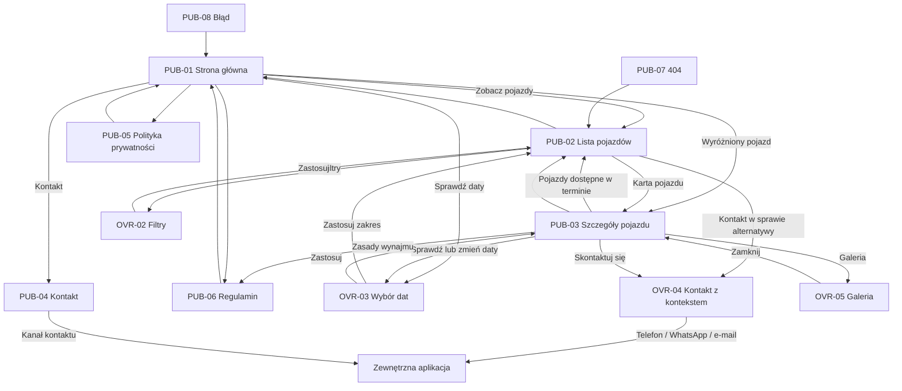
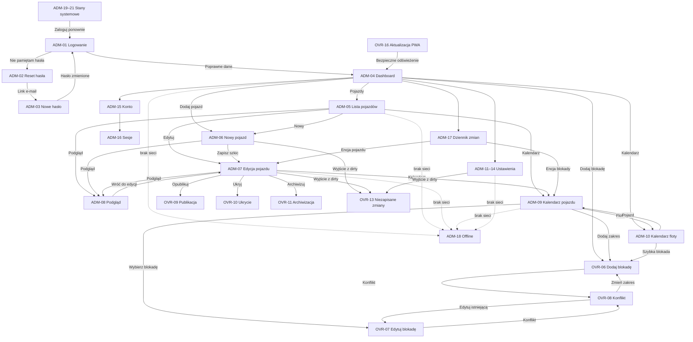
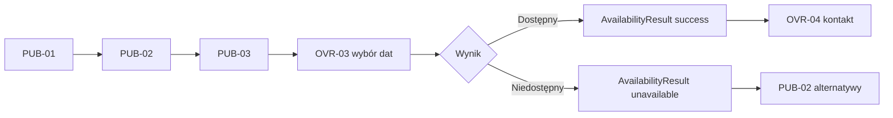

# Auterva — specyfikacja makiet, Design System i mapa ekranów

> **Podstawa produktu:** [PRD 3.1](../product/PRD.md); zachowany kontrakt floty: [BASELINE_FLEET](../product/BASELINE_FLEET.md)  
> **Wersja:** kontrakt bazowy 1.0 z jawną aktualizacją do MVP 3.1, 22.10.2026  
> **Zakres:** cztery obszary MVP 3.1; wspólny Design System, superadmin, panel firmy/PWA i publiczna oferta  
> **Platformy:** marketing Autervy, superadmin, panel firmy/PWA, oferta firmy WWW  
> **Język interfejsu:** polski  
> **Rynek i formaty:** Polska, PLN, `dd.MM.yyyy`, strefa `Europe/Warsaw`, tydzień od poniedziałku  
> **Metoda projektowa:** mobile-first, pełna zgodność funkcjonalna mobile/desktop  
> **Docelowy standard dostępności:** WCAG 2.2 AA

---

## 0. Aktualny kontrakt MVP 3.1

Ten dokument zachowuje szczegóły DS i bazowe identyfikatory, a poniższa warstwa aktualizacji ma pierwszeństwo nad historycznymi tabelami. Logikę określa [PRD 3.1](../product/PRD.md), wygląd — najnowsza kanoniczna makieta Penpota zgodna z tym PRD. Nie przenosić do kodu starych decyzji single-tenant, opcjonalnego MFA, edycji logo przez firmę ani komercyjnego blokowania panelu.

- [Wymagania](../WYMAGANIA_AUTERVA.md) zawierają pełny aktualny katalog i rejestr D rozbieżności. [Architektura, załącznik A](../ARCHITEKTURA_AUTERVA.md#załącznik-a-dokładne-ścieżki-w-penpocie) zawiera dokładne strony, nazwy oraz rzeczywiste ID. Odczyt 22.10.2026: 7 stron, 175 komponentów biblioteki, 15 stylów kolorów, 17 stylów tekstu; 180 pozycji starego katalogu nie oznacza 180 masterów.
- Zachowane źródła implementacyjne: [komponenty](../../design/handoff/components.md), [zachowanie responsywne](../../design/handoff/responsive.md), [tokeny](../../design/tokens/auterva.tokens.json) i [traceability](../../design/traceability.json). Reguły ruchu/treści z dawnych handoffów przeniesiono do §24. Nie wymagać usuniętych eksportów/raportów QA do implementacji.
- Makiety są statycznym kontraktem. Prototypy zostały odłożone; siedem nieaktualnych odwołań i 52 puste cele interakcji są odnotowane w załączniku A architektury. Focus, klawiatura, sieć, zapis i bezpieczeństwo wymagają testów aplikacji.
- Cztery obszary zachowują oddzielne hosty: marketing, superadmin, panel firmy, publiczna oferta. Jedno konto firmy obsługuje jedną firmę; brak przełącznika i zespołów. Superadmin obsługuje flotę pod kartą wybranej firmy i własną tożsamością.
- Koniec trialu/opłaty wyłącza publiczną ofertę przy zachowaniu pełnego panelu i czatu; status nie jest wygasłą sesją. Archiwizacja firmy blokuje dostęp i ofertę, zachowując dane; przywrócenie publicznej widoczności ma osobny kontrolowany krok superadmina.
- Publiczne logo/materiały white-label zmienia superadmin. Logo w ADM-11 jest do odczytu; granice edycji kontaktu/SEO/treści prawnych pozostają w D-01. Flotę i zdjęcia pojazdów obsługują administrator oraz superadmin.
- MFA jest obowiązkowe dla obu ról. Sam ekran ustawienia hasła nie zastępuje enrollment i weryfikacji drugiego składnika. Reset/sesje zachowują odziedziczony priorytet; stare oznaczenie MFA jako P1 jest nieaktualne.
- Publiczne CTA prowadzą do telefonu, WhatsApp lub e-maila, bez tworzenia rezerwacji. Pusta aktywna oferta, brak wyników, błąd i wyłączona witryna mają różne stany.
- Kanoniczny typ blokady serwisowej: `MAINTENANCE`, wariant `maintenance`, etykieta „Serwis”. Historyczne `SERVICE` w scenariuszu makiety nie jest drugim enumem.

### 0.1. Zachowane potwierdzone decyzje DEC

Rejestr przeniesiono z historycznego handoffu decyzji; numery pozostają źródłami odwołań. Zatwierdzenia właściciela: 12.10.2026.

| ID | Obowiązująca decyzja | Źródło |
|---|---|---|
| DEC-013 | Jednorazowy trial: dokładnie 336 godzin od pierwszej skutecznej rejestracji; prezentacja czasu w Europe/Warsaw. | PRD §5.2B Q-03A |
| DEC-014 | White-label obejmuje logo/dane/treści/zdjęcia, bez indywidualnych kolorów/fontów/ikon/panelu; akceptacja materiałów poza aplikacją. | PRD §5.2B Q-05A |
| DEC-015 | Adres `{slug}.{publicDomainAutervy}`; domenę własną kupuje klient, Auterva obsługuje DNS/routing/TLS i przekierowanie adresu zastępczego. | PRD §5.2B Q-06A/B |
| DEC-016 | Lokalny szkic per rozmowa pozostaje przy swoim odbiorcy i wraca po zmianie firmy, bez dialogu blokującego. | PRD §5.2B Q-08A |
| DEC-017 | Archiwizacja zachowuje dane; brak automatycznego purge i przycisku trwałego usunięcia firmy. | PRD §5.2B Q-10B |
| DEC-018 | Zaproszenie jednorazowe, 7 dni; resend unieważnia poprzednie. MFA obowiązkowe dla obu ról. | PRD §5.2B Q-14 |
| DEC-019 | Przypomnienia trialu/opłaty w panelu i e-mailem 7 dni, 1 dzień i w dniu końca; brak mailowych alertów czatu. | PRD §5.2B Q-15 |
| DEC-020 | Marketing i oferta komunikują możliwości oraz korzyści, bez sugerowania rezerwacji/płatności online. | PRD §12.1–12.2; polecenie właściciela |

Czat ma WebSocket, typing i read zgodnie z U3/Q-08A. Publiczna strona działa podczas przyznanego trialu zgodnie z Q-03B. Nowsze U3/U4 rozstrzygają sprzeczne stare akapity źródłowego PRD; nie są nowymi pytaniami.

---

## 1. Cel dokumentu

Dokument jest kompletną podstawą do:

1. przygotowania makiet low-fidelity i high-fidelity,
2. utworzenia biblioteki komponentów w Penpocie,
3. wdrożenia design tokenów w aplikacji,
4. zaprojektowania prototypów przejść pomiędzy ekranami,
5. przekazania projektu programistom i testerom,
6. późniejszej rozbudowy o rezerwacje, płatności i konta klientów bez przebudowy podstawowych komponentów.

Dokument nie zmienia logiki biznesowej PRD. Rozwija wymagania produktowe do poziomu konkretnych komponentów, wariantów, stanów, układów responsywnych oraz połączeń między ekranami.

### 1.1. Zakres obowiązkowy

- wszystkie ekrany części publicznej,
- wszystkie ekrany i widoki panelu administratora,
- warianty mobilne, tabletowe i desktopowe,
- komponenty bazowe, domenowe i systemowe,
- stany: domyślny, hover, focus, active, disabled, loading, empty, success, warning, error i offline,
- kalendarze dostępności klienta oraz administratora,
- obsługa zdjęć,
- logowanie, sesje, ustawienia i audyt,
- instalacja i działanie PWA,
- kompletna mapa nawigacji i przepływów.

### 1.2. Zakres nieprojektowany jako aktywna funkcja MVP

Poniższe funkcje nie otrzymują pełnych ekranów produkcyjnych w MVP:

- rezerwacja online,
- płatność online,
- konto i panel klienta,
- automatyczne naliczanie ceny,
- podpisywanie umów,
- faktury,
- synchronizacja zmian wykonywanych offline,
- aplikacje natywne.

Design System otrzymuje jednak neutralne punkty rozszerzeń, aby w kolejnych etapach można było dodać status rezerwacji, płatności, klienta i dokumentów bez zmiany fundamentów wizualnych.

---

## 2. Kluczowe decyzje projektowe wynikające z PRD

### 2.1. Cztery obszary produktu

| Obszar | Użytkownik | Główny cel |
|---|---|---|
| Marketing Autervy | zainteresowana wypożyczalnia | poznanie systemu i kontakt poza aplikacją |
| Panel superadmina | superadmin Autervy | firmy, okresy, domeny, zaproszenia, materiały publiczne, wiadomości i zagnieżdżona obsługa floty |
| Panel firmy / PWA | jeden administrator danej firmy | własna flota, zdjęcia, blokady, dozwolone ustawienia i czat z Autervą |
| Publiczna oferta firmy | odwiedzający bez konta | pojazd, informacyjna dostępność i kontakt |

Obszary współdzielą fundamenty wizualne, lecz mają oddzielne hosty, nawigację i uprawnienia. Szczegóły PUB/ADM poniżej są bazowym kontraktem rozszerzonym o MKT/PLT/ACC/TEN z PRD 3.1.

### 2.2. Dostępność nie jest rezerwacją

Wynik „dostępny” jest informacją na podstawie bieżących danych. Interfejs zawsze pokazuje zastrzeżenie:

> Dostępność ma charakter informacyjny i wymaga potwierdzenia przez właściciela.

Przycisk „Skontaktuj się” nie blokuje terminu i nie tworzy rekordu klienta.

### 2.3. Publicznie widoczne są tylko dwa stany dostępności

- `DOSTĘPNY`,
- `NIEDOSTĘPNY`.

Klient nie widzi typu blokady, źródła, numeru referencyjnego ani prywatnej notatki. Administrator widzi pełne dane blokady.

### 2.4. Administrator dodaje tylko okresy niedostępności

Dni wolne są wyliczane automatycznie. Design kalendarza nie może sugerować, że administrator musi ręcznie oznaczać każdy wolny dzień.

### 2.5. Pełna funkcjonalność mobilna panelu

Wersja mobilna nie jest wersją uproszczoną. Zmienia się sposób prezentacji:

- tabela staje się kartami,
- sidebar staje się dolną nawigacją i menu,
- dialog staje się pełnoekranowym arkuszem lub bottom sheet,
- kalendarz zbiorczy staje się listą pojazdów i okresów,
- formularz jest podzielony na akordeony,
- główna akcja pozostaje przyklejona do dolnej krawędzi.

### 2.6. Monochromatyczna semantyka statusów

Paleta przekazana do projektu jest paletą monochromatyczną i ma pierwszeństwo przed wstępną sugestią zieleni, czerwieni i pomarańczu z PRD. Statusy są odróżniane przez:

- tekst,
- ikonę,
- kształt,
- styl obramowania,
- opcjonalny wzór tła,
- pozycję w układzie.

Kolor nigdy nie jest jedynym nośnikiem informacji. Design System zachowuje semantyczne nazwy tokenów (`success`, `error`, `warning`), dzięki czemu w przyszłości można podmienić ich wartości na kolory bez przebudowy komponentów.

### 2.7. Brak trybu ciemnego w MVP

Paleta jest projektowana dla jasnego interfejsu. Tryb ciemny pozostaje poza zakresem MVP. Komponenty nie mogą jednak używać wartości kolorów wpisanych bezpośrednio — wyłącznie tokenów semantycznych.

---

## 3. Organizacja pliku projektowego w Penpocie

### 3.1. Strony pliku — odczyt 22.10.2026

1. `00 — Start i przekazanie`
2. `01 — System projektu`
3. `02 — Strony publiczne / Auterva i firma · M+D`
4. `03 — Panel firmy · M+D`
5. `14 — Scenarios / MVP / Mobile`
6. `15 — Scenarios / MVP / Desktop`
7. `16 — Reference / Scenario descriptions`

Nie odtwarzać historycznej piętnastostronicowej propozycji biblioteki. Rzeczywiste page/board/component ID są w załączniku A architektury; nazwa/numer strony nie zastępuje UUID.

### 3.2. Nazewnictwo komponentów

Format:

```text
Obszar / Rodzina / Komponent / Element
```

Przykłady:

```text
Shared / Action / Button
Shared / Form / TextField
Public / Vehicle / Card
Public / Availability / Result
Admin / Navigation / Sidebar
Admin / Calendar / BlockEvent
```

### 3.3. Nazewnictwo wariantów

Format właściwości wariantu:

```text
style=primary | secondary | tertiary | destructive
size=sm | md | lg
state=default | hover | pressed | focus | disabled | loading
icon=none | leading | trailing | only
width=hug | fill
viewport=mobile | tablet | desktop
```

Przykład instancji:

```text
Shared/Button — style=primary, size=lg, state=default, icon=leading, width=fill
```

### 3.4. Zasady Auto Layout

- wszystkie komponenty korzystają z Auto Layout,
- tekst nie jest zamieniany na krzywe,
- wysokość komponentu wynika z paddingu i minimalnej wysokości,
- szerokość przycisków może być `Hug contents` lub `Fill container`,
- żaden ekran nie jest budowany z absolutnego pozycjonowania poza kontrolowanymi warstwami typu tooltip, menu i dialog,
- listy i tabele korzystają z powtarzalnych komponentów wiersza,
- układy mobilne muszą działać od 320 px szerokości.

---

## 4. Fundamenty Design Systemu

## 4.1. Prymitywne tokeny kolorystyczne

| Token | Wartość | Główne zastosowanie | Ograniczenia |
|---|---:|---|---|
| `color.neutral.950` | `#151515` | najmocniejszy tekst, nagłówki, focus, pressed, mocne akcenty | nie stosować jako duże jednolite tło wielu sekcji naraz |
| `color.neutral.700` | `#424242` | CTA, przyciski, tekst drugorzędny, aktywne elementy | podstawowy kolor akcji |
| `color.neutral.500` | `#737373` | krawędzie, ikony drugorzędne, cienie, obramowania | dla zwykłego tekstu na `#f2f2f2` ma zbyt niski kontrast 4,24:1; używać głównie dla dużego tekstu, ikon i granic |
| `color.neutral.300` | `#a5a5a5` | elementy wyłączone, dekoracyjne, bardzo subtelne granice | nie używać dla treści i aktywnych kontrolek |
| `color.neutral.050` | `#f2f2f2` | główne tło, tekst na ciemnych tłach, pola i powierzchnie | podstawowa jasna powierzchnia |

### 4.1.1. Tokeny alfa wyprowadzane wyłącznie z palety

| Token | Wartość CSS | Zastosowanie |
|---|---|---|
| `alpha.ink.04` | `rgba(21, 21, 21, 0.04)` | najsubtelniejsze tło hover i statusów |
| `alpha.ink.08` | `rgba(21, 21, 21, 0.08)` | tło zaznaczenia, zebra rows |
| `alpha.ink.12` | `rgba(21, 21, 21, 0.12)` | delikatny overlay |
| `alpha.ink.16` | `rgba(21, 21, 21, 0.16)` | mocniejszy hover |
| `alpha.ink.24` | `rgba(21, 21, 21, 0.24)` | cień lub backdrop lokalny |
| `alpha.ink.40` | `rgba(21, 21, 21, 0.40)` | ikony nieaktywne, scrim |
| `alpha.ink.60` | `rgba(21, 21, 21, 0.60)` | modal backdrop |
| `alpha.graphite.08` | `rgba(66, 66, 66, 0.08)` | tło secondary hover |
| `alpha.graphite.16` | `rgba(66, 66, 66, 0.16)` | zaznaczenie i pressed |
| `alpha.edge.35` | `rgba(115, 115, 115, 0.35)` | subtelne obramowanie |

## 4.2. Semantyczne tokeny kolorów

### 4.2.1. Tekst

| Token | Wartość | Użycie |
|---|---:|---|
| `text.primary` | `#151515` | nagłówki, treść, etykiety pól, dane |
| `text.secondary` | `#424242` | opisy, metadane, tekst pomocniczy |
| `text.tertiary` | `#737373` | wyłącznie duży tekst pomocniczy, ikony lub elementy o mniejszym znaczeniu |
| `text.disabled` | `#737373` | nieaktywne kontrolki |
| `text.inverse` | `#f2f2f2` | tekst na `#151515` lub `#424242` |
| `text.link` | `#151515` | link z podkreśleniem lub ikoną kierunkową |
| `text.error` | `#151515` | błąd zawsze z ikoną `OctagonX` i etykietą |

### 4.2.2. Powierzchnie

| Token | Wartość | Użycie |
|---|---:|---|
| `surface.canvas` | `#f2f2f2` | tło całej aplikacji |
| `surface.default` | `#f2f2f2` | karta i sekcja; odróżniana obramowaniem lub cieniem |
| `surface.subtle` | `rgba(21,21,21,0.04)` na `#f2f2f2` | tła pól, hover, pasy tabeli |
| `surface.selected` | `rgba(21,21,21,0.08)` na `#f2f2f2` | zaznaczony filtr, dzień, wiersz |
| `surface.strong` | `#424242` | CTA i mocny panel |
| `surface.inverse` | `#151515` | footer, modalny akcent, stan pressed |
| `surface.disabled` | `#a5a5a5` | nieaktywne przyciski i placeholdery graficzne |
| `surface.scrim` | `rgba(21,21,21,0.60)` | tło modala i szuflady |

### 4.2.3. Obramowania i fokus

| Token | Wartość | Użycie |
|---|---:|---|
| `border.subtle` | `rgba(115,115,115,0.35)` | podziały wewnętrzne |
| `border.default` | `#737373` | pola, karty, tabele |
| `border.strong` | `#424242` | aktywne pola, wybrane karty |
| `border.critical` | `#151515` | błędy, działania destrukcyjne |
| `focus.ring` | `#151515` | ring 2 px |
| `focus.offset` | `#f2f2f2` | odstęp ringa 2 px |

### 4.2.4. Akcje

| Token | Default | Hover | Pressed | Disabled | Tekst/ikona |
|---|---:|---:|---:|---:|---:|
| `action.primary` | `#424242` | `#151515` | `#151515` | `#a5a5a5` | `#f2f2f2` |
| `action.secondary` | transparent + `#424242` border | `alpha.graphite.08` | `alpha.graphite.16` | `#a5a5a5` border | `#151515` |
| `action.tertiary` | transparent | `alpha.ink.04` | `alpha.ink.08` | transparent | `#424242` |
| `action.destructive` | transparent + 2 px `#151515` | `alpha.ink.08` | `#151515` | `#a5a5a5` border | default `#151515`, pressed `#f2f2f2` |

### 4.2.5. Statusy w palecie monochromatycznej

| Semantyka | Ikona | Tekst | Obramowanie | Tło | Dodatkowy wyróżnik |
|---|---|---:|---|---|---|
| `status.success` | `CircleCheck` | `#151515` | 2 px solid `#151515` | `alpha.ink.04` | znak ✓ i etykieta „Dostępny”/„Opublikowany” |
| `status.unavailable` | `CircleSlash` | `#151515` | 2 px double `#424242` | `alpha.graphite.08` | znak zakazu i etykieta „Niedostępny” |
| `status.warning` | `TriangleAlert` | `#151515` | 2 px dashed `#737373` | `alpha.ink.04` | trójkąt i tekst ostrzeżenia |
| `status.error` | `OctagonX` | `#151515` | 2 px solid `#151515` | wzór ukośnych linii z `alpha.ink.08` | prefiks „Błąd:” i instrukcja naprawy |
| `status.info` | `Info` | `#424242` | 1 px solid `#737373` | transparent | ikona informacji |
| `status.draft` | `FilePenLine` | `#151515` | 1 px dashed `#737373` | transparent | etykieta „Szkic” |
| `status.archived` | `Archive` | `#424242` | 1 px dotted `#737373` | `alpha.ink.04` | etykieta „Zarchiwizowany” |

### 4.2.6. Zweryfikowane kontrasty

| Para | Kontrast | Zastosowanie |
|---|---:|---|
| `#151515` na `#f2f2f2` | 16,31:1 | dowolny tekst, AAA |
| `#424242` na `#f2f2f2` | 8,98:1 | dowolny tekst, AAA |
| `#737373` na `#f2f2f2` | 4,24:1 | granice, ikony, duży tekst; nie zwykły tekst |
| `#a5a5a5` na `#f2f2f2` | 2,20:1 | dekoracje i disabled |
| `#f2f2f2` na `#424242` | 8,98:1 | tekst przycisku CTA |
| `#f2f2f2` na `#151515` | 16,31:1 | tekst na najmocniejszym tle |

## 4.3. Implementacyjny zestaw zmiennych CSS

```css
:root {
  --color-neutral-950: #151515;
  --color-neutral-700: #424242;
  --color-neutral-500: #737373;
  --color-neutral-300: #a5a5a5;
  --color-neutral-050: #f2f2f2;

  --color-text-primary: var(--color-neutral-950);
  --color-text-secondary: var(--color-neutral-700);
  --color-text-tertiary: var(--color-neutral-500);
  --color-text-inverse: var(--color-neutral-050);

  --color-surface-canvas: var(--color-neutral-050);
  --color-surface-default: var(--color-neutral-050);
  --color-surface-subtle: rgba(21, 21, 21, 0.04);
  --color-surface-selected: rgba(21, 21, 21, 0.08);
  --color-surface-strong: var(--color-neutral-700);
  --color-surface-inverse: var(--color-neutral-950);

  --color-border-subtle: rgba(115, 115, 115, 0.35);
  --color-border-default: var(--color-neutral-500);
  --color-border-strong: var(--color-neutral-700);
  --color-focus-ring: var(--color-neutral-950);

  --shadow-sm: 0 1px 2px rgba(21, 21, 21, 0.08);
  --shadow-md: 0 8px 24px rgba(21, 21, 21, 0.12);
  --shadow-lg: 0 20px 48px rgba(21, 21, 21, 0.16);
}
```

## 4.4. Typografia

### 4.4.1. Rodzina fontu

- podstawowy font: **Inter Variable**,
- fallback: `system-ui, -apple-system, BlinkMacSystemFont, "Segoe UI", sans-serif`,
- cyfry w datach, cenach i tabelach: `font-variant-numeric: tabular-nums`,
- maksymalnie cztery używane grubości: 400, 500, 600, 700,
- kursywa tylko dla cytatu lub treści prawnej, nie jako substytut hierarchii.

### 4.4.2. Skala typograficzna

| Token | Mobile | Desktop | Weight | Użycie |
|---|---|---|---:|---|
| `type.display` | 40/48 px | 56/64 px | 700 | hero strony głównej |
| `type.h1` | 32/40 px | 40/48 px | 700 | tytuł strony |
| `type.h2` | 28/36 px | 32/40 px | 700 | główna sekcja |
| `type.h3` | 22/30 px | 24/32 px | 600 | podsekcja, karta wyróżniona |
| `type.title-lg` | 20/28 px | 20/28 px | 600 | tytuł karty i panelu |
| `type.title-md` | 18/26 px | 18/26 px | 600 | nagłówek mniejszej sekcji |
| `type.body-lg` | 18/28 px | 18/28 px | 400 | lead i ważny opis |
| `type.body` | 16/24 px | 16/24 px | 400 | główna treść |
| `type.body-sm` | 14/20 px | 14/20 px | 400 | metadane, tabele |
| `type.label` | 14/20 px | 14/20 px | 600 | etykiety pól i kontrolek |
| `type.button` | 15/20 px | 15/20 px | 600 | przyciski |
| `type.caption` | 12/16 px | 12/16 px | 500 | znaczniki i pomocnicze podpisy |
| `type.data` | 14/20 px | 14/20 px | 500 | daty, ceny, wartości w tabelach |

### 4.4.3. Reguły tekstu

- szerokość długiej treści: maksymalnie 70–75 znaków w wierszu,
- nagłówki bez kropek na końcu,
- przyciski zaczynają się od czasownika: „Dodaj pojazd”, „Zapisz zmiany”, „Sprawdź termin”,
- zakaz używania samych ikon dla krytycznych akcji bez tooltipu i dostępnej nazwy,
- komunikat błędu opisuje problem i sposób rozwiązania,
- komunikat sukcesu opisuje wykonany rezultat,
- data końcowa zawsze jest przedstawiana jako dzień wliczony w zakres.

## 4.5. Skala odstępów

Bazowa jednostka: **4 px**.

| Token | px | Typowe zastosowanie |
|---|---:|---|
| `space.0` | 0 | brak odstępu |
| `space.1` | 4 | ikona–etykieta, gęste elementy |
| `space.2` | 8 | mały gap, wnętrze badge |
| `space.3` | 12 | pola kompaktowe |
| `space.4` | 16 | podstawowy padding mobile |
| `space.5` | 20 | większy gap komponentów |
| `space.6` | 24 | padding karty, odstęp sekcji formularza |
| `space.8` | 32 | odstęp między blokami |
| `space.10` | 40 | sekcja mobile |
| `space.12` | 48 | sekcja tablet |
| `space.16` | 64 | sekcja desktop |
| `space.20` | 80 | duża sekcja marketingowa |
| `space.24` | 96 | hero desktop |

## 4.6. Promienie narożników

| Token | Wartość | Użycie |
|---|---:|---|
| `radius.none` | 0 | tabele i listy ciągłe |
| `radius.xs` | 4 px | badge, małe pola |
| `radius.sm` | 8 px | input, button, tooltip |
| `radius.md` | 12 px | karta, panel, sheet |
| `radius.lg` | 16 px | duża karta, galeria |
| `radius.xl` | 24 px | hero i wyjątkowe panele |
| `radius.full` | 9999 px | chip, avatar, FAB |

Design powinien być nowoczesny, ale nie nadmiernie „obły”. Domyślny promień kart to 12 px, a pól i przycisków 8 px.

## 4.7. Obramowania i cienie

| Token | Specyfikacja | Użycie |
|---|---|---|
| `border.hairline` | 1 px `border.subtle` | separatory |
| `border.default` | 1 px `#737373` | pola i karty |
| `border.active` | 2 px `#424242` | wybrana karta, aktywne pole |
| `border.focus` | 2 px `#151515` + 2 px offset | fokus klawiatury |
| `shadow.sm` | `0 1px 2px rgba(21,21,21,.08)` | karta w spoczynku |
| `shadow.md` | `0 8px 24px rgba(21,21,21,.12)` | dropdown, sticky panel |
| `shadow.lg` | `0 20px 48px rgba(21,21,21,.16)` | modal i lightbox |

Krawędź jest podstawową metodą oddzielania powierzchni. Cień jest używany oszczędnie i nigdy nie zastępuje widocznego obramowania kontrolki.

## 4.8. Siatka i kontenery

| Zakres | Kolumny | Margines boczny | Gutter | Maks. szerokość treści |
|---|---:|---:|---:|---:|
| 320–479 px | 4 | 16 px | 16 px | 100% |
| 480–767 px | 4 | 24 px | 20 px | 100% |
| 768–1023 px | 8 | 32 px | 24 px | 100% |
| 1024–1279 px | 12 | 40 px | 24 px | 1200 px |
| 1280–1919 px | 12 | 48 px | 32 px | public: 1200 px, admin: 1440 px |
| 1920 px+ | 12 | auto | 32 px | public: 1280 px, admin: 1600 px |

### 4.8.1. Breakpointy implementacyjne

```text
xs: 320 px
sm: 480 px
md: 768 px
lg: 1024 px
xl: 1280 px
2xl: 1440 px
wide: 1920 px
```

Nie należy projektować tylko dla breakpointów. Każdy układ musi płynnie działać pomiędzy nimi.

## 4.9. Wymiary interaktywne

- minimalny cel dotykowy: 44×44 px,
- standardowy przycisk: 48 px wysokości,
- duży CTA: 52–56 px,
- kompaktowy przycisk desktop: minimum 40 px,
- input: 48 px, textarea zależna od treści,
- icon button: 44×44 px mobile, minimum 40×40 px desktop,
- odległość między sąsiednimi celami dotykowymi: minimum 8 px.

## 4.10. Ikonografia

- biblioteka: **Lucide**,
- rozmiary: 16, 20, 24 i 32 px,
- standardowy stroke: 1,75–2 px,
- ikona nie może być jedynym sposobem rozróżnienia statusu,
- ikony destrukcyjne zawsze z tekstem w potwierdzeniu,
- ikony nawigacji mają etykiety w mobile bottom navigation,
- dekoracyjne ikony posiadają `aria-hidden="true"`,
- funkcjonalne ikony posiadają dostępną nazwę.

## 4.11. Ruch i animacje

| Token | Czas | Użycie |
|---|---:|---|
| `motion.fast` | 120 ms | hover, focus, kolor |
| `motion.base` | 180 ms | menu, accordion, tooltip |
| `motion.slow` | 240 ms | drawer, sheet, modal |

Easing:

```text
standard: cubic-bezier(0.2, 0, 0, 1)
exit: cubic-bezier(0.4, 0, 1, 1)
```

Przy `prefers-reduced-motion: reduce`:

- wyłączane są przesunięcia i zoom,
- pozostaje natychmiastowa lub bardzo krótka zmiana opacity,
- karuzele nie przewijają się automatycznie,
- skeleton nie pulsuje agresywnie.

## 4.12. Warstwy i z-index

| Token | Wartość | Warstwa |
|---|---:|---|
| `z.base` | 0 | zwykła treść |
| `z.sticky` | 100 | sticky header, sticky CTA |
| `z.dropdown` | 300 | select, menu |
| `z.popover` | 400 | kalendarz, tooltip |
| `z.drawer` | 600 | menu mobilne i sheet |
| `z.modal` | 800 | dialog |
| `z.toast` | 1000 | powiadomienia |
| `z.critical` | 1200 | session expired, update blocking |

## 4.13. Lokalizacja i formatowanie

- format daty w UI: `dd.MM.yyyy`,
- zakres: `10.09.2026–12.09.2026`,
- miesiąc: `wrzesień 2026`,
- dzień tygodnia od poniedziałku,
- waluta: `250 zł / doba`,
- liczby miejsc: `9 miejsc`,
- stan braku ceny: sekcja ceny ukryta lub tekst „Wycena indywidualna”,
- slug techniczny bez polskich znaków,
- komunikaty są przygotowane do przeniesienia do słownika i18n.

---

## 5. Globalne reguły responsywne

| Wzorzec | Mobile | Tablet | Desktop |
|---|---|---|---|
| Nawigacja publiczna | pasek + hamburger/drawer | pasek + skrócone linki | pełny header z linkami i CTA |
| Nawigacja admina | bottom navigation + menu „Więcej” | zwijany sidebar | stały sidebar |
| Lista pojazdów klienta | 1 kolumna | 2 kolumny | 3 kolumny, opcjonalnie 4 na wide |
| Lista pojazdów admina | karty | karty lub tabela uproszczona | pełna tabela |
| Filtry klienta | przycisk otwierający bottom sheet | panel nad listą | poziomy toolbar lub sidebar |
| Galeria | karuzela swipe, 1 duże zdjęcie | duże + miniatury | mozaika + lightbox |
| Szczegóły pojazdu | jedna kolumna, sticky CTA na dole | dwie sekcje | treść + sticky panel dostępności |
| Formularz pojazdu | akordeony, sticky „Zapisz” | sekcje, 2 kolumny pól | szeroki formularz + panel statusu |
| Modal | pełnoekranowy sheet lub bottom sheet | dialog 640–720 px | dialog 560–800 px |
| Kalendarz publiczny | jeden miesiąc + pola dat | jeden/dwa miesiące | dwa miesiące |
| Kalendarz pojazdu admina | miesiąc + lista blokad | miesiąc | miesiąc/tydzień + panel boczny |
| Kalendarz całej floty | lista pojazdów i blokad | przewijana oś czasu | macierz pojazdy × dni/tygodnie |
| Tabela | karty rekordów | tabela uproszczona | tabela z kolumnami i akcjami |
| Główna akcja | pełna szerokość, sticky gdy potrzebne | wyrównana do prawej | w nagłówku strony |

### 5.1. Reguła zachowania funkcji

Zmiana breakpointu może zmienić układ i komponent prezentacyjny, ale nie może usunąć:

- dodawania i edycji pojazdu,
- zarządzania zdjęciami,
- dodawania i edycji blokady,
- filtrowania i wyszukiwania,
- publikacji, ukrycia i archiwizacji,
- dostępu do ustawień, konta, sesji i logów,
- informacji o błędzie, konflikcie i stanie offline.

### 5.2. Safe area dla PWA

Elementy przyklejone do krawędzi ekranu wykorzystują:

```css
padding-bottom: max(16px, env(safe-area-inset-bottom));
padding-top: max(12px, env(safe-area-inset-top));
```

Dotyczy to dolnej nawigacji, sticky action bar, bottom sheet i ekranu offline.

---

## 6. Kompletny katalog komponentów

Każdy komponent musi mieć wariant mobilny i desktopowy, jeżeli sposób prezentacji rzeczywiście się różni. Warianty nie powinny być duplikatami bez potrzeby — jeden responsywny komponent jest preferowany, a osobne warianty tworzy się dla istotnie odmiennej anatomii.

### 6.1. Layout i struktura

| ID | Komponent | Warianty / właściwości | Mobile | Desktop | Wymagane stany / uwagi |
|---|---|---|---|---|---|
| `DS-LYT-001` | `AppContainer` | `public`, `admin`, `fullBleed`, `narrow` | padding 16–24 px | max-width 1200/1440/1600 px | obsługa safe area |
| `DS-LYT-002` | `Stack` | gap 4–96 px, align, justify | pionowy domyślnie | pionowy/poziomy zależnie od breakpointu | bazowy primitive Auto Layout |
| `DS-LYT-003` | `Cluster` | `start`, `center`, `end`, wrap | zawijanie | zawijanie | grupy akcji i badge |
| `DS-LYT-004` | `ResponsiveGrid` | 1/2/3/4 kolumny | 1 kolumna | 2–4 kolumny | skeleton musi zachować tę samą siatkę |
| `DS-LYT-005` | `PublicPageShell` | header/footer, sticky contact | header uproszczony | pełny header | loading, global error |
| `DS-LYT-006` | `AdminPageShell` | sidebar expanded/collapsed, bottom-nav | bottom nav | sidebar | online, offline, session expired |
| `DS-LYT-007` | `PageHeader` | title, description, breadcrumbs, actions | akcje pod tytułem | akcje po prawej | compact, sticky optional |
| `DS-LYT-008` | `Section` | default, compact, emphasized | padding 40 px | 64–80 px | może mieć heading i action |
| `DS-LYT-009` | `TwoColumnLayout` | 50/50, 7/5, 8/4 | jedna kolumna | dwie kolumny | sticky aside optional |
| `DS-LYT-010` | `StickyAside` | top offset header/admin | zwykle inline | sticky | fallback przy małej wysokości viewportu |
| `DS-LYT-011` | `StickyActionBar` | save, contact, multi-action | przyklejony dół | inline lub dół formularza | unsaved, saving, success, error |
| `DS-LYT-012` | `Divider` | horizontal, vertical, labeled | horizontal | horizontal/vertical | subtle/default/strong |
| `DS-LYT-013` | `AspectRatio` | 16:9, 4:3, 3:2, 1:1 | 4:3/3:2 | 16:9/3:2 | dla zdjęć i skeletonów |
| `DS-LYT-014` | `ScrollArea` | horizontal, vertical | oś czasu/miniatury | tabela/sidebar | widoczny focus i gradient końca |
| `DS-LYT-015` | `SafeArea` | top, bottom, both | obowiązkowy PWA | bez zmian | iOS/Android standalone |

### 6.2. Nawigacja

| ID | Komponent | Warianty / właściwości | Mobile | Desktop | Stany |
|---|---|---|---|---|---|
| `DS-NAV-001` | `SkipLink` | do treści, do nawigacji | ukryty do focusu | ukryty do focusu | focus |
| `DS-NAV-002` | `BrandLogo` | symbol, wordmark, compact, inverse | compact | wordmark | link do `/` lub `/admin` |
| `DS-NAV-003` | `PublicHeader` | default, transparent-over-hero, sticky | logo + menu + kontakt | logo + linki + CTA | top, scrolled, menu open |
| `DS-NAV-004` | `PublicMobileDrawer` | menu, contact shortcuts | pełna wysokość | nie występuje | open/closing, focus trap |
| `DS-NAV-005` | `PublicFooter` | full, compact | sekcje pionowe/accordion | kolumny | dane warunkowe bez pustych sekcji |
| `DS-NAV-006` | `Breadcrumbs` | public, admin, collapsed | pierwszy + bieżący | pełna ścieżka | overflow, current page |
| `DS-NAV-007` | `AdminSidebar` | expanded, collapsed | nie występuje | 240/72 px | active, hover, badge, disabled |
| `DS-NAV-008` | `AdminTopbar` | with search, with status | tytuł + user/menu | breadcrumbs + user menu | online/offline/update |
| `DS-NAV-009` | `AdminBottomNavigation` | 4 główne + „Więcej” | stała | nie występuje | active, notification dot |
| `DS-NAV-010` | `AdminMoreMenu` | sheet/drawer | pełna lista modułów | dropdown/user menu | open, active |
| `DS-NAV-011` | `UserMenu` | profile, account, logout | sheet | dropdown | current session, logout |
| `DS-NAV-012` | `Tabs` | underline, contained, scrollable | przewijane poziomo | pełne | default, active, disabled, badge |
| `DS-NAV-013` | `SegmentedControl` | 2–4 opcje | fill width | hug content | selected, focus |
| `DS-NAV-014` | `Pagination` | numbered, compact, previous-next | previous/next + count | numery stron | disabled, loading |
| `DS-NAV-015` | `BackButton` | icon+label, icon-only | „Wróć” | breadcrumbs lub „Wróć” | focus |
| `DS-NAV-016` | `AnchorNavigation` | sekcje formularza/prawne | horizontal scroll/dropdown | sticky side list | current section |

### 6.3. Akcje

| ID | Komponent | Warianty | Rozmiary | Stany | Zastosowanie |
|---|---|---|---|---|---|
| `DS-ACT-001` | `Button` | primary, secondary, tertiary, destructive | sm 40, md 48, lg 56 | default, hover, pressed, focus, disabled, loading | wszystkie główne akcje |
| `DS-ACT-002` | `IconButton` | default, subtle, destructive | 40, 44, 48 | jak Button | galeria, tabela, menu |
| `DS-ACT-003` | `TextLink` | inline, standalone, inverse, external | body-sm/body | default, hover, visited, focus | nawigacja i treść |
| `DS-ACT-004` | `ButtonGroup` | horizontal, vertical, split-responsive | sm/md/lg | disabled child, loading child | formularze i dialogi |
| `DS-ACT-005` | `FloatingActionButton` | add, quick-block | 56 | default, pressed, focus | wyłącznie mobile admin, opcjonalnie |
| `DS-ACT-006` | `CopyButton` | icon-only, icon+label | sm/md | copied, error | telefon, e-mail, wiadomość |
| `DS-ACT-007` | `MenuTrigger` | kebab, chevron, avatar | 40/44 | open, focus | akcje rekordu |
| `DS-ACT-008` | `InlineAction` | edit, remove, retry | body-sm | hover, focus, disabled | w treści, alertach i listach |

### 6.4. Pola formularzy i kontrolki

| ID | Komponent | Warianty / właściwości | Mobile | Desktop | Stany |
|---|---|---|---|---|---|
| `DS-FRM-001` | `FormField` | label, hint, optional, required, counter | zawsze label nad polem | label nad polem | default, focus-within, error, disabled |
| `DS-FRM-002` | `TextInput` | text, email, tel, url | 48 px, full | 48 px | empty, filled, hover, focus, error, disabled, readonly |
| `DS-FRM-003` | `SearchInput` | with clear, with shortcut | full | 280–400 px | searching, no match |
| `DS-FRM-004` | `PasswordInput` | reveal/hide, autocomplete | full | full | strength, error, caps-lock info |
| `DS-FRM-005` | `Textarea` | short, long, autosize, markdown | min 120 px | 120–320 px | counter, error, disabled |
| `DS-FRM-006` | `NumberInput` | integer, currency, year, order | native keypad | compact | min/max, step, error |
| `DS-FRM-007` | `Select` | single, native fallback | bottom sheet/native | popover | open, selected, error, disabled |
| `DS-FRM-008` | `Combobox` | searchable single | full-screen/sheet list | popover list | typing, loading, empty, selected |
| `DS-FRM-009` | `MultiSelect` | chips, checkbox list | sheet | popover | selected, max reached, empty |
| `DS-FRM-010` | `Checkbox` | unchecked, checked, indeterminate | 44 px target | 40 px target | hover, focus, disabled, error |
| `DS-FRM-011` | `RadioGroup` | vertical, cards, inline | vertical/cards | inline/cards | selected, focus, disabled |
| `DS-FRM-012` | `Switch` | label left/right | 44 px target | 40 px target | on, off, disabled, loading |
| `DS-FRM-013` | `DateInput` | start, end, single-day | native keyboard + picker | text + popover | invalid, past-date, disabled |
| `DS-FRM-014` | `DateRangeField` | two inputs, compact summary | pionowo lub 2 kolumny | 2 kolumny | empty, partial, valid, invalid, checking |
| `DS-FRM-015` | `DateRangePicker` | public, admin, one/two months | 1 miesiąc/full-screen | 2 miesiące/popover | selecting start/end, selected, unavailable |
| `DS-FRM-016` | `CalendarGrid` | public, admin, month, fleet | jedna kolumna | 1–2 miesiące lub grid | loading, keyboard focus, selected range |
| `DS-FRM-017` | `TimeZoneNotice` | compact info | pod datami | tooltip/info | zawsze `Europe/Warsaw`, zwykle ukryty |
| `DS-FRM-018` | `SlugField` | auto/manual | full | prefix domeny + input | generated, edited, conflict, redirect warning |
| `DS-FRM-019` | `CurrencyField` | PLN, price-from | numeric keypad | prefix/suffix | empty, valid, error |
| `DS-FRM-020` | `TagInput` | free tags, predefined features | chips + sheet | chips + combobox | duplicate, max, empty |
| `DS-FRM-021` | `FeaturePicker` | grouped checkboxes, searchable | sheet/accordion | popover/panel | selected count, no results |
| `DS-FRM-022` | `FileDropzone` | empty, drag-over, upload | tap-first | drag/drop + browse | invalid type, too large, limit, uploading |
| `DS-FRM-023` | `ImageUploader` | single logo, multiple vehicle | camera/files choice | drag/drop | progress, success, error, retry |
| `DS-FRM-024` | `MarkdownEditor` | description, legal content | textarea + preview tab | split editor/preview | dirty, validation, preview |
| `DS-FRM-025` | `RichDescriptionField` | plain/markdown | accordion section | full section | sanitized preview |
| `DS-FRM-026` | `FormSection` | card, accordion, plain | accordion optional | card/plain | complete, incomplete, error count |
| `DS-FRM-027` | `FormSectionNav` | steps/anchors | scroll chips | left sticky nav | active, complete, error |
| `DS-FRM-028` | `ValidationSummary` | page, dialog | top of form | top/side | list links to invalid fields |
| `DS-FRM-029` | `CharacterCounter` | current/max | inline | inline | warning near limit, exceeded |
| `DS-FRM-030` | `FormActions` | save draft, preview, publish | sticky bottom | page header/footer | saving, saved, error, disabled |
| `DS-FRM-031` | `UnsavedIndicator` | dot+text, banner | sticky compact | header text | clean, dirty, saving, saved |
| `DS-FRM-032` | `FieldArray` | contact channels, features | cards | rows | add, reorder, remove, empty |

### 6.5. Informacja zwrotna, stany i warstwy

| ID | Komponent | Warianty | Mobile | Desktop | Stany / wymagania |
|---|---|---|---|---|---|
| `DS-FBK-001` | `Alert` | info, success, warning, error | pełna szerokość | inline/banner | title, description, action, dismissible |
| `DS-FBK-002` | `InlineMessage` | hint, validation, success | pod polem | pod polem | `aria-describedby`, `aria-live` dla błędu |
| `DS-FBK-003` | `StatusBadge` | availability, publication, block type, session | wrap | inline | tekst + ikona, nigdy sam kolor |
| `DS-FBK-004` | `Toast` | success, error, info, undo | dół nad nav | prawy górny róg | auto-dismiss tylko dla niekrytycznych |
| `DS-FBK-005` | `GlobalBanner` | offline, update, maintenance | góra | góra | sticky, action, dismiss rules |
| `DS-FBK-006` | `Spinner` | inline, button, page | 16/24/32 | 16/24/32 | tekst alternatywny |
| `DS-FBK-007` | `ProgressBar` | determinate, indeterminate | upload/save | upload/save | value label |
| `DS-FBK-008` | `Skeleton` | text, card, image, table, calendar | zgodny z layoutem | zgodny z layoutem | reduced motion |
| `DS-FBK-009` | `EmptyState` | first-use, filtered, no-data | center, action | center/inline | ikona, title, description, CTA |
| `DS-FBK-010` | `ErrorState` | local, page, network, permission | full | full/inline | retry, back, request id optional |
| `DS-FBK-011` | `Tooltip` | text, shortcut | tap/focus fallback | hover/focus | nie zawiera krytycznej treści |
| `DS-FBK-012` | `Popover` | menu, calendar, details | prefer sheet | anchored | focus management |
| `DS-FBK-013` | `DropdownMenu` | record actions, user | sheet/dropdown | dropdown | keyboard navigation |
| `DS-FBK-014` | `Dialog` | confirm, form, info, destructive | full-screen lub bottom sheet | 480–800 px | focus trap, escape, return focus |
| `DS-FBK-015` | `BottomSheet` | filters, contact, actions, select | podstawowy mobile overlay | nie występuje lub drawer | drag handle optional, safe area |
| `DS-FBK-016` | `SideDrawer` | menu, detail, quick edit | full width | 480–640 px right | dirty state warning |
| `DS-FBK-017` | `ConfirmDialog` | publish, unpublish, archive, delete | sheet/dialog | dialog | jawna nazwa obiektu i skutek |
| `DS-FBK-018` | `UnsavedChangesDialog` | stay, discard, save | full dialog | dialog | blokuje przypadkowe wyjście |
| `DS-FBK-019` | `ConflictPanel` | availability overlap | sheet | dialog/inline | istniejąca blokada, edit link, cancel |
| `DS-FBK-020` | `SessionExpiredDialog` | re-login, discard | critical overlay | critical modal | nie ujawnia danych po wygaśnięciu |
| `DS-FBK-021` | `AnnouncementRegion` | polite, assertive | niewidoczny | niewidoczny | wyniki filtrów, zapis, błędy |

### 6.6. Treść, dane i karty

| ID | Komponent | Warianty | Mobile | Desktop | Stany |
|---|---|---|---|---|---|
| `DS-DAT-001` | `Card` | default, interactive, selected, emphasized | full | grid/list | hover, focus, disabled |
| `DS-DAT-002` | `VehicleCardPublic` | grid, list, featured, with-availability | pionowa | grid/list | loading, available, unavailable, no-price |
| `DS-DAT-003` | `VehicleCardFeatured` | large, compact | swipe/stack | 3–6 grid | image fallback |
| `DS-DAT-004` | `VehicleRowAdmin` | table row | zamiana na kartę | pełny wiersz | selected, menu open, updating |
| `DS-DAT-005` | `VehicleCardAdmin` | compact, detailed | podstawowy | opcjonalny | status, quick actions, warnings |
| `DS-DAT-006` | `StatCard` | number, number+trend, warning | 2 kolumny | 4 kolumny | loading, empty, warning |
| `DS-DAT-007` | `SpecList` | icon list, definition list | 2 kolumny | 3–4 kolumny | pola opcjonalne ukryte |
| `DS-DAT-008` | `FeatureChip` | icon, text, removable admin | wrap | wrap | selected/removable |
| `DS-DAT-009` | `PriceBlock` | price-from, individual, hidden | pełny | inline/aside | nie renderuje `0 zł` |
| `DS-DAT-010` | `DefinitionList` | vertical, two-column | vertical | two-column | missing values omitted |
| `DS-DAT-011` | `DataTable` | vehicles, logs, sessions | nie używać jako szerokiej tabeli | pełna tabela | sort, filter, selection, loading, empty |
| `DS-DAT-012` | `RecordCard` | log, session, block | podstawowy mobile | optional compact | expandable details |
| `DS-DAT-013` | `KeyValueRow` | plain, copyable, status | vertical | row | long value wrap |
| `DS-DAT-014` | `AuditLogRow` | compact, expanded | card | table row | expanded summary, redacted values |
| `DS-DAT-015` | `SessionCard` | current, other, expired | card | table/card | terminate action, current badge |
| `DS-DAT-016` | `WarningList` | data quality, setup | stack | panel | item action, dismissed/resolved |
| `DS-DAT-017` | `ResultCount` | filters/search | sticky near toolbar | toolbar | aria-live update |
| `DS-DAT-018` | `SortControl` | select, menu | sheet/select | compact select | current sort |
| `DS-DAT-019` | `FilterChip` | applied, removable | horizontal scroll | wrap | focus, remove |
| `DS-DAT-020` | `FilterBar` | public, admin | trigger + chips | full controls | dirty/applied/loading |
| `DS-DAT-021` | `FilterSheet` | vehicles, logs | bottom sheet | optional drawer | apply, clear, count |
| `DS-DAT-022` | `LegalContent` | privacy, terms | readable column | readable column | headings, links, lists |
| `DS-DAT-023` | `ContactDataList` | phone, email, WhatsApp, address, hours | cards/list | grid/list | missing channels hidden |
| `DS-DAT-024` | `MapEmbed` | static link, embedded map | static preview preferred | embed optional | conditional; consent/performance |

### 6.7. Media i galeria

| ID | Komponent | Warianty | Mobile | Desktop | Stany |
|---|---|---|---|---|---|
| `DS-MED-001` | `ResponsiveImage` | vehicle, logo, decorative | właściwe `sizes` | właściwe `sizes` | loading, error, fallback |
| `DS-MED-002` | `VehicleGallery` | carousel, mosaic | carousel swipe | mosaic + thumbnails | 1 image, many images, loading |
| `DS-MED-003` | `GalleryThumbnail` | default, selected | horizontal scroll | vertical/horizontal list | selected, focus |
| `DS-MED-004` | `Lightbox` | image, gallery | full-screen | modal/full-screen | keyboard, swipe, zoom optional |
| `DS-MED-005` | `ImageAdminTile` | cover, regular, uploading, failed | 2 kolumny | 3–5 kolumn | drag handle, alt edit, delete |
| `DS-MED-006` | `ReorderableGallery` | drag/drop, keyboard reorder | buttons „w górę/w dół” | drag/drop + keyboard | saving order, conflict |
| `DS-MED-007` | `CoverMarker` | badge + radio/action | visible | visible | dokładnie jedno zdjęcie główne |
| `DS-MED-008` | `UploadQueue` | files, progress, errors | stack | list/grid | retry, cancel, completed |
| `DS-MED-009` | `ImageAltEditor` | inline, dialog | sheet | inline/dialog | required, suggested, custom |
| `DS-MED-010` | `LogoUploader` | empty, preview | single file | single file | replace, remove, invalid |

### 6.8. Komponenty dostępności pojazdu i kalendarzy

| ID | Komponent | Warianty | Mobile | Desktop | Stany |
|---|---|---|---|---|---|
| `DS-AVL-001` | `AvailabilityChecker` | homepage, list, vehicle-detail | pionowy/full | horizontal/card | empty, partial, checking, result, error |
| `DS-AVL-002` | `AvailabilityDateSummary` | compact, detailed | nad CTA | inline | start/end, one-day |
| `DS-AVL-003` | `PublicAvailabilityCalendar` | one-month, two-month | 1 miesiąc | 2 miesiące | loading, unavailable, selected, past |
| `DS-AVL-004` | `PublicDayCell` | available, unavailable, past, today, selected, range-start/end/middle | 44 px minimum | 40–44 px | tekst/ikona/wzór oprócz koloru |
| `DS-AVL-005` | `CalendarLegend` | public, admin | wrap | inline | dostępny dla screen readera |
| `DS-AVL-006` | `AvailabilityResult` | available, unavailable, invalid, stale | full panel | inline/sticky panel | CTA, disclaimer, alternative action |
| `DS-AVL-007` | `AvailabilityDisclaimer` | compact, full | pod wynikiem | pod wynikiem | zawsze przy pozytywnym wyniku |
| `DS-AVL-008` | `AdminVehicleCalendar` | month, month+list | month + list | month + side panel | loading, empty, conflict, editing |
| `DS-AVL-009` | `AdminDayCell` | free, reserved, maintenance, blocked, other, today, selected | 44 px | 36–44 px | typ + ikona/label w szczegółach |
| `DS-AVL-010` | `BlockEvent` | reserved, maintenance, blocked, other | list row/chip | calendar bar | hover, selected, truncated |
| `DS-AVL-011` | `BlockTypeBadge` | 4 typy | text+icon | text+icon | prywatny, tylko admin |
| `DS-AVL-012` | `BlockForm` | create, edit, quick | full-screen sheet | dialog/side panel | valid, conflict, saving, delete confirm |
| `DS-AVL-013` | `QuickBlockFlow` | 4 kroki, single screen | stepper/one-column | compact dialog | vehicle, dates, type, save |
| `DS-AVL-014` | `BlockConflictCard` | single, multiple conflicts | stack | panel/table | edit existing, cancel, optional merge |
| `DS-AVL-015` | `UpcomingBlocksList` | dashboard, vehicle | cards | list/table | empty, loading |
| `DS-AVL-016` | `FleetCalendarGrid` | day, week, month horizon | nie używać pełnej macierzy | pojazdy × dni/tygodnie | horizontal scroll, sticky axes |
| `DS-AVL-017` | `FleetCalendarMobileList` | by vehicle, by date | podstawowy | optional | expand vehicle, quick block |
| `DS-AVL-018` | `CalendarToolbar` | prev/next, today, month, range | compact | full | disabled at horizon |
| `DS-AVL-019` | `DateRangePreset` | today, weekend, next week, custom | chips | buttons/menu | selected |
| `DS-AVL-020` | `BlockDetailsPanel` | view, edit | sheet | side panel | delete, edit, audit metadata |

### 6.9. Kontakt

| ID | Komponent | Warianty | Mobile | Desktop | Stany |
|---|---|---|---|---|---|
| `DS-CNT-001` | `ContactCTA` | generic, vehicle, vehicle+dates, sticky | sticky/full width | inline/sticky aside | disabled only when no channel configured |
| `DS-CNT-002` | `ContactSheet` | channels, message preview | bottom sheet | dialog/popover | open, no channel, copy success |
| `DS-CNT-003` | `ContactChannelButton` | phone, WhatsApp, email, Messenger, copy | full width | list/grid | available, default, external |
| `DS-CNT-004` | `PrefilledMessage` | preview, editable-before-copy | card | card | vehicle only, vehicle+dates |
| `DS-CNT-005` | `ContactContextSummary` | vehicle, date range | compact | compact | no dates |
| `DS-CNT-006` | `ContactHours` | open text, structured | list | list | current status optional, no live logic required |
| `DS-CNT-007` | `ContactShortcutBar` | phone+WhatsApp | fixed optional | inline | public mobile only |

### 6.10. Uwierzytelnianie, konto i bezpieczeństwo

| ID | Komponent | Warianty | Mobile | Desktop | Stany |
|---|---|---|---|---|---|
| `DS-AUT-001` | `LoginForm` | default, rate-limited | full | 400–480 px card | loading, invalid, locked delay, session expired |
| `DS-AUT-002` | `ResetPasswordRequest` | P1 | full | card | sent-neutral, rate-limited, error |
| `DS-AUT-003` | `SetNewPasswordForm` | P1 | full | card | token valid/expired, strength, success |
| `DS-AUT-004` | `PasswordStrength` | weak/medium/strong semantically | bar + checklist | bar + checklist | nie opierać na samym kolorze |
| `DS-AUT-005` | `TwoFactorForm` | TOTP/recovery, P1 | numeric keypad | segmented input | error, resend/retry, recovery |
| `DS-AUT-006` | `AccountSummary` | profile, email, role | card | panel | readonly email/role |
| `DS-AUT-007` | `ChangePasswordForm` | current/new/confirm | one column | max 640 px | re-auth, strength, success |
| `DS-AUT-008` | `ActiveSessionList` | current/other | cards | table/cards | terminate one/all, loading |
| `DS-AUT-009` | `ReauthenticationDialog` | password, MFA required | full dialog | dialog | critical settings |
| `DS-AUT-010` | `PermissionState` | unauthenticated, forbidden | page | page | login/back actions |

### 6.11. PWA i połączenie sieciowe

| ID | Komponent | Warianty | Mobile | Desktop | Stany |
|---|---|---|---|---|---|
| `DS-PWA-001` | `InstallPrompt` | Android/browser, iOS instructions | sheet/banner | banner/dialog | eligible, dismissed, installed |
| `DS-PWA-002` | `OfflineBanner` | compact, blocking | sticky top | sticky top | offline, reconnecting, online restored |
| `DS-PWA-003` | `OfflineScreen` | shell cached, no-data | full screen | full page | retry, go to cached dashboard shell |
| `DS-PWA-004` | `NetworkActionGuard` | save-disabled, retry | inline | inline | nie potwierdza fikcyjnego zapisu |
| `DS-PWA-005` | `UpdatePrompt` | safe refresh, unsaved changes | sheet/banner | toast/dialog | update available, postponed, refreshing |
| `DS-PWA-006` | `OnlineStatusIndicator` | icon+text | topbar | topbar | online/offline/reconnecting |
| `DS-PWA-007` | `StandaloneHeader` | PWA-safe | safe area | jak admin topbar | no browser controls |

### 6.12. Ustawienia i audyt

| ID | Komponent | Warianty | Mobile | Desktop | Stany |
|---|---|---|---|---|---|
| `DS-SET-001` | `SettingsNavigation` | tabs/anchors | scroll tabs | side nav/tabs | active, error count |
| `DS-SET-002` | `CompanyDetailsForm` | general | accordion | section | dirty, saving, error |
| `DS-SET-003` | `ContactChannelEditor` | phone/email/WhatsApp/custom | cards | rows/cards | add, reorder, default, remove |
| `DS-SET-004` | `PresentationSettingsForm` | pricing, featured count, disclaimer | accordion | section | dependent fields |
| `DS-SET-005` | `SEOFields` | default title/description | stack | 2 columns + preview | character limits, preview |
| `DS-SET-006` | `SEOPreview` | desktop search snippet, social | card | card | truncation preview |
| `DS-SET-007` | `LegalContentEditor` | privacy, terms, link/content | tabs | split view | draft, preview, validation |
| `DS-SET-008` | `AuditFilters` | date, actor, action, entity | filter sheet | filter bar | applied, clear |
| `DS-SET-009` | `AuditDetails` | safe diff/summary | accordion/sheet | expandable row/dialog | redacted secrets |
| `DS-SET-010` | `DataQualityIssue` | vehicle/contact/system | card | row/card | resolved, action required |

---

## 7. Szczegółowe specyfikacje kluczowych komponentów

### 7.1. `DS-ACT-001 Button`

#### Anatomia

1. kontener,
2. opcjonalna ikona prowadząca,
3. etykieta,
4. opcjonalna ikona końcowa,
5. spinner zastępujący lub poprzedzający etykietę w stanie loading,
6. focus ring poza obrysem.

#### Warianty

| Wariant | Zastosowanie | Przykład |
|---|---|---|
| Primary | jedna najważniejsza akcja w obszarze | „Sprawdź termin”, „Zapisz zmiany” |
| Secondary | akcja alternatywna | „Podgląd”, „Wyczyść filtry” |
| Tertiary | lekka akcja lokalna | „Anuluj”, „Zmień termin” |
| Destructive | operacja niszcząca | „Archiwizuj”, „Usuń blokadę” |

#### Reguły

- maksymalnie jeden Primary w jednym logicznym panelu,
- loading blokuje ponowne kliknięcie, ale zachowuje etykietę kontekstową, np. „Zapisywanie…”,
- disabled nie może zastępować wyjaśnienia — przy niespełnionych warunkach publikacji pokazuje się przyczyna,
- na mobile główny CTA jest `width=fill`,
- przycisk icon-only wymaga tooltipu i `aria-label`,
- destructive nie jest domyślną akcją po otwarciu dialogu.

### 7.2. `DS-FRM-001 FormField`

#### Anatomia

1. etykieta,
2. oznaczenie opcjonalności zamiast gwiazdki przy większości pól,
3. kontrolka,
4. hint,
5. błąd,
6. licznik znaków lub metadane.

#### Reguły

- placeholder nie zastępuje etykiety,
- błąd pozostaje widoczny do poprawy wartości,
- focus jest przenoszony na pierwsze błędne pole po nieudanej próbie zapisu,
- `ValidationSummary` linkuje do pól,
- wartości formularza pozostają po błędzie serwera,
- pola zależne są ukrywane lub blokowane z jasnym opisem, nigdy pozostawiane bez kontekstu.

### 7.3. `DS-FRM-015 DateRangePicker`

#### Publiczny wariant

- pokazuje dni dostępne/niedostępne,
- nie pokazuje rodzaju blokady,
- nie pozwala wybrać daty przeszłej,
- wybór pierwszego dnia uruchamia wybór końca,
- dzień końcowy jest wliczony,
- dostępna jest alternatywa w postaci dwóch pól tekstowych/natywnych,
- po wyborze zakresu użytkownik aktywuje „Sprawdź termin”.

#### Administracyjny wariant

- pokazuje pełne typy blokad,
- umożliwia wybór zakresu przez kliknięcie/przeciągnięcie i klawiaturę,
- ostrzega przy datach w przeszłości,
- konflikt nie jest prezentowany dopiero po zamknięciu formularza — zakres kolizyjny jest sygnalizowany już w pickerze, jeśli dane są dostępne.

#### Responsywność

- mobile: jeden miesiąc, sticky nagłówek z nazwą miesiąca, pełnoekranowy sheet,
- tablet: jeden lub dwa miesiące zależnie od szerokości,
- desktop: dwa miesiące w popoverze lub panelu.

### 7.4. `DS-DAT-002 VehicleCardPublic`

#### Anatomia

1. zdjęcie główne 3:2,
2. opcjonalny badge dostępności dla wybranych dat,
3. nazwa pojazdu,
4. kategoria,
5. 2–4 najważniejsze parametry,
6. krótki opis maksymalnie 2–3 linie,
7. opcjonalna cena „od”,
8. przycisk lub cały bezpiecznie klikalny obszar prowadzący do szczegółów.

#### Warianty

- `grid` — standardowa lista,
- `list` — opcjonalny widok porównawczy desktop,
- `featured` — większe zdjęcie i wyróżniona hierarchia,
- `with-availability` — wynik filtrowania po terminie,
- `skeleton`,
- `image-fallback`.

#### Reguły

- brak ceny nie tworzy pustej przestrzeni,
- karta nie pokazuje prywatnego typu blokady,
- dostępność jest oznaczona etykietą i ikoną,
- cały tekst alternatywny zdjęcia jest związany z pojazdem,
- hover nie może być jedynym sygnałem klikalności.

### 7.5. `DS-MED-002 VehicleGallery`

#### Mobile

- jedno zdjęcie na ekranie,
- swipe i przyciski poprzedni/następny,
- licznik `2 / 8`,
- przycisk pełnego ekranu,
- miniatury opcjonalne dopiero od szerszego telefonu/tabletu.

#### Desktop

- główne zdjęcie + 2–4 pomocnicze w mozaice,
- przycisk „Zobacz wszystkie zdjęcia”,
- lightbox z klawiaturą, licznikiem i miniaturami,
- lazy loading zdjęć poza pierwszym ekranem.

### 7.6. `DS-AVL-001 AvailabilityChecker`

#### Warianty

| Wariant | Umiejscowienie | Układ |
|---|---|---|
| Homepage | hero/sekcja startowa | daty + CTA, bez pojazdu |
| Vehicle list | toolbar/filtry | daty filtrują całą flotę |
| Vehicle detail | sticky panel/sekcja | daty sprawdzają jeden pojazd |
| Admin preview | chroniony podgląd | zachowuje się jak publiczny |

#### Stany

1. pusty,
2. wybrana tylko data początkowa,
3. niepoprawny zakres,
4. sprawdzanie,
5. dostępny,
6. niedostępny,
7. błąd sieci/API,
8. wynik potencjalnie nieaktualny po dłuższym czasie — opcjonalny przycisk ponownego sprawdzenia.

### 7.7. `DS-AVL-006 AvailabilityResult`

#### Dostępny

- ikona `CircleCheck`,
- tytuł „Pojazd jest dostępny w wybranym terminie”,
- nazwa pojazdu i zakres,
- zastrzeżenie informacyjne,
- primary CTA „Skontaktuj się”.

#### Niedostępny

- ikona `CircleSlash`,
- tytuł „Pojazd nie jest dostępny w całym wybranym terminie”,
- akcja „Zmień termin”,
- akcja „Zobacz pojazdy dostępne w tym terminie”,
- opcjonalny kontakt w sprawie alternatywy,
- brak informacji o przyczynie blokady.

### 7.8. `DS-DAT-011 DataTable` i `DS-DAT-012 RecordCard`

Jedna reprezentacja danych ma dwa warianty prezentacyjne:

- desktop: semantyczna tabela,
- mobile: karty rekordów.

Nie należy wymuszać poziomego scrolla szerokiej tabeli jako podstawowego rozwiązania mobilnego. Mobile karta zachowuje:

- identyfikację rekordu,
- status,
- najważniejsze metadane,
- primary quick action,
- menu wszystkich pozostałych akcji.

### 7.9. `DS-AVL-012 BlockForm`

#### Pola

- pojazd,
- data od,
- data do,
- typ: rezerwacja, serwis, blokada administracyjna, inny,
- opcjonalny numer referencyjny,
- prywatna notatka.

#### Wariant create

- pojazd może być wstępnie wybrany,
- zapis tworzy blokadę,
- publiczny kalendarz jest odświeżany po sukcesie.

#### Wariant edit

- pokazuje autora/źródło i datę zmiany w sekcji metadanych,
- umożliwia zapis lub usunięcie,
- usunięcie wymaga osobnego potwierdzenia.

#### Konflikt

- zapis zostaje zatrzymany,
- konflikt jest pokazany wraz z istniejącym zakresem,
- użytkownik może wrócić do edycji lub otworzyć istniejącą blokadę,
- opcjonalne scalenie jest oznaczone jako funkcja późniejsza.

### 7.10. `DS-FRM-022 FileDropzone` i zarządzanie zdjęciami

- akceptuje JPEG, PNG, WebP i warunkowo HEIC,
- pokazuje limity formatu, liczby i wielkości plików,
- każdy plik ma osobny postęp,
- błąd jednego pliku nie anuluje poprawnych plików,
- zdjęcie główne ma jednoznaczną etykietę,
- zmiana kolejności działa klawiaturą,
- usunięcie zdjęcia głównego jest blokowane, dopóki nie wybrano zamiennika albo nie cofnięto publikacji.

### 7.11. Nawigacja administratora

#### Desktop

Sidebar zawiera:

1. Dashboard,
2. Pojazdy,
3. Czat z Autervą,
4. Ustawienia,
5. Konto.

Na dole: status online/PWA, użytkownik i wylogowanie. „Czat z Autervą” prowadzi do `/admin/czat` i pokazuje tekstowo dostępny wskaźnik nowych wiadomości. Status usługi jest dostępny z dashboardu i menu użytkownika przez `/admin/usluga`.

#### Mobile

Dolna nawigacja:

1. Start,
2. Pojazdy,
3. Czat,
4. Więcej.

Start prowadzi do `/admin`, Pojazdy do `/admin/pojazdy`, a Czat do `/admin/czat`. Pozycja Czat sygnalizuje nowe wiadomości także przy zamkniętym menu; sama kropka nie zastępuje dostępnej nazwy/stanu. „Więcej” otwiera status usługi (`/admin/usluga`), ustawienia (`/admin/ustawienia`), konto (`/admin/konto`), warunkową instalację PWA i akcję wylogowania. Nie pokazuje w MVP opcjonalnych ekranów dziennika zmian ani przeglądu sesji.

Kalendarz w MVP zawsze dotyczy wybranego pojazdu: Pojazdy → widoczna akcja „Kalendarz”/„Terminy” na jego wierszu lub karcie → `/admin/pojazdy/[id]/kalendarz`. Bez wskazanego pojazdu nie ma aktywnego celu kalendarza; `/admin/kalendarz` (ADM-10) pozostaje SHOULD. W pustej flocie lista prowadzi do dodania pierwszego pojazdu. Główna akcja kontekstowa „Dodaj pojazd” lub „Dodaj blokadę” jest umieszczona w nagłówku albo jako dostępny FAB, ale nie może zasłaniać treści.

W zagnieżdżonej obsłudze firmy superadmin zachowuje własną nawigację platformową i stały kontekst wybranej firmy; powrót prowadzi do jej karty PLT-03, bez przełączenia aktora i bez globalnej floty w koncie firmy.

### 7.12. `DS-CNT-002 ContactSheet`

- otwiera się po „Skontaktuj się”,
- priorytet kanałów wynika z ustawień administratora,
- mobile: telefon i WhatsApp jako pierwsze,
- desktop: telefon, e-mail, WhatsApp i kopiowanie,
- pokazuje nazwę pojazdu i wybrany termin,
- wiadomość jest przygotowana, ale nie zapisywana w bazie,
- brak skonfigurowanego kanału jest stanem błędu konfiguracji, nie pustym panelem.

### 7.13. `DS-FBK-017 ConfirmDialog`

Każda operacja destrukcyjna musi zawierać:

- nazwę obiektu,
- dokładny skutek,
- informację o możliwości lub braku możliwości odwrócenia,
- neutralne „Anuluj” jako bezpieczną akcję,
- przycisk destrukcyjny z pełną etykietą, np. „Archiwizuj pojazd”, nie samo „Tak”.

### 7.14. `DS-PWA-003 OfflineScreen`

Ekran zawiera:

- ikonę offline,
- tytuł „Brak połączenia z internetem”,
- informację, że zmian nie można teraz zapisać,
- przycisk „Spróbuj ponownie”,
- opcjonalny powrót do wcześniej wczytanego szkieletu dashboardu,
- status ponownego łączenia.

Nie pokazuje komunikatu sukcesu dla niezapisanej operacji i nie tworzy kolejki zmian offline.

### 7.15. `DS-PWA-005 UpdatePrompt`

- komunikat „Dostępna jest nowa wersja aplikacji”,
- przycisk „Odśwież teraz”,
- przycisk „Później”, jeśli aktualizacja nie jest krytyczna,
- przy niezapisanym formularzu odświeżenie najpierw uruchamia `UnsavedChangesDialog`,
- po bezpiecznym odświeżeniu użytkownik wraca do właściwej trasy lub logowania, jeśli sesja wygasła.

---

## 8. Kompletna lista ekranów i widoków

### 8.1. Legenda priorytetów

| Oznaczenie | Znaczenie |
|---|---|
| `MUST` | konieczne w MVP |
| `SHOULD` | zalecane w pierwszym wydaniu lub tuż po nim |
| `P1` | przygotować komponent i makietę, wdrożenie może nastąpić po stabilizacji |
| `CONDITIONAL` | ekran/sekcja występuje tylko po włączeniu opcji lub dostarczeniu danych |

### 8.2. Rejestr ekranów publicznych

| ID | Trasa | Ekran | Priorytet | Główne wejścia | Główne wyjścia |
|---|---|---|---|---|---|
| `PUB-01` | `/` | Strona główna | MUST | wejście bezpośrednie, logo | lista pojazdów, szczegóły, kontakt |
| `PUB-02` | `/pojazdy` | Lista pojazdów | MUST | header, hero, wynik dat | szczegóły pojazdu, kontakt |
| `PUB-03` | `/pojazdy/[slug]` | Szczegóły pojazdu | MUST | karta pojazdu, URL, wynik wyszukiwarki | kontakt, lista dostępna w terminie |
| `PUB-04` | `/kontakt` | Kontakt | MUST | header, footer, CTA | telefon, WhatsApp, e-mail, mapa opcjonalna |
| `PUB-05` | `/polityka-prywatnosci` | Polityka prywatności | MUST | footer | kontakt, strona główna |
| `PUB-06` | `/regulamin` | Regulamin / zasady wynajmu | CONDITIONAL | footer, szczegóły pojazdu | kontakt, strona główna |
| `PUB-07` | `/404` | Nie znaleziono strony | MUST | nieprawidłowy URL, usunięty slug | strona główna, lista pojazdów |
| `PUB-08` | global | Błąd publicznej strony | MUST | błąd renderowania/API | ponów, strona główna, kontakt |

### 8.3. Rejestr ekranów administratora

| ID | Trasa | Ekran / widok | Priorytet | Główne wejścia | Główne wyjścia |
|---|---|---|---|---|---|
| `ADM-01` | `/admin/login` | Logowanie | MUST | redirect z chronionej trasy, start PWA | dashboard, reset hasła |
| `ADM-02` | `/admin/reset-hasla` | Prośba o reset hasła | SHOULD/P1 | logowanie | potwierdzenie neutralne, logowanie |
| `ADM-03` | `/admin/reset-hasla/[token]` | Ustawienie nowego hasła | SHOULD/P1 | link e-mail | sukces, logowanie |
| `ADM-04` | `/admin` | Dashboard | MUST | logowanie, start PWA | pojazdy, nowy pojazd, blokada, czat, kalendarz konkretnego pojazdu |
| `ADM-05` | `/admin/pojazdy` | Lista pojazdów | MUST | sidebar/bottom nav, dashboard | nowy pojazd, edycja, kalendarz, podgląd |
| `ADM-06` | `/admin/pojazdy/nowy` | Dodawanie pojazdu | MUST | dashboard, lista | szkic, podgląd, publikacja, lista |
| `ADM-07` | `/admin/pojazdy/[id]` | Edycja pojazdu | MUST | lista, dashboard, kalendarz | podgląd, kalendarz, publikacja, lista |
| `ADM-08` | chroniony preview | Podgląd szkicu / pojazdu | SHOULD | formularz pojazdu | powrót do edycji, publikacja |
| `ADM-09` | `/admin/pojazdy/[id]/kalendarz` | Kalendarz pojazdu | MUST | lista, edycja, dashboard | dodaj/edytuj blokadę, pojazd |
| `ADM-10` | `/admin/kalendarz` | Kalendarz całej floty | SHOULD | nav, dashboard | pojazd, jego kalendarz, szybka blokada |
| `ADM-11` | `/admin/ustawienia` | Ustawienia — dane firmy | MUST | nav | kontakt, prezentacja/SEO, prawne |
| `ADM-12` | `/admin/ustawienia?sekcja=kontakt` | Ustawienia — kanały kontaktu | MUST | ustawienia | zapis, publiczny kontakt |
| `ADM-13` | `/admin/ustawienia?sekcja=prezentacja` | Ustawienia — prezentacja i SEO | MUST | ustawienia | zapis, podgląd publiczny |
| `ADM-14` | `/admin/ustawienia?sekcja=prawne` | Ustawienia — treści prawne | MUST/CONDITIONAL | ustawienia | podgląd polityki/regulaminu |
| `ADM-15` | `/admin/konto` | Konto i zmiana hasła | MUST | menu użytkownika/nav | aktywne sesje, wylogowanie |
| `ADM-16` | `/admin/konto?sekcja=sesje` | Aktywne sesje | SHOULD | konto | zakończenie sesji, konto |
| `ADM-17` | `/admin/logi` | Dziennik zmian | SHOULD | nav/menu | szczegóły wpisu, encja źródłowa |
| `ADM-18` | `/admin/offline` | Ekran offline PWA | MUST | brak sieci, start PWA | ponów, cached shell |
| `ADM-19` | global | Brak uprawnień / sesja wygasła | MUST | nieuprawnione wejście, wygaśnięcie sesji | logowanie, bezpieczny powrót |
| `ADM-20` | global | Nie znaleziono strony panelu | MUST | błędna trasa admin | dashboard, poprzednia strona |
| `ADM-21` | global | Błąd panelu administratora | MUST | błąd renderowania/API | ponów, dashboard, request ID |

### 8.4. Rejestr overlayów i stanów modalnych

| ID | Widok | Typ mobile | Typ desktop | Wywołanie |
|---|---|---|---|---|
| `OVR-01` | Menu publiczne | drawer full-height | nie dotyczy | hamburger |
| `OVR-02` | Filtry pojazdów | bottom sheet | toolbar/sidebar | „Filtry” |
| `OVR-03` | Wybór zakresu dat | full-screen sheet | popover/dialog | pole dat |
| `OVR-04` | Kontakt | bottom sheet | dialog/popover | „Skontaktuj się” |
| `OVR-05` | Lightbox galerii | full-screen | full-screen/modal | zdjęcie / „Zobacz wszystkie” |
| `OVR-06` | Dodaj blokadę | full-screen sheet | dialog/side drawer | kalendarz, dashboard |
| `OVR-07` | Edytuj blokadę | full-screen sheet | side drawer/dialog | blokada w kalendarzu |
| `OVR-08` | Konflikt blokad | dialog/sheet | dialog/inline panel | nieudany zapis zakresu |
| `OVR-09` | Potwierdzenie publikacji | dialog | dialog | „Opublikuj” |
| `OVR-10` | Potwierdzenie ukrycia | dialog | dialog | „Ukryj” |
| `OVR-11` | Potwierdzenie archiwizacji | dialog | dialog | „Archiwizuj” |
| `OVR-12` | Potwierdzenie usunięcia zdjęcia | dialog | dialog | „Usuń zdjęcie” |
| `OVR-13` | Niezapisane zmiany | dialog | dialog | opuszczenie formularza |
| `OVR-14` | Sesja wygasła | krytyczny dialog | krytyczny dialog | odpowiedź 401 / timeout |
| `OVR-15` | Instalacja PWA | sheet/instrukcja | banner/dialog | możliwość instalacji/menu |
| `OVR-16` | Aktualizacja PWA | banner/sheet | toast/dialog | nowy service worker |
| `OVR-17` | User menu / Więcej | sheet | dropdown | avatar / bottom nav |
| `OVR-18` | Szczegóły wpisu audytu | sheet | expandable row/dialog | wpis logu |
| `OVR-19` | Zakończ sesję | dialog | dialog | karta sesji |
| `OVR-20` | Podgląd SEO | card/sheet | panel | ustawienia SEO |

---

## 9. Specyfikacja poszczególnych ekranów

## 9.1. `PUB-01` — Strona główna

### Cel

W ciągu kilku sekund odpowiedzieć klientowi: czym jest oferta, jakie pojazdy są dostępne i jak sprawdzić termin.

### Hierarchia mobile

1. skip link,
2. compact header,
3. hero: tytuł, krótki opis, CTA „Zobacz pojazdy”,
4. szybkie sprawdzenie dat,
5. wyróżnione pojazdy w jednej kolumnie lub poziomym snap scroll,
6. 3–4 przewagi oferty,
7. skrócone dane kontaktowe,
8. footer.

### Hierarchia desktop

1. pełny header,
2. hero w układzie 7/5: treść + reprezentacyjne zdjęcie pojazdu,
3. availability checker w hero lub bezpośrednio pod nim,
4. sekcja 3–6 wyróżnionych pojazdów,
5. przewagi,
6. sekcja kontaktowa,
7. footer.

### Komponenty

`PublicHeader`, `Hero`, `AvailabilityChecker`, `VehicleCardFeatured`, `ResponsiveGrid`, `Feature/BenefitCard`, `ContactCTA`, `PublicFooter`.

### Stany

- brak wyróżnionych pojazdów — sekcja ukryta, nie pusty blok,
- brak skonfigurowanego szybkiego sprawdzenia — CTA prowadzi do listy,
- loading wyróżnionych pojazdów,
- błąd części danych z zachowaniem głównego CTA,
- duże zdjęcie zoptymalizowane i zarezerwowane wymiarowo.

### Połączenia

- „Zobacz pojazdy” → `PUB-02`,
- wybrane daty + „Sprawdź” → `PUB-02` z parametrami `from` i `to`,
- karta pojazdu → `PUB-03`,
- „Skontaktuj się” → `OVR-04` lub `PUB-04`,
- logo → `PUB-01`.

## 9.2. `PUB-02` — Lista pojazdów

### Cel

Pozwolić porównać ofertę i znaleźć pojazdy dostępne dla wybranych kryteriów.

### Mobile

- nagłówek strony i liczba wyników,
- zwarty pasek dat,
- przyciski „Filtry” i „Sortuj”,
- aktywne filtry jako przewijane chipy,
- jedna kolumna kart,
- filtr otwierany w `OVR-02`,
- wynik dostępności widoczny na karcie tylko po wybraniu dat,
- przy braku wyników widoczny reset, zmiana terminu i kontakt.

### Desktop

- nagłówek i availability checker,
- toolbar filtrów: kategoria, miejsca, skrzynia, sortowanie,
- opcjonalny panel boczny przy dużej liczbie filtrów,
- 3-kolumnowa siatka kart,
- liczba wyników i aktywne filtry,
- bez „infinite scroll” jako jedynego mechanizmu; architektura wspiera paginację.

### Stany

- bez wybranych dat,
- z wybranymi datami,
- filtry zastosowane,
- loading/skeleton,
- brak opublikowanych pojazdów,
- brak wyników filtrów,
- błąd pobierania,
- częściowe odświeżanie wyników bez skoku layoutu.

### Połączenia

- karta → `PUB-03`, zachowując zakres dat w URL,
- „Wyczyść filtry” → stan bazowy `PUB-02`,
- „Zmień termin” → `OVR-03`,
- „Skontaktuj się w sprawie alternatywy” → `OVR-04`,
- breadcrumbs/logo → `PUB-01`.

## 9.3. `PUB-03` — Szczegóły pojazdu

### Cel

Zaprezentować pojazd, jego wyposażenie i dostępność oraz doprowadzić klienta do kontaktu.

### Mobile

1. breadcrumbs/back,
2. galeria carousel,
3. nazwa, kategoria, opcjonalna cena,
4. kluczowe parametry,
5. availability checker,
6. wynik sprawdzenia,
7. kalendarz dostępności,
8. pełny opis,
9. wyposażenie,
10. warunki dodatkowe,
11. disclaimer,
12. sticky „Skontaktuj się”.

### Desktop

- galeria na górze lub lewa część 7/5,
- po prawej tytuł, parametry, cena i sticky panel dostępności,
- niżej opis, wyposażenie, kalendarz i warunki,
- kontakt pozostaje widoczny w panelu lub jako sticky aside.

### Stany

- pojazd dostępny,
- niedostępny,
- daty niepełne/niepoprawne,
- brak ceny,
- jedno zdjęcie,
- wiele zdjęć,
- brak opcjonalnego parametru,
- slug nieaktualny z przekierowaniem,
- pojazd ukryty/zarchiwizowany → kontrolowane `PUB-07` lub komunikat braku dostępności.

### Połączenia

- „Skontaktuj się” → `OVR-04` z pojazdem i datami,
- „Zobacz pojazdy dostępne w tym terminie” → `PUB-02` z datami,
- galeria → `OVR-05`,
- breadcrumbs → `PUB-02`/`PUB-01`,
- link regulaminu → `PUB-06`.

## 9.4. `PUB-04` — Kontakt

### Cel

Pokazać wszystkie skonfigurowane kanały kontaktu i dane firmy.

### Układ

- nagłówek,
- preferowany kanał jako mocny CTA,
- pozostałe kanały w kartach,
- adres i obszar działania,
- godziny kontaktu,
- opcjonalna mapa lub link do mapy,
- informacja, że zapytanie o pojazd najlepiej wysłać z nazwą i terminem.

### Mobile vs desktop

- mobile: kanały jako pełnoszerokie przyciski; tel/WhatsApp na początku,
- desktop: dwie kolumny — dane i mapa/obszar; e-mail oraz kopiowanie widoczne bez dodatkowego menu.

### Stany i połączenia

- brak kanału → komponent ukryty,
- brak wszystkich kanałów → błąd konfiguracji i bezpieczny komunikat,
- akcje zewnętrzne otwierają właściwe aplikacje,
- powrót przez header/footer do `PUB-01` i `PUB-02`.

## 9.5. `PUB-05` — Polityka prywatności

- wąska kolumna czytelnicza,
- spis treści/anchor navigation dla długiego dokumentu,
- data aktualizacji,
- semantyczne nagłówki i listy,
- link kontaktowy,
- brak ciężkich komponentów interaktywnych,
- mobile i desktop różnią się tylko szerokością i nawigacją po sekcjach.

## 9.6. `PUB-06` — Regulamin / zasady wynajmu

- struktura jak `PUB-05`,
- ekran renderowany tylko, gdy treść lub link są skonfigurowane,
- możliwy wariant przekierowania do zewnętrznego pliku/strony,
- link powrotny do pojazdu, jeśli wejście nastąpiło ze szczegółów.

## 9.7. `PUB-07` — 404

- prosty komunikat „Nie znaleziono tej strony”,
- CTA „Zobacz pojazdy”,
- secondary „Wróć na stronę główną”,
- brak sugestii, że ukryty pojazd istnieje,
- bez automatycznego przekierowania utrudniającego zrozumienie błędu.

## 9.8. `PUB-08` — globalny błąd

- komunikat bez danych technicznych,
- „Spróbuj ponownie”,
- „Przejdź do strony głównej”,
- kontakt awaryjny, jeżeli publiczne ustawienia są dostępne,
- opcjonalny request ID,
- zachowanie głównego header/footer tylko wtedy, gdy ich renderowanie jest bezpieczne.

## 9.9. `ADM-01` — Logowanie

### Mobile

- logo,
- tytuł „Zaloguj się do panelu”,
- e-mail,
- hasło z pokaż/ukryj,
- CTA pełnej szerokości,
- link resetu hasła, jeśli funkcja jest aktywna,
- brak rejestracji,
- informacja o bezpiecznym panelu bez ujawniania technicznych szczegółów.

### Desktop

- wyśrodkowana karta 400–480 px,
- opcjonalny panel wizerunkowy bez wpływu na szybkość,
- brak publicznej nawigacji rozpraszającej użytkownika.

### Stany i połączenia

- niepoprawne dane → neutralny komunikat,
- rate limit → komunikat i opóźnienie bez potwierdzania istnienia konta,
- loading → „Logowanie…”,
- poprawne → `ADM-04` lub pierwotnie żądana chroniona trasa,
- reset → `ADM-02`,
- uruchomienie PWA z ważną sesją omija login i prowadzi do `ADM-04`.

## 9.10. `ADM-02` i `ADM-03` — Reset hasła

### Prośba

- jedno pole e-mail,
- po wysłaniu zawsze neutralne potwierdzenie,
- link powrotu do logowania,
- loading/rate limit/error.

### Ustawienie nowego hasła

- nowe hasło,
- potwierdzenie,
- checklist siły,
- token ważny/wygasły,
- sukces prowadzi do `ADM-01`.

Jeżeli reset nie zostanie wdrożony w MVP, makiety pozostają w bibliotece P1, a login nie pokazuje martwego linku.

## 9.11. `ADM-04` — Dashboard

### Zawartość

- statystyki: aktywne, opublikowane, niedostępne dziś,
- szybkie akcje „Dodaj pojazd” i „Dodaj blokadę”,
- najbliższe blokady,
- ostrzeżenia jakości danych,
- skrót do listy pojazdów i kalendarza konkretnego pojazdu przy znanej najbliższej blokadzie,
- status połączenia/PWA.

### Mobile

- 2 kolumny statystyk,
- quick actions wysoko na ekranie,
- bloki jako karty,
- dolna nawigacja,
- możliwość dodania blokady w kilku krokach.

### Desktop

- 4 stat cards,
- dwie kolumny: najbliższe blokady + jakość danych,
- skróty w nagłówku,
- sidebar.

### Stany i połączenia

- nowy system bez pojazdów → first-use empty state z „Dodaj pierwszy pojazd”,
- brak blokad → pozytywny empty state,
- ostrzeżenie pojazdu → `ADM-07`,
- blokada → `ADM-09` lub `OVR-07`,
- quick add vehicle → `ADM-06`,
- quick block → `OVR-06`.

## 9.12. `ADM-05` — Lista pojazdów

### Desktop

Tabela zawiera:

- miniaturę,
- nazwę,
- kategorię,
- publikację,
- dostępność dziś,
- ostatnią zmianę,
- szybkie akcje,
- menu dodatkowe.

Toolbar: wyszukiwanie, status publikacji, kategoria, aktywność, dostępność, sortowanie i „Dodaj pojazd”.

### Mobile

- karty z miniaturą, nazwą, statusami i datą zmiany,
- primary quick action „Edytuj” lub „Kalendarz”,
- menu dla publikacji/ukrycia/archiwizacji,
- filtry w bottom sheet,
- przycisk dodania w nagłówku lub FAB.

### Stany i połączenia

- brak pojazdów → `ADM-06`,
- brak wyników → reset filtrów,
- wiersz/karta → `ADM-07`,
- kalendarz → `ADM-09`,
- podgląd → `ADM-08`,
- akcje statusu → `OVR-09`, `OVR-10`, `OVR-11`.

## 9.13. `ADM-06` i `ADM-07` — Formularz pojazdu

### Sekcje

1. dane podstawowe,
2. parametry techniczne,
3. opis i wyposażenie,
4. cena,
5. zdjęcia,
6. dostępność bazowa,
7. publikacja i SEO.

### Mobile

- sekcje w akordeonach,
- nawigacja do sekcji z licznikiem błędów,
- pola w jednej kolumnie, logiczne pary mogą mieć 2 kolumny od około 480 px,
- sticky action bar: „Zapisz szkic” i główna akcja,
- „Podgląd” jako secondary,
- błędy otwierają odpowiedni akordeon.

### Desktop

- lewa/sticky nawigacja sekcji,
- formularz 8 kolumn + panel statusu 4 kolumny lub pełna szerokość z action bar,
- pola grupowane w 2–3 kolumny tylko, gdy ich związek jest oczywisty,
- zdjęcia w reorderable grid,
- status publikacji i checklist wymagań widoczne obok.

### Różnice create/edit

- create startuje jako niekompletny szkic,
- edit pokazuje status, datę zmiany i akcje publikacyjne,
- zmiana slugu po publikacji pokazuje ostrzeżenie o przekierowaniu,
- archiwizacja nie jest w głównej grupie zapisu.

### Stany i połączenia

- clean/dirty/saving/saved/error,
- niekompletny szkic można zapisać,
- publikacja bez wymagań → `ValidationSummary`, bez otwierania pustego confirm dialogu,
- podgląd → `ADM-08`,
- kalendarz → `ADM-09`,
- wyjście z dirty form → `OVR-13`,
- publikacja → `OVR-09`,
- ukrycie → `OVR-10`,
- archiwizacja → `OVR-11`.

## 9.14. `ADM-08` — Chroniony podgląd pojazdu

- wygląd niemal identyczny jak `PUB-03`,
- widoczny stały banner „Tryb podglądu — pojazd nie jest publiczny” lub odpowiedni status,
- brak indeksowania,
- przyciski „Wróć do edycji” i „Opublikuj”,
- kontakt może być nieaktywny lub oznaczony jako symulacja,
- prywatne notatki nadal nie są widoczne w warstwie publicznego podglądu.

## 9.15. `ADM-09` — Kalendarz pojazdu

### Zawartość

- identyfikacja pojazdu i status publikacji,
- toolbar miesiąca,
- kalendarz z pełnymi typami blokad,
- lista nadchodzących blokad,
- „Dodaj okres niedostępności”,
- legenda typów,
- opcjonalna historia wcześniejszych okresów.

### Mobile

- miesiąc w jednej kolumnie,
- pod nim lista blokad,
- dotknięcie dnia może wstępnie wybrać zakres,
- blokada otwiera `OVR-07`,
- główny przycisk przyklejony do dołu.

### Desktop

- kalendarz + panel boczny blokad,
- wybór zakresu otwiera formularz po prawej lub dialog,
- kliknięcie eventu pokazuje szczegóły i edycję,
- skróty „Dzisiaj” i „Następny miesiąc”.

### Stany i połączenia

- brak blokad,
- loading,
- conflict podczas zapisu → `OVR-08`,
- save success → odświeżenie kalendarza i toast,
- powrót do pojazdu → `ADM-07`,
- przejście do floty → `ADM-10`.

## 9.16. `ADM-10` — Kalendarz całej floty

### Desktop

- sticky pierwsza kolumna z pojazdami,
- sticky header dat,
- pozioma oś dni lub tygodni,
- bloki jako pasy,
- filtry pojazdów/kategorii,
- kliknięcie komórki lub zakresu otwiera szybki formularz,
- kliknięcie pojazdu prowadzi do `ADM-09`.

### Mobile

Pełna macierz nie jest podstawowym widokiem. Ekran pokazuje:

- przełącznik „Według pojazdu / Według daty”,
- listę pojazdów z najbliższym wolnym/zajętym okresem,
- rozwijane listy blokad,
- quick block,
- link do kalendarza konkretnego pojazdu.

### Stany

- brak pojazdów,
- pojazdy bez blokad,
- loading,
- filtr bez wyników,
- bardzo długi zakres z kontrolowanym horyzontem.

## 9.17. `ADM-11`–`ADM-14` — Ustawienia

Ustawienia działają pod jedną trasą z widokami sekcji. Na mobile są to przewijane tabs/akordeony; na desktopie sticky side navigation. Zakres edycji wyznacza serwerowa macierz ról: logo/materiały white-label wyłącznie superadmin, logo ADM-11 tylko do odczytu; sporne pola danych/SEO/prawnych pozostają w D-01 dokumentu wymagań. Poniższa lista pól nie nadaje sama uprawnień.

### Dane firmy

- nazwa,
- logo,
- krótki opis,
- adres,
- obszar działania,
- godziny kontaktu.

### Kontakt

- telefon,
- e-mail,
- WhatsApp,
- inne kanały,
- kanał domyślny,
- kolejność kanałów.

### Prezentacja i SEO

- tytuł SEO,
- opis SEO,
- liczba wyróżnionych pojazdów,
- widoczność cen,
- disclaimer dostępności,
- podgląd search/social snippet.

### Treści prawne

- polityka prywatności,
- regulamin lub link,
- edytor + preview,
- ostrzeżenie, że treść wymaga zatwierdzenia prawnego.

### Stany i połączenia

- dirty/saving/saved/error,
- błędy per sekcja,
- brak kanału kontaktowego jako data-quality warning,
- podgląd publiczny → `PUB-01`, `PUB-04`, `PUB-05`, `PUB-06` w trybie bezpiecznego otwarcia,
- opuszczenie z niezapisanymi zmianami → `OVR-13`.

## 9.18. `ADM-15` i `ADM-16` — Konto i sesje

### Konto

- nazwa administratora,
- e-mail i rola,
- zmiana hasła z aktualnym hasłem,
- obowiązkowe MFA zgodnie z PRD 3.1,
- wylogowanie.

### Sesje

- bieżąca sesja,
- inne urządzenia/sesje,
- ostatnia aktywność,
- skrócona informacja techniczna,
- zakończenie pojedynczej sesji,
- zakończenie wszystkich pozostałych sesji.

### Mobile vs desktop

- mobile: sesje jako karty,
- desktop: tabela lub karty w dwóch kolumnach,
- akcje destrukcyjne wymagają `OVR-19`.

## 9.19. `ADM-17` — Dziennik zmian

### Desktop

Tabela:

- czas lokalnie prezentowany z danych UTC,
- administrator,
- akcja,
- obiekt,
- bezpieczne podsumowanie,
- szczegóły.

Filtry: zakres dat, administrator, typ akcji, typ obiektu.

### Mobile

- karty wpisów,
- filtry w sheet,
- szczegóły rozwijane lub w `OVR-18`,
- długie identyfikatory kopiowalne,
- brak sekretów, haseł i tokenów.

### Połączenia

Jeżeli encja nadal istnieje i użytkownik ma dostęp, wpis może prowadzić do `ADM-07`, `ADM-09` lub ustawień. W przeciwnym razie pokazuje tylko bezpieczne podsumowanie historyczne.

## 9.20. `ADM-18` — Offline PWA

- pełny ekran opisany w `DS-PWA-003`,
- link lub retry do ostatniej bezpiecznej trasy,
- wszystkie mutacje są blokowane,
- po odzyskaniu sieci automatyczna próba odświeżenia danych może nastąpić po komunikacie,
- niezapisane dane formularza nie mogą zostać usunięte bez ostrzeżenia.

## 9.21. `ADM-19`–`ADM-21` — Stany systemowe panelu

### Sesja wygasła / brak uwierzytelnienia

- krytyczny modal lub przekierowanie do `ADM-01`,
- po ponownym logowaniu powrót do bezpiecznej trasy, jeśli możliwe,
- brak renderowania prywatnych danych w tle.

### Brak uprawnień

- jasny komunikat,
- „Wróć do dashboardu”,
- brak szczegółów chronionego zasobu.

### 404 panelu

- link do dashboardu i poprzedniej sekcji,
- zachowany admin shell, jeśli sesja jest ważna.

### Błąd panelu

- retry,
- dashboard,
- request ID do zgłoszenia,
- bez stack trace i danych prywatnych.

---

## 10. Mapa ekranów i połączeń

## 10.1. Mapa części publicznej



## 10.2. Mapa panelu administratora



## 10.3. Połączenie publicznej strony z panelem

Panel administratora i część publiczna nie mają wspólnej nawigacji użytkowej. Dozwolone są wyłącznie kontrolowane przejścia:

- `ADM-07` → `ADM-08` — chroniony podgląd,
- `ADM-08` → publiczny wygląd pojazdu w trybie preview,
- `ADM-11–14` → bezpieczny podgląd odpowiedniej strony publicznej,
- logo panelu prowadzi do `/admin`, nie do `/`,
- publiczny header nie pokazuje linku „Panel administratora”, chyba że właściciel świadomie chce taki link w stopce; domyślnie trasa logowania nie jest eksponowana.

## 10.4. Macierz przejść — klient

| Z ekranu | Akcja | Warunek / przekazywany kontekst | Do ekranu / rezultatu |
|---|---|---|---|
| `PUB-01` | Zobacz pojazdy | bez dat | `PUB-02` |
| `PUB-01` | Sprawdź termin | poprawne `from`, `to` | `PUB-02?from=&to=` |
| `PUB-01` | Wybierz wyróżniony pojazd | opublikowany slug | `PUB-03` |
| `PUB-01` | Kontakt | brak kontekstu pojazdu | `PUB-04` lub `OVR-04` |
| `PUB-02` | Otwórz filtry | dowolny stan | `OVR-02` |
| `OVR-02` | Zastosuj | filtry poprawne | `PUB-02` z URL state |
| `OVR-02` | Wyczyść | — | `PUB-02` bez filtrów |
| `PUB-02` | Zmień daty | — | `OVR-03` |
| `PUB-02` | Otwórz pojazd | zachowaj daty | `PUB-03?from=&to=` |
| `PUB-02` | Brak wyników — kontakt | zachowaj daty | `OVR-04` z terminem, bez pojazdu |
| `PUB-03` | Otwórz zdjęcie | indeks zdjęcia | `OVR-05` |
| `PUB-03` | Sprawdź dostępność | poprawne daty | stan result na `PUB-03` |
| `PUB-03` | Skontaktuj się | pojazd + opcjonalne daty | `OVR-04` |
| `PUB-03` | Zobacz alternatywy | daty | `PUB-02?from=&to=` |
| `PUB-03` | Regulamin | skonfigurowany | `PUB-06` |
| `OVR-04` | Telefon | skonfigurowany numer | `tel:` |
| `OVR-04` | WhatsApp | skonfigurowany numer/link | aplikacja/web WhatsApp |
| `OVR-04` | E-mail | skonfigurowany e-mail | `mailto:` z kontekstem |
| `PUB-07` | Zobacz pojazdy | — | `PUB-02` |
| `PUB-08` | Spróbuj ponownie | — | ponowienie bieżącej trasy |

## 10.5. Macierz przejść — administrator

| Z ekranu | Akcja | Warunek | Do ekranu / rezultatu |
|---|---|---|---|
| `ADM-01` | Zaloguj | poprawna sesja | żądana trasa lub `ADM-04` |
| `ADM-01` | Reset hasła | funkcja aktywna | `ADM-02` |
| `ADM-04` | Dodaj pojazd | online | `ADM-06` |
| `ADM-04` | Dodaj blokadę | online | `OVR-06` |
| `ADM-04` | Ostrzeżenie jakości | istniejący pojazd | `ADM-07` właściwa sekcja |
| `ADM-04` | Najbliższa blokada | — | `ADM-09`/`OVR-07` |
| `ADM-05` | Edytuj | — | `ADM-07` |
| `ADM-05` | Kalendarz | — | `ADM-09` |
| `ADM-05` | Podgląd | — | `ADM-08` |
| `ADM-05` | Opublikuj | wymagania spełnione | `OVR-09` → toast |
| `ADM-05` | Ukryj | status published | `OVR-10` → lista |
| `ADM-05` | Archiwizuj | potwierdzenie | `OVR-11` → lista |
| `ADM-06` | Zapisz szkic | minimalne dane technicznie poprawne | `ADM-07` + toast |
| `ADM-06/07` | Publikuj | komplet danych | `OVR-09` → status PUBLISHED |
| `ADM-06/07` | Publikuj | braki | `ValidationSummary`, bez zmiany trasy |
| `ADM-06/07` | Podgląd | szkic zapisany lub stan bezpiecznie przekazany | `ADM-08` |
| `ADM-06/07` | Wyjdź | dirty | `OVR-13` |
| `ADM-09/10` | Dodaj blokadę | online | `OVR-06` |
| `OVR-06` | Zapisz | brak konfliktu | zamknięcie + odświeżenie + toast |
| `OVR-06` | Zapisz | konflikt | `OVR-08` |
| `OVR-07` | Usuń | potwierdzenie | odświeżenie kalendarza |
| `OVR-08` | Edytuj istniejącą | ręczna blokada | `OVR-07` |
| `ADM-11–14` | Zapisz | online i poprawne dane | toast + rewalidacja publiczna |
| `ADM-15` | Zmień hasło | re-auth | success + opcjonalne unieważnienie sesji |
| `ADM-16` | Zakończ sesję | nie bieżąca lub potwierdzenie | `OVR-19` → lista |
| `ADM-17` | Otwórz obiekt | obiekt istnieje | `ADM-07` lub `ADM-09` |
| dowolny admin | wyloguj | — | `ADM-01` |
| dowolny admin | zapis offline | brak sieci | blokada akcji + `OfflineBanner`/`ADM-18` |
| dowolny admin | sesja wygasła | 401 | `OVR-14` → `ADM-01` |
| dowolny admin | nowa wersja | service worker waiting | `OVR-16` |

---

## 11. Kluczowe prototypy do wykonania

### 11.1. Prototyp P-01 — klient sprawdza konkretny pojazd



Prototyp musi pokazać wariant mobile i desktop oraz oba wyniki.

### 11.2. Prototyp P-02 — filtrowanie floty po terminie

1. `PUB-02` bez dat,
2. otwarcie `OVR-03`,
3. wybór zakresu,
4. loading wyników,
5. lista dostępnych pojazdów,
6. zastosowanie filtra kategorii,
7. brak wyników,
8. reset i kontakt w sprawie alternatywy.

### 11.3. Prototyp A-01 — dodanie i publikacja pojazdu

1. `ADM-04`,
2. `ADM-06`,
3. uzupełnienie podstaw,
4. upload zdjęć z postępem,
5. zapis szkicu,
6. `ADM-08`,
7. powrót do edycji,
8. próba publikacji z brakującym polem,
9. `ValidationSummary`,
10. poprawa,
11. `OVR-09`,
12. sukces i status `PUBLISHED`.

### 11.4. Prototyp A-02 — szybka blokada na telefonie

1. `ADM-04`,
2. „Dodaj blokadę”,
3. wybór pojazdu,
4. wybór dat,
5. typ blokady,
6. zapis,
7. toast,
8. odświeżony `ADM-09`.

Cel: zakończenie w maksymalnie kilku logicznych krokach bez utraty pełnej walidacji.

### 11.5. Prototyp A-03 — konflikt blokad

1. `ADM-09`,
2. wybór zakresu przecinającego istniejącą blokadę,
3. `OVR-06`,
4. próba zapisu,
5. `OVR-08`,
6. przejście do istniejącej blokady,
7. edycja zakresu lub anulowanie,
8. poprawny zapis.

### 11.6. Prototyp A-04 — PWA offline i aktualizacja

1. panel online,
2. utrata sieci → `OfflineBanner`,
3. próba zapisu → kontrolowany komunikat,
4. `ADM-18`,
5. odzyskanie sieci,
6. nowa wersja → `OVR-16`,
7. formularz dirty → `OVR-13`,
8. bezpieczne odświeżenie.

---

## 12. Macierz stanów ekranów i komponentów

Każda makieta route-level musi posiadać co najmniej wariant bazowy oraz stany istotne dla danego ekranu. Nie wszystkie stany wymagają osobnego pełnego frame'u — część może być komponentowym wariantem w kontekście ekranu.

| Stan | Publiczna strona | Panel administratora | Komponenty |
|---|---|---|---|
| Initial | treść bez filtrów/dat | dane załadowane | default variants |
| Loading | skeleton kart/galerii/kalendarza | skeleton statystyk, tabeli, formularza | `Skeleton`, `Spinner`, `ProgressBar` |
| Empty — first use | brak floty zwykle niepożądany publicznie | brak pojazdów/blokad/logów | `EmptyState` z głównym CTA |
| Empty — filtered | brak pojazdów dla filtrów | brak rekordów dla filtrów | reset, zmiana dat, kontakt |
| Partial data | ukrycie opcjonalnych pustych sekcji | data-quality warning | `Alert`, `WarningList` |
| Success | dostępny termin, kontakt otwarty | zapis/publikacja/usunięcie | `AvailabilityResult`, `Toast` |
| Unavailable | niedostępny termin | pojazd niedostępny dziś | status + alternatywna akcja |
| Validation error | niepoprawne daty | błędne pola formularza | inline errors + summary |
| Domain conflict | nie dotyczy publicznie | nakładające się blokady, slug | `ConflictPanel` |
| Network error | retry bez utraty kontekstu | retry; zapis bez fałszywego sukcesu | `ErrorState`, `OfflineBanner` |
| Offline | zwykły błąd sieci/odczytu | dedykowany PWA state | `OfflineScreen` |
| Unauthorized | nie dotyczy | login/session expired | `PermissionState`, `SessionExpiredDialog` |
| Forbidden | nie dotyczy | brak uprawnień | `PermissionState` |
| Not found | 404 | admin 404 | route-level state |
| Destructive pending | nie dotyczy | dialog potwierdzenia | `ConfirmDialog` |
| Unsaved | nie dotyczy | dirty form | `UnsavedIndicator`, dialog |
| Updating | dynamiczny check dat | service worker/update danych | update prompt/progress |
| Disabled | tylko uzasadnione kontrolki | offline, brak wymagań | disabled + opis przyczyny |

### 12.1. Zasady loading

- skeleton ma taki sam rozmiar jak treść docelowa,
- nie zastępuje całej strony spinnerem, jeśli shell może się wyświetlić,
- interakcja sprawdzania dat pokazuje lokalny loading w panelu wyniku,
- upload pokazuje postęp per plik,
- zapis blokuje wielokrotne wysłanie.

### 12.2. Zasady empty state

Każdy empty state odpowiada na trzy pytania:

1. Co się stało?
2. Dlaczego nic tu nie ma?
3. Co użytkownik może zrobić teraz?

Przykłady:

- „Nie dodano jeszcze żadnego pojazdu” + „Dodaj pierwszy pojazd”,
- „Brak blokad w tym okresie” + „Dodaj okres niedostępności”,
- „Nie znaleziono pojazdów dla wybranych filtrów” + „Wyczyść filtry” oraz „Zmień termin”.

### 12.3. Zasady error state

- nie ujawnia stack trace ani prywatnych danych,
- zachowuje wprowadzone dane, jeśli to bezpieczne,
- pokazuje retry lub konkretną poprawę,
- przy błędzie serwera może pokazać request ID,
- krytyczny błąd nie jest komunikowany wyłącznie toastem.

---

## 13. Zestaw wymaganych makiet

### 13.1. Referencyjne rozmiary frame'ów

| Nazwa | Rozmiar | Cel |
|---|---:|---|
| `M-XS` | 320×568 | minimalna szerokość i bardzo mały ekran |
| `M` | 390×844 | główna makieta telefonu |
| `M-L` | 430×932 | duży telefon |
| `T-P` | 768×1024 | tablet pionowo |
| `T-L` | 1024×768 | tablet poziomo |
| `D` | 1440×1024 | główna makieta desktop |
| `D-W` | 1920×1080 | duży monitor i kontrola max-width |

Główne makiety high-fidelity należy tworzyć dla `M` i `D`. `M-XS`, `T-P`, `T-L` oraz `D-W` służą do walidacji układu i kluczowych różnic.

### 13.2. Publiczne frame'y obowiązkowe

| Ekran | M | D | Dodatkowe warianty komponentowe |
|---|:---:|:---:|---|
| `PUB-01` Home | ✓ | ✓ | bez wyróżnionych, błąd sekcji |
| `PUB-02` Lista | ✓ | ✓ | loading, filters applied, no results, date results |
| `PUB-03` Szczegóły | ✓ | ✓ | available, unavailable, no price, one image |
| `PUB-04` Kontakt | ✓ | ✓ | brak mapy, różne kanały |
| `PUB-05` Prywatność | ✓ | ✓ | długi dokument |
| `PUB-06` Regulamin | ✓ | ✓ | link zewnętrzny/treść |
| `PUB-07` 404 | ✓ | ✓ | — |
| `PUB-08` Error | ✓ | ✓ | retry |
| `OVR-02` Filtry | ✓ | ✓ jako toolbar | applied/clear |
| `OVR-03` Date picker | ✓ | ✓ | one-day, invalid, unavailable |
| `OVR-04` Kontakt | ✓ | ✓ | vehicle+dates, no dates |
| `OVR-05` Lightbox | ✓ | ✓ | 1/many images |

### 13.3. Administracyjne frame'y obowiązkowe

| Ekran | M | D | Dodatkowe warianty |
|---|:---:|:---:|---|
| `ADM-01` Login | ✓ | ✓ | error, loading, rate limit |
| `ADM-04` Dashboard | ✓ | ✓ | first use, warnings, loading |
| `ADM-05` Vehicles | ✓ | ✓ | empty, filters, row actions |
| `ADM-06` New vehicle | ✓ | ✓ | initial, validation, uploading |
| `ADM-07` Edit vehicle | ✓ | ✓ | dirty, published, hidden, archived |
| `ADM-08` Preview | ✓ | ✓ | draft banner |
| `ADM-09` Vehicle calendar | ✓ | ✓ | no blocks, selected block, conflict |
| `ADM-10` Fleet calendar | ✓ | ✓ | mobile list, desktop matrix |
| `ADM-11–14` Settings | ✓ | ✓ | each section, dirty/error/saved |
| `ADM-15` Account | ✓ | ✓ | password error/success |
| `ADM-16` Sessions | ✓ | ✓ | current/others/empty |
| `ADM-17` Audit | ✓ | ✓ | filters, expanded detail, empty |
| `ADM-18` Offline | ✓ | ✓ | reconnecting/online restored |
| `ADM-19–21` System states | ✓ | ✓ | unauthorized, 404, error |
| `OVR-06/07` Block form | ✓ | ✓ | create/edit/saving |
| `OVR-08` Conflict | ✓ | ✓ | one/multiple conflict |
| `OVR-09–13` Confirms | ✓ component | ✓ component | publish, hide, archive, image, unsaved |
| `OVR-14` Session expired | ✓ | ✓ | — |
| `OVR-15/16` PWA | ✓ | ✓ | install/update/dirty |

### 13.4. Makiety P1

- reset hasła request/success,
- ustawienie nowego hasła valid/expired token,
- MFA challenge i konfiguracja są MUST w 3.1; nie należą do P1,
- automatyczne przekierowanie starego slugu,
- zaawansowany zbiorczy kalendarz tygodniowy,
- instalacja PWA na iOS — instrukcja krok po kroku.

---

## 14. Wymagania dostępności komponentów

### 14.1. Ogólne

- semantyczne landmarki: `header`, `nav`, `main`, `aside`, `footer`,
- logiczna kolejność nagłówków,
- skip link,
- widoczny focus dla wszystkich interaktywnych elementów,
- pełna obsługa klawiaturą,
- zoom 200% bez utraty funkcji,
- brak wymuszonej orientacji,
- etykiety pól zawsze widoczne,
- komunikaty błędów powiązane z polami,
- statusy ogłaszane w `aria-live`,
- cel dotykowy około 44×44 px,
- brak informacji przekazywanej wyłącznie kolorem.

### 14.2. Kalendarz

- grid z poprawnymi rolami lub semantyczne przyciski dni,
- nazwa dostępna dnia obejmuje datę i stan, np. „12 września 2026, niedostępny”,
- strzałki poruszają fokus po dniach,
- Page Up/Down lub równoważne kontrolki zmieniają miesiąc,
- Enter/Space wybiera dzień,
- dostępne pola dat jako alternatywa,
- wybrany zakres jest ogłaszany,
- legenda jest tekstowa.

### 14.3. Dialog, drawer i sheet

- focus trafia na tytuł lub pierwsze logiczne pole,
- focus jest uwięziony w warstwie,
- Escape zamyka tylko wtedy, gdy nie prowadzi to do utraty danych bez ostrzeżenia,
- po zamknięciu focus wraca do triggera,
- tytuł i opis są powiązane przez ARIA,
- backdrop nie jest jedynym sposobem zamknięcia.

### 14.4. Galeria

- każde zdjęcie ma alt,
- przyciski mają nazwy „Poprzednie zdjęcie” i „Następne zdjęcie”,
- licznik jest ogłaszany bez nadmiernego spamowania,
- lightbox działa bez gestów,
- zoom nie jest wymagany do zrozumienia treści.

### 14.5. Drag and drop

Każde przeciąganie posiada alternatywę klawiaturową:

- „Przenieś w górę”,
- „Przenieś w dół”,
- „Ustaw jako pierwsze”,
- komunikat o nowej pozycji.

### 14.6. Formularze

- required/optional komunikowane tekstowo,
- błędy nie znikają po utracie focusu bez poprawy,
- autouzupełnianie dla loginu, e-maila, telefonu i hasła,
- manager haseł nie jest blokowany,
- po błędzie serwera wartości pozostają,
- przy błędzie publikacji fokus przechodzi do podsumowania, a następnie do pola.

---

## 15. Zasady treści interfejsu

### 15.1. Styl komunikacji publicznej

- prosty i konkretny,
- bez technicznego żargonu,
- akcent na pojazd, termin i kontakt,
- bez obietnicy automatycznej rezerwacji,
- przyjazny, ale nie przesadnie marketingowy.

### 15.2. Styl komunikacji panelu

- działanie + rezultat,
- komunikaty mówią, co zostało zapisane,
- błąd mówi, co należy poprawić,
- operacja destrukcyjna jasno opisuje skutek,
- prywatna notatka jest wyraźnie oznaczona „Widoczna tylko dla administratorów”.

### 15.3. Standardowe etykiety

| Kontekst | Rekomendowana etykieta |
|---|---|
| główny publiczny CTA | „Zobacz pojazdy” |
| sprawdzenie | „Sprawdź termin” |
| kontakt | „Skontaktuj się” |
| zmiana dat | „Zmień termin” |
| alternatywy | „Zobacz dostępne pojazdy” |
| zapis admin | „Zapisz zmiany” |
| szkic | „Zapisz jako szkic” |
| publikacja | „Opublikuj pojazd” |
| ukrycie | „Ukryj pojazd” |
| archiwizacja | „Archiwizuj pojazd” |
| blokada | „Dodaj okres niedostępności” |
| anulowanie | „Anuluj” |
| retry | „Spróbuj ponownie” |

### 15.4. Standardowe komunikaty

#### Sukces

- „Pojazd został zapisany.”
- „Pojazd został opublikowany.”
- „Okres niedostępności został dodany.”
- „Ustawienia kontaktowe zostały zaktualizowane.”

#### Walidacja

- „Wybierz datę początkową.”
- „Data końcowa nie może być wcześniejsza niż początkowa.”
- „Ten okres przecina istniejącą blokadę.”
- „Dodaj co najmniej jedno zdjęcie przed publikacją.”
- „Wybierz zdjęcie główne.”

#### Sieć i sesja

- „Brak połączenia z internetem. Dane nie mogą zostać teraz zapisane.”
- „Dostępna jest nowa wersja aplikacji. Zapisz zmiany i odśwież.”
- „Twoja sesja wygasła. Zaloguj się ponownie.”
- „Nie udało się zalogować. Sprawdź dane i spróbuj ponownie.”

---

## 16. Implementacja Design Systemu

## 16.1. Kolekcje zmiennych w Penpocie

### Collection: `Primitives`

- kolory pięciu wartości bazowych,
- wartości alfa,
- skala spacing,
- radius,
- shadow,
- motion duration,
- breakpoint metadata.

### Collection: `Semantic / Light`

- text,
- surface,
- border,
- action,
- focus,
- status,
- calendar,
- overlay.

### Collection: `Component`

Tylko wartości wyjątkowe dla komponentu, np.:

- `button.height.sm/md/lg`,
- `input.height`,
- `header.height.mobile/desktop`,
- `sidebar.width.expanded/collapsed`,
- `bottomNav.height`,
- `calendar.day.size`,
- `card.image.aspectRatio`.

Komponent nie powinien odwoływać się bezpośrednio do prymitywnego hex, jeżeli istnieje token semantyczny.

## 16.2. Proponowane tokeny komponentowe

| Token | Wartość |
|---|---:|
| `button.height.sm` | 40 px |
| `button.height.md` | 48 px |
| `button.height.lg` | 56 px |
| `button.padding.x.sm` | 12 px |
| `button.padding.x.md` | 16 px |
| `button.padding.x.lg` | 24 px |
| `input.height` | 48 px |
| `input.padding.x` | 12 px |
| `header.public.mobile` | 64 px |
| `header.public.desktop` | 72 px |
| `topbar.admin` | 64 px |
| `sidebar.expanded` | 240 px |
| `sidebar.collapsed` | 72 px |
| `bottomNav.height` | 64 px + safe area |
| `card.padding.mobile` | 16 px |
| `card.padding.desktop` | 24 px |
| `dialog.width.sm` | 480 px |
| `dialog.width.md` | 640 px |
| `dialog.width.lg` | 800 px |
| `calendar.day.mobile` | 44 px minimum |
| `calendar.day.desktop` | 40–44 px |

## 16.3. Mapowanie do Tailwind CSS

Przykładowe nazewnictwo klas użytkowych powinno opierać się na tokenach, nie na arbitralnych kolorach:

```css
@theme {
  --color-ink: #151515;
  --color-graphite: #424242;
  --color-edge: #737373;
  --color-muted: #a5a5a5;
  --color-canvas: #f2f2f2;

  --radius-control: 0.5rem;
  --radius-card: 0.75rem;
  --radius-panel: 1rem;
}
```

Przykładowe użycie:

```tsx
<Button variant="primary" size="lg">
  Sprawdź termin
</Button>

<StatusBadge status="available">
  Dostępny
</StatusBadge>
```

Nazwy `bg-[#424242]` i podobne nie powinny występować w kodzie komponentów produkcyjnych poza plikiem tokenów.

## 16.4. Proponowana struktura komponentów w kodzie

```text
src/components/
  ui/
    button/
    icon-button/
    form-field/
    input/
    select/
    dialog/
    sheet/
    alert/
    badge/
    table/
    skeleton/
  layout/
    public-shell/
    admin-shell/
    page-header/
    responsive-grid/
    sticky-action-bar/
  public/
    public-header/
    public-footer/
    vehicle-card/
    vehicle-gallery/
    availability-checker/
    availability-calendar/
    availability-result/
    contact-sheet/
  admin/
    admin-sidebar/
    admin-bottom-navigation/
    vehicle-table/
    vehicle-admin-card/
    vehicle-form/
    image-manager/
    block-form/
    vehicle-calendar/
    fleet-calendar/
    settings-form/
    audit-log/
    session-list/
  pwa/
    offline-banner/
    offline-screen/
    install-prompt/
    update-prompt/
```

## 16.5. Zasady implementacji komponentów

- bazowe komponenty interaktywne mogą korzystać z Radix primitives/shadcn/ui, ale ich wygląd i API muszą zostać ujednolicone przez Auterva Design System,
- warianty są typowane, np. przez `class-variance-authority` lub równoważny mechanizm,
- komponenty domenowe nie zawierają reguł biznesowych obliczania konfliktów — otrzymują wynik i prezentują stan,
- wszystkie komponenty formularzy współpracują z React Hook Form oraz schematami Zod,
- błędy serwera mapują się na `ValidationSummary`, `InlineMessage` lub `Alert`,
- komponenty publiczne ograniczają JavaScript do interakcji rzeczywiście potrzebnych,
- obrazy używają responsywnych wariantów, prawidłowego `sizes` i zarezerwowanych proporcji,
- prywatne odpowiedzi panelu nie są przechowywane w publicznym cache.

## 16.6. Dokumentacja komponentów

Dla każdego komponentu w Storybooku lub równoważnej dokumentacji powinny istnieć:

1. opis zastosowania,
2. anatomy,
3. wszystkie warianty,
4. wszystkie stany,
5. przykład mobile i desktop,
6. przykład obsługi klawiaturą,
7. wymagania ARIA,
8. do/don't,
9. powiązane tokeny,
10. powiązane wymagania PRD.

### 16.6.1. Minimalne stories dla Button

- Primary / Default,
- Primary / Loading,
- Primary / Disabled,
- Secondary,
- Tertiary,
- Destructive,
- With leading icon,
- With trailing icon,
- Icon only,
- Full width mobile,
- Focus visible.

### 16.6.2. Minimalne stories dla kalendarza

- Public / Default,
- Public / Selected one day,
- Public / Selected range,
- Public / Unavailable days,
- Public / Keyboard focus,
- Admin / Block types,
- Admin / Conflict,
- Mobile one-month,
- Desktop two-month,
- Loading.

---

## 17. Traceability — powiązanie z wymaganiami PRD

### 17.1. Część publiczna

| Wymagania PRD | Ekrany | Główne komponenty |
|---|---|---|
| `FR-PUB-001`–`FR-PUB-003` | `PUB-01`, `OVR-03` | PublicHeader, Hero, AvailabilityChecker, VehicleCardFeatured, ContactCTA |
| `FR-PUB-010`–`FR-PUB-015` | `PUB-02`, `OVR-02`, `OVR-03` | VehicleCardPublic, FilterBar, FilterSheet, SortControl, ResultCount, EmptyState, Pagination |
| `FR-PUB-020`–`FR-PUB-022` | `PUB-03`, `OVR-05` | VehicleGallery, Lightbox, SpecList, PriceBlock, FeatureChip |
| `FR-PUB-023`–`FR-PUB-026` | `PUB-03`, `OVR-03` | PublicAvailabilityCalendar, DateRangePicker, AvailabilityResult, Disclaimer |
| `FR-PUB-030`–`FR-PUB-033` | `PUB-03`, `PUB-04`, `OVR-04` | ContactCTA, ContactSheet, ContactChannelButton, PrefilledMessage |
| `FR-PUB-040` | `PUB-04` | ContactDataList, ContactHours, MapEmbed conditional |
| `FR-PUB-041` | `PUB-05`, `ADM-14` | LegalContent, LegalContentEditor |
| `FR-PUB-042` | `PUB-06`, `ADM-14` | LegalContent, external-link state |

### 17.2. Panel administratora

| Wymagania PRD | Ekrany | Główne komponenty |
|---|---|---|
| `FR-ADM-001`–`FR-ADM-005` | `ADM-01`, `ADM-19` | LoginForm, PasswordInput, Alert, rate-limit state, SessionExpiredDialog |
| `FR-ADM-006` | `ADM-02`, `ADM-03` | ResetPasswordRequest, SetNewPasswordForm |
| `FR-ADM-007` | P1 w `ADM-15` | TwoFactorForm, recovery state |
| `FR-ADM-010`–`FR-ADM-011` | `ADM-04` | StatCard, UpcomingBlocksList, WarningList, quick actions |
| `FR-ADM-020`–`FR-ADM-022` | `ADM-05` | DataTable, VehicleRowAdmin, VehicleCardAdmin, FilterBar, reorder controls |
| `FR-ADM-030`–`FR-ADM-035` | `ADM-06`, `ADM-07`, `ADM-08` | VehicleForm, FormSection, SlugField, ValidationSummary, FormActions, preview banner |
| `FR-ADM-040`–`FR-ADM-046` | `ADM-06`, `ADM-07`, `OVR-12` | FileDropzone, UploadQueue, ReorderableGallery, ImageAltEditor, CoverMarker, ConfirmDialog |
| `FR-ADM-050`–`FR-ADM-054` | `ADM-09`, `OVR-06`, `OVR-07` | AdminVehicleCalendar, BlockEvent, BlockForm, BlockDetailsPanel |
| `FR-ADM-055` | `OVR-08` | ConflictPanel, BlockConflictCard |
| `FR-ADM-056` | `ADM-04`, `ADM-09`, `OVR-06` | QuickBlockFlow, mobile sticky action |
| `FR-ADM-057` | `ADM-10` | FleetCalendarGrid, FleetCalendarMobileList |
| `FR-ADM-058` | wszystkie kalendarze po zapisie | Toast, local refresh/loading state |
| `FR-ADM-060`–`FR-ADM-063` | `ADM-11`–`ADM-14` | CompanyDetailsForm, ContactChannelEditor, PresentationSettingsForm, SEOFields, LegalContentEditor |
| `FR-ADM-070`–`FR-ADM-071` | `ADM-17`, `OVR-18` | AuditLogRow, AuditFilters, AuditDetails |
| `FR-ADM-080`–`FR-ADM-082` | `ADM-15`, `ADM-16`, `OVR-19` | ChangePasswordForm, ActiveSessionList, UserMenu, logout confirmation as needed |

### 17.3. PWA

| Wymaganie PRD | Ekrany / stany | Komponenty |
|---|---|---|
| `FR-PWA-001` | instalacja panelu | InstallPrompt, icon/manifest assets |
| `FR-PWA-002` | wszystkie trasy produkcyjne | brak osobnego UI; błąd konfiguracji w build/monitoringu |
| `FR-PWA-003` | `ADM-01` lub `ADM-04` | session-aware start state |
| `FR-PWA-004` | `ADM-18`, global offline | OfflineBanner, OfflineScreen, NetworkActionGuard |
| `FR-PWA-005` | `OVR-16`, `OVR-13` | UpdatePrompt, UnsavedChangesDialog |

### 17.4. Wymagania niefunkcjonalne i UX

| Obszar PRD | Konsekwencja projektowa |
|---|---|
| Core Web Vitals | mało JS publicznie, skeleton bez CLS, zoptymalizowane zdjęcia |
| WCAG 2.2 AA | fokus, klawiatura, kontrast, tekstowe statusy, alternatywa dla kalendarza |
| Responsywność 320–1920+ | frame'y walidacyjne, brak usuwania funkcji mobile |
| Lokalizacja | polskie daty, PLN, poniedziałek, `Europe/Warsaw` |
| Użyteczność | loading dla mutacji, ochrona double-submit, potwierdzenia, dirty warning |
| Bezpieczeństwo | neutralny login error, re-auth, prywatne dane niewidoczne publicznie |
| Prywatność | brak formularza zapisującego klienta w MVP, brak prywatnych notatek publicznie |
| SEO | semantyczna treść, breadcrumbs, czytelne URL, admin `noindex` |
| PWA | offline bez zapisu, update bez utraty formularza, safe areas |

### 17.5. Przypadki użycia

| Use case | Pokrycie w makietach |
|---|---|
| `UC-01` opublikowany pojazd | `PUB-02` karta + `PUB-03` |
| `UC-02` ukrycie pojazdu | `ADM-07` + `OVR-10` + `PUB-07` |
| `UC-03` wolny termin | `PUB-03` dostępny + `OVR-04` |
| `UC-04` termin przecina blokadę | `PUB-03` niedostępny |
| `UC-05` styk zakresów | warianty DateRangePicker i testy kalendarza |
| `UC-06` konflikt administratora | `OVR-08` |
| `UC-07` pojazd bez zdjęcia | szkic możliwy, publikacja z `ValidationSummary` |
| `UC-08` brak sieci PWA | `ADM-18` + blokada zapisu |
| `UC-09` nieuprawniony dostęp | `ADM-19` → `ADM-01` |
| `UC-10` odświeżenie po blokadzie | toast + lokalny reload + publiczny aktualny wynik |

---

## 18. Komponenty przygotowane pod przyszłą rozbudowę — poza MVP

Poniższe komponenty nie powinny być widoczne w produkcyjnym MVP. Warto jednak zachować ich nazwy semantyczne i miejsce w architekturze biblioteki.

| ID przyszły | Komponent | Etap | Powiązanie z obecnym Design Systemem |
|---|---|---|---|
| `FUT-BKG-001` | `BookingStatusBadge` | rezerwacje | rozszerza `StatusBadge` |
| `FUT-BKG-002` | `BookingCard` | rezerwacje | bazuje na `RecordCard` |
| `FUT-BKG-003` | `BookingFormStepper` | rezerwacje | bazuje na `FormSectionNav` |
| `FUT-BKG-004` | `TemporaryHoldTimer` | rezerwacje | bazuje na `Alert` i `Progress` |
| `FUT-BKG-005` | `CustomerDataForm` | rezerwacje | bazowe pola i walidacja |
| `FUT-BKG-006` | `BookingSummary` | rezerwacje | `KeyValueRow`, `DateRangeSummary`, `PriceBlock` |
| `FUT-PRC-001` | `PriceBreakdown` | cenniki | rozszerza `PriceBlock` |
| `FUT-PRC-002` | `SeasonalPriceRule` | cenniki | `FormSection`, `DateRangePicker` |
| `FUT-PAY-001` | `PaymentStatusBadge` | płatności | rozszerza tokeny statusów |
| `FUT-PAY-002` | `PaymentMethodSelector` | płatności | `RadioCardGroup` |
| `FUT-PAY-003` | `PaymentResult` | płatności | `Alert`/`ResultState` |
| `FUT-PAY-004` | `RefundStatus` | płatności | `StatusBadge`, `AuditDetails` |
| `FUT-CUS-001` | `CustomerAccountNavigation` | konto klienta | osobny shell public-auth |
| `FUT-CUS-002` | `BookingHistory` | konto klienta | `DataTable`/`RecordCard` |
| `FUT-DOC-001` | `DocumentCard` | umowy | `Card`, download/sign status |
| `FUT-NOT-001` | `NotificationPreferences` | automatyzacja | `Switch`, `Checkbox`, kanały |

### 18.1. Zasada rozszerzania statusów

Nowe statusy korzystają z semantycznych tokenów, a nie z nazw kolorów. Przykład:

```text
status=booking.pending
status=booking.confirmed
status=booking.cancelled
status=payment.pending
status=payment.paid
status=payment.failed
```

W monochromatycznej wersji każdy status otrzymuje unikalną ikonę, tekst i wzór obramowania. Ewentualne przyszłe kolory można wprowadzić przez zmianę wartości tokenów.

### 18.2. Zasada rozszerzania procesu klienta

Obecny `AvailabilityChecker` i `ContactCTA` nie powinny być przebudowywane. W przyszłości:

- wynik dostępny może otrzymać dodatkową akcję „Zarezerwuj online”,
- „Skontaktuj się” pozostaje alternatywą,
- wybrany pojazd i zakres dat przechodzą do `BookingFormStepper`,
- finalne potwierdzenie dostępności następuje transakcyjnie, nie na podstawie samego komponentu UI.

---

## 19. Decyzje bazowe — aktualizacja statusu 3.1

Aktualny rejestr otwartych decyzji D znajduje się w [wymaganiach](../WYMAGANIA_AUTERVA.md). Poniższa tabela zachowuje pochodzenie decyzji bazowych; pozycje rozstrzygnięte nie wymagają ponownego zatwierdzenia.

| Nr | Decyzja | Domyślne założenie tej specyfikacji | Wpływ na makiety |
|---:|---|---|---|
| 1 | Czy ceny są publiczne? | komponent ceny jest opcjonalny; projektować wariant z ceną i bez ceny | karty, szczegóły, ustawienia |
| 2 | Dokładne kategorie pojazdów | słownik konfiguracyjny; przykładowo osobowy, bus, van, premium | filtry, formularz, badge |
| 3 | Główny kanał kontaktu | konfigurowalny; mobile preferuje telefon/WhatsApp | CTA i kolejność kanałów |
| 4 | Liczba administratorów | ROZSTRZYGNIĘTE 3.1: jedno aktywne konto na firmę, jedno konto obsługuje jedną firmę | bez zespołu i przełącznika; osobny superadmin |
| 5 | Wynajem tylko na pełne dni | tak | picker bez godzin |
| 6 | Data końcowa wliczona | tak | teksty, zakres i konflikty |
| 7 | Zbiorczy kalendarz w pierwszym wydaniu | projektować jako SHOULD | zakres prac high-fidelity |
| 8 | Publiczny adres i mapa | adres opcjonalny, mapa conditional | `PUB-04` |
| 9 | Treści prawne jako edytor czy link | wspierać oba warianty | `ADM-14`, `PUB-05/06` |
| 10 | Liczba firm | ROZSTRZYGNIĘTE 3.1: wiele odseparowanych firm | własne dane i logo, wspólny system wizualny |
| 11 | Nazwa i logo platformy | Auterva; komponent BrandLogo w kanonicznym Penpocie | materiały firm nadal wymagają dostarczenia |
| 12 | Maksymalna liczba zdjęć pojazdu | do ustalenia; projekt kolejki powinien obsłużyć min. 12 | upload i galeria |
| 13 | Zdjęcie hero | użycie wyróżnionego pojazdu lub assetu marki | `PUB-01` |
| 14 | Czy klient może przełączać grid/list? | domyślnie nie w MVP; jeden zoptymalizowany widok | `PUB-02` |
| 15 | Czy administrator może zmieniać kolejność drag & drop? | tak, z alternatywą klawiaturową | lista i media |

### 19.1. Decyzje, które nie blokują low-fidelity

Low-fidelity można rozpocząć bez finalnego logo, zdjęć, tekstów marketingowych, listy kategorii i decyzji o mapie. Należy użyć realistycznych placeholderów o zbliżonej długości, nie tekstu Lorem Ipsum w krytycznych ścieżkach.

---

## 20. Checklist projektu makiet

### 20.1. Foundations

- [ ] Paleta pięciu kolorów jest zapisana jako prymitywy.
- [ ] Komponenty korzystają z tokenów semantycznych.
- [ ] Kontrast tekstu i kontrolek został sprawdzony.
- [ ] `#a5a5a5` nie jest używany jako tekst treści.
- [ ] Zdefiniowano typografię, spacing, radius, shadow, motion i grid.
- [ ] Istnieje widoczny focus ring.
- [ ] Statusy mają tekst i ikonę.

### 20.2. Komponenty

- [ ] Każdy komponent ma stan default.
- [ ] Interaktywne komponenty mają hover, pressed i focus.
- [ ] Formularze mają error i disabled.
- [ ] Mutacje mają loading.
- [ ] Listy mają loading, empty i error.
- [ ] Dialogi mają focus trap i powrót focusu.
- [ ] Drag & drop ma alternatywę klawiaturową.
- [ ] Komponenty mobile mają cel dotykowy co najmniej 44×44 px.
- [ ] Warianty nie powielają bez potrzeby tej samej anatomii.

### 20.3. Część publiczna

- [ ] Home ma jasne CTA i szybki wybór dat.
- [ ] Lista działa bez dat i z datami.
- [ ] Filtry działają w bottom sheet na mobile.
- [ ] Karta pokazuje status dla wybranego terminu.
- [ ] Szczegóły mają galerię, parametry, opis i kalendarz.
- [ ] Wynik dostępny zawiera disclaimer.
- [ ] Wynik niedostępny nie ujawnia przyczyny.
- [ ] Kontakt przekazuje pojazd i daty.
- [ ] Brak ceny nie tworzy „0 zł”.
- [ ] Zaprojektowano 404 i global error.

### 20.4. Panel administratora

- [ ] Login nie ma rejestracji.
- [ ] Dashboard ma quick actions.
- [ ] Lista jest tabelą desktop i kartami mobile.
- [ ] Formularz pojazdu ma siedem sekcji.
- [ ] Szkic można zapisać bez pełnych danych.
- [ ] Publikacja pokazuje brakujące wymagania.
- [ ] Upload ma postęp i błędy per plik.
- [ ] Dokładnie jedno zdjęcie jest główne.
- [ ] Kalendarz pokazuje pełne typy blokad tylko administratorowi.
- [ ] Quick block działa wygodnie na telefonie.
- [ ] Konflikt blokad ma osobny stan.
- [ ] Ustawienia obejmują firmę, kontakt, prezentację/SEO i prawo.
- [ ] Konto obejmuje hasło i sesje.
- [ ] Dziennik nie pokazuje sekretów.

### 20.5. PWA

- [ ] Start z ikonki prowadzi do dashboardu lub logowania.
- [ ] Uwzględniono safe area.
- [ ] Jest globalny offline banner.
- [ ] Jest dedykowany ekran offline.
- [ ] Zapis offline nie kończy się sukcesem.
- [ ] Aktualizacja nie usuwa niezapisanych danych.
- [ ] Jest wariant instrukcji instalacji iOS.

### 20.6. Responsywność

- [ ] Sprawdzono 320 px.
- [ ] Sprawdzono 390 px.
- [ ] Sprawdzono 768 i 1024 px.
- [ ] Sprawdzono 1440 px.
- [ ] Sprawdzono 1920 px i max-width.
- [ ] Wszystkie funkcje admina są dostępne na telefonie.
- [ ] Żadna szeroka tabela nie jest jedynym mobilnym widokiem.
- [ ] Sticky elementy nie zasłaniają treści ani klawiatury ekranowej.

### 20.7. Dostępność

- [ ] Całość działa klawiaturą.
- [ ] Kolejność focusu jest logiczna.
- [ ] Kalendarz ma alternatywne pola dat.
- [ ] Zoom 200% nie usuwa funkcji.
- [ ] Screen reader otrzymuje wynik sprawdzenia terminu.
- [ ] Alt text jest dostępny i edytowalny.
- [ ] Reduced motion jest uwzględnione.
- [ ] Nie wymuszono orientacji.

---

## 21. Definition of Ready dla przekazania do implementacji

Projekt UX/UI jest gotowy do implementacji, gdy:

1. wszystkie ekrany MUST mają makiety `M` i `D`,
2. kluczowe ekrany zostały sprawdzone na `M-XS`, `T-P` i `D-W`,
3. komponenty mają komplet stanów i wariantów,
4. ścieżki i stany mają jednoznaczny kontrakt; prototypy P-01/P-02/A-01–A-04 pozostają odłożone decyzją właściciela, a zachowanie zostanie zweryfikowane w implementacji,
5. tokeny są nazwane semantycznie i dostępne dla deweloperów,
6. każda makieta korzysta wyłącznie z komponentów biblioteki lub oznaczonego wyjątku,
7. rozstrzygnięto decyzje wpływające na finalny content i branding,
8. wykonano przegląd dostępności,
9. wykonano UX review najważniejszych ścieżek,
10. programista potwierdził wykonalność kalendarzy, galerii i zachowania PWA,
11. tester otrzymał stany loading, empty, error, conflict, offline i unauthorized,
12. specyfikacja opisuje zachowanie po zmianie breakpointu,
13. żadna funkcja poza zakresem MVP nie jest przypadkowo pokazana jako aktywna.

---

## 22. Rekomendowana kolejność projektowania

1. foundations i tokeny,
2. Button, FormField, Alert, Dialog, Sheet, Tabs i nawigacja,
3. VehicleCardPublic i galeria,
4. DateRangePicker, kalendarz publiczny i AvailabilityResult,
5. `PUB-01`–`PUB-04`,
6. Admin shell i nawigacja,
7. Dashboard oraz lista pojazdów,
8. formularz pojazdu i media,
9. kalendarz pojazdu i BlockForm,
10. kalendarz floty,
11. ustawienia, konto, sesje i logi,
12. PWA offline/update/install,
13. wszystkie stany systemowe,
14. prototypy i dostępność,
15. handoff oraz dokumentacja komponentów.

Taka kolejność minimalizuje projektowanie ekranów na niegotowych komponentach i pozwala najpierw zweryfikować najtrudniejsze elementy domenowe: wybór zakresu dat, status dostępności, formularz pojazdu, upload zdjęć oraz blokady kalendarza.

---

## 23. Podsumowanie zakresu

Design System obejmuje:

- pięć bazowych kolorów i ich semantyczne zastosowania,
- tokeny alfa, tekstu, powierzchni, obramowań, akcji i statusów,
- typografię, spacing, grid, breakpointy, radius, shadow, motion i z-index,
- 180 pozycji bazowego katalogu kontraktów i kompozycji; rzeczywista biblioteka Penpota ma 175 komponentów,
- 8 bazowych ekranów publicznych oraz zakres MKT/PUB-09/10 z PRD 3.1,
- 21 bazowych widoków administracyjnych/systemowych oraz zakres PLT/ACC/TEN z PRD 3.1,
- 20 overlayów i stanów modalnych,
- kompletne mapy nawigacji,
- macierze przejść klienta i administratora,
- zestaw wymaganych makiet mobile/desktop,
- stany loading, empty, success, unavailable, validation, conflict, error, offline i unauthorized,
- traceability do wymagań PRD,
- punkty rozszerzeń pod rezerwacje i płatności.

Dokument stanowi kontrakt interfejsu podległy PRD 3.1 i kanonicznym makietom. Nie jest poleceniem ponownego generowania biblioteki ani dowodem gotowości runtime. Stos Next.js/Tailwind/Radix/shadcn wymaga walidacji ADR-0002.


## 24. Zachowane reguły zachowania i treści

Reguły przeniesiono z dawnych handoffów motion/copy podczas porządkowania 22.10.2026. Nie przeniesiono raportów QA ani wyników usuniętego demonstratora.

- Animować głównie transform/opacity; treść, akcje i fokus są dostępne bez czekania na animację. Kolejna interakcja przerywa poprzednią, zamiast trafiać do kolejki.
- Spóźniona odpowiedź dostępności nie nadpisuje nowszego zapytania. Loading/błąd usuwa poprzedni pozytywny wynik; sukces pochodzi z serwera, nigdy z timera makiety.
- Rzeczywisty postęp może używać `linear`; skeleton rezerwuje geometrię i jest statyczny przy reduced motion. Nie dodawać biblioteki animacji wyłącznie dla hover/dialogu/crossfade.
- Brak autoplay, scroll hijackingu i nieskończonych dekoracyjnych pętli. Wariant bez animacji zachowuje tę samą treść, nawigację i kolejność fokusu.

### 24.1. Ruch komponentów

| Wzorzec | Trigger | Start → koniec | Token | Przerwanie i focus | Reduced motion |
|---|---|---|---|---|---|
| Button hover/focus | pointer/focus-visible | kolor/border do stanu aktywnego | fast | nowy stan zastępuje poprzedni; focus ring nie czeka na transition | zmiana natychmiastowa lub ≤120 ms opacity |
| Button pressed | pointer/key down | `scale(1)` → `scale(.98)` → `1` | fast | release wraca z bieżącej wartości; nie blokuje click | bez scale, pozostaje kolor/border |
| Card hover desktop | hover/focus-within | `translateY(0)` → `-2px`, subtelny shadow/border | base | opuszczenie odwraca; cała karta ma jeden fokusowalny target | bez translate, tylko border |
| Dropdown / menu | open/close | opacity 0→1 i Y -4→0; odwrotnie przy wyjściu | base / exit | ponowne otwarcie odwraca wyjście; focus do pierwszej właściwej pozycji | tylko opacity lub natychmiast |
| Accordion | activate | zawartość zamknięta→otwarta, opacity 0→1 | base | kolejne kliknięcie odwraca; focus pozostaje na nagłówku | bez przesunięcia, natychmiastowy rozmiar |
| Tooltip | hover/focus delay spełniony | opacity 0→1 | base | znika po opuszczeniu/Escape; nie przejmuje focusu | natychmiast/opacity |
| Input validation | blur/submit/response | komunikat pojawia się przez opacity | fast | najnowszy wynik walidacji zastępuje poprzedni | natychmiast |
| AvailabilityResult | odpowiedź sprawdzenia dostępności | skeleton→available/unavailable przez crossfade | base | nowe zapytanie anuluje stary wynik; focus pozostaje na akcji | bez przesunięcia, krótka opacity |
| Calendar month | poprzedni/następny miesiąc | opcjonalny slide zgodny z kierunkiem + opacity | base | wielokrotne kliknięcia kończą na ostatnim miesiącu; focus na przycisku | bez slide, natychmiastowa zmiana z aktualizacją live |
| Upload item | wybór/upload | dodanie elementu opacity; pasek 0→wartość serwera | fast, pasek linear | anulowanie zatrzymuje postęp; błąd zastępuje progress | pasek aktualizuje się bez easing; brak pulsowania |
| Gallery | wybór miniatury/swipe | aktualne zdjęcie→kolejne, transform/opacity | slow | gest można przerwać; przyciski poprzedni/następny zachowują focus | natychmiastowa zamiana/opacity; bez autoplay |
| Toast | zakończenie mutacji | opacity + Y 8→0; wyjście odwrotne | base / exit | nowy komunikat nie usuwa krytycznego błędu; focus nie jest przenoszony | opacity albo natychmiast |
| Offline/update banner | zmiana stanu sieci/SW | opacity + Y -8→0 | base | stan krytyczny pozostaje do jawnej decyzji; niezapisany formularz chroniony | bez Y, natychmiast/opacity |

### 24.2. Overlaye

| Typ | Wejście | Wyjście | Focus i zamknięcie |
|---|---|---|---|
| Dialog | opacity 180 ms | dissolve 180 ms `exit` | focus do tytułu lub pierwszej bezpiecznej akcji; Escape zgodnie z wariantem; krytyczny dialog bez click-outside |
| Bottom sheet | slide up 240 ms | slide down 180–240 ms `exit` | focus wewnątrz; drag nie jest jedyną metodą zamknięcia |
| Drawer | slide od krawędzi 240 ms | slide do krawędzi 180–240 ms `exit` | focus na pierwszym linku/close; po zamknięciu wraca do menu |
| Lightbox | dissolve 240 ms | dissolve 180 ms | close, Escape i przyciski poprzedni/następny dostępne bez gestu |
| Session expired | dissolve scrimu/dialogu 180 ms | dopiero po reautoryzacji | brak click-outside i zamknięcia odsłaniającego prywatne dane |

`prefers-reduced-motion: reduce` usuwa slide, scale i zoom dla wszystkich
overlayów. Pozostaje natychmiastowe pojawienie albo krótka opacity; kolejność
focusu i stan końcowy są identyczne.

### 24.3. Komunikaty i potwierdzenia

- Język polski, konkretna czynność zamiast „Tak”; tytuł wskazuje obiekt i skutek. Dane DEMO zastępuje rzeczywista nazwa obiektu.
- Ukrycie pojazdu usuwa go z oferty, zachowuje dane i możliwość późniejszej publikacji. Sukces: „Pojazd został ukryty.”
- Archiwizacja pojazdu usuwa go z aktywnej floty/oferty i zachowuje historię. Nie obiecywać samodzielnego przywracania, dopóki funkcja nie istnieje. Archiwizacja firmy ma osobny kontrakt PRD 3.1.
- Usunięcie zdjęcia wskazuje zdjęcie i pojazd. Jednego głównego zdjęcia opublikowanego pojazdu nie usuwać bez zamiennika lub ukrycia auta; komunikat: „To zdjęcie główne. Najpierw wybierz inne zdjęcie główne albo ukryj pojazd.”
- Zakończenie sesji wskazuje urządzenie i wyjaśnia, że bieżąca sesja pozostaje aktywna. Wylogowanie bieżącego urządzenia pozostaje osobną akcją.
- Szczegóły audytu pokazują bezpieczne przed/po i aktora, bez surowej encji, pełnego IP, sekretów, tokenów, prywatnych notatek i pełnego czatu.
- Lightbox pokazuje nazwę pojazdu, podpis ujęcia i licznik. Przy jednym zdjęciu brak nieaktywnych akcji poprzednie/następne. Alt opisuje pojazd i ujęcie, nie powtarza licznika.
- Dialog destrukcyjny ma bezpieczne „Anuluj” z początkowym fokusem. Escape działa jak anulowanie, gdy dopuszcza to kontrakt; nie odsłania prywatnego widoku po utracie sesji. Po zamknięciu fokus wraca do wyzwalacza.
- W trakcie zapisu akcje uniemożliwiają wielokrotne wykonanie; błąd pozostawia dialog i kontekst, bez fałszywego sukcesu. Pole i komunikat używają powiązań dostępnościowych.
- Runtime sprawdza szybkie open/close, przerwanie animacji, wiele zmian miesiąca, konkurujące zapytania, błąd uploadu, reduced motion, powrót fokusu i utratę sieci przy dirty form. Makieta nie zalicza tych testów.
