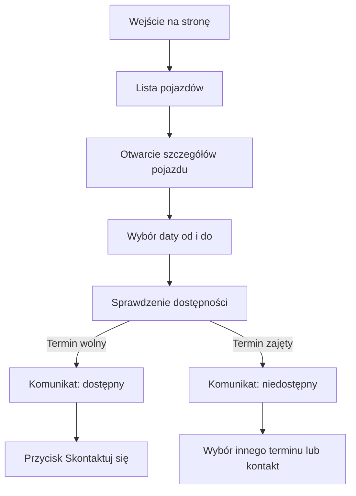
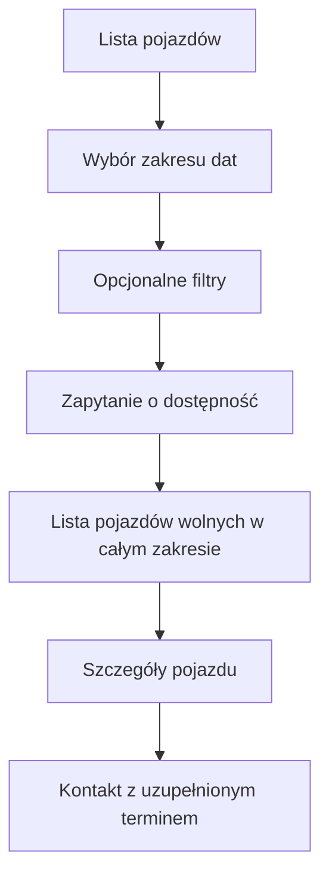
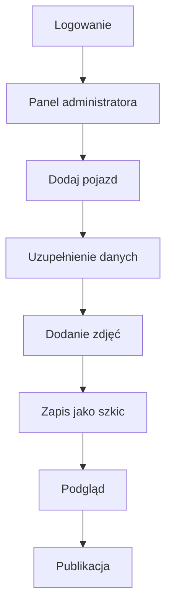
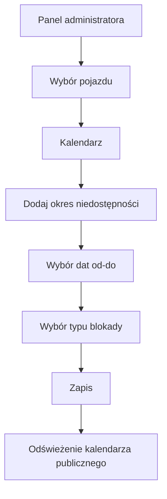
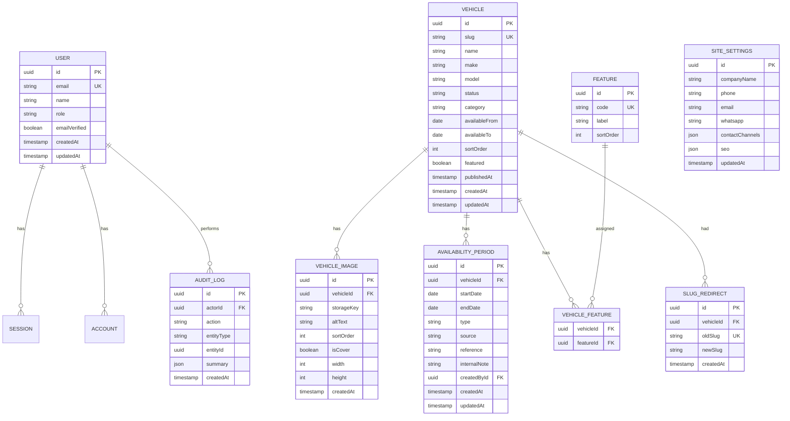
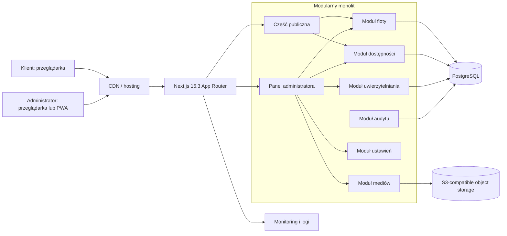

> **Archiwalny kontrakt floty — podległy PRD 3.1.** Poniżej zachowano niezmienioną treść PRD 1.0, wcześniej przechowywaną jako `docs/product/PRD.md`. Nie jest to aktualny samodzielny zakres produktu ani gotowa implementacja.

## Jak używać bazy

- Obowiązujące źródło produktu: [PRD.md](PRD.md), zwłaszcza zatwierdzone U3/U4. Bazowe FR, UC, reguły dat, zdjęć, dostępności i jakości obowiązują tylko w niesprzecznej części i z pierwotnym priorytetem MUST/SHOULD/P1.
- Historyczne dwa obszary, single-tenant, kilka kont administratorów i opcjonalne MFA zostały zastąpione modelem czterech obszarów, superadminem, jedną firmą na konto i obowiązkowym MFA.
- Aktualna interpretacja wszystkich odziedziczonych wymagań: [WYMAGANIA_AUTERVA.md](../WYMAGANIA_AUTERVA.md). Źródło wyglądu: [SPEC](../design/SPEC.md). Stos i wersje są projektem do walidacji, nie stanem instalacji.
- Historyczne oznaczenie „Gotowy do implementacji” poniżej nie zamyka bieżących decyzji i ADR. Pełny opis przy publikacji pozostaje jawną kolizją FR-ADM-032 z §17.3.
- Oryginalna treść i numeracja pozostają niezmienione; źródłowy hash oraz hash pliku z preambułą są zapisane w [source-provenance.json](../source-provenance.json).

---

# PRD — System prezentacji floty i dostępności pojazdów

> **Nazwa robocza produktu:** Auterva
> **Wersja dokumentu:** 1.0  
> **Status:** Gotowy do projektowania i implementacji MVP  
> **Data:** 25 sierpnia 2026  
> **Język aplikacji w MVP:** polski  
> **Rynek początkowy:** Polska  
> **Strefa czasowa:** Europe/Warsaw  
> **Typ rozwiązania:** responsywna aplikacja internetowa dla klienta + panel administratora instalowalny jako PWA

---

## 1. Cel dokumentu

Niniejszy dokument opisuje kompletny zakres produktu, wymagania funkcjonalne i niefunkcjonalne, reguły biznesowe, proponowaną architekturę, model danych, interfejsy, bezpieczeństwo, testy, wdrożenie oraz plan dalszego rozwoju systemu prezentującego flotę pojazdów i ich dostępność.

Dokument ma być źródłem prawdy dla:

- właściciela produktu,
- projektanta UX/UI,
- programisty lub zespołu programistycznego,
- testera,
- administratora infrastruktury,
- przyszłych osób rozwijających system o rezerwacje i płatności.

---

## 2. Streszczenie produktu

System będzie składał się z dwóch logicznych części:

1. **Publicznej strony internetowej dla klienta** — szybkiej, nowoczesnej, responsywnej i dostępnej bez logowania.
2. **Panelu administratora** — dostępnego po zalogowaniu w przeglądarce na komputerze, tablecie i telefonie oraz możliwego do zainstalowania na urządzeniu mobilnym jako PWA.

Klient będzie mógł:

- przeglądać dostępne pojazdy,
- filtrować flotę,
- otwierać szczegóły pojazdu,
- przeglądać kalendarz dostępności,
- sprawdzać dostępność pojazdu dla wybranego zakresu dat,
- skontaktować się z właścicielem floty za pomocą przycisku „Skontaktuj się”.

Administrator będzie mógł:

- logować się do panelu,
- dodawać, edytować, publikować, ukrywać i archiwizować pojazdy,
- zarządzać zdjęciami i opisami,
- dodawać okresy zajętości, rezerwacji, serwisu i innych blokad,
- widzieć automatycznie wyliczane wolne terminy,
- zarządzać danymi kontaktowymi i podstawową treścią strony,
- korzystać z panelu jak z aplikacji zainstalowanej na telefonie.

W MVP **nie będzie** kont klientów, rezerwacji online ani płatności. Architektura ma jednak umożliwić dodanie tych funkcji bez przepisywania całego systemu.

---

## 3. Problem biznesowy

Właściciel floty pojazdów potrzebuje prostego narzędzia, które:

- prezentuje ofertę w profesjonalny sposób,
- ogranicza liczbę telefonów dotyczących oczywiście zajętych terminów,
- umożliwia szybkie aktualizowanie dostępności,
- działa poprawnie na telefonie bez konieczności tworzenia natywnej aplikacji,
- nie wymaga skomplikowanego systemu rezerwacyjnego na pierwszym etapie,
- może w przyszłości zostać rozbudowane o pełny proces sprzedażowy.

Klient potrzebuje natomiast szybkiej odpowiedzi na trzy pytania:

1. Jakie pojazdy są dostępne w ofercie?
2. Czy wybrany pojazd jest wolny w interesującym go terminie?
3. Jak natychmiast skontaktować się z właścicielem?

---

## 4. Wizja produktu

Stworzyć najprostszy możliwy system prezentacji floty, który jest łatwy w obsłudze dla administratora, bardzo szybki dla klienta i stanowi solidną podstawę do przyszłego uruchomienia rezerwacji online.

### 4.1. Główne zasady produktu

1. **Prostota ponad liczbę funkcji.**
2. **Brak logowania po stronie klienta w MVP.**
3. **Dostępność widoczna bez wykonywania rezerwacji.**
4. **Administrator aktualizuje tylko informacje, które rzeczywiście się zmieniają.**
5. **Wolne terminy są wyliczane automatycznie.**
6. **Publiczna strona jest zoptymalizowana pod telefony i wyszukiwarki.**
7. **Panel administratora jest wygodny zarówno na telefonie, jak i komputerze.**
8. **Dane prywatne administratora i powody blokad nigdy nie są ujawniane publicznie.**
9. **Architektura pozostaje prosta — bez mikroserwisów w MVP.**
10. **Każda funkcja powinna mieć uzasadnienie biznesowe.**

---

## 5. Cele produktu

### 5.1. Cele MVP

- umożliwić właścicielowi samodzielne zarządzanie flotą,
- umożliwić zarządzanie dostępnością każdego pojazdu,
- zapewnić klientowi jednoznaczny podgląd terminów wolnych i zajętych,
- umożliwić sprawdzenie zakresu dat jednym działaniem,
- skrócić drogę od zainteresowania pojazdem do kontaktu,
- zapewnić poprawne działanie od małego telefonu po duży monitor,
- umożliwić instalację panelu administratora jako PWA,
- przygotować model danych pod przyszłe rezerwacje i płatności,
- zapewnić podstawowe bezpieczeństwo, kopie zapasowe i audyt zmian.

### 5.2. Cele długoterminowe

- uruchomienie rezerwacji online,
- obsługa płatności i zaliczek,
- automatyczne potwierdzenia e-mail/SMS,
- konta klientów,
- cenniki sezonowe i rabaty,
- umowy oraz dokumenty,
- synchronizacja z zewnętrznymi kalendarzami,
- obsługa wielu oddziałów i wielu administratorów

---

## 6. Zakres MVP

### 6.1. W zakresie MVP

- publiczna strona główna,
- lista pojazdów,
- szczegóły pojazdu,
- podstawowe filtry,
- kalendarz dostępności,
- sprawdzanie zakresu dat,
- przycisk kontaktowy z kontekstem pojazdu i terminu,
- panel logowania administratora,
- panel główny administratora,
- CRUD pojazdów,
- zarządzanie zdjęciami,
- publikowanie i ukrywanie pojazdów,
- okresy niedostępności pojazdu,
- typy blokad: rezerwacja, serwis, blokada administracyjna, inny powód,
- ustawienia danych kontaktowych,
- responsywność,
- PWA panelu administratora,
- rejestr najważniejszych zmian,
- podstawowa analityka i monitoring błędów,
- kopie zapasowe,
- środowisko testowe i produkcyjne.

### 6.2. Poza zakresem MVP

- rezerwowanie pojazdu przez klienta,
- blokowanie terminu przez klienta,
- płatności online,
- zaliczki i kaucje,
- konto klienta,
- panel klienta,
- podpisywanie umów,
- wystawianie faktur,
- automatyczne SMS-y,
- dynamiczne wyliczanie ceny,
- kody rabatowe,
- program lojalnościowy,
- integracja z GPS,
- obsługa szkód,
- harmonogram pracowników,
- aplikacje natywne na Android i iOS,
- praca administratora offline z późniejszą synchronizacją zmian,
- automatyczne importowanie rezerwacji z zewnętrznych systemów.

---

## 7. Role użytkowników

### 7.1. Klient

W MVP klient jest użytkownikiem publicznym i **nie posiada konta**. Rola „klient” oznacza osobę odwiedzającą stronę.

Uprawnienia klienta:

- odczyt opublikowanych pojazdów,
- odczyt publicznych parametrów i zdjęć,
- odczyt zagregowanej dostępności,
- sprawdzanie wybranego terminu,
- przejście do kontaktu,
- odczyt publicznych stron informacyjnych.

Klient nie może:

- zobaczyć danych administratora innych niż publiczne dane firmy,
- zobaczyć prywatnego powodu blokady,
- zobaczyć danych innych klientów,
- modyfikować floty ani kalendarza,
- rezerwować lub tymczasowo blokować terminu w MVP.

### 7.2. Administrator

Administrator jest uwierzytelnionym użytkownikiem zarządzającym systemem.

Uprawnienia administratora:

- pełne zarządzanie pojazdami,
- pełne zarządzanie okresami niedostępności,
- publikowanie i ukrywanie treści,
- zarządzanie zdjęciami,
- zarządzanie danymi kontaktowymi,
- wgląd do dziennika zmian,
- zarządzanie własnym hasłem i sesjami.

### 7.3. Założenie dotyczące liczby administratorów

MVP powinno technicznie obsługiwać więcej niż jednego administratora, nawet jeśli początkowo konto będzie jedno. Publiczna rejestracja administratorów jest wyłączona. Nowe konto może utworzyć wyłącznie uprawniona osoba za pomocą kontrolowanego procesu administracyjnego.

---

## 8. Persony

### 8.1. Klient mobilny

- korzysta głównie z telefonu,
- chce szybko zobaczyć zdjęcia, liczbę miejsc i dostępność,
- nie chce zakładać konta,
- oczekuje możliwości bezpośredniego telefonu lub wiadomości WhatsApp,
- może korzystać ze słabego połączenia mobilnego.

### 8.2. Klient desktopowy

- porównuje kilka pojazdów,
- używa filtrów,
- ogląda większą galerię,
- sprawdza kilka wariantów terminów,
- może przejść do kontaktu e-mailowego.

### 8.3. Właściciel floty / administrator mobilny

- aktualizuje terminy w biegu,
- potrzebuje dużych przycisków i prostego kalendarza,
- chce szybko oznaczyć pojazd jako zajęty,
- może zainstalować panel na ekranie głównym telefonu,
- nie powinien wykonywać skomplikowanych operacji administracyjnych.

### 8.4. Administrator desktopowy

- dodaje pełne opisy i zdjęcia,
- porządkuje flotę,
- planuje blokady z wyprzedzeniem,
- przegląda większy kalendarz całej floty,
- oczekuje szybkiej obsługi klawiaturą.

---

## 9. Najważniejsze decyzje produktowe

### 9.1. Wolne terminy są wyliczane, a nie zapisywane dzień po dniu

System przyjmuje model:

- pojazd jest domyślnie dostępny w swoim okresie aktywności,
- administrator dodaje tylko okresy niedostępności,
- wolne terminy są wynikiem obliczenia: okres aktywności minus blokady.

Administrator nadal widzi w panelu zarówno terminy wolne, jak i zajęte, ale nie musi ręcznie dodawać każdego wolnego dnia.

Korzyści:

- mniej danych,
- mniej pracy administratora,
- brak sprzecznych wpisów „wolny” i „zajęty” dla tego samego dnia,
- łatwiejsza przyszła integracja z rezerwacjami online,
- prostszy i szybszy algorytm dostępności.

### 9.2. Brak szczegółów blokady po stronie publicznej

Publicznie istnieją tylko dwa stany:

- **dostępny**,
- **niedostępny**.

Klient nie widzi, czy termin jest zajęty przez rezerwację, serwis, urlop właściciela czy inną przyczynę.

### 9.3. Sprawdzenie terminu nie jest rezerwacją

Pozytywny wynik sprawdzenia oznacza wyłącznie, że według aktualnych danych systemu pojazd jest dostępny. Termin nie zostaje zablokowany. Interfejs powinien jasno wyświetlać informację:

> Dostępność ma charakter informacyjny i wymaga potwierdzenia przez właściciela.

### 9.4. Jedna aplikacja, dwa obszary

Część publiczna i panel administratora będą działały w jednym projekcie i pod jedną domeną, np.:

- `https://example.pl/` — część publiczna,
- `https://example.pl/admin` — panel administratora.

Pozwala to ograniczyć koszty, uprościć wdrożenie i współdzielić model danych bez tworzenia mikroserwisów.

### 9.5. PWA dotyczy panelu administratora

Manifest aplikacji, punkt startowy i zakres PWA powinny kierować do `/admin`. Publiczna strona pozostaje zwykłą nowoczesną stroną responsywną, chociaż technicznie korzysta z tej samej aplikacji.

---

## 10. Główne przepływy użytkownika

### 10.1. Klient sprawdza dostępność konkretnego pojazdu



### 10.2. Klient wyszukuje pojazdy dostępne w terminie



### 10.3. Administrator dodaje pojazd



### 10.4. Administrator blokuje termin



---

## 11. Architektura informacji i mapa ekranów

### 11.1. Część publiczna

| Ścieżka                 | Ekran                | Cel                                              |
| ----------------------- | -------------------- | ------------------------------------------------ |
| `/`                     | Strona główna        | prezentacja oferty i szybkie przejście do floty  |
| `/pojazdy`              | Lista pojazdów       | wyszukiwanie i porównanie pojazdów               |
| `/pojazdy/[slug]`       | Szczegóły pojazdu    | opis, zdjęcia, wyposażenie, dostępność i kontakt |
| `/kontakt`              | Kontakt              | dane firmy i kanały kontaktowe                   |
| `/polityka-prywatnosci` | Polityka prywatności | informacje o przetwarzaniu danych                |
| `/regulamin`            | Regulamin / zasady   | opcjonalna strona informacyjna                   |
| `/404`                  | Brak strony          | powrót do floty                                  |

### 11.2. Panel administratora

| Ścieżka                         | Ekran                 | Cel                                         |
| ------------------------------- | --------------------- | ------------------------------------------- |
| `/admin/login`                  | Logowanie             | bezpieczny dostęp do panelu                 |
| `/admin`                        | Dashboard             | szybki przegląd floty i najbliższych blokad |
| `/admin/pojazdy`                | Lista pojazdów        | zarządzanie flotą                           |
| `/admin/pojazdy/nowy`           | Nowy pojazd           | dodanie pojazdu                             |
| `/admin/pojazdy/[id]`           | Edycja pojazdu        | dane, zdjęcia, publikacja                   |
| `/admin/pojazdy/[id]/kalendarz` | Kalendarz pojazdu     | zarządzanie dostępnością                    |
| `/admin/kalendarz`              | Kalendarz całej floty | zbiorczy podgląd, funkcja zalecana w MVP    |
| `/admin/ustawienia`             | Ustawienia            | dane firmy, kontakt, wygląd podstawowy      |
| `/admin/konto`                  | Konto                 | hasło, aktywne sesje, wylogowanie           |
| `/admin/logi`                   | Dziennik zmian        | historia istotnych operacji                 |
| `/admin/offline`                | Stan offline PWA      | informacja o braku połączenia               |

---

## 12. Wymagania funkcjonalne — część publiczna

### 12.1. Strona główna

#### FR-PUB-001 — Sekcja główna

System musi wyświetlać:

- nazwę lub logo firmy,
- krótki opis usługi,
- główny przycisk „Zobacz pojazdy”,
- opcjonalny formularz szybkiego sprawdzenia dat,
- wyróżnione pojazdy,
- najważniejsze przewagi oferty,
- skrócone dane kontaktowe.

#### FR-PUB-002 — Wyróżnione pojazdy

Administrator może oznaczyć pojazd jako wyróżniony. Strona główna pokazuje maksymalnie ustaloną liczbę wyróżnionych pojazdów, np. 3–6.

#### FR-PUB-003 — Szybkie sprawdzenie terminu

Użytkownik może wybrać datę początkową i końcową, a następnie przejść do listy pojazdów dostępnych w całym zakresie.

### 12.2. Lista pojazdów

#### FR-PUB-010 — Lista tylko opublikowanych pojazdów

Publiczna lista pokazuje wyłącznie pojazdy o statusie `PUBLISHED`, które nie są zarchiwizowane.

#### FR-PUB-011 — Karta pojazdu

Każda karta pojazdu powinna zawierać co najmniej:

- zdjęcie główne,
- nazwę handlową,
- kategorię,
- liczbę miejsc,
- skrzynię biegów,
- krótki opis lub najważniejsze cechy,
- opcjonalną cenę „od”, jeśli administrator ją poda,
- przycisk „Zobacz szczegóły”,
- status dostępności dla wybranego terminu, jeśli podano daty.

#### FR-PUB-012 — Filtry

Minimalny zestaw filtrów:

- zakres dat,
- kategoria pojazdu,
- minimalna liczba miejsc,
- skrzynia biegów,
- opcjonalnie liczba sztuk / typ nadwozia w przyszłości.

Filtry muszą działać na urządzeniach mobilnych i być dostępne z klawiatury.

#### FR-PUB-013 — Sortowanie

MVP powinno obsługiwać:

- kolejność rekomendowaną ustawioną przez administratora,
- nazwę rosnąco,
- opcjonalnie cenę rosnąco/malejąco, jeśli ceny są używane.

#### FR-PUB-014 — Brak wyników

Gdy nie ma wyników, system wyświetla:

- jasny komunikat,
- możliwość wyczyszczenia filtrów,
- możliwość zmiany terminu,
- przycisk kontaktowy w sprawie alternatywy.

#### FR-PUB-015 — Paginacja lub ładowanie

Dla floty do około 100 pojazdów dopuszczalne jest wyświetlenie całej przefiltrowanej listy. Architektura API musi jednak wspierać paginację na przyszłość.

### 12.3. Szczegóły pojazdu

#### FR-PUB-020 — Galeria

Galeria musi:

- prezentować zdjęcie główne,
- umożliwiać przeglądanie pozostałych zdjęć,
- działać dotykiem i klawiaturą,
- używać tekstów alternatywnych,
- nie ładować wszystkich dużych plików od razu.

#### FR-PUB-021 — Informacje podstawowe

Widok powinien zawierać:

- markę i model lub nazwę handlową,
- rok produkcji, jeśli podany,
- typ/kategorię,
- liczbę miejsc,
- liczbę drzwi, jeśli dotyczy,
- skrzynię biegów,
- rodzaj paliwa lub napędu,
- pojemność bagażową opisaną tekstowo lub liczbowo,
- wyposażenie,
- pełny opis,
- opcjonalne warunki dodatkowe.

#### FR-PUB-022 — Cena

Cena jest polem opcjonalnym. Jeżeli administrator jej nie poda lub wyłączy prezentację cen, interfejs nie może pokazywać pustej sekcji ani wartości „0 zł”.

Możliwe formaty:

- „od 250 zł / doba”,
- „wycena indywidualna”,
- brak ceny.

Cena w MVP ma charakter informacyjny i nie jest używana do automatycznego rozliczenia.

#### FR-PUB-023 — Kalendarz dostępności

Kalendarz powinien:

- pokazywać co najmniej bieżący i następny miesiąc,
- umożliwiać nawigację do kolejnych miesięcy,
- odróżniać dni dostępne i niedostępne,
- nie opierać informacji wyłącznie na kolorze,
- zawierać legendę,
- blokować wybór dat przeszłych,
- być czytelny na telefonie,
- nie ujawniać typu ani powodu blokady.

#### FR-PUB-024 — Sprawdzenie zakresu dat

Użytkownik wybiera:

- datę „od”,
- datę „do”.

System sprawdza, czy:

- daty są poprawne,
- data końcowa nie jest wcześniejsza niż początkowa,
- cały zakres mieści się w okresie aktywności pojazdu,
- żaden dzień zakresu nie przecina okresu niedostępności.

#### FR-PUB-025 — Wynik pozytywny

Po pozytywnym sprawdzeniu system pokazuje:

- komunikat „Pojazd jest dostępny w wybranym terminie”,
- nazwę pojazdu,
- wybrany zakres dat,
- informację, że dostępność wymaga potwierdzenia,
- wyraźny przycisk „Skontaktuj się”.

#### FR-PUB-026 — Wynik negatywny

Po negatywnym sprawdzeniu system pokazuje:

- komunikat „Pojazd nie jest dostępny w całym wybranym terminie”,
- możliwość zmiany dat,
- powrót do pojazdów dostępnych w tym terminie,
- opcjonalny kontakt w sprawie alternatywy.

System nie podaje publicznie dokładnej przyczyny niedostępności.

### 12.4. Kontakt

#### FR-PUB-030 — Konfigurowalne kanały kontaktu

Administrator może skonfigurować:

- numer telefonu,
- adres e-mail,
- numer lub link WhatsApp,
- opcjonalnie Messenger lub inny kanał,
- preferowany kanał domyślny.

#### FR-PUB-031 — Przycisk „Skontaktuj się”

Przycisk powinien otwierać panel lub listę dostępnych kanałów. Na telefonie priorytetem mogą być telefon i WhatsApp, a na komputerze telefon, e-mail i kopiowanie danych.

#### FR-PUB-032 — Wiadomość z kontekstem

Jeśli klient wybrał pojazd i termin, system przygotowuje treść wiadomości, np.:

> Dzień dobry, interesuje mnie pojazd [NAZWA] w terminie [DATA OD]–[DATA DO]. Czy dostępność jest aktualna?

#### FR-PUB-033 — Brak zapisu danych klienta w MVP

Samo użycie linku telefonicznego, WhatsApp lub e-mail nie tworzy rekordu klienta w bazie systemu. Formularz kontaktowy zapisujący dane nie jest wymagany w MVP.

### 12.5. Strony informacyjne

#### FR-PUB-040 — Kontakt

Strona kontaktowa zawiera dane ustawione przez administratora, godziny kontaktu, opcjonalną mapę oraz przyciski kanałów kontaktowych.

#### FR-PUB-041 — Polityka prywatności

System musi mieć możliwość opublikowania treści polityki prywatności. Treść powinna zostać przygotowana lub zatwierdzona przez osobę odpowiedzialną prawnie za działalność.

#### FR-PUB-042 — Regulamin / zasady wynajmu

Strona jest opcjonalna w MVP, ale system powinien umożliwić dodanie linku do regulaminu lub podstawowych zasad wynajmu.

---

## 13. Wymagania funkcjonalne — panel administratora

### 13.1. Uwierzytelnianie

#### FR-ADM-001 — Logowanie

Administrator loguje się adresem e-mail i hasłem.

#### FR-ADM-002 — Brak publicznej rejestracji

Ekran logowania nie może zawierać otwartej rejestracji administratora.

#### FR-ADM-003 — Bezpieczna sesja

Po poprawnym logowaniu system tworzy bezpieczną sesję. Sesja może być unieważniona po wylogowaniu, zmianie hasła lub ręcznym zakończeniu sesji z poziomu konta.

#### FR-ADM-004 — Niepoprawne logowanie

System pokazuje neutralny komunikat, który nie potwierdza, czy podany adres e-mail istnieje.

#### FR-ADM-005 — Ograniczenie prób

Po serii niepoprawnych prób system stosuje ograniczenie częstotliwości, opóźnienie lub dodatkową weryfikację.

#### FR-ADM-006 — Reset hasła

Reset hasła przez e-mail jest funkcją zalecaną w MVP. Jeżeli nie zostanie wdrożony w pierwszej wersji, musi istnieć udokumentowana, bezpieczna procedura ręcznego odzyskania dostępu.

#### FR-ADM-007 — Uwierzytelnianie dwuskładnikowe

2FA jest wymaganiem priorytetu P1, możliwym do wdrożenia bez zmiany modelu aplikacji. Dla pojedynczego właściciela floty może zostać uruchomione tuż po stabilizacji MVP.

### 13.2. Dashboard

#### FR-ADM-010 — Podsumowanie

Dashboard pokazuje co najmniej:

- liczbę wszystkich aktywnych pojazdów,
- liczbę pojazdów opublikowanych,
- liczbę pojazdów niedostępnych dzisiaj,
- najbliższe okresy niedostępności,
- skróty „Dodaj pojazd” i „Dodaj blokadę”.

#### FR-ADM-011 — Ostrzeżenia jakości danych

System może pokazywać ostrzeżenia:

- pojazd bez zdjęcia głównego,
- pojazd bez opisu,
- szkic nieopublikowany,
- brak numeru telefonu lub innego kanału kontaktu,
- błąd synchronizacji lub publikacji.

### 13.3. Lista pojazdów

#### FR-ADM-020 — Tabela lub karty

Na komputerze preferowana jest tabela, a na telefonie responsywne karty. Każdy element pokazuje:

- miniaturę,
- nazwę,
- status publikacji,
- aktualny status dostępności,
- datę ostatniej zmiany,
- szybkie akcje.

#### FR-ADM-021 — Wyszukiwanie i filtrowanie

Administrator może wyszukać po nazwie i filtrować według:

- statusu publikacji,
- kategorii,
- aktywności,
- bieżącej dostępności.

#### FR-ADM-022 — Kolejność prezentacji

Administrator może ustawić kolejność pojazdów na publicznej liście, np. liczbą porządkową lub przeciąganiem.

### 13.4. Dodawanie i edycja pojazdu

#### FR-ADM-030 — Pola podstawowe

Formularz powinien obsługiwać:

- nazwę handlową,
- markę,
- model,
- wariant,
- kategorię,
- rok produkcji,
- krótki opis,
- pełny opis,
- liczbę miejsc,
- liczbę drzwi,
- skrzynię biegów,
- paliwo/napęd,
- kolor,
- pojemność bagażową,
- wyposażenie,
- opcjonalną cenę „od”,
- jednostkę ceny,
- datę rozpoczęcia dostępności,
- opcjonalną datę zakończenia dostępności,
- kolejność,
- wyróżnienie,
- status publikacji.

#### FR-ADM-031 — Statusy pojazdu

Rekomendowane statusy:

- `DRAFT` — szkic, niewidoczny publicznie,
- `PUBLISHED` — widoczny publicznie,
- `UNPUBLISHED` — tymczasowo ukryty,
- `ARCHIVED` — wycofany z aktywnej floty.

Archiwizacja jest preferowana zamiast trwałego usuwania pojazdu, który ma historię blokad.

#### FR-ADM-032 — Walidacja

System musi walidować dane po stronie interfejsu i serwera. Minimalne wymagania do publikacji:

- nazwa,
- unikalny slug,
- kategoria,
- krótki opis,
- co najmniej jedno zdjęcie,
- zdjęcie główne,
- liczba miejsc, jeżeli dotyczy kategorii,
- poprawny okres aktywności.

#### FR-ADM-033 — Szkic i publikacja

Administrator może zapisać niekompletny formularz jako szkic. Publikacja wymaga spełnienia walidacji publikacyjnej.

#### FR-ADM-034 — Podgląd

Administrator może otworzyć podgląd nieopublikowanego pojazdu w chronionym trybie podglądu.

#### FR-ADM-035 — Slug

Slug jest generowany z nazwy, ale może być edytowany. Po publikacji zmiana slugu powinna tworzyć przekierowanie ze starego adresu albo wymagać świadomego potwierdzenia.

### 13.5. Zdjęcia

#### FR-ADM-040 — Dodawanie zdjęć

Administrator może dodać wiele zdjęć jednocześnie.

#### FR-ADM-041 — Ograniczenia plików

Akceptowane formaty wejściowe:

- JPEG,
- PNG,
- WebP,
- opcjonalnie HEIC po stronie serwera, jeśli wdrożona zostanie konwersja.

System musi odrzucać pliki niezgodne z deklarowanym typem, zbyt duże lub potencjalnie niebezpieczne.

#### FR-ADM-042 — Optymalizacja

Po dodaniu zdjęcia system tworzy warianty zoptymalizowane do wyświetlania. Oryginał może być przechowywany opcjonalnie.

#### FR-ADM-043 — Zdjęcie główne

Dokładnie jedno zdjęcie pojazdu może być oznaczone jako główne.

#### FR-ADM-044 — Kolejność

Administrator może zmieniać kolejność zdjęć.

#### FR-ADM-045 — Tekst alternatywny

System proponuje domyślny tekst alternatywny na podstawie nazwy pojazdu, ale administrator może go poprawić.

#### FR-ADM-046 — Usuwanie

Usunięcie zdjęcia wymaga potwierdzenia. Nie można usunąć jedynego zdjęcia głównego opublikowanego pojazdu bez wskazania zamiennika lub cofnięcia publikacji.

### 13.6. Kalendarz i okresy niedostępności

#### FR-ADM-050 — Widok kalendarza pojazdu

Administrator widzi:

- dni wolne,
- dni niedostępne,
- typ blokady,
- początek i koniec blokady,
- prywatną notatkę,
- źródło blokady.

#### FR-ADM-051 — Dodanie blokady

Formularz zawiera:

- pojazd,
- datę od,
- datę do,
- typ,
- opcjonalny numer referencyjny,
- prywatną notatkę.

#### FR-ADM-052 — Typy blokady

Minimalne typy:

- `RESERVED` — rezerwacja przyjęta poza systemem,
- `MAINTENANCE` — serwis lub naprawa,
- `BLOCKED` — blokada administracyjna,
- `OTHER` — inny powód.

Wszystkie powyższe typy są publicznie prezentowane identycznie jako „niedostępny”.

#### FR-ADM-053 — Zakres całodniowy

MVP działa na pełnych dniach, bez godzin odbioru i zwrotu. Data końcowa w interfejsie jest traktowana jako dzień objęty niedostępnością.

Przykład: blokada od 10 do 12 września obejmuje 10, 11 i 12 września.

#### FR-ADM-054 — Edycja i usuwanie

Administrator może edytować i usuwać ręczne blokady. Każda operacja zapisuje się w dzienniku zmian.

#### FR-ADM-055 — Nakładające się okresy

System nie powinien tworzyć dwóch nakładających się blokad dla tego samego pojazdu. Przy próbie zapisu:

- pokazuje istniejący konflikt,
- pozwala anulować,
- umożliwia przejście do edycji istniejącej blokady,
- opcjonalnie proponuje scalenie okresów tego samego typu.

#### FR-ADM-056 — Szybka blokada z telefonu

Na telefonie administrator powinien móc dodać blokadę w maksymalnie kilku krokach:

1. wybór pojazdu,
2. wybór zakresu dat,
3. wybór typu,
4. zapis.

#### FR-ADM-057 — Zbiorczy kalendarz floty

Widok zbiorczy pokazuje pojazdy w wierszach i dni lub tygodnie w kolumnach. Na małym ekranie może zostać zastąpiony listą pojazdów z podsumowaniem.

#### FR-ADM-058 — Automatyczne odświeżenie publicznej strony

Po dodaniu, edycji lub usunięciu blokady publiczny kalendarz i wyniki sprawdzania dostępności muszą zostać unieważnione w cache i odświeżone.

### 13.7. Ustawienia

#### FR-ADM-060 — Dane firmy

Administrator może ustawić:

- nazwę firmy,
- logo,
- krótki opis,
- adres,
- obszar działania,
- godziny kontaktu.

#### FR-ADM-061 — Kontakt

Administrator może zarządzać numerem telefonu, e-mailem, WhatsApp i innymi dozwolonymi kanałami.

#### FR-ADM-062 — Ustawienia prezentacji

Administrator może ustawić:

- domyślny tytuł SEO,
- opis SEO,
- liczbę wyróżnionych pojazdów,
- widoczność cen,
- domyślny kanał kontaktu,
- tekst zastrzeżenia dotyczącego dostępności.

#### FR-ADM-063 — Treści prawne

System umożliwia zapis treści lub linków do polityki prywatności i regulaminu.

### 13.8. Dziennik zmian

#### FR-ADM-070 — Rejestrowane zdarzenia

Dziennik powinien obejmować co najmniej:

- logowanie i wylogowanie,
- utworzenie i zmianę pojazdu,
- publikację, ukrycie i archiwizację,
- dodanie, zmianę i usunięcie blokady,
- zmianę ustawień kontaktowych,
- zmianę hasła,
- zakończenie sesji.

#### FR-ADM-071 — Dane wpisu

Wpis zawiera:

- czas w UTC,
- administratora,
- typ akcji,
- typ i identyfikator obiektu,
- bezpieczne podsumowanie zmiany,
- adres IP lub skróconą informację techniczną, jeśli jest to uzasadnione i zgodne z polityką retencji.

Dziennik nie powinien przechowywać haseł, tokenów ani pełnych sekretów.

### 13.9. Konto administratora

#### FR-ADM-080 — Zmiana hasła

Zmiana hasła wymaga podania aktualnego hasła lub ponownego uwierzytelnienia.

#### FR-ADM-081 — Aktywne sesje

Administrator może zobaczyć aktywne sesje i zakończyć pozostałe sesje.

#### FR-ADM-082 — Wylogowanie

Wylogowanie unieważnia bieżącą sesję i kieruje do ekranu logowania.

---

## 14. Wymagania funkcjonalne — PWA administratora

### 14.1. Instalowalność

#### FR-PWA-001

Panel administratora musi mieć osobny manifest PWA z:

- nazwą aplikacji,
- krótką nazwą,
- ikonami 192×192 i 512×512,
- ikoną maskowalną,
- kolorem motywu,
- kolorem tła,
- `display: standalone`,
- `start_url: /admin`,
- zakresem obejmującym panel administratora.

### 14.2. HTTPS

#### FR-PWA-002

PWA działa produkcyjnie wyłącznie przez HTTPS.

### 14.3. Zachowanie po uruchomieniu

#### FR-PWA-003

Po uruchomieniu z ikony użytkownik trafia:

- do dashboardu, jeśli ma ważną sesję,
- do logowania, jeśli sesja wygasła.

### 14.4. Tryb offline

#### FR-PWA-004

MVP nie obsługuje zapisywania zmian offline. Przy braku sieci:

- aplikacja pokazuje czytelny ekran offline,
- może wyświetlić wcześniej zapisany szkielet interfejsu,
- nie pozwala udawać, że zapis danych zakończył się sukcesem,
- formularze zapisu są wyłączone lub kończą się kontrolowanym komunikatem.

### 14.5. Aktualizacja aplikacji

#### FR-PWA-005

Gdy dostępna jest nowa wersja service workera, użytkownik powinien otrzymać komunikat umożliwiający bezpieczne odświeżenie aplikacji. Aktualizacja nie może utracić niezapisanych danych formularza.

### 14.6. Powiadomienia push

Powiadomienia push są poza zakresem MVP. Architektura nie powinna jednak ich blokować w przyszłości.

---

## 15. Reguły biznesowe dostępności

### 15.1. Definicje

- **Zakres żądany** — daty wybrane przez klienta.
- **Okres aktywności pojazdu** — przedział, w którym pojazd może być oferowany.
- **Blokada** — okres, w którym pojazd jest niedostępny.
- **Dostępny** — cały żądany zakres mieści się w okresie aktywności i nie przecina żadnej blokady.
- **Niedostępny** — co najmniej jeden dzień żądanego zakresu wypada poza aktywnością lub przecina blokadę.

### 15.2. Reguła podstawowa

Dla zakresów domkniętych datami:

```text
pojazd jest dostępny,
jeżeli requestedStart >= vehicle.availableFrom
oraz requestedEnd <= vehicle.availableTo (jeśli availableTo istnieje)
oraz nie istnieje blokada, dla której:
block.startDate <= requestedEnd
oraz block.endDate >= requestedStart
```

### 15.3. Daty przeszłe

Klient nie może wybierać dat wcześniejszych niż bieżąca data w strefie `Europe/Warsaw`.

Administrator może zobaczyć historię, ale przy dodawaniu blokady w przeszłości system powinien wyświetlić ostrzeżenie.

### 15.4. Jeden dzień

Zakres z identyczną datą początkową i końcową jest prawidłowy i oznacza sprawdzenie jednego dnia.

### 15.5. Brak daty końcowej aktywności

Brak `availableTo` oznacza brak zdefiniowanej daty końcowej. Interfejs publiczny może ograniczać nawigację kalendarza do rozsądnego horyzontu, np. 18–24 miesięcy.

### 15.6. Status pojazdu a dostępność

Pojazd musi być `PUBLISHED`, aby pojawić się publicznie. Nawet jeśli ma wolny termin, pojazd w szkicu, ukryty lub zarchiwizowany nie jest dostępny na stronie klienta.

### 15.7. Blokada całego pojazdu bez okresu

Doraźne wycofanie pojazdu z oferty powinno odbywać się przez status `UNPUBLISHED` lub `ARCHIVED`, a nie przez tworzenie nieskończonej blokady.

### 15.8. Jednoczesne zmiany

Każda operacja sprawdzająca lub modyfikująca dostępność musi korzystać z aktualnego stanu bazy. W przyszłym systemie rezerwacji ostateczna blokada będzie tworzona transakcyjnie, aby wyeliminować podwójną rezerwację.

### 15.9. Prywatność

Pola `type`, `internalNote`, `reference` i dane techniczne blokady są dostępne tylko administratorowi. Publiczne API zwraca wyłącznie informację, czy dany dzień lub zakres jest dostępny.

---

## 16. Przypadki użycia i kryteria akceptacji

### UC-01 — Wyświetlenie opublikowanego pojazdu

**Warunki początkowe:** pojazd ma status `PUBLISHED` i spełnia wymagania publikacyjne.  
**Działanie:** klient otwiera listę pojazdów.  
**Oczekiwany rezultat:** pojazd jest widoczny z poprawnym zdjęciem, nazwą i podstawowymi parametrami.

### UC-02 — Ukrycie pojazdu

**Działanie:** administrator zmienia status na `UNPUBLISHED`.  
**Oczekiwany rezultat:** pojazd znika z publicznej listy i bezpośredni adres zwraca kontrolowany brak dostępności lub 404; panel nadal przechowuje dane.

### UC-03 — Wolny termin

**Dane:** pojazd aktywny od 1 września; brak blokad 10–12 września.  
**Działanie:** klient sprawdza 10–12 września.  
**Oczekiwany rezultat:** status dostępny i aktywny przycisk kontaktu z uzupełnionym kontekstem.

### UC-04 — Termin przecinający blokadę

**Dane:** blokada 11–13 września.  
**Działanie:** klient sprawdza 10–12 września.  
**Oczekiwany rezultat:** status niedostępny, bez ujawnienia przyczyny.

### UC-05 — Termin stykający się z blokadą

**Dane:** blokada obejmuje 10–12 września włącznie.  
**Działanie:** klient sprawdza 12 września.  
**Oczekiwany rezultat:** niedostępny.  
**Działanie:** klient sprawdza 13 września.  
**Oczekiwany rezultat:** dostępny, o ile nie ma innej blokady.

### UC-06 — Konflikt okresów administratora

**Dane:** istnieje blokada 10–12 września.  
**Działanie:** administrator próbuje dodać 11–15 września.  
**Oczekiwany rezultat:** zapis jest zatrzymany, a system wskazuje konflikt i istniejący wpis.

### UC-07 — Dodanie pojazdu bez zdjęcia

**Działanie:** administrator zapisuje pojazd bez zdjęcia jako szkic.  
**Oczekiwany rezultat:** zapis szkicu jest możliwy.  
**Działanie:** administrator próbuje publikować.  
**Oczekiwany rezultat:** publikacja jest zablokowana z jasnym komunikatem.

### UC-08 — Brak sieci w PWA

**Działanie:** administrator otwiera zainstalowaną aplikację bez połączenia.  
**Oczekiwany rezultat:** widzi ekran offline; system nie potwierdza fikcyjnego zapisu.

### UC-09 — Nieuprawniony dostęp

**Działanie:** niezalogowany użytkownik otwiera `/admin/pojazdy`.  
**Oczekiwany rezultat:** przekierowanie do logowania; dane administracyjne nie są zwracane w HTML ani API.

### UC-10 — Aktualizacja blokady i cache

**Działanie:** administrator dodaje blokadę na aktualnie wolny termin.  
**Oczekiwany rezultat:** po zakończonym zapisie publiczne sprawdzenie tego terminu zwraca „niedostępny” bez oczekiwania na ręczne czyszczenie cache.

---

## 17. Model danych

### 17.1. Założenia modelu

- identyfikatory biznesowe są niezależne od nazw i adresów URL,
- podstawowym identyfikatorem rekordów jest UUID,
- daty dostępności są przechowywane jako typ `DATE`, bez godziny,
- znaczniki czasu audytowe są przechowywane w UTC jako `TIMESTAMPTZ`,
- interfejs prezentuje daty w strefie `Europe/Warsaw`,
- rekordy historyczne są archiwizowane zamiast usuwane, gdy mogą mieć znaczenie audytowe,
- dane uwierzytelniania są oddzielone od danych domenowych floty,
- przyszła rezerwacja będzie osobną encją, a nie rozbudową prywatnej notatki w blokadzie.

### 17.2. Diagram encji



### 17.3. Encja `Vehicle`

| Pole                 | Typ                |       Wymagane        | Opis                                    |
| -------------------- | ------------------ | :-------------------: | --------------------------------------- |
| `id`                 | UUID               |          tak          | niezmienny identyfikator                |
| `slug`               | string             |          tak          | unikalny adres publiczny                |
| `name`               | string             |          tak          | nazwa handlowa wyświetlana klientowi    |
| `make`               | string             |          nie          | marka                                   |
| `model`              | string             |          nie          | model                                   |
| `variant`            | string             |          nie          | wariant/wersja                          |
| `year`               | smallint           |          nie          | rok produkcji                           |
| `category`           | enum               |          tak          | np. osobowy, bus, van, premium          |
| `shortDescription`   | string             |   tak do publikacji   | tekst na karcie                         |
| `description`        | text               |   tak do publikacji   | pełny opis                              |
| `seats`              | smallint           | zależnie od kategorii | liczba miejsc                           |
| `doors`              | smallint           |          nie          | liczba drzwi                            |
| `transmission`       | enum               |          nie          | manualna/automatyczna                   |
| `fuelType`           | enum               |          nie          | benzyna/diesel/hybryda/EV/inne          |
| `color`              | string             |          nie          | kolor                                   |
| `luggageDescription` | string             |          nie          | opis pojemności bagażowej               |
| `priceFrom`          | decimal            |          nie          | cena informacyjna                       |
| `priceUnit`          | enum               |          nie          | doba, dzień, wycena                     |
| `status`             | enum               |          tak          | DRAFT/PUBLISHED/UNPUBLISHED/ARCHIVED    |
| `featured`           | boolean            |          tak          | wyróżnienie na stronie głównej          |
| `sortOrder`          | integer            |          tak          | kolejność publiczna                     |
| `availableFrom`      | date               |          tak          | początek okresu aktywności              |
| `availableTo`        | date nullable      |          nie          | koniec okresu aktywności                |
| `publishedAt`        | timestamp nullable |          nie          | pierwsza lub ostatnia publikacja        |
| `createdAt`          | timestamp          |          tak          | utworzenie                              |
| `updatedAt`          | timestamp          |          tak          | ostatnia modyfikacja                    |
| `version`            | integer            |          tak          | opcjonalna kontrola równoczesnej edycji |

### 17.4. Encja `VehicleImage`

| Pole         | Typ                   |      Wymagane       | Opis                                 |
| ------------ | --------------------- | :-----------------: | ------------------------------------ |
| `id`         | UUID                  |         tak         | identyfikator                        |
| `vehicleId`  | UUID                  |         tak         | pojazd                               |
| `storageKey` | string                |         tak         | klucz obiektu w storage              |
| `publicUrl`  | string lub generowane | zależnie od storage | adres CDN lub sposób jego wyliczenia |
| `altText`    | string                |         tak         | tekst alternatywny                   |
| `sortOrder`  | integer               |         tak         | kolejność                            |
| `isCover`    | boolean               |         tak         | zdjęcie główne                       |
| `mimeType`   | string                |         tak         | zweryfikowany typ                    |
| `width`      | integer               |         tak         | szerokość                            |
| `height`     | integer               |         tak         | wysokość                             |
| `sizeBytes`  | integer               |         tak         | rozmiar                              |
| `createdAt`  | timestamp             |         tak         | data dodania                         |

### 17.5. Encja `AvailabilityPeriod`

| Pole           | Typ       | Wymagane | Opis                                         |
| -------------- | --------- | :------: | -------------------------------------------- |
| `id`           | UUID      |   tak    | identyfikator                                |
| `vehicleId`    | UUID      |   tak    | pojazd                                       |
| `startDate`    | date      |   tak    | pierwszy niedostępny dzień                   |
| `endDate`      | date      |   tak    | ostatni niedostępny dzień                    |
| `type`         | enum      |   tak    | RESERVED/MAINTENANCE/BLOCKED/OTHER           |
| `source`       | enum      |   tak    | MANUAL, w przyszłości BOOKING/IMPORT         |
| `reference`    | string    |   nie    | numer lub neutralny identyfikator wewnętrzny |
| `internalNote` | text      |   nie    | prywatna notatka                             |
| `createdById`  | UUID      |   tak    | administrator tworzący wpis                  |
| `updatedById`  | UUID      |   nie    | administrator aktualizujący                  |
| `createdAt`    | timestamp |   tak    | utworzenie                                   |
| `updatedAt`    | timestamp |   tak    | modyfikacja                                  |

### 17.6. Encje uwierzytelniania

Better Auth korzysta z tabel użytkowników, sesji, kont i weryfikacji. Model powinien umożliwiać:

- sesje bazodanowe,
- unieważnianie pojedynczych i wszystkich sesji,
- reset hasła,
- przyszłe 2FA,
- rolę `ADMIN` zapisaną po stronie serwera,
- brak publicznej rejestracji.

### 17.7. Encja `SiteSettings`

Rekomendowany jest pojedynczy rekord ustawień obejmujący:

- nazwę firmy,
- logo,
- dane kontaktowe,
- adres i godziny kontaktu,
- kanały kontaktowe,
- domyślne metadane SEO,
- ustawienia cen,
- liczbę wyróżnionych pojazdów,
- tekst zastrzeżenia dostępności,
- linki lub treści prawne,
- podstawowe ustawienia wizualne.

Dla większej elastyczności część pól może być przechowywana w ustrukturyzowanym JSON, ale kluczowe dane kontaktowe powinny mieć typowane kolumny.

### 17.8. Encja `AuditLog`

Dziennik zmian powinien być tylko dopisywany. Aktualizacja lub kasowanie wpisów przez standardowy panel nie jest dozwolone.

`summary` zawiera bezpieczne podsumowanie zmiany, np. listę zmienionych pól, ale nie pełną kopię sekretów czy haseł.

### 17.9. Ograniczenia i indeksy

Wymagane:

- unikalny indeks na `Vehicle.slug`,
- indeks na `Vehicle.status`, `featured`, `sortOrder`,
- indeks na `AvailabilityPeriod(vehicleId, startDate, endDate)`,
- ograniczenie `startDate <= endDate`,
- ograniczenie poprawności `availableFrom <= availableTo`, jeśli `availableTo` istnieje,
- dokładnie jedno zdjęcie główne dla pojazdu — egzekwowane transakcją i walidacją,
- unikalna para `VehicleFeature(vehicleId, featureId)`,
- indeks na `AuditLog(createdAt, actorId)`,
- unikalny indeks na `SlugRedirect.oldSlug`.

Nakładanie okresów powinno być blokowane na poziomie logiki domenowej w transakcji. Zalecane jest dodatkowe zabezpieczenie bazodanowe w PostgreSQL, np. constraint wykorzystujący zakresy dat, szczególnie przed uruchomieniem rezerwacji online.

### 17.10. Retencja i usuwanie

- pojazdy z historią są archiwizowane,
- zdjęcia usunięte logicznie mogą być fizycznie kasowane z opóźnieniem,
- ręczne blokady można usuwać, ale operacja pozostaje w audycie,
- logi bezpieczeństwa mają zdefiniowaną retencję, np. 90–365 dni zależnie od potrzeb,
- dane niepotrzebne nie powinny być przechowywane bezterminowo.

---

## 18. Kontrakt API

### 18.1. Zasady ogólne

- publiczne odczyty mogą korzystać z Route Handlers lub bezpośredniego pobierania danych w Server Components,
- operacje administratora mogą używać Server Functions/Server Actions, ale powinny mieć jasno wydzieloną warstwę usług domenowych,
- autoryzacja jest sprawdzana po stronie serwera dla każdej operacji administracyjnej,
- wejścia są walidowane schematami Zod,
- błędy mają stabilne kody,
- wewnętrzne szczegóły wyjątku nie są zwracane klientowi,
- przyszłe publiczne API integracyjne powinno zostać wersjonowane, np. `/api/v1`.

### 18.2. Publiczne operacje odczytu

| Metoda | Ścieżka                                        | Cel                                                |
| ------ | ---------------------------------------------- | -------------------------------------------------- |
| `GET`  | `/api/public/vehicles`                         | lista opublikowanych pojazdów z filtrami           |
| `GET`  | `/api/public/vehicles/[slug]`                  | szczegóły publiczne pojazdu                        |
| `GET`  | `/api/public/vehicles/[id]/calendar?from=&to=` | status dni w zakresie                              |
| `POST` | `/api/public/availability/check`               | sprawdzenie jednego lub wielu pojazdów dla zakresu |
| `GET`  | `/api/public/settings`                         | wyłącznie publiczne ustawienia firmy               |

### 18.3. Przykładowe żądanie sprawdzenia dostępności

```json
{
  "vehicleIds": ["uuid-1", "uuid-2"],
  "startDate": "2026-09-10",
  "endDate": "2026-09-12"
}
```

### 18.4. Przykładowa odpowiedź

```json
{
  "data": [
    {
      "vehicleId": "uuid-1",
      "available": true
    },
    {
      "vehicleId": "uuid-2",
      "available": false
    }
  ],
  "checkedRange": {
    "startDate": "2026-09-10",
    "endDate": "2026-09-12"
  },
  "disclaimer": "Dostępność wymaga potwierdzenia."
}
```

Odpowiedź publiczna nie zawiera typu blokady, notatki ani numeru referencyjnego.

### 18.5. Operacje administratora

| Metoda   | Ścieżka                                 | Cel                                    |
| -------- | --------------------------------------- | -------------------------------------- |
| `POST`   | `/api/admin/vehicles`                   | utworzenie pojazdu                     |
| `PATCH`  | `/api/admin/vehicles/[id]`              | edycja pojazdu                         |
| `POST`   | `/api/admin/vehicles/[id]/publish`      | publikacja                             |
| `POST`   | `/api/admin/vehicles/[id]/unpublish`    | ukrycie                                |
| `POST`   | `/api/admin/vehicles/[id]/archive`      | archiwizacja                           |
| `POST`   | `/api/admin/vehicles/[id]/images`       | inicjacja uploadu lub zapis metadanych |
| `PATCH`  | `/api/admin/vehicles/[id]/images/order` | kolejność zdjęć                        |
| `DELETE` | `/api/admin/images/[imageId]`           | usunięcie zdjęcia                      |
| `GET`    | `/api/admin/vehicles/[id]/availability` | pełne okresy administratora            |
| `POST`   | `/api/admin/vehicles/[id]/availability` | dodanie blokady                        |
| `PATCH`  | `/api/admin/availability/[periodId]`    | edycja blokady                         |
| `DELETE` | `/api/admin/availability/[periodId]`    | usunięcie blokady                      |
| `GET`    | `/api/admin/settings`                   | odczyt ustawień                        |
| `PATCH`  | `/api/admin/settings`                   | zmiana ustawień                        |
| `GET`    | `/api/admin/audit-logs`                 | odczyt logów                           |

Powyższe ścieżki opisują kontrakt logiczny. Implementacja może część operacji realizować za pomocą Server Actions, pod warunkiem zachowania tej samej separacji i walidacji.

### 18.6. Format błędu

```json
{
  "error": {
    "code": "AVAILABILITY_CONFLICT",
    "message": "Wybrany okres koliduje z istniejącą blokadą.",
    "fieldErrors": {
      "startDate": ["Zakres przecina istniejący okres 2026-09-10–2026-09-12."]
    },
    "requestId": "request-uuid"
  }
}
```

### 18.7. Kody błędów domenowych

- `VALIDATION_ERROR`,
- `UNAUTHENTICATED`,
- `FORBIDDEN`,
- `VEHICLE_NOT_FOUND`,
- `VEHICLE_NOT_PUBLISHED`,
- `AVAILABILITY_CONFLICT`,
- `INVALID_DATE_RANGE`,
- `DATE_OUTSIDE_VEHICLE_WINDOW`,
- `IMAGE_UPLOAD_FAILED`,
- `PUBLISHING_REQUIREMENTS_NOT_MET`,
- `RATE_LIMITED`,
- `INTERNAL_ERROR`.

### 18.8. Ograniczenie ruchu

Publiczne endpointy sprawdzające dostępność powinny mieć:

- ograniczenie liczby żądań na adres/IP lub inną bezpieczną jednostkę,
- maksymalny dopuszczalny zakres dat,
- maksymalną liczbę pojazdów w jednym żądaniu,
- ochronę przed kosztownymi, automatycznymi zapytaniami.

---

## 19. Proponowana architektura systemu

### 19.1. Styl architektury

**Modularny monolit** w jednej aplikacji Next.js.

Nie należy tworzyć mikroserwisów w MVP, ponieważ:

- domena jest niewielka,
- jeden zespół może utrzymywać całość,
- transakcje dotyczą jednej bazy,
- wdrożenie i monitoring są prostsze,
- koszt infrastruktury jest niższy,
- przyszłe wydzielenie modułu rezerwacji pozostaje możliwe.

### 19.2. Diagram architektury



### 19.3. Podział logiczny kodu

Rekomendowana struktura:

```text
src/
  app/
    (public)/
      page.tsx
      pojazdy/
      kontakt/
    admin/
      login/
      pojazdy/
      kalendarz/
      ustawienia/
    api/
  modules/
    auth/
    fleet/
    availability/
    media/
    settings/
    audit/
  components/
    public/
    admin/
    shared/
  lib/
    db/
    validation/
    dates/
    security/
    observability/
  generated/
  styles/
prisma/
  schema.prisma
  migrations/
tests/
  unit/
  integration/
  e2e/
```

### 19.4. Warstwy

1. **Prezentacja** — strony, komponenty, formularze.
2. **Warstwa aplikacyjna** — przypadki użycia, np. `publishVehicle`, `createAvailabilityPeriod`.
3. **Domena** — reguły dostępności, publikacji i konfliktów.
4. **Infrastruktura** — Prisma, PostgreSQL, storage, e-mail, monitoring.

Komponent UI nie powinien bezpośrednio zawierać reguł biznesowych dotyczących nakładania okresów.

### 19.5. Renderowanie

- publiczne strony pojazdów: Server Components oraz renderowanie po stronie serwera lub cache z kontrolowaną rewalidacją,
- interaktywne filtry i kalendarze: Client Components tylko tam, gdzie są potrzebne,
- panel administratora: mieszane Server i Client Components,
- dane dostępności: odczyty dynamiczne lub bardzo krótko cache’owane,
- statyczne treści: dłuższy cache,
- mutacje administratora: unieważnienie tagów cache związanych z flotą i konkretnym pojazdem.

### 19.6. Strategia cache

| Dane                 | Strategia                                               |
| -------------------- | ------------------------------------------------------- |
| strona główna        | cache + rewalidacja po zmianie ustawień/pojazdów        |
| lista floty          | cache tagowany `fleet`                                  |
| szczegóły pojazdu    | cache tagowany `vehicle:[id]`                           |
| kalendarz publiczny  | network-first lub krótki cache, unieważniany po zmianie |
| sprawdzenie zakresu  | aktualny odczyt bazy; bez długiego cache                |
| panel administratora | dane prywatne, bez publicznego CDN cache                |
| pliki graficzne      | długi cache z wersjonowanym kluczem                     |

---

## 20. Proponowany stos technologiczny

### 20.1. Stos rekomendowany

| Obszar                  | Technologia                                          | Uzasadnienie                                                                                                         |
| ----------------------- | ---------------------------------------------------- | -------------------------------------------------------------------------------------------------------------------- |
| Framework pełnego stosu | **Next.js 16.3+ App Router**                         | SSR, routing, Server Components, Route Handlers, optymalizacja obrazów, jeden projekt dla publicznej strony i panelu |
| Biblioteka UI           | **React 19.2+**                                      | ekosystem Next.js i komponenty interaktywne                                                                          |
| Język                   | **TypeScript 7.x**                                   | typowanie modeli, formularzy i kontraktów                                                                            |
| Runtime                 | **Node.js 24 LTS**                                   | wspierana linia LTS do aplikacji produkcyjnych                                                                       |
| Style                   | **Tailwind CSS 4.x**                                 | szybkie tworzenie spójnego responsywnego interfejsu                                                                  |
| Komponenty              | **shadcn/ui + Radix primitives**                     | dostępne i łatwe do modyfikacji komponenty bez ciężkiego zamkniętego frameworka                                      |
| Ikony                   | **Lucide**                                           | spójny lekki zestaw SVG                                                                                              |
| Formularze              | **React Hook Form + Zod**                            | wydajne formularze i współdzielona walidacja                                                                         |
| Baza danych             | **PostgreSQL**                                       | relacje, transakcje, indeksy i dobra podstawa pod rezerwacje                                                         |
| ORM                     | **Prisma ORM 7.x**                                   | typowany klient, migracje i wygodny model danych; używać stabilnego wydania, nie RC                                  |
| Uwierzytelnianie        | **Better Auth**                                      | integracja z Next.js, sesje bazodanowe, e-mail/hasło i możliwość późniejszego 2FA                                    |
| Storage zdjęć           | **S3-compatible object storage**                     | niezależność od lokalnego dysku serwera i możliwość użycia CDN                                                       |
| PWA                     | **Serwist (`@serwist/next`)**                        | service worker, strategie cache i integracja z Next.js                                                               |
| Daty                    | **date-fns** + własna warstwa `LocalDate`            | czytelna obsługa dat bez godzin i kontrola strefy                                                                    |
| Testy jednostkowe       | **Vitest**                                           | szybkie testy TypeScript                                                                                             |
| Testy komponentów       | **Testing Library**                                  | testowanie zachowania z perspektywy użytkownika                                                                      |
| Testy E2E               | **Playwright**                                       | Chromium, Firefox, WebKit i emulacja urządzeń mobilnych                                                              |
| Lint/format             | **ESLint lub Biome**                                 | spójność kodu; wybrać jedno rozwiązanie na starcie                                                                   |
| Menedżer pakietów       | **pnpm**                                             | szybkie i deterministyczne instalacje                                                                                |
| CI/CD                   | **GitHub Actions**                                   | automatyczne testy, build i wdrożenia                                                                                |
| Monitoring              | **Sentry lub równoważny system**                     | błędy, wydajność i identyfikatory żądań                                                                              |
| Analityka               | rozwiązanie prywatnościowe lub platformowa analityka | pomiar wejść i kliknięć kontaktowych bez zbędnego profilowania                                                       |

### 20.2. Zalecana infrastruktura początkowa

Wariant prosty:

- hosting aplikacji: Vercel lub inny hosting poprawnie obsługujący Next.js,
- baza: zarządzany PostgreSQL,
- storage: dostawca zgodny z S3,
- DNS i HTTPS: zarządzane przez hosting lub Cloudflare,
- repozytorium: GitHub,
- środowiska: `development`, `staging`, `production`.

Architektura musi również umożliwiać wdrożenie kontenerowe na własnym serwerze. Kod nie może zakładać zapisu trwałych plików na lokalnym dysku instancji aplikacji.

### 20.3. Dlaczego nie osobny frontend i backend

Na etapie MVP osobny backend w NestJS i osobny frontend zwiększyłyby:

- liczbę wdrożeń,
- liczbę kontraktów do utrzymania,
- koszt monitoringu,
- ryzyko niespójności typów,
- czas realizacji.

Warstwa domenowa powinna być jednak napisana tak, aby w przyszłości można było wystawić ją przez wersjonowane API lub wydzielić, gdy pojawi się realna potrzeba.

### 20.4. Dlaczego PostgreSQL zamiast bazy dokumentowej

System operuje na relacjach i zakresach dat. PostgreSQL zapewnia:

- transakcje,
- spójność danych,
- indeksowanie zakresów,
- ograniczenia integralności,
- łatwe dodanie rezerwacji i płatności,
- dojrzałe mechanizmy kopii zapasowych.

### 20.5. Polityka wersji

- wersje zależności są zapisane w lockfile,
- produkcja używa wyłącznie wersji stabilnych,
- wydania RC i beta nie są używane bez osobnej decyzji technicznej,
- aktualizacje bezpieczeństwa są wdrażane regularnie,
- większe aktualizacje frameworka przechodzą pełne testy regresji,
- wersja Node jest przypięta w `.nvmrc`, `.node-version` lub konfiguracji środowiska.

---

## 21. Wymagania niefunkcjonalne

### 21.1. Wydajność

#### NFR-PERF-001 — Core Web Vitals

Dla strony publicznej na 75. percentylu wizyt, osobno dla urządzeń mobilnych i desktopowych:

- LCP ≤ 2,5 s,
- INP ≤ 200 ms,
- CLS ≤ 0,1.

#### NFR-PERF-002 — Czas API

Cele przy normalnym obciążeniu:

- publiczne sprawdzenie dostępności: p95 ≤ 500 ms po stronie serwera,
- zapis blokady: p95 ≤ 800 ms bez czasu uploadu,
- lista do 100 pojazdów: odpowiedź p95 ≤ 600 ms.

#### NFR-PERF-003 — Budżet JavaScript

Publiczne strony powinny ograniczać komponenty klienckie. Logika, która nie wymaga interakcji, pozostaje na serwerze. Należy unikać ciężkich bibliotek kalendarza, jeżeli prostszy dostępny komponent spełnia wymagania.

#### NFR-PERF-004 — Obrazy

- responsywne warianty,
- lazy loading poza pierwszym ekranem,
- poprawne `sizes`,
- preferowane nowoczesne formaty,
- rezerwacja wymiarów w układzie, aby zapobiegać CLS,
- limit rozmiaru pliku po optymalizacji.

### 21.2. Skalowalność

MVP powinno bez zmian architektury obsłużyć co najmniej:

- 100 pojazdów,
- 100 000 okresów historycznych i przyszłych łącznie,
- 10 000–100 000 odsłon miesięcznie,
- wielu równoległych klientów sprawdzających terminy,
- kilku administratorów.

Rozwiązanie nie musi od początku skalować się do marketplace’u z tysiącami właścicieli. Multi-tenancy jest poza zakresem.

### 21.3. Dostępność usługi

- cel miesięczny: ≥ 99,9%,
- kontrolowany ekran błędu,
- kontrolowany ekran offline PWA,
- mechanizm ponowienia odczytu po błędzie sieciowym,
- brak utraty danych po błędzie pojedynczego procesu aplikacji.

### 21.4. Dostępność cyfrowa

Aplikacja powinna spełniać **WCAG 2.2 na poziomie AA** w zakresie mającym zastosowanie.

Wymagane:

- pełna obsługa klawiaturą,
- widoczny fokus,
- semantyczne nagłówki i landmarki,
- etykiety formularzy,
- czytelne komunikaty błędów,
- status nieprzekazywany wyłącznie kolorem,
- tekst alternatywny zdjęć,
- poprawny kontrast,
- obsługa powiększenia co najmniej do 200%,
- brak wymuszonej orientacji ekranu,
- respektowanie `prefers-reduced-motion`,
- dostępny kalendarz z alternatywnym wyborem dat w polach tekstowych lub natywnych kontrolkach,
- odpowiednio duże obszary dotykowe, rekomendowane około 44×44 CSS px.

### 21.5. Responsywność

Projekt mobile-first. Minimalny zakres testów:

- 320 px szerokości,
- typowy telefon 360–430 px,
- tablet 768–1024 px,
- laptop 1280–1440 px,
- duży monitor 1920 px i więcej.

Nie wolno projektować osobnej, ograniczonej wersji mobilnej. Wszystkie kluczowe funkcje administratora muszą być dostępne na telefonie.

### 21.6. Kompatybilność przeglądarek

Wspierane aktualne stabilne wersje:

- Chrome,
- Edge,
- Firefox,
- Safari,
- Chrome na Androidzie,
- Safari na iOS.

PWA może mieć różnice instalacyjne zależne od systemu, ale panel w przeglądarce musi pozostać w pełni funkcjonalny.

### 21.7. SEO

Publiczna część musi mieć:

- unikalne tytuły i opisy,
- czytelne adresy URL,
- canonical,
- sitemapę,
- `robots.txt`,
- Open Graph,
- odpowiednie dane strukturalne dla firmy i oferty,
- renderowaną treść dostępną bez wykonywania klientowego JavaScriptu,
- przekierowania po zmianie slugu,
- strony administratora oznaczone `noindex` i wyłączone z mapy strony.

### 21.8. Lokalizacja

MVP:

- język polski,
- format dat `dd.MM.yyyy` w prezentacji,
- waluta PLN,
- strefa `Europe/Warsaw`,
- pierwszy dzień tygodnia: poniedziałek.

Kod nie powinien utrudniać dodania kolejnych języków. Teksty interfejsu powinny być możliwe do wydzielenia do słownika.

### 21.9. Użyteczność

- najważniejsze akcje dostępne bez przewijania na typowym ekranie telefonu,
- formularze zachowują dane po błędzie walidacji,
- każda mutacja ma stan ładowania,
- przycisk zapisu jest zabezpieczony przed wielokrotnym wysłaniem,
- komunikaty sukcesu są jednoznaczne,
- operacje destrukcyjne wymagają potwierdzenia,
- niedokończona edycja ostrzega przed opuszczeniem strony.

### 21.10. Utrzymywalność

- ścisły TypeScript,
- brak `any` bez uzasadnienia,
- moduły domenowe niezależne od komponentów,
- migracje bazy wersjonowane w repozytorium,
- dokumentacja zmiennych środowiskowych,
- testy krytycznych reguł,
- konwencja błędów i logowania,
- kod review przed wdrożeniem na produkcję.

---

## 22. Bezpieczeństwo

### 22.1. Model zagrożeń

Najważniejsze ryzyka:

- przejęcie konta administratora,
- brute force logowania,
- ominięcie autoryzacji endpointów administracyjnych,
- CSRF przy mutacjach,
- XSS w opisach pojazdów lub ustawieniach,
- upload złośliwego pliku,
- ujawnienie prywatnych powodów blokad,
- błędna konfiguracja cache ujawniająca dane administratora,
- wyciek sekretów środowiskowych,
- niekontrolowane zapytania obciążające API dostępności,
- utrata danych bazy lub zdjęć.

### 22.2. Uwierzytelnianie i sesje

- hasła hashowane przez sprawdzoną bibliotekę uwierzytelniania,
- minimalna długość hasła co najmniej 12 znaków lub polityka oparta na sile,
- możliwość użycia menedżera haseł,
- ciasteczka sesyjne `Secure`, `HttpOnly` i odpowiednie `SameSite`,
- rotacja/unieważnianie sesji,
- ograniczenie prób logowania,
- niewyświetlanie informacji, czy konto istnieje,
- opcjonalne 2FA,
- ponowne uwierzytelnienie przed zmianą krytycznych danych.

### 22.3. Autoryzacja

- każda operacja admina sprawdza sesję na serwerze,
- obecność ciasteczka w warstwie proxy może służyć jedynie do wstępnego przekierowania; właściwa autoryzacja następuje w stronie, akcji lub endpointcie,
- UI nie jest zabezpieczeniem — ukryty przycisk nie zastępuje kontroli serwerowej,
- wszystkie rekordy odczytywane po ID muszą być sprawdzane pod kątem uprawnień.

### 22.4. Walidacja i kodowanie danych

- wszystkie dane wejściowe walidowane przez Zod po stronie serwera,
- opisy domyślnie przechowywane jako bezpieczny tekst/Markdown z kontrolowanym renderowaniem,
- surowy HTML jest zabroniony lub rygorystycznie sanityzowany,
- zapytania wykonywane przez ORM lub parametryzowany SQL,
- nazwy plików użytkownika nie są używane jako klucze storage bez normalizacji.

### 22.5. Upload plików

- limit rozmiaru pliku i liczby plików,
- weryfikacja magic bytes, nie tylko rozszerzenia,
- odrzucenie SVG od użytkownika albo rygorystyczna sanitacja,
- generowanie własnych nazw obiektów,
- przetwarzanie obrazu w odizolowanym procesie/usłudze,
- brak wykonywania przesłanych plików,
- opcjonalny skaner antywirusowy przy rozszerzeniu zakresu plików.

### 22.6. Nagłówki bezpieczeństwa

Należy skonfigurować co najmniej:

- Content Security Policy,
- `X-Content-Type-Options: nosniff`,
- politykę ramek przez CSP `frame-ancestors`,
- Referrer Policy,
- Permissions Policy,
- HSTS na produkcji,
- bezpieczne zasady CORS — bez `*` dla endpointów administracyjnych.

### 22.7. Cache danych prywatnych

- odpowiedzi administratora nie mogą trafiać do publicznego cache CDN,
- strony prywatne powinny mieć odpowiednie nagłówki cache,
- service worker PWA nie może zapisywać odpowiedzi zawierających sekrety lub wrażliwe dane bez świadomej strategii,
- wylogowanie powinno usuwać lub unieważniać prywatne cache aplikacyjne.

### 22.8. Sekrety

- sekrety wyłącznie w managerze sekretów lub zmiennych środowiskowych platformy,
- brak sekretów w repozytorium,
- osobne wartości dla staging i production,
- rotacja kluczy,
- minimalne uprawnienia kont technicznych,
- klucze storage ograniczone do wymaganych operacji.

### 22.9. Standard weryfikacji

Bezpieczeństwo należy projektować i testować z wykorzystaniem wymagań OWASP ASVS odpowiednich dla standardowej aplikacji biznesowej. Nie należy deklarować formalnej zgodności z poziomem ASVS bez przeprowadzenia rzeczywistej weryfikacji.

---

## 23. Prywatność i zgodność

### 23.1. Minimalizacja danych

MVP nie wymaga przechowywania danych klienta. Główne kanały kontaktowe przekierowują do telefonu, WhatsApp lub klienta pocztowego.

Dzięki temu zakres danych osobowych w bazie może ograniczać się do:

- danych administratorów,
- logów bezpieczeństwa,
- publicznych danych firmy.

### 23.2. RODO

Jeżeli system przetwarza dane osób fizycznych, należy zapewnić zgodność z RODO, w szczególności:

- określić administratora danych,
- opisać cele i podstawy przetwarzania,
- stosować minimalizację i ograniczenie retencji,
- zabezpieczyć dane,
- zawrzeć właściwe umowy powierzenia z dostawcami,
- przygotować procedury realizacji praw osób,
- uwzględnić ochronę danych w projekcie i ustawieniach domyślnych.

Dokument PRD nie zastępuje porady prawnej. Treści polityki prywatności i regulaminu powinny zostać zatwierdzone dla konkretnej działalności i wybranych dostawców.

### 23.3. Analityka i cookies

Preferowane jest rozwiązanie niewymagające zbędnego profilowania użytkownika. Jeżeli zostaną dodane narzędzia marketingowe lub cookies niewymagane do działania usługi, należy wdrożyć właściwy mechanizm zgód zgodnie z aktualnymi wymaganiami prawnymi.

### 23.4. Prywatne notatki

Administrator powinien unikać wpisywania w `internalNote` zbędnych danych osobowych. Po uruchomieniu rezerwacji dane klienta muszą trafić do dedykowanego modelu z polityką dostępu i retencji.

---

## 24. PWA — strategia techniczna

### 24.1. Zakres service workera

Service worker powinien obejmować panel `/admin` i zasoby niezbędne do jego uruchomienia. Nie należy bez potrzeby przejmować całej domeny, jeżeli PWA ma służyć administratorowi.

### 24.2. Strategie cache

| Rodzaj zasobu                | Strategia                                               |
| ---------------------------- | ------------------------------------------------------- |
| wersjonowane pliki JS/CSS    | cache-first                                             |
| ikony i statyczne zasoby PWA | cache-first                                             |
| dokument panelu              | network-first z fallbackiem offline                     |
| dane administracyjne         | network-only lub network-first z bardzo ostrożnym cache |
| operacje zapisu              | network-only                                            |
| publiczne obrazy pojazdów    | stale-while-revalidate lub cache-first z wersjonowaniem |

### 24.3. Brak kolejki zapisów w MVP

Nie należy w MVP implementować background sync dla zmian floty. Konflikty, wygasłe sesje i edycja tych samych okresów sprawiają, że pozornie prosty zapis offline znacząco zwiększa ryzyko niespójności.

### 24.4. Kryteria PWA

- poprawny manifest,
- ikony,
- start URL,
- tryb standalone,
- HTTPS,
- service worker bez błędów,
- ekran offline,
- poprawne uruchomienie po instalacji,
- działanie po aktualizacji wersji,
- test na Androidzie i iOS zgodnie z możliwościami instalacji danej platformy.

---

## 25. Projekt UX/UI

### 25.1. Styl publiczny

- nowoczesny, ale spokojny,
- duże wysokiej jakości zdjęcia,
- czytelna typografia,
- ograniczona paleta kolorów,
- wyraźne CTA,
- brak zbędnych animacji,
- dużo przestrzeni,
- szybkie skanowanie parametrów.

### 25.2. Styl panelu administratora

- funkcjonalny i prosty,
- nawigacja boczna na desktopie,
- dolna lub zwijana nawigacja na telefonie,
- duże kontrolki dotykowe,
- ważne akcje zawsze widoczne,
- statusy z tekstem i ikoną,
- jednolite potwierdzenia i komunikaty.

### 25.3. Kolory statusów

- dostępny — zielony oraz tekst/ikona,
- niedostępny — czerwony lub neutralny ciemny oraz tekst/ikona,
- szkic — szary,
- opublikowany — zielony/niebieski,
- ostrzeżenie — pomarańczowy,
- błąd — czerwony.

Kolor nie może być jedynym nośnikiem informacji.

### 25.4. Formularz pojazdu

Formularz należy podzielić na sekcje:

1. dane podstawowe,
2. parametry techniczne,
3. opis i wyposażenie,
4. cena,
5. zdjęcia,
6. dostępność bazowa,
7. publikacja i SEO.

Na telefonie sekcje mogą być akordeonami, ale błędy muszą prowadzić użytkownika do odpowiedniego pola.

### 25.5. Kalendarz administratora

- kliknięcie lub zaznaczenie zakresu otwiera formularz blokady,
- istniejące blokady mają etykiety typu,
- kliknięcie blokady otwiera szczegóły i edycję,
- na telefonie możliwy jest alternatywny widok listy okresów,
- dostępne są skróty „dzisiaj”, „następny miesiąc” i szybki wybór dat.

---

## 26. Analityka produktu

### 26.1. Zdarzenia publiczne

Zalecane zdarzenia:

- `page_view`,
- `vehicle_list_view`,
- `vehicle_view`,
- `availability_check_started`,
- `availability_check_result` z wynikiem bez danych osobowych,
- `contact_clicked` z kanałem,
- `filter_applied`,
- `no_results_viewed`.

### 26.2. Zdarzenia administracyjne

Analityka produktowa panelu jest opcjonalna. Zdarzenia audytowe i bezpieczeństwa nie powinny być mieszane z analityką marketingową.

### 26.3. Konwersja główna

Główna konwersja MVP:

> kliknięcie kanału kontaktowego po sprawdzeniu dostępności pojazdu.

### 26.4. Ochrona danych

Do analityki nie należy wysyłać:

- prywatnych notatek,
- adresów e-mail administratora,
- tokenów,
- treści potencjalnych wiadomości klienta,
- szczegółów powodów blokady.

---

## 27. Monitoring i obserwowalność

### 27.1. Logi

Logi aplikacyjne powinny być strukturalne i zawierać:

- poziom,
- czas,
- środowisko,
- `requestId`,
- nazwę operacji,
- wynik,
- bezpieczne ID encji,
- błąd bez sekretów.

### 27.2. Monitoring błędów

System powinien raportować:

- nieobsłużone wyjątki,
- błędy API,
- błędy renderowania,
- błędy service workera,
- nieudane uploady,
- problemy z bazą i storage.

### 27.3. Alerty

Minimalne alerty:

- aplikacja niedostępna,
- wysoki odsetek błędów 5xx,
- brak połączenia z bazą,
- nieudane kopie zapasowe,
- znaczny wzrost nieudanych logowań,
- brak miejsca lub limit storage,
- błędy migracji podczas wdrożenia.

### 27.4. Health check

Endpoint zdrowia powinien odróżniać:

- proces aplikacji działa,
- baza jest osiągalna,
- podstawowe zależności są dostępne.

Nie może ujawniać wersji, sekretów ani szczegółowej konfiguracji publicznie.

---

## 28. Kopie zapasowe i odtwarzanie

### 28.1. Baza danych

- automatyczna kopia co najmniej raz dziennie,
- preferowane Point-in-Time Recovery u dostawcy zarządzanego,
- retencja dopasowana do działalności, rekomendowane minimum 14–30 dni,
- kopie oddzielone logicznie od środowiska produkcyjnego,
- szyfrowanie w tranzycie i spoczynku.

### 28.2. Zdjęcia

- storage z wersjonowaniem lub mechanizmem ochrony przed przypadkowym usunięciem,
- okres karencji przed trwałym usunięciem,
- możliwość odtworzenia kluczowych zdjęć.

### 28.3. Test odtworzenia

Co najmniej okresowo należy wykonać test odtworzenia na środowisku nieprodukcyjnym. Sam fakt wykonywania backupu nie gwarantuje możliwości przywrócenia.

### 28.4. Cele odzyskiwania

Wstępne cele:

- RPO: do 24 godzin, preferowane krótsze przy PITR,
- RTO: do kilku godzin dla niewielkiej aplikacji.

Przed uruchomieniem rezerwacji i płatności cele powinny zostać zaostrzone.

---

## 29. Testy i zapewnienie jakości

### 29.1. Piramida testów

1. testy jednostkowe reguł domenowych,
2. testy integracyjne bazy, auth i storage,
3. testy komponentów,
4. testy E2E najważniejszych przepływów,
5. testy eksploracyjne i urządzeń rzeczywistych.

### 29.2. Krytyczne testy jednostkowe dostępności

- brak blokad,
- jeden dzień,
- zakres przed blokadą,
- zakres po blokadzie,
- zakres zaczynający się w blokadzie,
- zakres kończący się w blokadzie,
- zakres zawierający całą blokadę,
- blokada zawierająca cały zakres,
- styk na początku i końcu,
- kilka blokad,
- data poza aktywnością,
- otwarte `availableTo`,
- niepoprawny zakres,
- zmiana dnia w strefie Europe/Warsaw.

### 29.3. Testy integracyjne

- migracje na czystej bazie,
- utworzenie i publikacja pojazdu,
- unikalność slugu,
- konflikt blokad,
- transakcyjna zmiana zdjęcia głównego,
- ochrona endpointów admina,
- unieważnienie sesji,
- rewalidacja cache po mutacji,
- odrzucenie nieprawidłowego pliku,
- audyt zmian.

### 29.4. Testy E2E — klient

- wejście na stronę główną,
- przejście do listy,
- filtrowanie,
- otwarcie pojazdu,
- przegląd galerii,
- sprawdzenie wolnego terminu,
- sprawdzenie zajętego terminu,
- przejście do kontaktu,
- brak wyników,
- działanie na emulowanym telefonie,
- obsługa klawiaturą.

### 29.5. Testy E2E — administrator

- poprawne i błędne logowanie,
- nieuprawnione wejście do panelu,
- dodanie szkicu,
- blokada publikacji bez wymaganych danych,
- upload i ustawienie zdjęcia głównego,
- publikacja,
- dodanie blokady,
- wykrycie konfliktu,
- edycja i usunięcie blokady,
- ukrycie pojazdu,
- zmiana ustawień kontaktowych,
- wylogowanie,
- działanie responsywne.

### 29.6. Testy PWA

- manifest,
- ikony,
- instalacja,
- start pod `/admin`,
- zachowanie sesji,
- offline fallback,
- brak pozornego zapisu offline,
- aktualizacja service workera,
- czyszczenie prywatnego cache po wylogowaniu.

### 29.7. Testy dostępności

- automatyczne testy axe,
- ręczna obsługa klawiaturą,
- VoiceOver na iOS/macOS,
- TalkBack na Androidzie,
- powiększenie,
- kontrast,
- komunikaty statusu i błędów,
- kalendarz.

### 29.8. Testy wydajności

- Lighthouse CI na kluczowych publicznych stronach,
- pomiar Web Vitals w produkcji,
- test listy z docelową liczbą pojazdów,
- test wielu równoległych sprawdzeń dostępności,
- analiza wielkości bundle,
- test obrazów na wolnym połączeniu mobilnym.

### 29.9. Testy bezpieczeństwa

- zależności i sekrety w CI,
- próba IDOR na endpointach,
- CSRF,
- XSS w opisach,
- brute force i rate limit,
- niebezpieczne pliki,
- cache danych prywatnych,
- błędne uprawnienia storage,
- podstawowy test penetracyjny przed produkcją lub przed dodaniem płatności.

---

## 30. CI/CD i środowiska

### 30.1. Środowiska

- **development** — lokalne,
- **preview** — automatyczne dla pull requestów,
- **staging** — trwałe środowisko akceptacyjne,
- **production** — środowisko użytkowników.

Każde środowisko ma osobną bazę, storage i sekrety.

### 30.2. Pipeline pull requestu

1. instalacja zależności z lockfile,
2. lint i format check,
3. TypeScript check,
4. testy jednostkowe,
5. testy integracyjne,
6. build produkcyjny,
7. skan zależności i sekretów,
8. wybrane testy E2E na preview,
9. raport wyników.

### 30.3. Wdrożenie produkcyjne

- merge do chronionej gałęzi głównej,
- automatyczny build,
- kontrolowana migracja bazy,
- wdrożenie,
- smoke test,
- health check,
- możliwość rollbacku aplikacji,
- procedura forward-fix/rollback migracji.

### 30.4. Migracje

- migracje są przeglądane w code review,
- nie wykonują niekontrolowanego usuwania danych,
- duże zmiany stosują podejście expand-and-contract,
- backup przed ryzykowną migracją,
- migracja jest testowana na kopii schematu staging.

---

## 31. Priorytety wymagań

### 31.1. MUST — bez tego MVP nie jest gotowe

- publiczna lista i szczegóły pojazdów,
- responsywność,
- kalendarz dostępności,
- sprawdzenie zakresu dat,
- kontakt,
- logowanie administratora,
- CRUD pojazdów,
- zdjęcia,
- publikowanie i ukrywanie,
- blokady terminów,
- walidacja konfliktów,
- publiczne ukrycie przyczyny blokady,
- PWA z ekranem offline,
- autoryzacja serwerowa,
- backup,
- testy krytycznych przepływów,
- monitoring błędów.

### 31.2. SHOULD — zalecane w pierwszym wydaniu lub tuż po nim

- zbiorczy kalendarz floty,
- reset hasła przez e-mail,
- aktywne sesje,
- pełny dziennik zmian,
- wyróżnione pojazdy,
- podgląd szkicu,
- automatyczne przekierowania po zmianie slugu,
- Lighthouse CI,
- 2FA.

### 31.3. COULD — po stabilizacji

- propozycja najbliższego wolnego terminu,
- kopiowanie blokad,
- masowe blokowanie kilku pojazdów,
- dodatkowe kanały kontaktowe,
- prosty formularz zapytania,
- eksport kalendarza,
- dodatkowy język.

### 31.4. WON’T — nie w MVP

- rezerwacje online,
- płatności,
- konta klientów,
- synchronizacja offline zapisów,
- aplikacje natywne,
- multi-tenancy.

---

## 32. Epiki implementacyjne

### EPIC-01 — Fundament projektu

- repozytorium,
- Next.js, TypeScript, Tailwind,
- konfiguracja środowisk,
- PostgreSQL i Prisma,
- CI,
- monitoring,
- design tokens.

### EPIC-02 — Uwierzytelnianie administratora

- Better Auth,
- model użytkownika i sesji,
- logowanie,
- ochrona tras,
- wylogowanie,
- rate limit,
- odzyskiwanie hasła lub procedura awaryjna.

### EPIC-03 — Zarządzanie flotą

- model pojazdu,
- lista administratora,
- formularz,
- statusy,
- publikacja,
- archiwizacja,
- podgląd.

### EPIC-04 — Media

- storage,
- upload,
- optymalizacja,
- galeria,
- zdjęcie główne,
- usuwanie.

### EPIC-05 — Dostępność

- model blokad,
- algorytm,
- konflikt okresów,
- kalendarz admina,
- kalendarz publiczny,
- sprawdzenie zakresu,
- unieważnianie cache.

### EPIC-06 — Część publiczna

- strona główna,
- lista,
- filtry,
- szczegóły,
- kontakt,
- strony informacyjne,
- SEO.

### EPIC-07 — PWA

- manifest administratora,
- service worker,
- offline fallback,
- aktualizacje,
- test instalacji.

### EPIC-08 — Ustawienia i audyt

- dane firmy,
- kanały kontaktu,
- ustawienia SEO,
- logi zmian,
- konto i sesje.

### EPIC-09 — Jakość i produkcja

- E2E,
- dostępność,
- wydajność,
- bezpieczeństwo,
- backup,
- staging,
- dokumentacja operacyjna,
- wdrożenie.

---

## 33. Plan rozwoju produktu

### Etap 0 — Discovery i UX

- potwierdzenie pól pojazdu,
- ustalenie kanałów kontaktu,
- makiety mobilne i desktopowe,
- prototyp kalendarza,
- identyfikacja wizualna,
- decyzja o cenach publicznych.

### Etap 1 — MVP informacyjne

Zakres opisany w niniejszym PRD: flota, dostępność, kontakt, panel i PWA.

### Etap 1.1 — Stabilizacja operacyjna

- 2FA,
- usprawnienia kalendarza zbiorczego,
- raporty jakości danych,
- lepsze alerty,
- testy odtworzenia backupu,
- optymalizacja na podstawie rzeczywistych Web Vitals.

### Etap 2 — Zapytania i rezerwacje wstępne

- formularz klienta,
- zapis leadu,
- statusy zapytania,
- tymczasowa blokada terminu z wygasaniem,
- e-mail potwierdzający,
- panel obsługi zapytań.

### Etap 3 — Rezerwacje online

- encja `Booking`,
- ceny i reguły naliczania,
- dostępność transakcyjna,
- dane klienta,
- zgody,
- potwierdzenie rezerwacji,
- anulowanie,
- historia.

### Etap 4 — Płatności

- integracja operatora płatności,
- zaliczka lub pełna płatność,
- webhooki,
- idempotencja,
- zwroty,
- statusy płatności,
- uzgodnienie płatności z rezerwacją.

### Etap 5 — Automatyzacja

- SMS/e-mail,
- przypomnienia,
- generowanie dokumentów,
- integracje kalendarzy,
- cenniki sezonowe,
- wiele lokalizacji,
- zaawansowane raporty.

---

## 34. Przygotowanie pod przyszłe rezerwacje i płatności

### 34.1. Rezerwacja jako osobna encja

Przyszły model `Booking` powinien zawierać m.in.:

- pojazd,
- klienta,
- zakres,
- status,
- cenę i walutę,
- źródło,
- czas wygaśnięcia tymczasowej blokady,
- płatności,
- historię statusów.

`AvailabilityPeriod.source = BOOKING` może wskazywać blokadę utworzoną przez rezerwację, ale rezerwacja pozostaje źródłem prawdy dla danych klienta i finansów.

### 34.2. Ochrona przed podwójną rezerwacją

Przy tworzeniu rezerwacji należy użyć:

- transakcji,
- blokady lub odpowiedniego poziomu izolacji,
- bazodanowego ograniczenia nakładających się zakresów,
- idempotency key dla ponawianych żądań,
- ponownej weryfikacji tuż przed zatwierdzeniem.

### 34.3. Płatności

Integracja płatności wymaga:

- webhooków jako źródła potwierdzenia,
- weryfikacji podpisu webhooka,
- idempotencji,
- rozdzielenia statusu rezerwacji i płatności,
- obsługi opóźnionych i nieudanych płatności,
- polityki anulowania i zwrotów,
- audytu operacji finansowych.

### 34.4. Brak uzależnienia MVP od operatora płatności

W modelu MVP nie należy dodawać pól specyficznych dla konkretnego operatora do encji pojazdu czy blokady. Integracja płatności powinna być oddzielnym modułem.

---

## 35. Ryzyka i sposoby ograniczenia

| Ryzyko                                     | Wpływ                               | Ograniczenie                                                               |
| ------------------------------------------ | ----------------------------------- | -------------------------------------------------------------------------- |
| administrator nie aktualizuje terminów     | klient widzi nieaktualną dostępność | prosty szybki formularz, przypomnienie w panelu, zastrzeżenie informacyjne |
| dwa okresy nakładają się                   | chaos w kalendarzu                  | walidacja aplikacyjna, transakcja, constraint bazodanowy                   |
| publiczny cache jest nieaktualny           | błędny wynik dla klienta            | tagowane unieważnianie i dynamiczny check                                  |
| przejęcie konta admina                     | pełna zmiana oferty                 | silne hasło, rate limit, 2FA, sesje, audyt                                 |
| duże zdjęcia spowalniają stronę            | słabe UX i SEO                      | limity, przetwarzanie, responsywne warianty, CDN                           |
| PWA zapisuje prywatne dane w cache         | wyciek na współdzielonym urządzeniu | ograniczony cache, network-only dla danych, czyszczenie po wylogowaniu     |
| zakres dat rozumiany inaczej przez klienta | nieporozumienia                     | jednoznaczne etykiety i zasada końca włącznie                              |
| rozbudowa MVP do pełnego ERP               | opóźnienie wdrożenia                | rygor zakresu i backlog etapów                                             |
| zależność od jednego hostingu              | koszt migracji                      | standardowy PostgreSQL, S3, możliwość kontenera                            |
| awaria lub błędna migracja                 | utrata danych                       | backup, staging, migracje review, test restore                             |
| niezgodność prawna treści                  | ryzyko prawne                       | zatwierdzenie przez właściwą osobę/specjalistę                             |

---

## 36. Założenia wymagające potwierdzenia przed projektem UI

Poniższe decyzje nie blokują PRD; dokument przyjmuje rozsądne wartości domyślne, ale należy je potwierdzić przed finalnym UI:

1. Czy ceny mają być publiczne?
2. Jakie dokładnie kategorie pojazdów występują we flocie?
3. Czy głównym kanałem jest telefon, WhatsApp czy e-mail?
4. Czy ma istnieć jeden administrator, czy kilka osób?
5. Czy pojazdy wynajmuje się wyłącznie na pełne dni?
6. Czy termin końcowy oznacza pełny dzień niedostępności? PRD zakłada, że tak.
7. Czy potrzebny jest zbiorczy kalendarz już w pierwszym wydaniu? PRD go zaleca.
8. Czy adres firmy i mapa mają być publiczne?
9. Czy opisy prawne będą edytowane w panelu, czy publikowane jako przygotowane pliki/strony?
10. Czy strona ma obsługiwać tylko jedną markę/firmę? PRD zakłada jedną.

---

## 37. Definition of Done dla funkcji

Funkcja jest ukończona, gdy:

- spełnia kryteria akceptacji,
- ma walidację klientową i serwerową,
- obsługuje loading, empty, success i error state,
- działa na telefonie i komputerze,
- jest dostępna z klawiatury,
- nie ujawnia prywatnych danych,
- ma testy odpowiednie do ryzyka,
- przechodzi lint i typecheck,
- ma poprawne logowanie błędów,
- nie pogarsza ustalonych budżetów wydajności,
- została sprawdzona na staging,
- ma zaktualizowaną dokumentację, jeśli zmienia konfigurację lub reguły biznesowe.

---

## 38. Kryteria gotowości całego MVP

MVP można wdrożyć produkcyjnie, gdy:

- administrator może zalogować się i wylogować,
- niezalogowany użytkownik nie ma dostępu do panelu,
- można utworzyć, edytować, opublikować i ukryć pojazd,
- można dodać oraz uporządkować zdjęcia,
- można dodać, edytować i usunąć blokadę,
- konflikt blokad jest wykrywany,
- wolne terminy są wyliczane poprawnie,
- strona klienta pokazuje wyłącznie dane publiczne,
- przycisk kontaktu przekazuje pojazd i termin,
- cache odświeża się po zmianie dostępności,
- panel można zainstalować jako PWA,
- PWA zachowuje się poprawnie bez sieci,
- testy krytyczne przechodzą w CI,
- wykonano test responsywności i dostępności,
- wykonano podstawowy przegląd bezpieczeństwa,
- monitoring i alerty działają,
- kopie zapasowe są włączone,
- wykonano próbne odtworzenie lub udokumentowano procedurę,
- polityka prywatności i dane firmy są opublikowane,
- nie ma otwartych błędów krytycznych ani wysokiego ryzyka.

---

## 39. Minimalne dane demonstracyjne

Na staging powinny istnieć:

- co najmniej 6 pojazdów różnych kategorii,
- pojazd opublikowany i wolny,
- pojazd opublikowany z blokadą,
- pojazd w szkicu,
- pojazd ukryty,
- pojazd bez ceny,
- pojazd z ceną,
- kilka nakładających się scenariuszy testowych, ale bez faktycznie nakładających się rekordów,
- konto administratora testowego bez dostępu do produkcji.

Dane staging nie mogą zawierać prawdziwych danych klientów ani produkcyjnych sekretów.

---

## 40. Przykładowe komunikaty interfejsu

### Sukces

- „Pojazd został zapisany.”
- „Pojazd został opublikowany.”
- „Okres niedostępności został dodany.”
- „Ustawienia kontaktowe zostały zaktualizowane.”

### Walidacja

- „Wybierz datę początkową.”
- „Data końcowa nie może być wcześniejsza niż początkowa.”
- „Ten okres przecina istniejącą blokadę.”
- „Dodaj co najmniej jedno zdjęcie przed publikacją.”
- „Wybierz zdjęcie główne.”

### Dostępność klienta

- „Pojazd jest dostępny w wybranym terminie.”
- „Pojazd nie jest dostępny w całym wybranym terminie.”
- „Dostępność ma charakter informacyjny i wymaga potwierdzenia.”

### Sieć i PWA

- „Brak połączenia z internetem. Dane nie mogą zostać teraz zapisane.”
- „Dostępna jest nowa wersja aplikacji. Zapisz zmiany i odśwież.”

### Bezpieczeństwo

- „Nie udało się zalogować. Sprawdź dane i spróbuj ponownie.”
- „Twoja sesja wygasła. Zaloguj się ponownie.”
- „Nie masz uprawnień do wykonania tej operacji.”

---

## 41. Podsumowanie rekomendacji

Rekomendowane rozwiązanie to jedna aplikacja Next.js oparta na modularnym monolicie, z PostgreSQL jako bazą danych, Prisma jako ORM, Better Auth dla administratora, storage zgodnym z S3 dla zdjęć oraz Serwist dla PWA.

Najważniejsza decyzja domenowa polega na zapisywaniu wyłącznie okresów niedostępności i automatycznym wyliczaniu terminów wolnych. Zapewnia to prostą obsługę teraz i tworzy poprawną podstawę pod przyszły moduł rezerwacji.

Publiczna część powinna maksymalnie wykorzystywać renderowanie serwerowe, ograniczać JavaScript i optymalizować zdjęcia. Panel administratora powinien zachować pełną funkcjonalność w przeglądarce, a PWA ma być wygodnym sposobem uruchamiania go na telefonie — bez komplikowania MVP pełnym trybem offline.

---

## 42. Źródła techniczne i standardy

Poniższe źródła zostały sprawdzone podczas przygotowywania rekomendacji technologicznej 25 sierpnia 2026 r. W implementacji należy używać dokumentacji właściwej dla faktycznie przypiętych wersji zależności.

1. [Next.js 16.3 — oficjalne wydanie](https://nextjs.org/blog/next-16-3)
2. [Next.js App Router — dokumentacja](https://nextjs.org/docs/app)
3. [Instalacja Next.js 16.3](https://nextjs.org/docs/app/getting-started/installation)
4. [React Server Components](https://react.dev/reference/rsc/server-components)
5. [Node.js — wspierane wydania i LTS](https://nodejs.org/en/about/previous-releases)
6. [Tailwind CSS z Next.js](https://tailwindcss.com/docs/installation/framework-guides/nextjs)
7. [Prisma ORM — dokumentacja](https://www.prisma.io/docs/orm)
8. [Prisma z PostgreSQL](https://www.prisma.io/docs/orm/core-concepts/supported-databases/postgresql)
9. [Better Auth — integracja z Next.js](https://docs.better-auth.com/docs/integrations/next)
10. [Better Auth — adapter Prisma](https://docs.better-auth.com/docs/adapters/prisma)
11. [Better Auth — e-mail i hasło](https://better-auth.com/docs/authentication/email-password)
12. [Serwist dla Next.js](https://serwist.pages.dev/docs/next/getting-started)
13. [Playwright — dokumentacja](https://playwright.dev/docs/intro)
14. [Vitest — dokumentacja](https://vitest.dev/guide/)
15. [Core Web Vitals i progi](https://web.dev/articles/vitals)
16. [WCAG 2.2 — W3C Recommendation](https://www.w3.org/TR/WCAG22/)
17. [RODO / GDPR — EUR-Lex](https://eur-lex.europa.eu/eli/reg/2016/679/oj/eng)
18. [OWASP Application Security Verification Standard](https://owasp.org/www-project-application-security-verification-standard/)

---

**Koniec dokumentu.**
